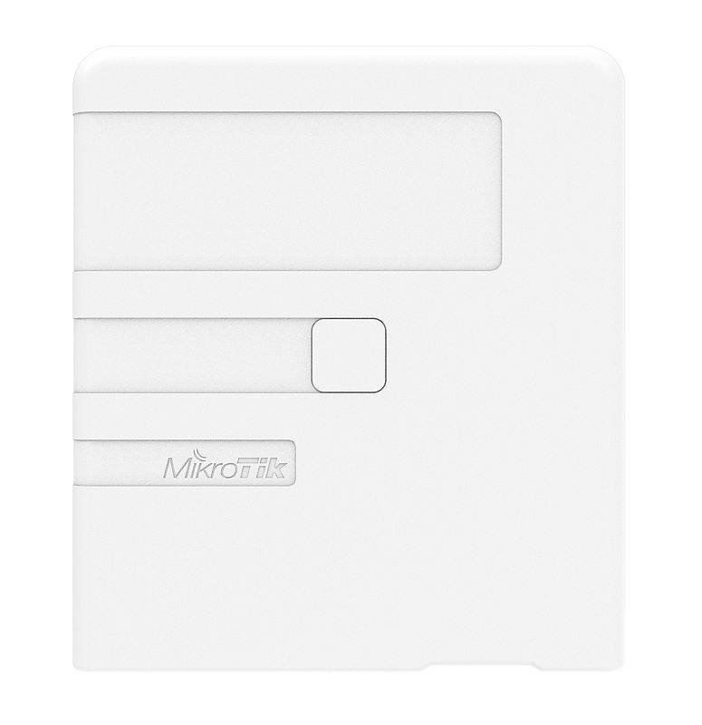
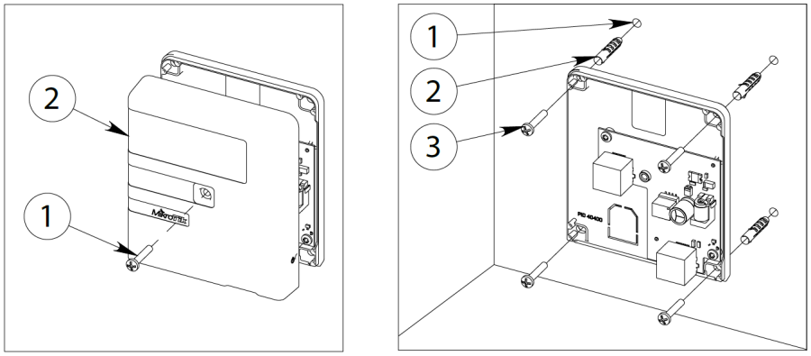
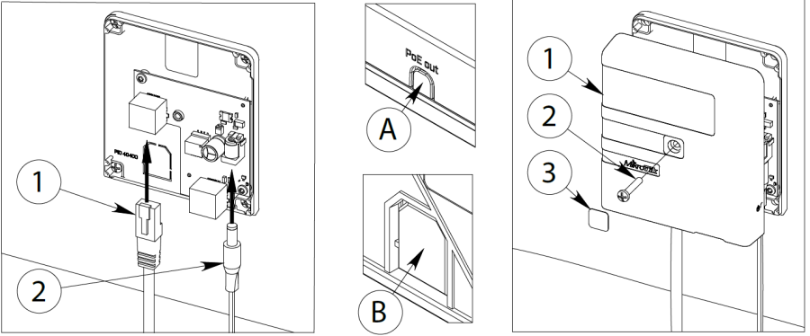
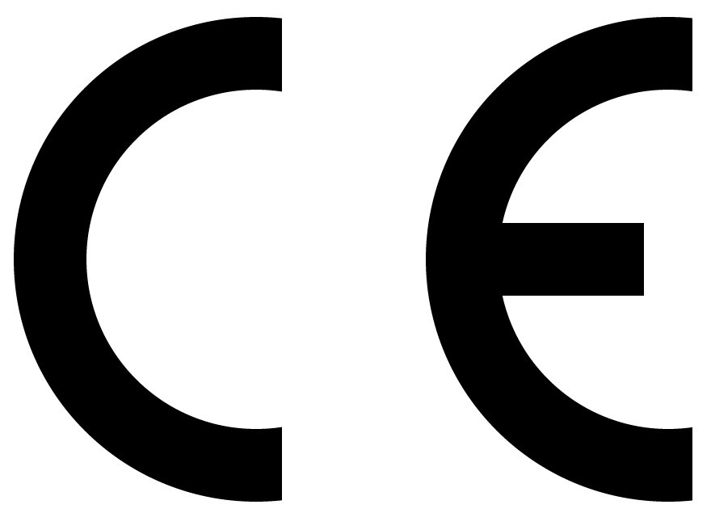

A power injector that can be mounted on a wall. See the [GPEN11 product page](https://mikrotik.com/product/gpen11) for full specifications and brochures.

## Safety Warnings

Before you work on any equipment, be aware of the hazards involved with electrical circuitry, and be familiar with standard practices for preventing accidents. Ultimate disposal of this product should be handled according to all national laws and regulations. The Installation of the equipment must comply with local and national electrical codes. This product is intended to be installed indoors. Keep this product away from water, fire, humidity, or hot environments. Use only the power supply and accessories approved by the manufacturer, which can be found in the original packaging of this product. Read the installation instructions before connecting the system to the power source. We cannot guarantee that no accidents or damage will occur due to the improper use of the device. Please use this product with care and operate at your own risk! In the case of device failure, please disconnect it from power. The fastest way to do so is by unplugging the power plug from the power outlet. It is the customer's responsibility to follow local country regulations. All MikroTik devices must be professionally installed.

## Powering

The device accepts power from a direct-input power jack (5.5 mm outside and 2 mm inside, female, pin positive plug) 12-57 V DC⎓.

## Power output

The device supports PoE out from the Ethernet port located under the cover. You can power MikroTik devices that support passive powering through Ethernet.

## Mounting

**Step 1:**

-

Remove the cover screw using a PH2 screwdriver;

-

Remove the cover to access mounting points. **Step 2:**

-

Drill holes using drill bid;

-

Insert dowels if needed;

-

Attach the unit to the wall, using the wall, and secure with screws. Step 1. Step 2.

**Step 3:**

-

Plug-in the Ethernet cable going to the unit that will be powered;

-

Plug-in power source for the GPEN.

-

Outgoing Ethernet cable can be guided through position A or B for cable leading into the wall. **Step 4:**

-

Re-attach cover;

-

Secure cover using the screw;

-

Use the sticker to cover the screw location. Step 3. Step 4.

When mounting on the wall, please ensure that the cable feed is pointing downwards. The IPX rating scale of this device is IPX0. We recommend using Cat6 shielded cables.

## Accessories

The package includes the following accessories that come with the device:

- K-62 screw kit

## Specifications

For more information about this product, specifications, pictures, downloads please visit our web page: [https://mikrotik.com/product/gpen11](https://mikrotik.com/product/gpen11)

[https://i.mt.lv/cdn/product_files/GPEN_concept_200204.pdf](https://i.mt.lv/cdn/product_files/GPEN_concept_200204.pdf)

## UKCA marking

## Eurasian Conformity Mark

Информация о дате изготовления устройства указана в конце серийного номера на его наклейке через дробь. Первая цифра означает номер года (последняя цифра года), две последующие означают номер недели.

Изготовитель: MikroTikls SIA, Aizkraukles iela 23, Riga, LV-1006, Латвия, [support@mikrotik.com](mailto:support@mikrotik.com). Сделано в Китае, Латвии или Литве. Cм. на упаковке.

Для получения подробных сведений о гарантийном обслуживании обратитесь к продавцу.

Продукты MikroTik, которые поставляются в Евразийский таможенный союз, оцениваются с учетом соответствующих требований и помечены знаком EAC, как показано ниже:

## Norma Oficial Mexicana

EFICIENCIA ENERGETICA CUMPLE CON LA NOM-029-ENER-2017.

La operacion de este equipo esta sujeta a las siguientes dos condiciones:

- Es posible que este equipo o dispositivo no cause interferencia perjudicial y.
- Este equipo debe aceptar cualquier interferencia, incluyendo la que pueda causar su operacion no deseada. Fabricante: MikroTikls SIA, Unijas 2, Riga, LV-1039, Latvia.

País De Origen: Letonia; Lituania; China (Republica Popular); Estados Unidos De America; Mexico.

Por favor contacte a su distribuidor local para preguntas regionales específicas. La lista de importadores se puede encontrar en nuestra página de inicio – [https://mikrotik.com/buy/latinamerica/mexico](https://mikrotik.com/buy/latinamerica/mexico).

CE Declaration of Conformity Manufacturer: MikroTikls SIA, Unijas iela 2, Riga, Latvia, LV1039.
