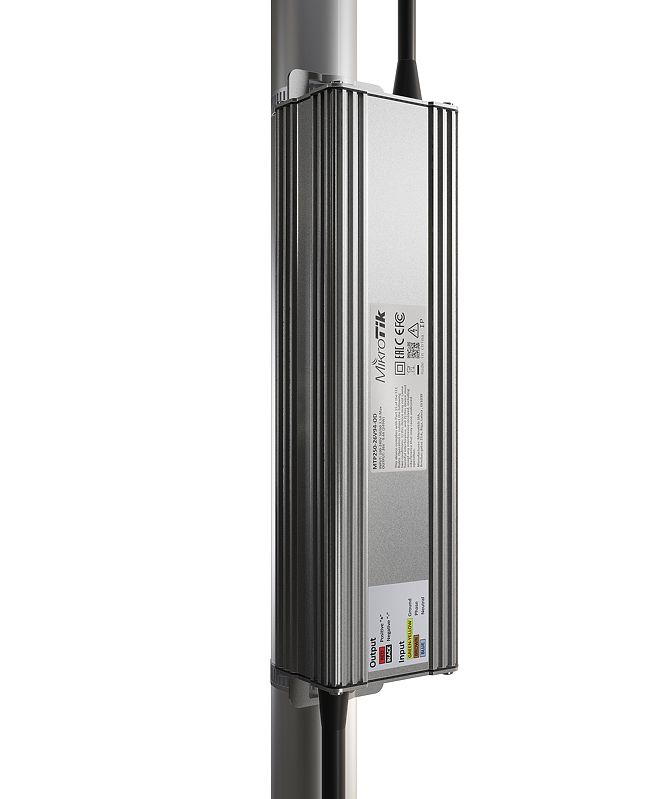
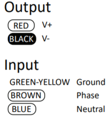
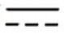
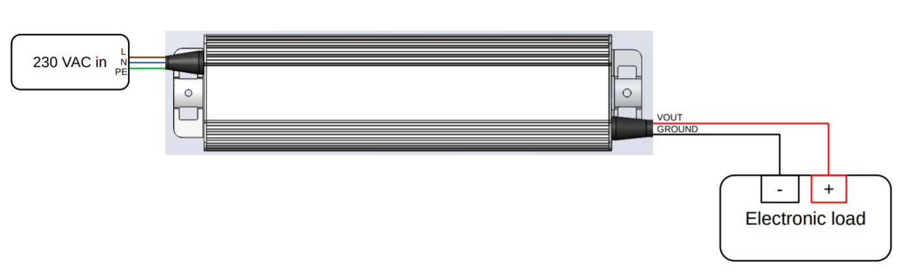
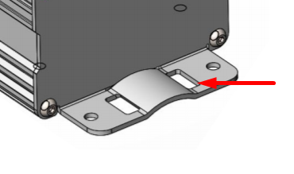
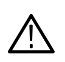
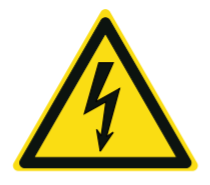
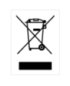
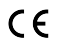

:::info This article covers

- **[MTP250-53V47-OD](https://mikrotik.com/product/mtp250_53v47_od)**
- **[MTP250-26V94-OD](https://mikrotik.com/product/mtp250_26v94_od)**

:::

## Safety Warnings

- Before you work on any MikroTik equipment, be aware of the hazards involved with electrical circuitry, and be familiar with standard practices for preventing accidents. The installer should be familiar with network structures, terms, and concepts.
- This equipment is to be installed by trained and qualified personnel, as per these installation instructions. The installer is responsible for making sure, that the Installation of the equipment is compliant with local and national electrical codes. Do not attempt to disassemble, repair, or modify the device.
- We cannot guarantee that no accidents or damage will occur due to the improper use of the device. Please use this product with care and operate at your own risk!
- In the case of device failure, please disconnect it from power. The fastest way to do so is by unplugging the power adapter from the power outlet.
- Contact time to touch PSU will be (&gt; 1 s and &lt; 10 s).

## Information

Technical specifications, brochures, and more info about products at you need help with configuration or installation, please seek a consultant [https://mikrotik.com/consultants](https://mikrotik.com/consultants)

## Powering

The device accepts power from an AC source:

Input: 100-240V ~ 50/60Hz.

Output:

<table><thead><tr><th></th><th>MTP250-26V94-OD</th><th>MTP250-53V47-OD</th></tr></thead><tbody><tr><td>DC output voltage (V)</td><td>26</td><td>53</td></tr><tr><td>DC output current (A)</td><td>9.4</td><td>4.7</td></tr><tr><td>DC output power (W)</td><td>244</td><td>249</td></tr></tbody></table>

## Installation

For installation Use a CU wire of at least 1.2 square millimeters for the DC output. On the input side, 100-240V ~ 50/60Hz connect MTP250 series PSU to RCD.

## Mounting

- Use provided steel clamp and guide through holes then secure the device to the mast.

- Or use provided screws and secure device to the wall, use dowels depending on the wall material.

## Accessories

The package includes:

CLAMP1-2_Hose Clamp SUS304 (Philips type; 9mm; clamping diameter range 25-70mm) with EPE bag. SET1_ K-77 Fastening set.

## Operation Environment

Operating temperature: -40°C to 70°C

Ingress Protection - IP 67

WARNING. Warning statements identify conditions or practices that could result in injury or loss of life.

## Symbols on the Product

The following symbols may appear on the product:

- HIGH VOLTAGE: This symbol indicates high voltage. It calls your attention to items or operations that could be dangerous to you and other people operation this equipment. Read the message and follow the instructions carefully.

- Do not dispose of electronic equipment as unsorted municipal waste. Please use a separate collection facility or contact the supplier from which this instrument was purchased.

## Federal Communication Commission Interference Statement

This equipment has been tested and found to comply with the limits for a Class A digital device, pursuant to Part 15 of the FCC Rules. These limits are designed to provide reasonable protection against harmful interference in a commercial installation.

This equipment generates, uses, and can radiate radio frequency energy and, if not installed and used in accordance with the instruction manual, may cause harmful interference to radio communications. Operation of this equipment in a residential area is likely to cause harmful interference in which case the user will be required to correct the interference at his own expense.

**FCC Caution:** Any changes or modifications not expressly approved by the party responsible for compliance could void the user's authority to operate this equipment. This device complies with Part 15 of the FCC Rules. Operation is subject to the following two conditions: (1) This device may not cause harmful interference, and (2) this device must accept any interference received, including interference that may cause undesired operation. This device and its antenna must not be co-located or operation in conjunction with any other antenna or transmitter.

## Innovation, Science and Economic Development Canada

This device complies with Industry Canada licence-exempt RSS standard(s). Operation is subject to the following two conditions: (1) this device may not cause interference, and (2) this device must accept any interference, including interference that may cause undesired operation of the device.

Le présent appareil est conforme aux CNR d'Industrie Canada applicables aux appareils radio exempts de licence. L'exploitation est autorisée aux deux conditions suivantes : (1) l'appareil ne doit pas produire de brouillage, et (2) l'utilisateur de l'appareil doit accepter tout brouillage radioélectrique subi, même si le brouillage est susceptible d'en compromettre le fonctionnement.

This Class A digital apparatus complies with Canadian ICES-003.

Cet appareil numérique de la classe [A] est conforme à la norme NMB-003 du Canada.

CAN ICES-003 (A) / NMB-003 (A)

## UKCA marking

## Інформація для користувачів в Україні

Цей пристрій відповідає вимогам Технічного регламенту електромагнітної сумісності обладнання та Технічного регламенту низьковольтного електричного обладнання.

Виробник гарантує, що даний пристрій безпечний при правильному використанні згідно з інструкцією.

## Eurasian Conformity Mark

Информация о дате изготовления устройства указана в конце серийного номера на его наклейке через дробь. Первая цифра означает номер года (последняя цифра года), две последующие означают номер недели.

Изготовитель: MikroTikls SIA, Aizkraukles iela 23, Riga, LV-1006, Латвия, [support@mikrotik.com](mailto:support@mikrotik.com). Сделано в Китае, Латвии или Литве. Cм. на упаковке.

Для получения подробных сведений о гарантийном обслуживании обратитесь к продавцу.

Продукты MikroTik, которые поставляются в Евразийский таможенный союз, оцениваются с учетом соответствующих требований и помечены знаком EAC, как показано ниже:

## Norma Oficial Mexicana

EFICIENCIA ENERGETICA CUMPLE CON LA NOM-029-ENER-2017.

La operacion de este equipo esta sujeta a las siguientes dos condiciones:

- Es posible que este equipo o dispositivo no cause interferencia perjudicial y.
- Este equipo debe aceptar cualquier interferencia, incluyendo la que pueda causar su operacion no deseada. Fabricante: MikroTikls SIA, Unijas iela 2, Riga, LV-1039, Latvia.

País De Origen: Letonia; Lituania; China (Republica Popular); Estados Unidos De America; Mexico.

Por favor contacte a su distribuidor local para preguntas regionales específicas. La lista de importadores se puede encontrar en nuestra página de inicio – [https://mikrotik.com/buy/latinamerica/mexico](https://mikrotik.com/buy/latinamerica/mexico).

## CE Declaration of Conformity

Manufacturer: MikroTikls SIA, Unijas iela 2, Riga, Latvia, LV1039.

The full text of the EU declaration of conformity is available at the following internet address: [https://mikrotik.com/products](https://mikrotik.com/products)

86929
