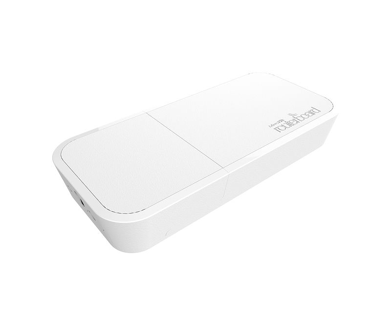
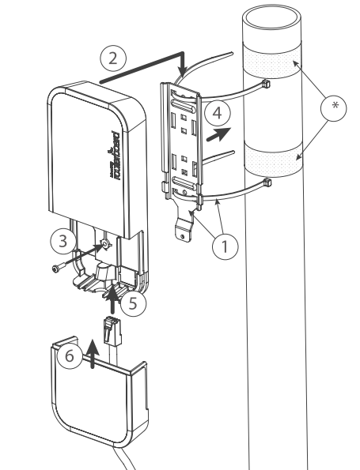
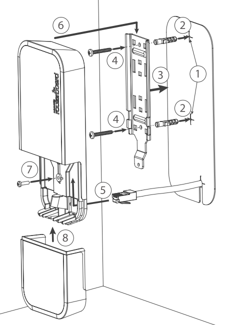
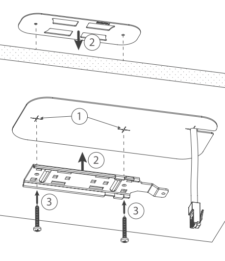
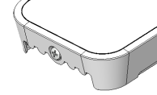
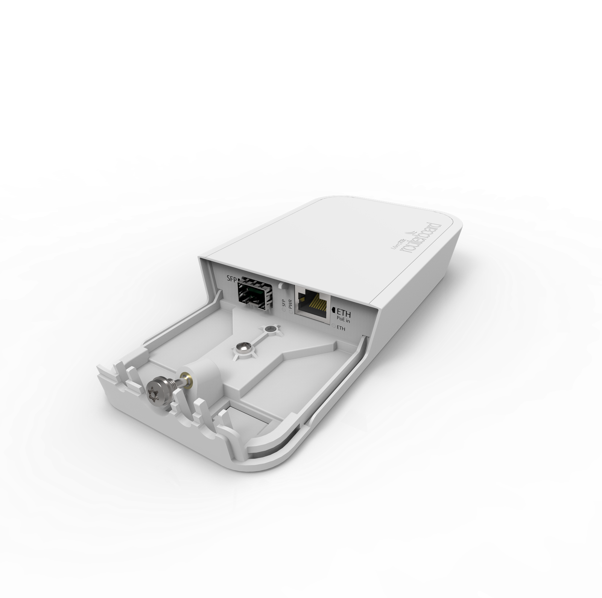

The FTC is a simple Fiber to Copper converter. Unlike many other media converters available on market, it has outdoor waterproof case with lock screw, it's mounting bracket can be attached and locked with a screw from inside the case. Unit has 12-57V PoE with 802.3af/at support (with unshielded cross cable). Comes with PoE injector and power supply. Works only with Gigabit SFP connections. See the [RBFTC11 product page](https://mikrotik.com/product/RBFTC11) for full specifications and brochures.

## Safety Warnings

Before you work on any MikroTik equipment, be aware of the hazards involved with electrical circuitry, and be familiar with standard practices for preventing accidents. The installer should be familiar with network structures, terms, and concepts. Use only accessories approved by the manufacturer, and which can be found in the original packaging of this product. This equipment is to be installed by trained and qualified personnel, as per these installation instructions. The installer is responsible for making sure, that the Installation of the equipment is compliant with local and national electrical codes. Do not attempt to disassemble, repair, or modify the device. This product is intended to be mounted outdoors on a pole. Please read the mounting instructions carefully before beginning installation. Failure to use the correct hardware and configuration or to follow the correct procedures could result in a hazardous situation for people and damage to the system. We cannot guarantee that no accidents or damage will occur due to the improper use of the device. Please use this product with care and operate at your own risk! In the case of device failure, please disconnect it from power. The fastest way to do so is by unplugging the power adapter from the power outlet. This is a Class A product. In a domestic environment, this product might cause radio interference in which case the user might be required to take adequate measures.

## First steps

- Open the Fiber and Ethernet port door;
- Connect the device to the PoE injector using an Ethernet cable, ensuring it connects to the data+power end;
- Connect the data end of the PoE injector to the computer;
- Connect the power adapter to the PoE injector;

## Mounting

The device can be mounted in several ways: wall, ceiling, pole or it can be placed in specially designed MikroTik holder which comes with the package. The package includes a drill hole template with instructions, to help you with the Ethernet cable installation and attachment to a ceiling or a wall. The package also includes a steel bracket to put on the other side of a dropdown ceiling tile and two screws and wall anchors. The Unit can be attached to the pole using zip ties or steel clamp. To prevent the bottom lid for opening the different screw can be used. One Torx T20 security screw is included for optional use. Use it with the included L-shaped wrench to fix it into the bottom lid. Detailed instructions of replacing the screw are in the package. The IP rating scale for this device is IP54. When mounting outdoors, please ensure that any cable openings are directed downwards. Use POE injector and proper grounding. Recommended using Cat5/6 cable. When using and installing this device please pay attention to Maximum Permissible Exposure (MPE) safety distance with a minimum of 35 cm between the radiator and your body.

**Mounting on the mast or pole:**

** It's recommended to use electrical tape to increase friction between materials.*

- Mount plastic tie straps to steel bracket guiding them through holes.
- Mount bracket to the device.
- Secure them with a screw.
- Mount and align the device on the pole or mast.
- Guide Ethernet cable through the opening and connect to the Ethernet port.
- Close bottom latch and secure with a screw. It's recommended to secure Ethernet cable to the pole using zip ties. With the distance from the device approximately 30 cm.

**Mounting unit on the wall:**

- Use included a template to mark spots for drilling holes. And if needed for Ethernet cable. Align accordingly, it will depend on how the device will be mounted finally.
- Insert dowels if needed, depends on wall structure and material.
- Place included a steel bracket on the wall.
- Use screws to secure it in the place.
- Extend your Ethernet cable through the opening and connect to the Ethernet port.
- Mount the device on the steel bracket
- Secure it in place with the screw.
- Close bottom latch. Avoid mounting the device on the low ground spot, as you won't be able to attach and close the bottom latch.

**Mounting on the ceiling:**

A Special bracket is included in the package to mount on the drop ceiling. As it consists of two parts, to be attached on both sides of the ceiling tile.

-

Use the template to mark spots for holes.

-

Place both mounting brackets on the spot.

-

Secure them together using screws. Continue assembling in the same manner if mounting on the wall.

-

Extend your Ethernet cable through the opening and connect to the Ethernet port.

-

Mount the device on the steel bracket.

-

Secure it in place with the screw.

-

Close bottom latch. 150

## Bottom Lid

- The bottom lid is secured in place with the captive screw.
- Use the Philips PH2 screwdriver to unscrew it, but do not remove the screw completely.

- Pull the cover in the opposite direction from the device to remove it.

- Reassemble.

## Powering

The device accepts power from the power jack or from the Ethernet port:

- Direct-input power jack (5.5 mm outside and 2 mm inside, female, pin positive plug) accepts 12-57 V ⎓ DC;
- Ethernet port accepts 802.3af/at PoE. The power consumption under maximum load can reach 3 W.

### Connecting to a PoE Adapter

- Connect the Ethernet cable from the device to the PoE+DATA port of the PoE adapter;
- Connect an Ethernet cable from your local network (LAN) to the PoE adapter;
- Connect the power cord to the adapter, and then plug the power cord into a power outlet.

## Extension slots and ports

- One 10/100/1000 Ethernet ports, supporting automatic cross/straight cable correction (Auto MDI/X). Either straight or crossover cable can be used for connecting to other network devices.
- One 1G SFP port.

## Configuration and operating system support

The RBFTC11 is a straightforward Fiber to Copper converter housed in an outdoor waterproof case with a lock screw. It is compatible exclusively with Gigabit SFP connections and does not have its own operating system.

## LED indicators

This device features LED indicators, including PWR LED (Power), ETH activity, and SFP activity LEDs.

To avoid pollution of the environment, please separate the device from household waste and dispose of it in a safe manner, such as in designated waste disposal sites. Familiarize yourself with the procedures for the proper transportation of the equipment to the designated disposal sites in your area.
