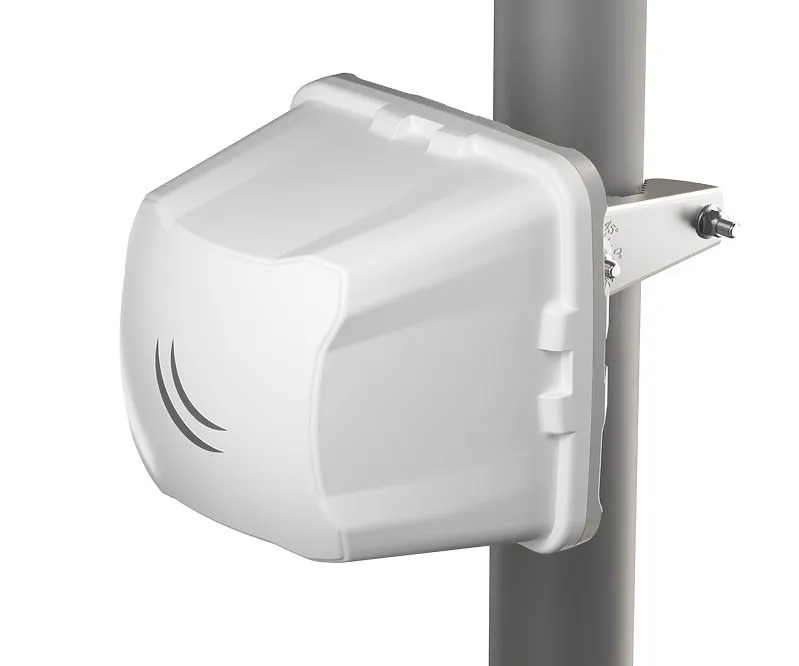
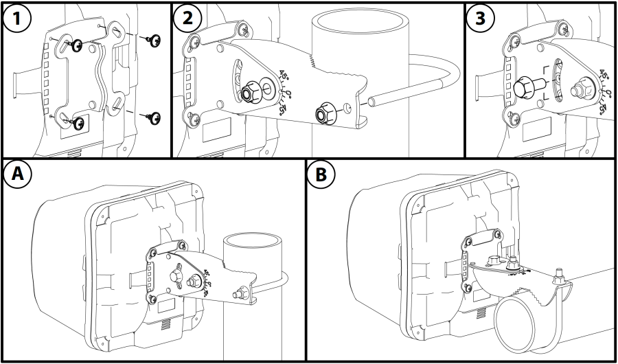
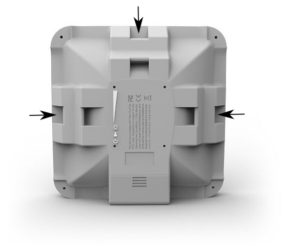
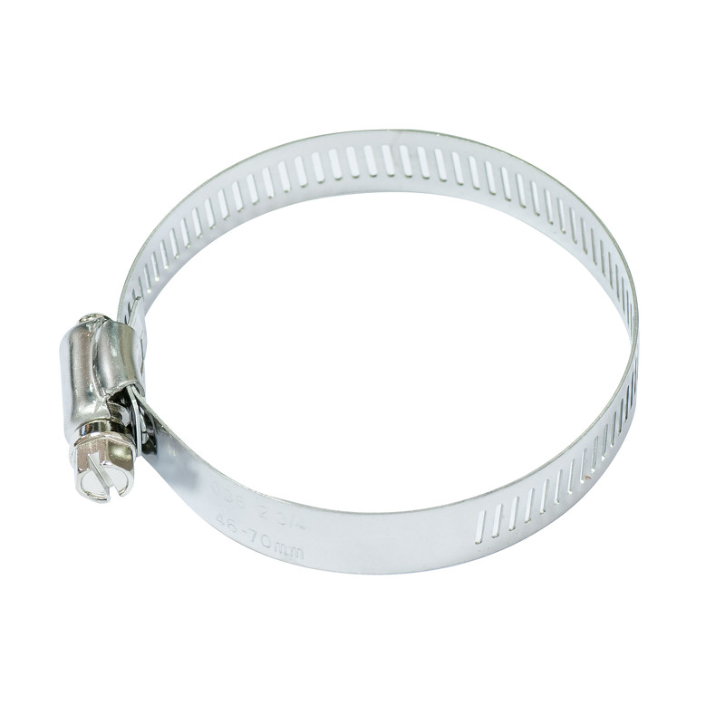
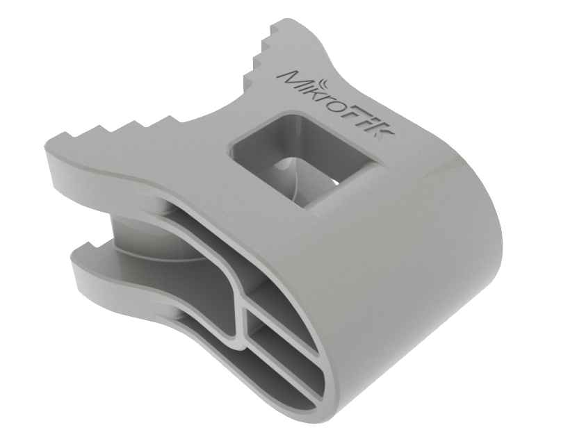
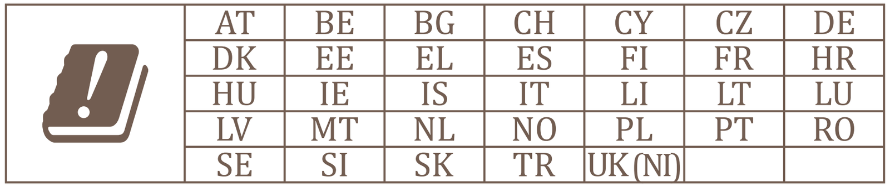

This guide can be downloaded as a [PDF file](https://manual.mikrotik.com/assets/files/cube-60g-ac.pdf).

## [Cube 60G ac](https://mikrotik.com/product/cube_60g_ac) (CubeG-5ac60ad)

It is the customer's responsibility to follow local country regulations, including operation within legal frequency channels, output power, cabling requirements, and Dynamic Frequency Selection (DFS) requirements. All MikroTik radio devices must be professionally installed.

## Safety Warnings

- Before you work on any equipment, be aware of the hazards involved with electrical circuitry, and be familiar with standard practices for preventing accidents.
- Ultimate disposal of this product should be handled according to all national laws and regulations.
- All installation methods for mounting an access point on any wall surface is subject to the acceptance of local jurisdiction.
- The Installation of the equipment must comply with local and national electrical codes.
- This product is intended to be mounted outdoors on a pole. Please read the mounting instructions carefully before beginning installation. Failure to use the correct hardware and configuration or to follow the correct procedures could result in a hazardous situation for people and damage to the system.
- Use only the power supply and accessories approved by the manufacturer, and which can be found in the original packaging of this product.
- Read the installation instructions before connecting the system to the power source.
- We cannot guarantee that no accidents or damage will occur due to the improper use of the device. Please use this product with care and operate at your own risk!
- In the case of device failure, please disconnect it from power. The fastest way to do so is by unplugging the power plug from the power outlet.
- It is the customer's responsibility to follow local country regulations, including operation within legal frequency channels, output power, cabling requirements, and Dynamic Frequency Selection (DFS) requirements. All MikroTik radio devices must be professionally installed.
- This is a class A device. In a domestic environment, this product might cause radio interference in which case the user might be required to take adequate measures.

## Quickstart

- Connect the device to the included PoE injector with Ethernet cable;
- Connect the PoE injector into the PC or to the network switch;
- Connect the power adapter to the PoE injector;
- Download WinBox configuration tool [https://mt.lv/winbox](https://mt.lv/winbox) Open WinBox and connect to the device;
- Default IP: 192.168.88.1, user name: **admin** and there is no password (or, for some models, check user and wireless passwords on the sticker);
- Download the latest RouterOS software from [https://mikrotik.com/download](https://mikrotik.com/download);
- Choose ARM packages, and save them to your PC;
- Open WinBox and upload downloaded packages, drag and drop into any windows;
- Restart the device;
- Connect again and select your Region in the Wireless menu, W60G tab, and in **QuickSet** menu set your Country, to apply country regulation settings. *If the device RX blocking condition has happened device will restore its signal after a few seconds.*

## MikroTik mobile app

Use the MikroTik smartphone app to configure your router in the field, or to apply the most basic initial settings for your MikroTik home access point.

- Scan QR code and choose your preferred OS.
- Install and open the application.
- By default, the IP address and user name will be already entered.
- Click Connect to establish a connection to your device through a wireless network.
- Choose Quick setup and application will guide you through all basic configuration settings in a couple of easy steps.
- An advanced menu is available to fully configure all necessary settings.

## Configuration

Once logged in, we recommend clicking the "Check for updates" button in the QuickSet menu, as updating your RouterOS software to the latest version ensures the best performance and stability. For wireless models, please make sure you have selected the country where the device will be used, to confirm with local regulations. RouterOS includes many configuration options in addition to what is described in this document. We suggest starting here to get yourself accustomed to the possibilities: [https://mt.lv/help](https://mt.lv/help) In case an IP connection is not available, the WinBox tool ([https://mt.lv/winbox](https://mt.lv/winbox)) can be used to connect to the MAC address of the device from the LAN side (all access is blocked from the Internet port by default). For recovery purposes, it is possible to boot the device from the network (see ). If the device loses connection, wait for few seconds and then the device will recover connection automatically.

## Assembly and mounting

The device can be mounted on the vertical or horizontal pole as shown in pictures A and B. Please note that a device needs to be mounted with the bottom latch facing down. The maximum pole diameter is 51 mm.

Mounting and configuration of this device should be done by a certified person.

Choose your desired position, the device will require precise adjustment for best performance.

- Attach provided mount to the back of the device with provided screws using a ph0 screwdriver.
- Mount on pole with U bolt bracket using 8 mm ratchet.
- Place a bolt in one of the three positions, they will allow for fine adjustment, when placed in the middle you can adjust in a 23-degree range if an adjustment needs to go further replace the screw in a different position.

The IP rating scale for this device is IP54. When mounting outdoors, please ensure that any cable openings are directed downwards. We recommend using the POE injector and proper grounding with Cat6 shielded cable. When using and installing this device please pay attention to the Maximum Permissible Exposure (MPE) safety distance with a minimum of 20 cm between the radiator and your body.

Alternatively, the device can be mounted on one of the three mounting slots on the backside of the device.

- You can use a metal ring for example.
- Use a Phillips screwdriver to loosen the metal ring.
- Slide one end of it through the most convenient of the three mounting slots.
- Position the device on the pole where it will be mounted.
- Slide the loose end of the mounting ring back to its closing latch and use the screwdriver to tighten it.

It's recommended to secure Ethernet cable to the pole using zip ties. With the distance from the device approximately 30 cm.

As an additional option, you can use "quickMOUNT-X" – mounting bracket for an easy adjustment that can be obtained separately. Product web page: [https://mikrotik.com/product/qm_x](https://mikrotik.com/product/qm_x)

Specially designed enables vertical and horizontal adjustment on the pole.

## Grounding

The device includes a grounding connection (marked ⏚) which you should connect to the grounding installation of the tower or building where the device will be used. This is to substantially reduce the risk of ESD and lightning damage.

## Powering

The device accepts DC ⎓ power from Passive PoE injectors (one power supply and PoE injector are included) accepts 12-28 V DC ⎓ consuming at maximum load 4 W.

### Connecting to a PoE Adapter

- Connect the Ethernet cable from the device to the PoE+DATA port of the PoE adapter.
- Connect an Ethernet cable from your local network (LAN) to the PoE adapter.
- Connect the power cord to the adapter, and then plug the power cord into a power outlet.

## Extension slots and ports

- 10/100 Ethernet port.
- Integrated 5 GHz 802.11a/n/ac interface with built-in antenna.
- WiGig chipset QCA6335.

## Reset button

The routerBOOT reset button has the following functions. Press the button and apply the power, then:

- Release the button when green LED starts flashing, to reset RouterOS configuration to defaults.
- Release the button when the LED turns solid green to clear all configuration and defaults.
- Release the button after LED is no longer lit (~20 seconds) to cause the device to look for Netinstall servers (required for reinstalling RouterOS over the network). Regardless of the above option used, the system will load the backup RouterBOOT loader if the button is pressed before power is applied to the device. Useful for RouterBOOT debugging and recovery.

## Accessories

Package includes the following accessories that come with the device:

- EU/US Switching Power Supply 24V DC ⎓, 0.8 A, 9 W, Level VI, cable:1.5 m.
- POE Injector with shielded ethernet cable/connector (RBPOE).
- Cube mount.
- K-70 Fastening set for Cube mount.

## Operating system support

The device supports RouterOS software version *v6.47.2*. The specific factory-installed version number is indicated in the RouterOS menu /system resource. Other operating systems have not been tested.

This device meets the Maximum TX power limit per ETSI regulations. The frequency and the maximum transmitted power in the EU are listed below: 57-66GHz: 34.92 dBm. An Operational mode in the 60 GHz band: 58.32 GHz, 60.48 GHz, 62.64 GHz, 64.80 GHz. This device is certified for outdoor use in Point to Multipoint applications. In the following countries this device cannot be used in Fixed Point-to-Point applications:

## Federal Communication Commission Interference Statement

<table><thead><tr><th>Model</th><th>FCCID</th></tr></thead><tbody><tr><td>CubeG-5ac60ad</td><td>TV7CB5A60</td></tr></tbody></table>

This equipment has been tested and found to comply with the limits for a Class A digital device, pursuant to Part 15 of the FCC Rules. These limits are designed to provide reasonable protection against harmful interference in a commercial installation.

This equipment generates, uses, and can radiate radio frequency energy and, if not installed and used in accordance with the instruction manual, may cause harmful interference to radio communications. Operation of this equipment in a residential area is likely to cause harmful interference in which case the user will be required to correct the interference at his own expense.

**FCC Caution:** Any changes or modifications not expressly approved by the party responsible for compliance could void the user’s authority to operate this equipment.

This device complies with Part 15 of the FCC Rules. Operation is subject to the following two conditions: (1) This device may not cause harmful interference, and (2) this device must accept any interference received, including interference that may cause undesired operation.

This device is not to be operated on aircraft except for the conditions listed on FCC CFR §15.255 (b)

**IMPORTANT: FCC Radiation Exposure Statement:** This equipment complies with FCC radiation exposure limits set forth for an uncontrolled environment. This equipment should be installed and operated with a minimum distance of 21cm between the radiator & your body. All cables used to connect peripherals must be shielded and grounded. Operation with cables connected to peripherals that are not shielded and grounded may result in interference to radio and television reception.

## Innovation, Science and Economic Development Canada

<table><thead><tr><th>Model</th><th>IC</th></tr></thead><tbody><tr><td>CubeG-5ac60ad</td><td>7442A-CB5A60</td></tr></tbody></table>

This device contains license-exempt transmitter(s)/receiver(s) that comply with Innovation, Science, and Economic Development Canada’s license-exempt RSS(s). Operation is subject to the following two conditions: (1) This device may not cause interference. (2) This device must accept any interference, including interference that may cause undesired operation of the device.

L’émetteur/récepteur exempt de licence contenu dans le présent appareil est conforme aux CNR d’Innovation, Sciences et Développement économique Canada applicables aux appareils radio exempts de licence. L’exploitation est autorisée aux deux conditions suivantes : 1) L’appareil ne doit pas produire de brouillage; 2) L’appareil doit accepter tout brouillage radioélectrique subi, même si le brouillage est susceptible d’en compromettre le fonctionnement.

This Class A digital apparatus complies with Canadian ICES-003.

Cet appareil numérique de la classe [A] est conforme à la norme NMB-003 du Canada.

CAN ICES-003 (A) / NMB-003 (A)

This device is not to be operated on aircraft except for the conditions listed on ISED RSS-210 Annex J.1.

Cet appareil ne doit pas être utilisé sur un avion, sauf dans les conditions énumérées ISED RSS-210 Annex J.1.

The device for operation in the band 5150–5250 MHz is only for indoor use to reduce the potential for harmful interference to co-channel mobile satellite systems.

Les dispositifs fonctionnant dans la bande de 5 150 à 5 250 MHz sont réservés uniquement pour une utilisation à l'intérieur afin de réduire les risques de brouillage préjudiciable aux systèmes de satellites mobiles utilisant les mêmes canaux.

**IMPORTANT: IC Radiation Exposure Statement:** This equipment complies with IC RSS-102 radiation exposure limits set forth for an uncontrolled environment. This equipment should be installed and operated with a minimum distance 21cm between the radiator & your body. Cet équipement est conforme aux limites d'exposition aux rayonnements IC établies pour un environnement non contrôlé. Cet équipement doit être installé et utilisé avec un minimum de 21cm de distance entre la source de rayonnement et votre corps.

## UKCA marking

## Eurasian Conformity Mark

<table><thead><tr><th>Частотный каналы</th><th>Мощность передатчика</th></tr></thead><tbody><tr><td>5650-5850 МГц</td><td>≤10 Вт</td></tr></tbody></table>

*Доступные частотные каналы могут различаться в зависимости от модели продукта и сертификации.

Информация о дате изготовления устройства указана в конце серийного номера на его наклейке через дробь. Первая цифра означает номер года (последняя цифра года), две последующие означают номер недели.

Изготовитель: MikroTikls SIA, Aizkraukles iela 23, Riga, LV-1006, Латвия, [support@mikrotik.com](mailto:support@mikrotik.com). Сделано в Китае, Латвии или Литве. Cм. на упаковке.

Для получения подробных сведений о гарантийном обслуживании обратитесь к продавцу. Информация об импортерах продукции MikroTik в Российскую Федерацию: [https://mikrotik.com/buy/europe/russia](https://mikrotik.com/buy/europe/russia)

Продукты MikroTik, которые поставляются в Евразийский таможенный союз, оцениваются с учетом соответствующих требований и помечены знаком EAC, как показано ниже:

## Norma Oficial Mexicana

Rango de frecuencia (potencia de salida máxima): 5725-5850 MHz (30 dBm). Los canales de frecuencia disponibles pueden variar según el modelo y la certificación del producto.

EFICIENCIA ENERGETICA CUMPLE CON LA NOM-029-ENER-2017.

La operacion de este equipo esta sujeta a las siguientes dos condiciones:

- Es posible que este equipo o dispositivo no cause interferencia perjudicial y.
- Este equipo debe aceptar cualquier interferencia, incluyendo la que pueda causar su operacion no deseada. Fabricante: MikroTikls SIA, Brivibas gatve 214i, Riga, LV-1039, Latvia.

País De Origen: Letonia; Lituania; China (Republica Popular); Estados Unidos De America; Mexico.

Por favor contacte a su distribuidor local para preguntas regionales específicas. La lista de importadores se puede encontrar en nuestra página de inicio – [https://mikrotik.com/buy/latinamerica/mexico](https://mikrotik.com/buy/latinamerica/mexico).

## The National Commission for the State Regulation of Communications and Informatization by Ukraine

Виробник: MikroTikls SIA, Brivibas gatve 214i Рига, Латвія, LV1039.

Робоча частота (Максимальна вихідна потужність): 5470-5725 МГц (27 дБм).

Справжнім MikroTikls SIA заявляє, що маршрутизатор відповідає основним вимогам та іншим відповідним положенням директиви 2014/53/EC, а також суттєвим вимогам Технічного регламенту радіообладнання, затвердженого постановою Кабінету Міністрів України від 24 травня 2017 року № 355.

Для експлуатації в Україні необхідно отримати дозвіл на експлуатацію у порядку, затвердженому рішенням НКРЗІ від 01.11.2012 № 559, зареєстрованому в Міністерстві юстиції України 03.01.2013 за № 57/22589.

## CE Declaration of Conformity

Manufacturer: MikroTikls SIA, Brivibas gatve 214i Riga, Latvia, LV1039.

Hereby, Mikrotīkls SIA declares that the radio equipment type CubeG-5ac60ad is in compliance with Directive 2014/53/EU. The full text of the EU declaration of conformity is available at the following internet address: [https://mikrotik.com/products](https://mikrotik.com/products)

### WiGig

<table><thead><tr><th>Operational channels / Maximum output power Betriebskanäle / maximale Ausgangsleistung Canaux opérationnels / puissance de sortie maximale Canali operativi / massima potenza di uscita Canales operacionales / potencia de salida máxima Операционные каналы / максимальная выходная мощность</th><th>58.32 GHz / &lt;40 dBm</th></tr></thead><tbody><tr><td>60.48 GHz / &lt;40 dBm</td><td></td></tr><tr><td>62.64 GHz / &lt;40 dBm</td><td></td></tr></tbody></table>

### WLAN

<table><thead><tr><th>Operating Frequency / Maximum output power Betriebsfrequenz / maximale Ausgangsleistung Fréquence de fonctionnement / puissance de sortie maximale Frequenza operativa / massima potenza di uscita Frecuencia de funcionamiento / potencia de salida máxima Рабочая частота / максимальная выходная мощность</th><th>5470-5725 MHz / 27 dBm</th></tr></thead></table>
