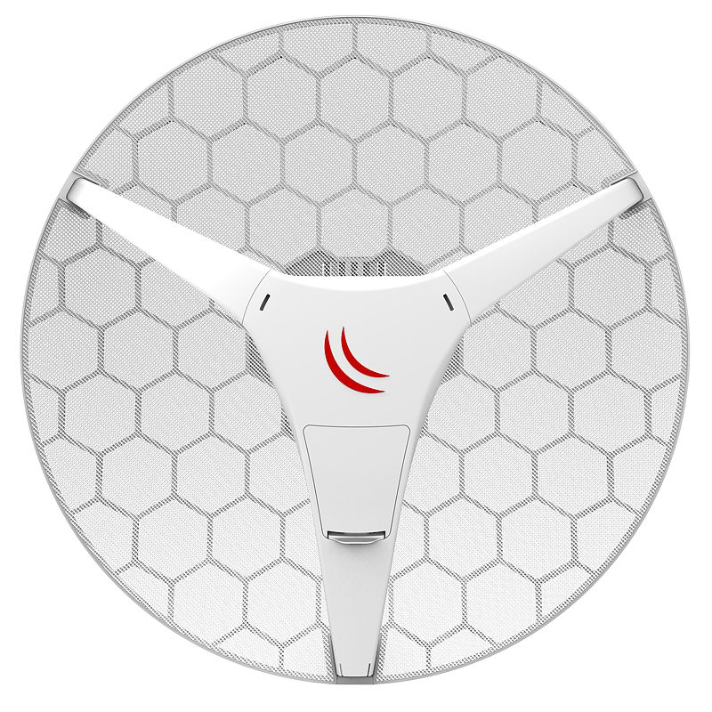
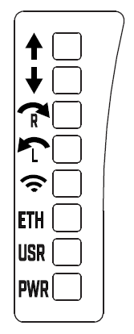
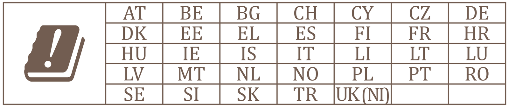

This guide can be downloaded as a [PDF file](https://manual.mikrotik.com/assets/files/lhg-60g.pdf).

## [LHG 60G](https://mikrotik.com/product/lhg_60g) (RBLHGG-60ad)

The LHG 60G device works in the 60 GHz wireless spectrum, the operating temperature of these devices is from -40°C up to +70°C. Each device has one gigabit Ethernet port and can be powered with PoE.

## Safety Warnings

- Before you work on any equipment, be aware of the hazards involved with electrical circuitry, and be familiar with standard practices for preventing accidents.
- Ultimate disposal of this product should be handled according to all national laws and regulations.
- All installation methods for mounting an access point on any wall surface is subject to the acceptance of local jurisdiction.
- The Installation of the equipment must comply with local and national electrical codes.
- This product is intended to be mounted outdoors on a pole. Please read the mounting instructions carefully before beginning installation. Failure to use the correct hardware and configuration or to follow the correct procedures could result in a hazardous situation for people and damage to the system.
- Use only the power supply and accessories approved by the manufacturer, and which can be found in the original packaging of this product.
- Read the installation instructions before connecting the system to the power source.
- We cannot guarantee that no accidents or damage will occur due to the improper use of the device. Please use this product with care and operate at your own risk!
- In the case of device failure, please disconnect it from power. The fastest way to do so is by unplugging the power plug from the power outlet.
- It is the customer's responsibility to follow local country regulations, including operation within legal frequency channels, output power, cabling requirements, and Dynamic Frequency Selection (DFS) requirements. All MikroTik radio devices must be professionally installed.
- This is a class A device. In a domestic environment, this product might cause radio interference in which case the user might be required to take adequate measures.

## Quickstart

- Assemble unit. See the [LHG 60G product page](https://mikrotik.com/product/lhg_60g) for mounting instructions; The device includes a grounding connection (marked ⏚) which you should connect to the grounding installation of the tower or building where the device will be used. This is to substantially reduce the risk of ESD and lightning damage. Grounding connector included in the package.

Warning! This equipment should be installed and operated with a minimum distance of 95 cm between the device and your body. Operation of this equipment in the residential environment could cause radio interference. The IP rating scale for this device is IP54. *Mounting and configuration of this device should be done by a qualified person.*

## Extension slots and ports

- One Ethernet port, supporting automatic cross/straight cable correction (Auto MDI/X), so you can use either straight or cross-over cables for connecting to other network devices.
- WiGig, 802.11ad.

## Powering

The devices accept powering from the Ethernet port. The Ethernet port accepts PoE input 12-57 V DC (passive and 802.3af/at). A power adapter and a passive PoE injector are included in the box. When using the PoE injector, make sure to use the "Power + Data" connector to connect to the device, and the "Data" connector to your PC, router or switch. **Connecting to a POE Adapter:**

- Connect the Ethernet cable from the device to the POE+DATA port of the POE adapter.
- Connect an Ethernet cable from your local network (LAN) to the POE adapter.
- Connect the power cord to the adapter, and then plug the power cord into a power outlet. Maximum power consumption 5 W.

## Configuration

We recommend clicking the "Check for updates" button and updating your RouterOS software to the latest version to ensure the best performance and stability. RouterOS includes many configuration options in addition to what is described in this document. We suggest starting here to get yourself accustomed to the possibilities: [https://mt.lv/help](https://mt.lv/help) In case the IP connection is not available, the WinBox tool ([https://mt.lv/winbox](https://mt.lv/winbox)) can be used to connect to the MAC address of the device from the LAN side. Please get yourself familiar with additional information on the [W60G interface](/docs/7.24/wireless/w60g/). For recovery purposes, it is possible to boot the device for reinstallation, see section .

## Buttons and jumpers

The routerBOOT reset button has the following functions. Press the button and apply the power, then:

- Release the button when green LED starts flashing, to reset RouterOS configuration to defaults.
- Release the button when the LED turns solid green to clear all configuration and defaults.
- Release the button after LED is no longer lit (~20 seconds) to cause the device to look for Netinstall servers (required for reinstalling RouterOS over the network). Regardless of the above option used, the system will load the backup RouterBOOT loader if the button is pressed before power is applied to the device. Useful for RouterBOOT debugging and recovery.

## LED status

The device includes precise alignment guides using LEDs. The lights indicate with arrows direction to turn the dish if looking from behind the dish to the other end of the link. When alignment LEDs turn off, leaving only the "link established" LED, it means alignment is complete. The LED lights are:

- Tilt-up.
- Tilt down.
- Rotate to right.
- Rotate to left.
- LED on when the link established.
- LED on when Ethernet connected.
- User-configurable LED.
- Power state on.

## Accessories

Package includes the following accessories that come with the device:

- K-LHG screw set/fastening set.
- Gigabit POE injector.
- LHG-5G-390 mm Dish (mesh size 0.5 t x1.0 wx1.4 mm ).
- EU/US Switching Power Supply 24 V ⎓, 0.38 A, 9 W, Level VI, cable:1.5 m.
- Hose Clamp SUS304 (Philips type; clamping diameter range 35-70 mm).
- BRAC1_ LHG montage element.
- DynaDish U-Bolt M8 (A2 Stainless Steel).
- QuickMount AIM.

## Specifications

For more information about LHG products, specifications and pictures please visit our web page: [https://mikrotik.com/product/lhg_60g](https://mikrotik.com/product/lhg_60g)

## Operating system support

The device supports RouterOS v7 and above. The specific factory-installed version is listed in /system resource. Other operating systems have not been tested.

## MikroTik mobile app

Use the MikroTik smartphone app to configure your router in the field, or to apply the most basic initial settings for your MikroTik home access point. Scan QR code and choose your preferred OS.

This device meets the Maximum TX power limit per ETSI regulations. The frequency and the maximum transmitted power in EU are listed below: 57-66GHz: 34.92 dBm. An Operational mode in the 60 GHz band: 58.32 GHz, 60.48 GHz, 62.64 GHz. This device is certified for outdoor use in Point to Multipoint applications. In the following countries this device cannot be used in Fixed Point-to-Point applications:

## Federal Communication Commission interference statement

<table><thead><tr><th>Model</th><th>FCCID</th></tr></thead><tbody><tr><td>RBLHGG-60ad</td><td>TV7LHGG60AD</td></tr></tbody></table>

This equipment has been tested and found to comply with the limits for a Class A digital device, pursuant to Part 15 of the FCC Rules. These limits are designed to provide reasonable protection against harmful interference in a commercial installation.

This equipment generates, uses, and can radiate radio frequency energy and, if not installed and used in accordance with the instruction manual, may cause harmful interference to radio communications. Operation of this equipment in a residential area is likely to cause harmful interference in which case the user will be required to correct the interference at his own expense.

**FCC Caution:** Any changes or modifications not expressly approved by the party responsible for compliance could void the user's authority to operate this equipment. This device complies with Part 15 of the FCC Rules. Operation is subject to the following two conditions: (1) This device may not cause harmful interference, and (2) this device must accept any interference received, including interference that may cause undesired operation. This device and its antenna must not be co-located or operation in conjunction with any other antenna or transmitter.

**IMPORTANT: Exposure to Radio Frequency Radiation.** 95 cm minimum distance has to be maintained between the antenna and the occupational user/general public. Under such configuration, the FCC radiation exposure limits set forth for an population/uncontrolled environment can be satisfied.

**Antenna Installation. WARNING:** It is the installer's responsibility to ensure that when using the authorized antennas in the United States (or where FCC rules apply); only those antennas certified with the product are used. The use of any antenna other than those certified with the product is expressly forbidden in accordance to FCC rules CFR47 part 15.204. The installer should configure the output power level of antennas, according to country regulations and per antenna type. Professional installation is required of equipment with connectors to ensure compliance with health and safety issues.

## Innovation, Science and Economic Development Canada

<table><thead><tr><th>Model</th><th>IC</th></tr></thead><tbody><tr><td>RBLHGG-60ad</td><td>7442A-LHGG60AD</td></tr></tbody></table>

This device complies with Industry Canada licence-exempt RSS standard(s). Operation is subject to the following two conditions: (1) this device may not cause interference, and (2) this device must accept any interference, including interference that may cause undesired operation of the device. Le présent appareil est conforme aux CNR d'Industrie Canada applicables aux appareils radio exempts de licence. L'exploitation est autorisée aux deux conditions suivantes : (1) l'appareil ne doit pas produire de brouillage, et (2) l'utilisateur de l'appareil doit accepter tout brouillage radioélectrique subi, même si le brouillage est susceptible d'en compromettre le fonctionnement.

This Class A digital apparatus complies with Canadian ICES-003.

Cet appareil numérique de la classe [A] est conforme à la norme NMB-003 du Canada.

CAN ICES-003 (A) / NMB-003 (A)

This device is not to be operated on aircraft except for the conditions listed on ISED RSS-210 Annex J.1. Cet appareil ne doit pas être utilisé sur un avion, sauf dans les conditions énumérées ISED RSS-210 Annex J.1.

**IMPORTANT NOTE: IC Radiation Exposure Statement:** This equipment complies with IC RSS-102 radiation exposure limits set forth for an uncontrolled environment. This equipment should be installed and operated with minimum distance 95 cm between the radiator & your body. Cet équipement est conforme aux limites d'exposition aux rayonnements IC établies pour un environnement non contrôlé. Cet équipement doit être installé et utilisé avec un minimum de 95 cm de distance entre la source de rayonnement et votre corps.

## UKCA marking

## Eurasian Conformity Mark

Информация о дате изготовления устройства указана в конце серийного номера на его наклейке через дробь. Первая цифра означает номер года (последняя цифра года), две последующие означают номер недели.

Изготовитель: MikroTikls SIA, Aizkraukles iela 23, Riga, LV-1006, Латвия, [support@mikrotik.com](mailto:support@mikrotik.com). Сделано в Китае, Латвии или Литве. Cм. на упаковке.

Для получения подробных сведений о гарантийном обслуживании обратитесь к продавцу. Информация об импортерах продукции MikroTik в Российскую Федерацию: [https://mikrotik.com/buy/europe/russia](https://mikrotik.com/buy/europe/russia)

Продукты MikroTik, которые поставляются в Евразийский таможенный союз, оцениваются с учетом соответствующих требований и помечены знаком EAC, как показано ниже:

## Norma Oficial Mexicana

EFICIENCIA ENERGETICA CUMPLE CON LA NOM-029-ENER-2017.

La operacion de este equipo esta sujeta a las siguientes dos condiciones:

- Es posible que este equipo o dispositivo no cause interferencia perjudicial y.
- Este equipo debe aceptar cualquier interferencia, incluyendo la que pueda causar su operacion no deseada. Fabricante: MikroTikls SIA, Brivibas gatve 214i, Riga, LV-1039, Latvia.

País De Origen: Letonia; Lituania; China (Republica Popular); Estados Unidos De America; Mexico.

Por favor contacte a su distribuidor local para preguntas regionales específicas. La lista de importadores se puede encontrar en nuestra página de inicio – [https://mikrotik.com/buy/latinamerica/mexico](https://mikrotik.com/buy/latinamerica/mexico).

## The National Commission for the State Regulation of Communications and Informatization by Ukraine

Виробник: MikroTikls SIA, Brivibas gatve 214i Рига, Латвія, LV1039.

Справжнім MikroTikls SIA заявляє, що маршрутизатор відповідає основним вимогам та іншим відповідним положенням директиви 2014/53/EC, а також суттєвим вимогам Технічного регламенту радіообладнання, затвердженого постановою Кабінету Міністрів України від 24 травня 2017 року № 355.

Для експлуатації в Україні необхідно отримати дозвіл на експлуатацію у порядку, затвердженому рішенням НКРЗІ від 01.11.2012 № 559, зареєстрованому в Міністерстві юстиції України 03.01.2013 за № 57/22589.

## CE Declaration of Conformity

Manufacturer: MikroTikls SIA, Brivibas gatve 214i Riga, Latvia, LV1039.

Hereby, Mikrotīkls SIA declares that the radio equipment type RBLHGG-60ad is in compliance with Directive 2014/53/EU. The full text of the EU declaration of conformity is available at the following internet address: [https://mikrotik.com/products](https://mikrotik.com/products)

### WiGig

<table><thead><tr><th>Operational channels / Maximum output power Betriebskanäle / maximale Ausgangsleistung Canaux opérationnels / puissance de sortie maximale Canali operativi / massima potenza di uscita Canales operacionales / potencia de salida máxima Операционные каналы / максимальная выходная мощность</th><th>58.32 GHz / &lt;40 dBm</th></tr></thead><tbody><tr><td>60.48 GHz / &lt;40 dBm</td><td></td></tr><tr><td>62.64 GHz / &lt;40 dBm</td><td></td></tr></tbody></table>
