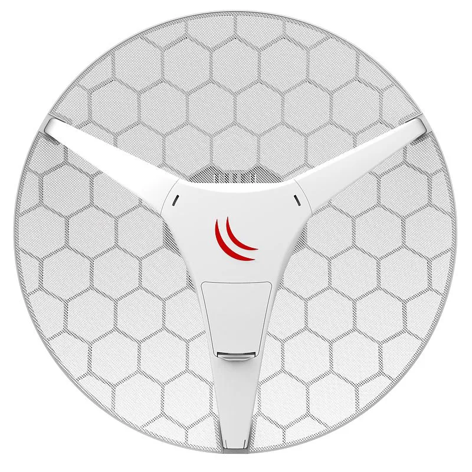

This guide can be downloaded as a [PDF file](https://manual.mikrotik.com/assets/files/lhg-lite60.pdf).

## [LHG Lite60](https://mikrotik.com/product/lhg_lite60) (RBLHG-60ad)

The LHG Lite 60 is an outdoor wireless router with a built-in directional antenna that works in the 60GHz spectrum. It can be used as a CPE to connect to MikroTik devices that work in 60GHz access point mode.

## Safety Warnings

- Before you work on any equipment, be aware of the hazards involved with electrical circuitry, and be familiar with standard practices for preventing accidents.
- Ultimate disposal of this product should be handled according to all national laws and regulations.
- All installation methods for mounting an access point on any wall surface is subject to the acceptance of local jurisdiction.
- The Installation of the equipment must comply with local and national electrical codes.
- This product is intended to be mounted outdoors on a pole. Please read the mounting instructions carefully before beginning installation. Failure to use the correct hardware and configuration or to follow the correct procedures could result in a hazardous situation for people and damage to the system.
- Use only the power supply and accessories approved by the manufacturer, and which can be found in the original packaging of this product.
- Read the installation instructions before connecting the system to the power source.
- We cannot guarantee that no accidents or damage will occur due to the improper use of the device. Please use this product with care and operate at your own risk!
- In the case of device failure, please disconnect it from power. The fastest way to do so is by unplugging the power plug from the power outlet.
- It is the customer's responsibility to follow local country regulations, including operation within legal frequency channels, output power, cabling requirements, and Dynamic Frequency Selection (DFS) requirements. All MikroTik radio devices must be professionally installed.
- This is a class A device. In a domestic environment, this product might cause radio interference in which case the user might be required to take adequate measures.

## Assembly

Attach the two legs to the LHG case, then snap the assembled LHG unit to the grid in the appropriate locations. Fix the legs in place with two self thread screws (Included, use Phillips screwdriver PH2). The package also contains a grounding cable connector and a precision alignment mount. Alignment instructions available on the product page on [https://mikrotik.com/products/](https://mikrotik.com/products/).

## Connecting

- Open the ethernet door to connect an ethernet cable to the ethernet port, connect the other end of the ethernet cable to the included PoE injector (LHG Lite60), or an 802.3af/at the power source (supported only by the LHG 60G model).
- Plug the PoE injector into your network switch or ISP internet outlet.
- Plug the included power supply into the PoE injector to start up the device.
- For configuration purposes, set your computer IP configuration to static in the range of 192.168.88.0-254 (/24 or 255.255.255.0)
- The default IP address of the unit is 192.168.88.1/24, open this address in your web browser to start the configuration. The username is admin and there is no password (or, for some models, check user and wireless passwords on the sticker). The device is preconfigured as a w60g station, and all you need to do is select the AP to connect to and set a device password. You can do this in the quickSET tab that is loaded by default. In case the IP connection is not available, WinBox can be used to connect to the MAC address of the device. We recommend clicking the "Check for updates" button and updating your RouterOS software to the latest version to ensure the best performance and stability. More information about using RouterOS and connecting to this device in our documentation: [https://mt.lv/help](https://mt.lv/help)

## Powering

The LHG Lite60 only accepts 12-30 V power from Passive PoE injectors (one power supply and PoE injector are included). The LHG 60G accepts 12-57 V 802.3af/at powering and also Passive PoE. Both models can consume up to 5 W at maximum load.

## Extension slots and ports

- One ethernet (10/100 Mbit or Gigabit, depends on model), supporting automatic cross/straight cable correction (Auto MDI/X), so you can use either straight or cross-over cables for connecting to other network devices.
- One Integrated w60g interface with a built-in antenna.

## Buttons and jumpers

The routerBOOT reset button has the following functions. Press the button and apply the power, then:

- Release the button when the green LED starts flashing, to reset RouterOS configuration to defaults.
- Release the button when the LED turns solid green to clear all configuration and defaults.
- Release the button after LED is no longer lit (~20 seconds) to cause the device to look for Netinstall servers (required for reinstalling RouterOS over the network). Regardless of the above option used, the system will load the backup RouterBOOT loader if the button is pressed before power is applied to the device. Useful for RouterBOOT debugging and recovery. The device includes a grounding connection (marked ⏚) which you should connect to the grounding installation of the tower or building where the device will be used. This is to substantially reduce the risk of ESD and lightning damage.

## Operating system support

The device supports RouterOS v7 and above. The specific factory-installed version is listed in /system resource. Other operating systems have not been tested.

## Federal Communication Commission Interference Statement

<table><thead><tr><th>Model</th><th>FCC ID</th></tr></thead><tbody><tr><td>RBLHG-60ad</td><td>TV7LHG60AD</td></tr></tbody></table>

This equipment has been tested and found to comply with the limits for a Class A digital device, pursuant to Part 15 of the FCC Rules. These limits are designed to provide reasonable protection against harmful interference in a commercial installation.

This equipment generates, uses, and can radiate radio frequency energy and, if not installed and used in accordance with the instruction manual, may cause harmful interference to radio communications. Operation of this equipment in a residential area is likely to cause harmful interference in which case the user will be required to correct the interference at his own expense.

**FCC Caution:** Any changes or modifications not expressly approved by the party responsible for compliance could void the user's authority to operate this equipment. This device complies with Part 15 of the FCC Rules. Operation is subject to the following two conditions: (1) This device may not cause harmful interference, and (2) this device must accept any interference received, including interference that may cause undesired operation. This device and its antenna must not be co-located or operation in conjunction with any other antenna or transmitter.

This device is not to be operated on aircraft except for the conditions listed on FCC CFR §15.255 (b)

**IMPORTANT: Exposure to Radio Frequency Radiation.** 20 cm minimum distance has to be maintained between the antenna and user. Under such configuration, the FCC radiation exposure limits set forth for an population/uncontrolled environment can be satisfied.

## Innovation, Science and Economic Development Canada

<table><thead><tr><th>Model</th><th>FCC ID</th></tr></thead><tbody><tr><td>RBLHG-60ad</td><td>7442A-LHG60AD</td></tr></tbody></table>

This device complies with Industry Canada's licence-exempt RSS standard(s). Operation is subject to the following two conditions: (1) this device may not cause interference, and (2) this device must accept any interference, including interference that may cause undesired operation of the device. Le présent appareil est conforme aux CNR d'Industrie Canada applicables aux appareils radio exempts de licence. L'exploitation est autorisée aux deux conditions suivantes : (1) l'appareil ne doit pas produire de brouillage, et (2) l'utilisateur de l'appareil doit accepter tout brouillage radioélectrique subi, même si le brouillage est susceptible d'en compromettre le fonctionnement.

This Class A digital apparatus complies with Canadian ICES-003.

Cet appareil numérique de la classe [A] est conforme à la norme NMB-003 du Canada.

CAN ICES-003 (A) / NMB-003 (A)

**IMPORTANT NOTE! IC Radiation Exposure Statement:** This equipment complies with IC RSS-102 radiation exposure limits set forth for an uncontrolled environment. This equipment should be installed and operated with minimum distance 20cm between the radiator & your body. Cet équipement est conforme aux limites d'exposition aux rayonnements IC établies pour un environnement non contrôlé. Cet équipement doit être installé et utilisé avec un minimum de 20 cm de distance entre la source de rayonnement et votre corps.

This device is not to be operated on aircraft except for the conditions listed on ISED RSS-210 Annex J.1. Cet appareil ne doit pas être utilisé sur un avion, sauf dans les conditions énumérées ISED RSS-210 Annex J.1.
