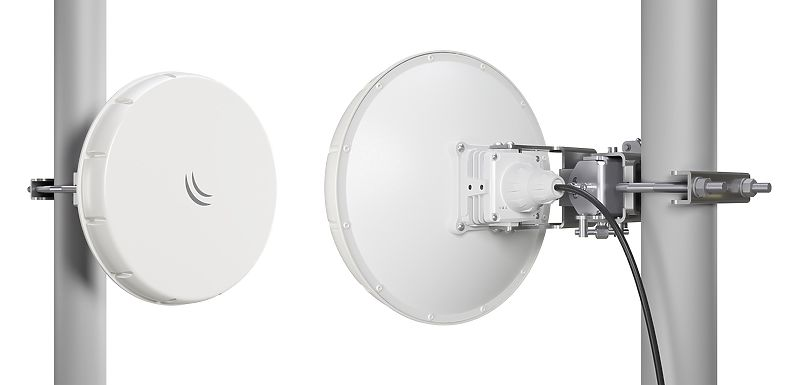
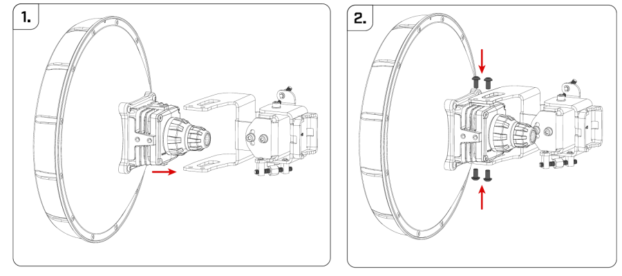
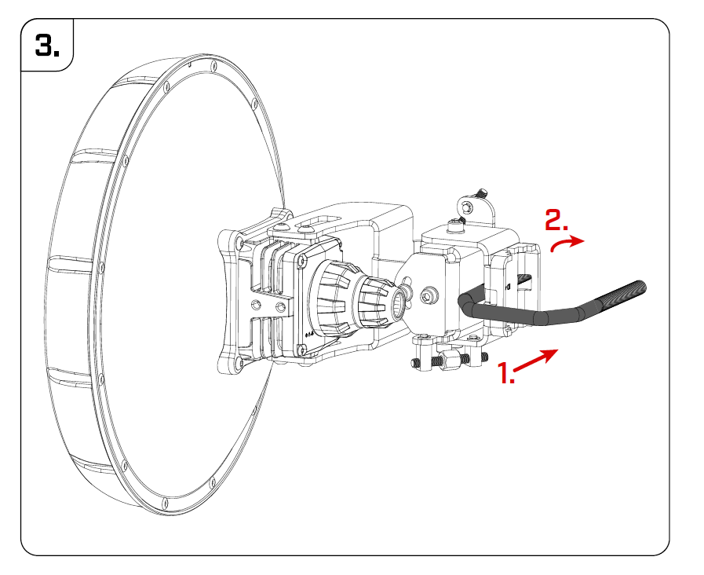
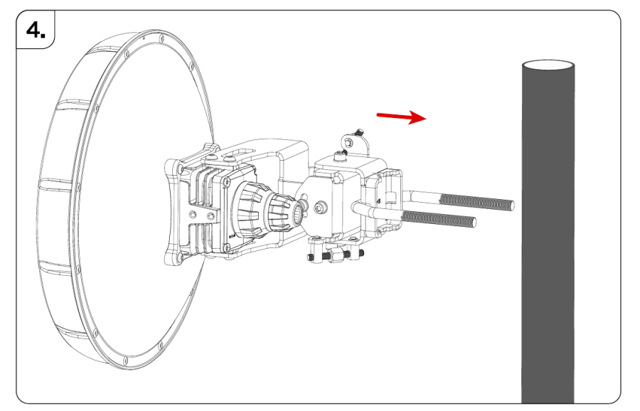
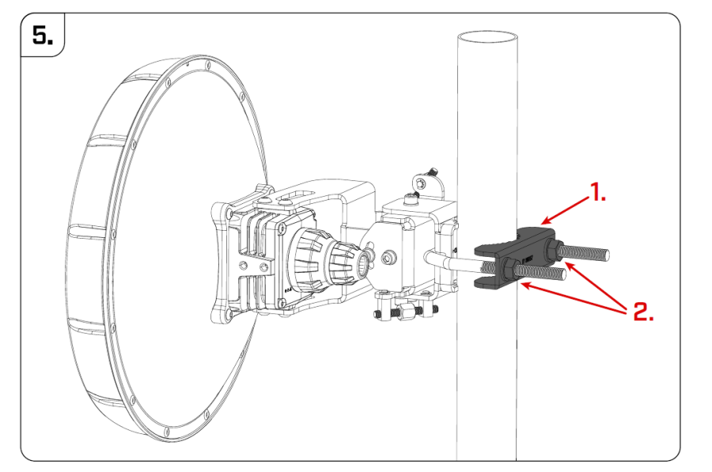
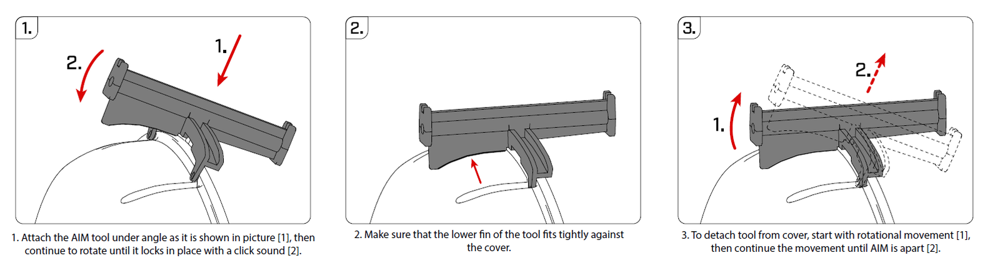
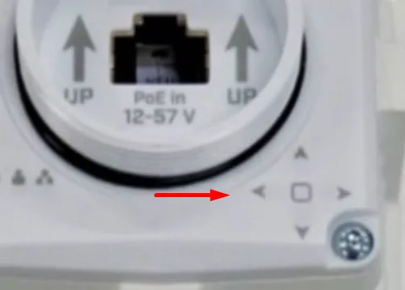
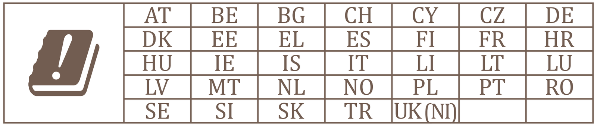

This guide can be downloaded as a [PDF file](https://manual.mikrotik.com/assets/files/nray-series.pdf).

## [Wireless Wire nRAY](https://mikrotik.com/product/wireless_wire_nray) (nRAYG-60adpair)

## Safety Warnings

- Before you work on any equipment, be aware of the hazards involved with electrical circuitry, and be familiar with standard practices for preventing accidents. See the [nRAY series product page](https://mikrotik.com/product/wireless_wire_nray) for full specifications and brochures.
- Ultimate disposal of this product should be handled according to all national laws and regulations.
- All installation methods for mounting an access point on any wall surface is subject to the acceptance of local jurisdiction.
- The Installation of the equipment must comply with local and national electrical codes.
- This product is intended to be mounted outdoors on a pole but can also be installed indoors. Please read the mounting instructions carefully before beginning installation. Failure to use the correct hardware and configuration or to follow the correct procedures could result in a hazardous situation to people and damage to the system.
- Use only the power supply and accessories approved by the manufacturer, and which can be found in the original packaging of this product.
- Read the installation instructions before connecting the system to the power source.
- We cannot guarantee that no accidents or damage will occur due to the improper use of the device. Please use this product with care and operate at your own risk!
- In the case of device failure, please disconnect it from power. The fastest way to do so is by unplugging the power plug from the power outlet.
- It is the customer's responsibility to follow local country regulations, including operation within legal frequency channels, output power, cabling requirements, and Dynamic Frequency Selection (DFS) requirements. All MikroTik radio devices must be professionally installed.
- This is a class A device. In a domestic environment, this product might cause radio interference in which case the user might be required to take adequate measures.

## Quickstart

Please follow these quick steps to set up your device:

- Unscrew the cover to reach the Ethernet port;
- Guide Ethernet cable through the opening;
- Plug into the Ethernet port and screw clockwise tightly, to ensure water protection;
- Connect the PoE injector into the computer;
- Connect the power adapter to the PoE injector;
- Download WinBox configuration tool [https://mt.lv/winbox](https://mt.lv/winbox), or use Web browser;
- Default IP: 192.168.88.2 and 192.168.88.3, user name: **admin**, and please find the password on the sticker;
- By default devices are configured as W60G Bridge;
- Once connected, configure the device, so it has an active Internet connection [https://mt.lv/configuration](https://mt.lv/configuration), or proceed to the next step to upgrade software manually;
- Upgrade the RouterOS software to the latest version [https://mt.lv/upgrade](https://mt.lv/upgrade);
- Connect again and choose your Region, this can be done in the Wireless menu W60G tab;
- Double click on the W60G interface, go to the Wireless tab and choose your Region;

## Powering

The device accepts power 802.3af/at PoE in 12 – 57 V DC ⎓. The power consumption under maximum load can reach 6 W.

### Connecting to a PoE Adapter

- Connect the Ethernet cable from the device to the PoE+DATA port of the PoE adapter.
- Connect an Ethernet cable from your local network (LAN) to the PoE adapter.
- Connect the power cord to the adapter, and then plug the power cord into a power outlet.

## Mounting

The device is designed to be used outdoors and mounted on the pole. When mounting, please ensure that the drain hole is pointing downwards. The IP rating scale of this device is IP54. We recommend using Cat6 shielded cables. Warning! This equipment should be installed and operated with a minimum distance of 60 cm between the device and your body. The operation of this equipment in the residential environment could cause radio interference. *The mounting and configuration of this device should be done by a qualified person.*

- Assemble the device with a mounting bracket.

- Use M5 screws to fix the mounting bracket, tighten it with the HEX3 tool - not provided in the package.
- Insert U bolt. In the sequence as it is shown in the picture.

- Attach the assembly to the pole.

- Add mount bracket and use two 13 mm nuts to secure the device.

## Aim tool usage

The device has led arrows on the back of the unit. Use the arrows to reach precise alignment.

The arrows will light up and show the direction where to turn the unit. The goal is to reach the 0.4 - 0.8 degree range, where the signal is at its peak.

## Grounding

The installation infrastructure (towers and masts), must be properly grounded. Please secure all loose Ethernet cables and antenna cables to the pole or mast approximately 30cm from the device, so that the cable weight is not pulling the ports and connectors.

## Configuration

We recommend clicking the "Check for updates" button in the QuickSet menu, as updating your RouterOS software to the latest version ensures the best performance and stability. Please make sure you have selected the country where the device will be used, to conform to local regulations. RouterOS includes many configuration options in addition to what is described in this document. We suggest starting here to get yourself accustomed to the possibilities: [https://mt.lv/help](https://mt.lv/help) In case IP connection is not available, the WinBox tool ([https://mt.lv/winbox](https://mt.lv/winbox)) can be used to connect to the MAC address of the device from the LAN side (all access is blocked from the Internet port by default). Seek additional help from your local trainers or become a trainer of yourself. [https://mikrotik.com/training/about](https://mikrotik.com/training/about) For recovery purposes, it is possible to boot the device for reinstallation, see section .

## Reset button

The reset button has three functions:

- Hold this button during boot time until LED light starts flashing, release the button to reset RouterOS configuration (total 5 seconds).
- Keep holding for 5 more seconds, LED turns solid, release now to turn on CAP mode. The device will now look for a CAPsMAN server (total 10 seconds).
- Or Keep holding the button for 5 more seconds until LED turns off, then release it to make the RouterBOARD look for Netinstall servers (total 15 seconds). Regardless of the above option used, the system will load the backup RouterBOOT loader if the button is pressed before power is applied to the device. Useful for RouterBOOT debugging and recovery.

## Operating system support

The device supports RouterOS v7 and above. The specific factory-installed version is listed in /system resource. Other operating systems have not been tested.

## Notes

This device meets the Maximum TX power limit per ETSI regulations. An Operational mode in the 60 GHz band: 58.32 GHz, 60.48 GHz, 62.64 GHz, 64.80 GHz. This device is certified for outdoor use in Point to Multipoint applications. In the following countries this device cannot be used in Fixed Point-to-Point applications:

## Federal Communication Commission Interference Statement

FCC ID: TV7RAY60

This equipment has been tested and found to comply with the limits for a Class A digital device, pursuant to Part 15 of the FCC Rules. These limits are designed to provide reasonable protection against harmful interference in a commercial installation.

This equipment generates, uses, and can radiate radio frequency energy and, if not installed and used in accordance with the instruction manual, may cause harmful interference to radio communications. Operation of this equipment in a residential area is likely to cause harmful interference in which case the user will be required to correct the interference at his own expense.

**FCC Caution:** Any changes or modifications not expressly approved by the party responsible for compliance could void the user's authority to operate this equipment. This device complies with Part 15 of the FCC Rules. Operation is subject to the following two conditions: (1) This device may not cause harmful interference, and (2) this device must accept any interference received, including interference that may cause undesired operation. This device and its antenna must not be co-located or operation in conjunction with any other antenna or transmitter.

**IMPORTANT: Exposure to Radio Frequency Radiation.** This equipment complies with the FCC RF radiation exposure limits set forth for an uncontrolled environment. This equipment should be installed and operated with a minimum distance of 60 cm between the radiator and any part of your body.

## Innovation, Science and Economic Development Canada

IC: 7442A-RAY60

This device contains license-exempt transmitter(s)/receiver(s) that comply with Innovation, Science, and Economic Development Canada's license-exempt RSS(s). Operation is subject to the following two conditions:

-

This device may not cause interference;

-

This device must accept any interference, including interference that may cause undesired operation of the device. L'émetteur/récepteur exempt de licence contenu dans le présent appareil est conforme aux CNR d'Innovation, Sciences et Développement économique Canada applicables aux appareils radio exempts de licence. L'exploitation est autorisée aux deux conditions suivantes:

-

L'appareil ne doit pas produire de brouillage;

-

L'appareil doit accepter tout brouillage radioélectrique subi, mźme si le brouillage est. **IMPORTANT: Exposure to Radio Frequency Radiation.** This equipment complies with the IC radiation exposure limits set forth for an uncontrolled environment. This equipment should be installed and operated with a minimum distance of 60 cm between the radiator and any part of your body. Cet equipement est conforme aux limites d'exposition au rayonnement IC definies pour un environnement non controle. Cet equipement doit etre installe et utilise a une distance minimale de 60 cm entre le radiateur et toute partie de votre corps.

This device is not to be operated on aircraft except for the conditions listed on ISED RSS-210 Annex J.1. Cet appareil ne doit pas être utilisé sur un avion, sauf dans les conditions énumérées ISED RSS-210 Annex J.1.

## UKCA marking

## Eurasian Conformity Mark

Информация о дате изготовления устройства указана в конце серийного номера на его наклейке через дробь. Первая цифра означает номер года (последняя цифра года), две последующие означают номер недели.

Изготовитель: MikroTikls SIA, Aizkraukles iela 23, Riga, LV-1006, Латвия, [support@mikrotik.com](mailto:support@mikrotik.com). Сделано в Китае, Латвии или Литве. Cм. на упаковке.

Для получения подробных сведений о гарантийном обслуживании обратитесь к продавцу. Информация об импортерах продукции MikroTik в Российскую Федерацию: [https://mikrotik.com/buy/europe/russia](https://mikrotik.com/buy/europe/russia)

Продукты MikroTik, которые поставляются в Евразийский таможенный союз, оцениваются с учетом соответствующих требований и помечены знаком EAC, как показано ниже:

## Norma Oficial Mexicana

EFICIENCIA ENERGETICA CUMPLE CON LA NOM-029-ENER-2017.

La operacion de este equipo esta sujeta a las siguientes dos condiciones:

- Es posible que este equipo o dispositivo no cause interferencia perjudicial y.
- Este equipo debe aceptar cualquier interferencia, incluyendo la que pueda causar su operacion no deseada. Fabricante: MikroTikls SIA, Brivibas gatve 214i, Riga, LV-1039, Latvia.

País De Origen: Letonia; Lituania; China (Republica Popular); Estados Unidos De America; Mexico.

Por favor contacte a su distribuidor local para preguntas regionales específicas. La lista de importadores se puede encontrar en nuestra página de inicio – [https://mikrotik.com/buy/latinamerica/mexico](https://mikrotik.com/buy/latinamerica/mexico).

## The National Commission for the State Regulation of Communications and Informatization by Ukraine

Виробник: MikroTikls SIA, Brivibas gatve 214i Рига, Латвія, LV1039.

Справжнім MikroTikls SIA заявляє, що маршрутизатор відповідає основним вимогам та іншим відповідним положенням директиви 2014/53/EC, а також суттєвим вимогам Технічного регламенту радіообладнання, затвердженого постановою Кабінету Міністрів України від 24 травня 2017 року № 355.

Для експлуатації в Україні необхідно отримати дозвіл на експлуатацію у порядку, затвердженому рішенням НКРЗІ від 01.11.2012 № 559, зареєстрованому в Міністерстві юстиції України 03.01.2013 за № 57/22589.

## CE Declaration of Conformity

Manufacturer: MikroTikls SIA, Brivibas gatve 214i Riga, Latvia, LV1039.

Hereby, Mikrotīkls SIA declares that the radio equipment type nRAYG-60adpair is in compliance with Directive 2014/53/EU. The full text of the EU declaration of conformity is available at the following internet address: [https://mikrotik.com/products](https://mikrotik.com/products)

### WiGig

<table><thead><tr><th>Operational channels / Maximum output power Betriebskanäle / maximale Ausgangsleistung Canaux opérationnels / puissance de sortie maximale Canali operativi / massima potenza di uscita Canales operacionales / potencia de salida máxima Операционные каналы / максимальная выходная мощность</th><th>58.32 GHz / &lt;40 dBm</th></tr></thead><tbody><tr><td>60.48 GHz / &lt;40 dBm</td><td></td></tr><tr><td>62.64 GHz / &lt;40 dBm</td><td></td></tr></tbody></table>
