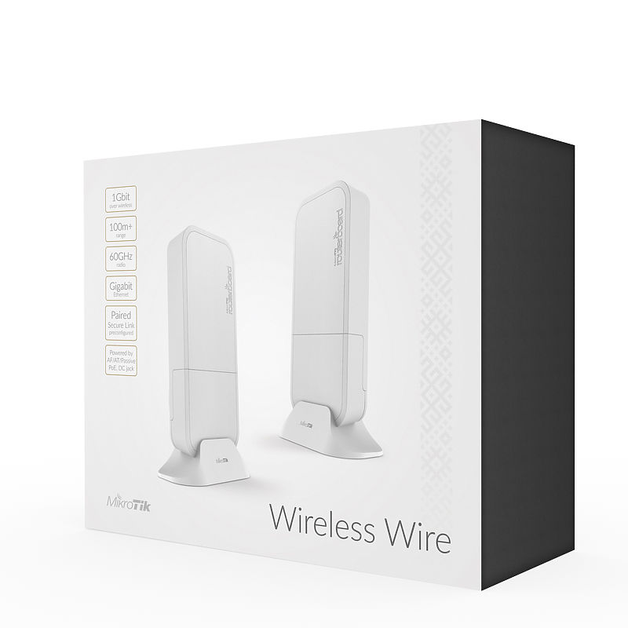
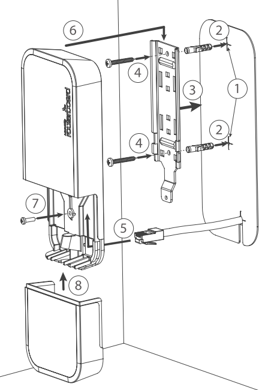
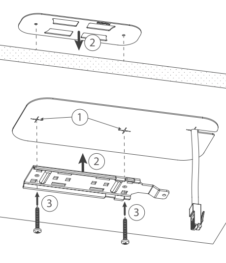
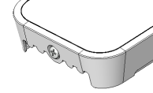
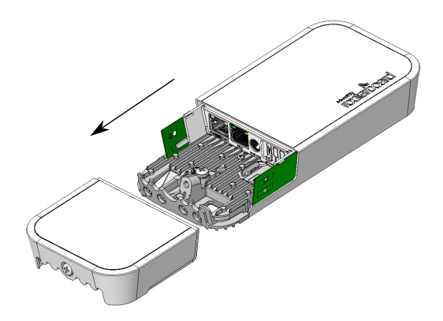
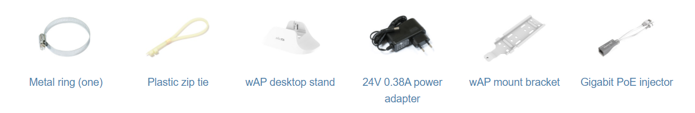
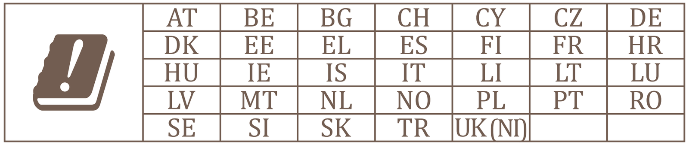

This guide can be downloaded as a [PDF file](https://manual.mikrotik.com/assets/files/wap-60g-series.pdf).

:::info This article covers

- **[Wireless Wire](https://mikrotik.com/product/wireless_wire)** (RBwAPG-60adkit)
- **[wAP 60G](https://mikrotik.com/product/wap_60g)** (RBwAPG-60ad)
- **[wAP 60G AP](https://mikrotik.com/product/wap_60g_ap)** (RBwAPG-60ad-A)
- **wAP 60Gx3 AP** (RBwAPG-60ad-SA)

:::

wAP60G devices work in the 60GHz wireless spectrum, the operating temperature of these devices is from -40°C up to +70°C. The devices have a one-gigabit ethernet port and can be powered from a power jack or from ethernet. Devices can be securely mounted on a wall, ceiling, or on a pole/mast.

## Safety Warnings

- Before you work on any equipment, be aware of the hazards involved with electrical circuitry, and be familiar with standard practices for preventing accidents.
- Ultimate disposal of this product should be handled according to all national laws and regulations.
- All installation methods for mounting an access point on any wall surface is subject to the acceptance of local jurisdiction.
- The Installation of the equipment must comply with local and national electrical codes.
- This product is intended to be mounted outdoors on a pole but can also be installed indoors. Please read the mounting instructions carefully before beginning installation. Failure to use the correct hardware and configuration or to follow the correct procedures could result in a hazardous situation to people and damage to the system.
- Use only the power supply and accessories approved by the manufacturer, and which can be found in the original packaging of this product.
- Read the installation instructions before connecting the system to the power source.
- We cannot guarantee that no accidents or damage will occur due to the improper use of the device. Please use this product with care and operate at your own risk!
- In the case of device failure, please disconnect it from power. The fastest way to do so is by unplugging the power plug from the power outlet.
- It is the customer's responsibility to follow local country regulations, including operation within legal frequency channels, output power, cabling requirements, and Dynamic Frequency Selection (DFS) requirements. All MikroTik radio devices must be professionally installed.
- This is a class A device. In a domestic environment, this product might cause radio interference in which case the user might be required to take adequate measures.

## Quickstart

- Connect the device to the included PoE injector with Ethernet cable to the data+power end;
- Connect the data end of the PoE injector into the computer;
- Connect the power adapter to the PoE injector;
- Download WinBox configuration tool [https://mt.lv/winbox](https://mt.lv/winbox) Default IP: 192.168.88.1, user name: **admin** and there is no password, please find the password on the sticker;
- Set an IP address of your computer to 192.168.88.2;
- In case the IP connection is not available, please use the Neighbors tab and connect through MAC address;
- Once connected configure the device, so it has an active Internet connection [https://mt.lv/configuration](https://mt.lv/configuration);
- Upgrade the RouterOS software to the latest version [https://mt.lv/upgrade](https://mt.lv/upgrade);
- Choose your country, to apply country regulation settings;
- Set the *Installation* to indoors or outdoors, depending on the usage type;
- Secure your device and set a strong password;
- For more configuration information, please visit the [W60G interface manual](/docs/wireless/w60g/);
- wAP60G AP units come pre-configured with WISP Bridge default configuration;
- Wireless Wire and wAP60G units come pre-configured with PTP Bridge default configuration;
- Wireless Wire devices have already, randomly generated, matching SSID, and Wireless passwords.

## Powering

The devices accept powering both from a power adapter, and through the ethernet port:

- Direct-input power jack (5.5 mm outside and 2 mm inside, female, pin positive plug) accepts 12-57 V DC.
- Ethernet port accepts PoE input 12-57 V DC (passive and 802.3af/at). A power adapter and a passive PoE injector are included in the box. If using the PoE injector, make sure to use the "Power + Data" connector to connect to the wAP60G device and the "Data" connector to your router or switch.

## Configuration and connecting

Full RouterOS documentation is located here: [https://mt.lv/help](https://mt.lv/help) Specific wAP 60G configuration can be found in the [W60G interface manual](/docs/wireless/w60g/). Access the device by connecting to the Ethernet port and then use the MikroTik WinBox utility for connection. For recovery purposes, it is possible to boot the device from the network, see section . In case the IP connection is not available, the WinBox utility can also be used to connect to the MAC address of the device.

## Mounting

**Mounting on the mast or pole:**

**It's recommended to use electrical tape to increase friction between materials.**

- Mount plastic tie straps to steel brackets guiding them through holes.
- Mount bracket to the device.
- Secure them with a screw.
- Mount and align the device on the pole or mast.
- Guide Ethernet cable through the opening and connect to the Ethernet port.
- Close bottom latch and secure with a screw. It's recommended to secure an Ethernet cable to the pole using zip ties. With the distance from the device approximately 30 cm.

**Mounting unit on the wall:**

- Use included a template to mark spots for drilling holes. And if needed for Ethernet cable. Align accordingly, it will depend on how the device will be mounted finally.
- Insert dowels if needed, depends on wall structure and material.
- Place included a steel bracket on the wall.
- Use screws to secure it in place.
- Extend your Ethernet cable through the opening and connect to the Ethernet port.
- Mount the device on the steel bracket
- Secure it in place with the screw.
- Close bottom latch.

Avoid mounting the device on the low ground spot, as you won't be able to attach and close the bottom latch.

**Mounting on the ceiling:**

A Special bracket is included in the package to mount on the drop ceiling. As it consists of two parts, to be attached on both sides of the ceiling tile.

-

Use the template to mark spots for holes.

-

Place both mounting brackets on the spot.

-

Secure them together using screws. Continue assembling in the same manner if mounting on the wall.

-

Extend your Ethernet cable through the opening and connect to the Ethernet port.

-

Mount the device on the steel bracket.

-

Secure it in place with the screw.

-

Close bottom latch.

## Bottom Lid

- The bottom lid is secured in place with the captive screw.
- Use the Philips PH2 screwdriver to unscrew it, but do not remove the screw completely.

- Pull the cover in the opposite direction from the device to remove it.

- Reassemble.

## Buttons and jumpers

The routerBOOT reset button has the following functions. Press the button and apply the power, then:

- Release the button when the green LED starts flashing, to reset RouterOS configuration to defaults.
- Release the button when the LED turns solid green to clear all configuration and defaults.
- Release the button after LED is no longer lit (~20 seconds) to cause the device to look for Netinstall servers (required for reinstalling RouterOS over the network). Regardless of the above option used, the system will load the backup RouterBOOT loader if the button is pressed before power is applied to the device. Useful for RouterBOOT debugging and recovery.

## Included items

## Operating system support

The device supports RouterOS v7 and above. The specific factory-installed version is listed in /system resource. Other operating systems have not been tested.

## Notes

This device meets the Maximum TX power limit per ETSI regulations. The operational mode in the 60 GHz band: 58.32 GHz, 60.48 GHz, 62.64 GHz. This device is certified for outdoor use in Point to Multipoint applications. In the following countries this device cannot be used in Fixed Point-to-Point applications:

## Federal Communication Commission Interference Statement

<table><thead><tr><th>Model</th><th>FCC ID</th></tr></thead><tbody><tr><td>RBwAPG-60adkit</td><td>TV7WAPG60AD</td></tr><tr><td>RBwAPG-60ad</td><td>TV7WAPG60AD</td></tr><tr><td>RBwAPG-60ad-A</td><td>TV7WAPG60AD</td></tr><tr><td>RBwAPG-60ad-SA</td><td>TV7WAPG60ADM</td></tr></tbody></table>

This equipment has been tested and found to comply with the limits for a Class A digital device, pursuant to Part 15 of the FCC Rules. These limits are designed to provide reasonable protection against harmful interference in a commercial installation.

This equipment generates, uses, and can radiate radio frequency energy and, if not installed and used in accordance with the instruction manual, may cause harmful interference to radio communications. Operation of this equipment in a residential area is likely to cause harmful interference in which case the user will be required to correct the interference at his own expense.

**FCC Caution:** Any changes or modifications not expressly approved by the party responsible for compliance could void the user’s authority to operate this equipment.

This device complies with Part 15 of the FCC Rules. Operation is subject to the following two conditions: (1) This device may not cause harmful interference, and (2) this device must accept any interference received, including interference that may cause undesired operation.

Note: This unit was tested with shielded cables on the peripheral devices. Shielded cables must be used with the unit to ensure compliance.

This device is not to be operated on aircraft except for the conditions listed on FCC CFR §15.255 (b)

**IMPORTANT: Exposure to Radio Frequency Radiation.** This equipment complies with the FCC RF radiation exposure limits set forth for an uncontrolled environment. This equipment should be installed and operated with a minimum distance of 20 cm between the radiator and any part of your body.

## Innovation, Science and Economic Development Canada

<table><thead><tr><th>Model</th><th>IC</th></tr></thead><tbody><tr><td>RBwAPG-60adkit</td><td>7442A-WAPG60AD</td></tr><tr><td>RBwAPG-60ad</td><td>7442A-WAPG60AD</td></tr><tr><td>RBwAPG-60ad-A</td><td>7442A-WAPG60AD</td></tr><tr><td>RBwAPG-60ad-SA</td><td>7442A-WAPG60ADM</td></tr></tbody></table>

This device contains license-exempt transmitter(s)/receiver(s) that comply with Innovation, Science, and Economic Development Canada’s license-exempt RSS(s). Operation is subject to the following two conditions: (1) This device may not cause interference. (2) This device must accept any interference, including interference that may cause undesired operation of the device.

L’émetteur/récepteur exempt de licence contenu dans le présent appareil est conforme aux CNR d’Innovation, Sciences et Développement économique Canada applicables aux appareils radio exempts de licence. L’exploitation est autorisée aux deux conditions suivantes : 1) L’appareil ne doit pas produire de brouillage; 2) L’appareil doit accepter tout brouillage radioélectrique subi, même si le brouillage est susceptible d’en compromettre le fonctionnement.

This Class A digital apparatus complies with Canadian ICES-003.

Cet appareil numérique de la classe [A] est conforme à la norme NMB-003 du Canada.

CAN ICES-003 (A) / NMB-003 (A)

**IMPORTANT: Exposure to Radio Frequency Radiation.** This equipment complies with the IC radiation exposure limits set forth for an uncontrolled environment. This equipment should be installed and operated with a minimum distance of 20 cm between the radiator and any part of your body. Cet equipement est conforme aux limites d'exposition au rayonnement IC definies pour un environnement non controle. Cet equipement doit etre installe et utilise a une distance minimale de 20 cm entre le radiateur et toute partie de votre corps.

This device is not to be operated on aircraft except for the conditions listed on ISED RSS-210 Annex J.1.

Cet appareil ne doit pas être utilisé sur un avion, sauf dans les conditions énumérées ISED RSS-210 Annex J.1.

## UKCA marking

## Eurasian Conformity Mark

Информация о дате изготовления устройства указана в конце серийного номера на его наклейке через дробь. Первая цифра означает номер года (последняя цифра года), две последующие означают номер недели.

Изготовитель: MikroTikls SIA, Aizkraukles iela 23, Riga, LV-1006, Латвия, [support@mikrotik.com](mailto:support@mikrotik.com). Сделано в Китае, Латвии или Литве. Cм. на упаковке.

Для получения подробных сведений о гарантийном обслуживании обратитесь к продавцу. Информация об импортерах продукции MikroTik в Российскую Федерацию: [https://mikrotik.com/buy/europe/russia](https://mikrotik.com/buy/europe/russia)

Продукты MikroTik, которые поставляются в Евразийский таможенный союз, оцениваются с учетом соответствующих требований и помечены знаком EAC, как показано ниже:

## Norma Oficial Mexicana

EFICIENCIA ENERGETICA CUMPLE CON LA NOM-029-ENER-2017.

La operacion de este equipo esta sujeta a las siguientes dos condiciones:

- Es posible que este equipo o dispositivo no cause interferencia perjudicial y.
- Este equipo debe aceptar cualquier interferencia, incluyendo la que pueda causar su operacion no deseada. Fabricante: MikroTikls SIA, Brivibas gatve 214i, Riga, LV-1039, Latvia.

País De Origen: Letonia; Lituania; China (Republica Popular); Estados Unidos De America; Mexico.

Por favor contacte a su distribuidor local para preguntas regionales específicas. La lista de importadores se puede encontrar en nuestra página de inicio – [https://mikrotik.com/buy/latinamerica/mexico](https://mikrotik.com/buy/latinamerica/mexico).

## The National Commission for the State Regulation of Communications and Informatization by Ukraine

Виробник: MikroTikls SIA, Brivibas gatve 214i Рига, Латвія, LV1039.

Справжнім MikroTikls SIA заявляє, що маршрутизатор відповідає основним вимогам та іншим відповідним положенням директиви 2014/53/EC, а також суттєвим вимогам Технічного регламенту радіообладнання, затвердженого постановою Кабінету Міністрів України від 24 травня 2017 року № 355.

Для експлуатації в Україні необхідно отримати дозвіл на експлуатацію у порядку, затвердженому рішенням НКРЗІ від 01.11.2012 № 559, зареєстрованому в Міністерстві юстиції України 03.01.2013 за № 57/22589.

## CE Declaration of Conformity

Manufacturer: MikroTikls SIA, Brivibas gatve 214i Riga, Latvia, LV1039.

Hereby, Mikrotīkls SIA declares that the radio equipment type RouterBOARD is in compliance with Directive 2014/53/EU. The full text of the EU declaration of conformity is available at the following internet address: [https://mikrotik.com/products](https://mikrotik.com/products)

### WiGig

<table><thead><tr><th>Operational channels / Maximum output power Betriebskanäle / maximale Ausgangsleistung Canaux opérationnels / puissance de sortie maximale Canali operativi / massima potenza di uscita Canales operacionales / potencia de salida máxima Операционные каналы / максимальная выходная мощность</th><th>58.32 GHz / 40 dBm</th></tr></thead><tbody><tr><td>60.48 GHz / 40 dBm</td><td></td></tr><tr><td>62.64 GHz / 40 dBm</td><td></td></tr></tbody></table>
