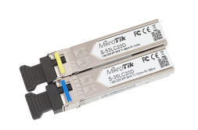
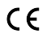

S-35/53LC20D is a pair of SFP transceivers, the S-35LC20D is a 1.25G Single Mode optical SFP module with an LC connector, T1310nm/R1550nm, which works for connections up to 20km and supports DDM. The S-53LC20D is a 1.25G Single Mode optical SFP transceiver with an LC connector, T1550nm/R1310nm, which works for connections up to 20km and supports DDM. See the [S-3553LC20D product page](https://mikrotik.com/product/S-3553LC20D) for full specifications and brochures.

## Specifications

<table><thead><tr><th>Product code</th><th>S-3553LC20D</th></tr></thead><tbody><tr><td>Connector</td><td>LC UPC</td></tr><tr><td>Data Rate</td><td>1.25G</td></tr><tr><td>Distance</td><td>20KM</td></tr><tr><td>Format</td><td>SFP</td></tr><tr><td>Mode</td><td>SM</td></tr><tr><td>Tested ambient temperature</td><td>-40 to +70C</td></tr></tbody></table>

## UKCA marking

## Eurasian Conformity Mark

Информация о дате изготовления устройства указана в конце серийного номера на его наклейке через дробь. Первая цифра означает номер года (последняя цифра года), две последующие означают номер недели.

Изготовитель: MikroTikls SIA, Aizkraukles iela 23, Riga, LV-1006, Латвия, [support@mikrotik.com](mailto:support@mikrotik.com). Сделано в Китае, Латвии или Литве. Cм. на упаковке.

Для получения подробных сведений о гарантийном обслуживании обратитесь к продавцу.

Продукты MikroTik, которые поставляются в Евразийский таможенный союз, оцениваются с учетом соответствующих требований и помечены знаком EAC, как показано ниже:

## Norma Oficial Mexicana

EFICIENCIA ENERGETICA CUMPLE CON LA NOM-029-ENER-2017.

La operacion de este equipo esta sujeta a las siguientes dos condiciones:

- Es posible que este equipo o dispositivo no cause interferencia perjudicial y.
- Este equipo debe aceptar cualquier interferencia, incluyendo la que pueda causar su operacion no deseada. Fabricante: MikroTikls SIA, Unijas iela 2, Riga, LV-1039, Latvia.

País De Origen: Letonia; Lituania; China (Republica Popular); Estados Unidos De America; Mexico.

Por favor contacte a su distribuidor local para preguntas regionales específicas. La lista de importadores se puede encontrar en nuestra página de inicio – [https://mikrotik.com/buy/latinamerica/mexico](https://mikrotik.com/buy/latinamerica/mexico).

## CE Declaration of Conformity

Manufacturer: MikroTikls SIA, Unijas iela 2, Riga, Latvia, LV1039.

The full text of the EU declaration of conformity is available at the following internet address: [https://mikrotik.com/products](https://mikrotik.com/products)
