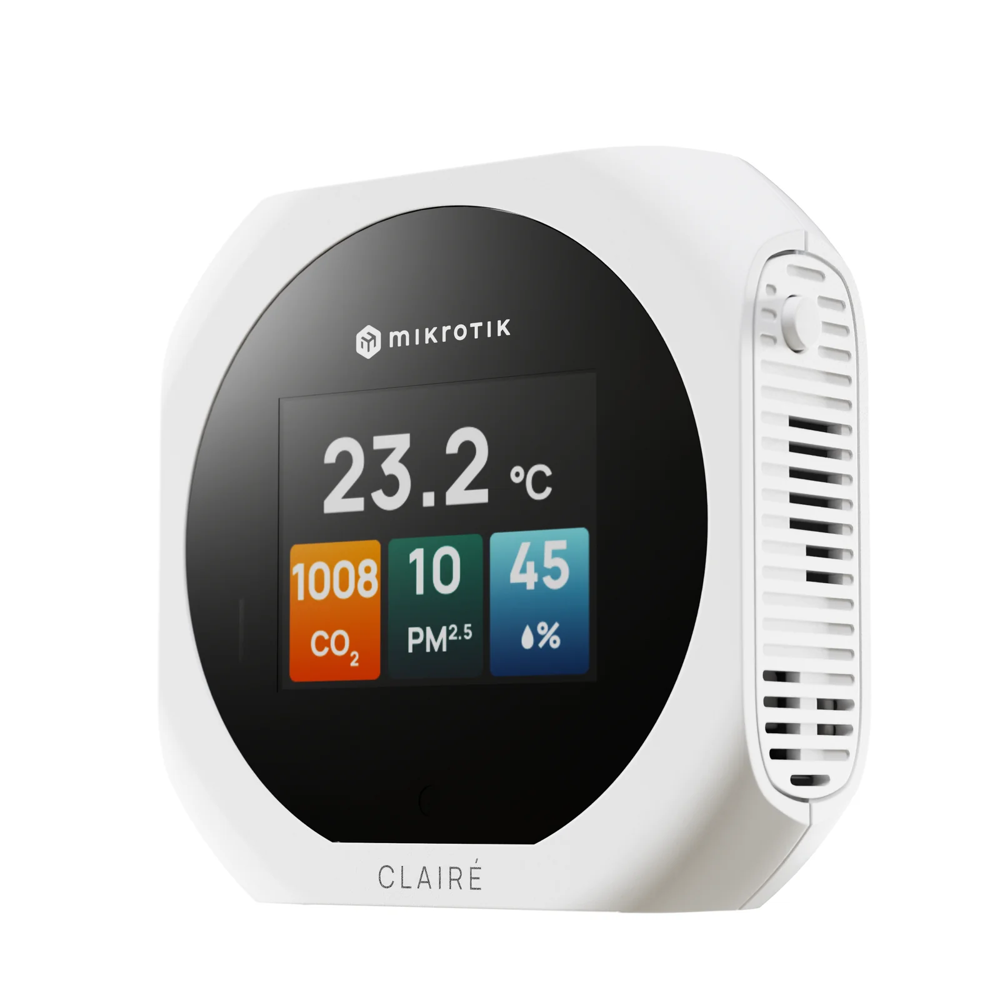
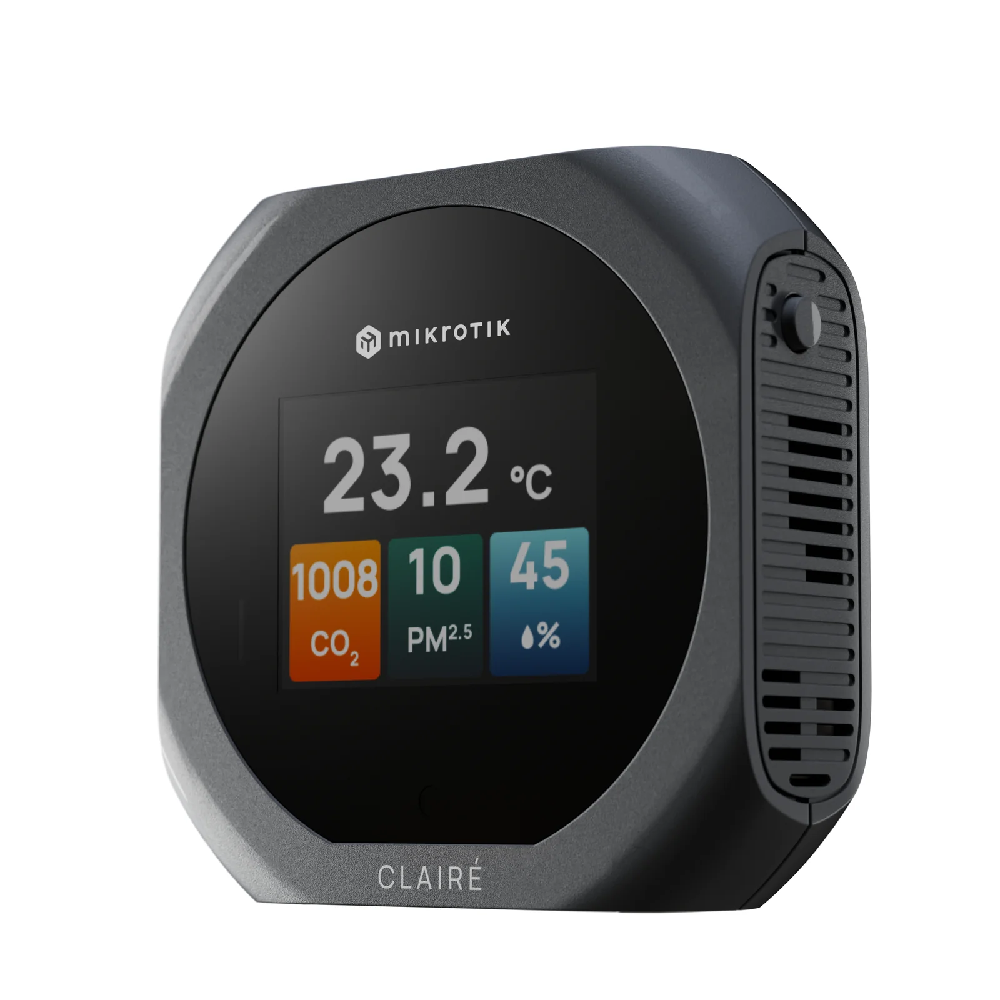
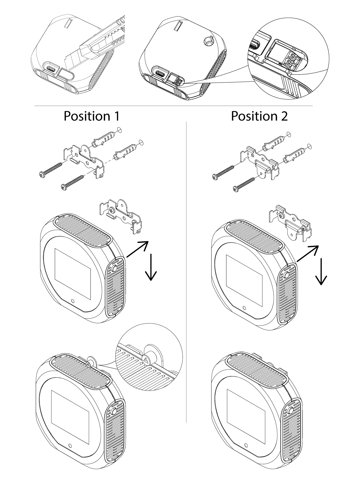

This guide can be downloaded as a [PDF file](https://manual.mikrotik.com/assets/files/iaqm-thc2pv-w-and-iaqm-thc2pv-g.pdf).

IAQM-THC2PV-W (white) and IAQM-THC2PV-G (grey), IAQM-THC2V-W (white) and IAQM-THC2V-G (grey), IAQM-THC2P-W (white) and IAQM-THC2P-G (grey) is an air quality sensor device that measures temperature (°C/°F), relative humidity (RH), carbon dioxide (CO₂) and optionally particulate matter (PM) or volatile organic compounds (VOC).

See the [CLAIRE](https://mikrotik.com/product/claire) and [CLAIRE Lite](https://mikrotik.com/product/claire_lite) product pages for full specifications and brochures.

Model naming convention: IAQM-THC2PV-W/G

- IAQM - Indoor air quality monitor
- T - Temperature [°C/°F]
- H - Relative humidity [%]
- C2 - Carbon dioxide [ppm]
- P - Particulate matter [μg/m3]
- V - Volatile organic compounds [VOC Index]
- W - White color
- G - Grey color

## Safety Warnings

Before you work on any equipment, be aware of the hazards involved with electrical circuitry, and be familiar with standard practices for preventing accidents. Ultimate disposal of this product should be handled according to all national laws and regulations. All installation methods for mounting an access point on any wall surface is subject to the acceptance of local jurisdiction. The Installation of the equipment must comply with local and national electrical codes. This product is intended to be installed indoors. Keep this product away from water, fire, humidity, or hot environments. Use only the power supply and accessories approved by the manufacturer, and which can be found in the original packaging of this product. We recommend powering this device using an external Limited Power Source (LPS) that complies with IEC 62368-1. Use only an LPS-rated AC/DC adapter whose output voltage and current match the values indicated on the product. We cannot guarantee that no accidents or damage will occur due to the improper use of the device. Please use this product with care and operate at your own risk! In the case of device failure, please disconnect it from power. The fastest way to do so is by unplugging the power plug from the power outlet. It is the customer's responsibility to follow local country regulations, including operation within legal frequency channels, output power and cabling requirements. All MikroTik radio devices must be professionally installed. To avoid pollution of the environment, please separate the device from household waste and dispose of it in a safe manner, such as in designated waste disposal sites. Familiarize yourself with the procedures for the proper transportation of the equipment to the designated disposal sites in your area.

**Exposure to Radio Frequency Radiation:** This MikroTik equipment complies with the European Union radiation exposure limits set forth for an uncontrolled environment. This MikroTik device should be installed and operated no closer than 20 centimeters from your body, occupational user, or the general public.

## Overview

Matter connectivity standard compatible air quality monitoring device with all the essential sensors - carbon dioxide (CO₂), Particulate matter sensor (PM2.5 and PM10), temperature, relative humidity and VOC sensor built-in.

Suitable for households, offices, schools, hotels, retirement homes or other public spaces.

## IAQM-THC2PV-W/G

- **Temperature sensor**
Range 0..+50°C
Accuracy ±0.5°C typ
- **Relative humidity sensor**
Range 0..100 %RH
Accuracy ±4% typ
- **CO₂ sensor**
Range 400..2000 ppm
Accuracy ±50.0 ppm ±5.0%
Automatic Self-Calibration (ASC) with weekly exposure to air at 400 ppm CO₂ concentration
- **Particulate matter PM2.5 sensor**
Range 0..1000 μg/m3
Accuracy ±10%
- **Particulate matter PM10 sensor**
Range 0..1000 μg/m3
Accuracy ±25%
- **VOC sensor**
Range 1..500 VOC Index points
Variation ±15%
Repeatability ±5%
- Matter connection: Yes, Matter over Thread
- Bluetooth®: Yes, for simple Matter provisioning (device setup) only
- Display: Full color 2” display with back-light
- Display modes: User adjustable various predefined display modes
- Indications: Visual color-coded warnings for deteriorated or unhealthy air
- Powering: USB Type-C socket or 5VDC terminal connector for LPS adapter
- Overall dimensions: 76x76x24mm
- Mounting: Desktop or wall-mounted bracket with a security screw option
- Compatible controllers: Google, Amazon, Apple Matter-enabled controllers, Integrates with Home Assistant App

---

## First Steps

- To power on the device, connect it using the included USB-C adapter.
- After powering on, allow up to 10 minutes for the system to stabilize.
- To change the display mode, press the side button for 50 ms to 3 seconds.
- To switch the temperature display between °C and °F, press and hold the side button for 3 seconds. When the menu appears, navigate to the Temperature unit section by briefly pressing the button once (50 ms to 1 s). To select this section, press and hold the button for 1 second. Use short button presses to switch between Celsius and Fahrenheit, and confirm your selection by pressing and holding the button for 1 second.
- All sensors update their measured values every 10 seconds, except the CO₂ sensor, which updates every 30 seconds, and the PM sensor, which updates every 5 minutes.

For instructions on how to pair the device with smart home systems compatible with Matter over Thread, please refer to the manual available here:

Scan the QR Code to open the manual: [https://mt.lv/claire-help](https://mt.lv/claire-help)

## Button controls

The device is operated with a single multi-function button located on the side. All menu navigation and settings are accessed through this button.

<table><thead><tr><th>Action</th><th>Where</th><th>Result</th></tr></thead><tbody><tr><td>Tap (50 ms – 3 s)</td><td>Main screen</td><td>Cycles to the next display layout</td></tr><tr><td>Hold (3 s)</td><td>Main screen</td><td>Opens the settings menu</td></tr><tr><td>Tap (50 ms – 1 s)</td><td>Settings menu</td><td>Cycles to the next menu option</td></tr><tr><td>Hold (1 s)</td><td>Settings menu</td><td>Confirms the highlighted menu item</td></tr><tr><td>No press (30 s inactivity)</td><td>Settings menu</td><td>Automatically reverts to the main screen</td></tr></tbody></table>

### Settings menu

Hold (3 s) the button from the home screen to open the settings menu. The menu contains the following items:

- Pairing code
- Temperature unit
- VOC unit for Matter
- Unpairing
- CO₂ sensor calibration
- Display settings
- Back (exit)

Tap (50 ms – 1 s) cycles through the settings items; hold (1 s) to confirm an item. If no input is registered for 30 seconds, the screen automatically reverts to the main layout.

#### Pairing code

Navigate to **Pairing code** and hold (1 s). The screen displays the Matter QR pairing code. Hold (1 s), or wait for the 30-second timeout, to return to the main screen.

#### Temperature unit

Navigate to **Temperature unit** and hold (1 s). Choose Celsius (°C), Fahrenheit (°F), or Back. Hold (1 s) to save the unit and return to the main screen.

#### VOC unit for Matter

Navigate to **VOC unit for Matter** and hold (1 s). Choose ppm, µg/m³, or Back. Hold (1 s) to confirm and return to the main screen.

:::note note

The VOC unit can affect how the air quality data is displayed on different platforms. When using the **Google Home** app, use **ppm**. When using the **Apple HomePod** and **Amazon Alexa** apps, use **µg/m³**.

:::

#### Unpairing

Navigate to **Unpairing** and hold (1 s); the screen will show "Ready to unpair BLE/Matter".

- If the 30-second timeout expires, the screen reverts back without unpairing.
- Tap (50 ms – 3 s) to unpair; the screen confirms success. Wait for the 5-second timeout or tap to go back.

:::note note

If the **Claire** has been paired to some other home already, do not forget to **Unpair** it, as it can prevent new pairing.

:::

#### CO₂ sensor calibration

Navigate to **CO₂ sensor calibration** and hold (1 s). Place the device in fresh air (~400 ppm CO₂) and wait 60 seconds. When prompted to start calibration, tap (50 ms – 3 s) to confirm (3-minute timeout reverts back). Wait while the calibration completes; the system reboots automatically.

#### Display settings

Navigate to **Display settings** and hold (1 s) to access screen preferences:

-

**Display anti-burn in** – Select **Display anti-burn in** (hold 1 s). Tap (50 ms – 1 s) to toggle **Enabled** or **Disabled** (Default = **Disabled**) or (go) Back. Hold (1 s) to save selection. This feature is meant for devices running 24/7 in bright light: every 15 minutes it briefly refreshes the display (a few seconds) to reduce burn-in. In normal use the brightness auto-adjusts and dims at night, so burn-in is unlikely and the feature is off by default.

-

**Display brightness** – Select **Display brightness** (hold 1 s). Tap (50 ms – 1 s) to toggle between **Automatic** (adjusts via ambient light sensor) or **Manual** (Default = **Automatic**) or (go) Back. Hold (1 s) to choose the selection. Under **Manual** you can tap (50 ms – 1 s) to toggle between **Set brightness** and **Night mode** (or go Back). Hold (1 s) to select your choice:

- **Set brightness** – Tap (50 ms – 1 s) to toggle between **2%, 10%, 25%, 50%, 75%, 100%** (or go Back).
- **Night mode** – Tap (50 ms – 1 s) to toggle **ON** or **OFF** (or go Back). **ON** uses the set brightness but drops to 2% in dark environments; **OFF** keeps the set brightness regardless of darkness. Hold (1 s) to confirm selection.

-

**Back** – Select **Back** and hold (1 s) to return to the device settings list.

#### Exit Menu

Select **Back** and hold (1 s) to return to the main screen.

### Firmware upgrade / Factory reset / Reboot

To access this menu, power on the device while holding the button pressed. Hold the button **before** connecting power, and keep it held while the device powers on.

#### Firmware Upgrade

To upgrade the firmware via GUI:

**Claire**

- Plug the device into your computer via USB while holding the button pressed — the device powers on and opens the Firmware upgrade / Factory reset / Reboot menu.
- Tap (50 ms – 1 s) to reach **Firmware Upgrade** and hold (1 s) to select it.
- The screen allows to choose **Start Firmware Upgrade** (or go Back); hold (1 s) on **Start Firmware Upgrade**.
- The device enters DFU mode and appears on your PC as a new USB device named "DFU in FS Mode".

**PC**

- Use a Chromium-based browser (**Chrome** or **Edge**).
- Open the firmware upgrade Web GUI in your browser: **[https://mikrotik.com/download/iot](https://mikrotik.com/download/iot)**.
- On the page, go through the steps: **Connect** and **Select** the USB interface, then **Update device**.
- Wait for the update to complete — do not disconnect the device during the process.

:::note note

**Ubuntu / Linux:** the browser will not be able to access the device until a **udev rule** for MikroTik is added. When you try to connect, the Web GUI shows an error with the required instructions — follow them, then reconnect the device and try the upload again.

:::

#### Factory Reset

Tap (50 ms – 1 s) to reach **Factory Reset** and hold (1 s) to select it. Hold (1 s) on **Confirm Factory Reset**; the device resets and reboots.

#### Reboot

Tap (50 ms – 1 s) to reach **Reboot** and hold (1 s) to reboot the device.

:::note note

Factory Reset is necessary for situations where the device button is locked.

:::

## Claire and Google Nest

If you have a Google Nest speaker or display with a Thread radio and would like to pair Claire with this ecosystem:

### Claire

- Hold the side button for 3 seconds to open the menu. Choose **Pairing code** option (you can short press the button for 50ms to 1s to cycle through the other menu settings). With **Pairing code** selected, press side button for 1 second and it will display the **Matter QR code**.

### Phone

- Open Google **Home** app and tap **(+)** **Add** → **(+)** **Device**:
- Scan the **Matter QR code** shown on the **Claire**'s display with your phone (camera).
- Follow the remaining prompts to complete the pairing process.

## Claire and Apple HomePod

If you have an Apple HomePod or Apple TV with a Thread radio and would like to pair the device with this ecosystem:

### Claire

- Hold the side button for 3 seconds to open the menu. Choose **Pairing code** option (you can short press the button for 50ms to 1s to cycle through the other menu settings). With **Pairing code** selected, press side button for 1 second and it will display the **Matter QR code**.

### iPhone

- Open **Home** app and tap **Add Accessory** (+).
- Scan the **Matter QR code** shown on the **Claire**'s display with your iPhone (camera).
- Follow the remaining prompts to complete the pairing process.

Once paired, the device will appear in your Apple **Home** app, and you can view air quality data from there.

:::tip tip

If you have trouble pairing the device, sometimes it is beneficial to restart your iPhone first.

:::

## Claire and Amazon Alexa

If you have an Amazon Alexa device (that supports Matter) and would like to pair Claire with this ecosystem:

### Claire

- Hold the side button for 3 seconds to open the menu. Choose **Pairing code** option (you can short press the button for 50ms to 1s to cycle through the other menu settings). With **Pairing code** selected, press side button for 1 second and it will display the **Matter QR code**.

### Phone

- In the **Amazon Alexa app**, select **Add device** → **Other** → **Matter**, then continue with the steps, which will lead you to scan the QR code.
- Scan the **Matter QR code** shown on the **Claire**'s display with your phone (camera).
- Follow the remaining prompts to complete the pairing process.

After pairing, you will be asked to set up multiple devices/sensors (you can put them into the same group).

## Mounting instruction

- To mount the device on a wall and supply power via the DC terminal, remove the small cover using a flat-head screwdriver or a utility knife. Ensure correct polarity when connecting the DC power wires. Do not reverse the polarity.
- Use the supplied mounting template to mark the required drill holes for the wall bracket and, if needed, the cable entry hole.

- Position 1 – mounting with the security screw (recommended for public installations). Use two screws at the sides for fixation.
- Position 2 – mounting without the security screw.

- For concrete or brick surfaces, drill the holes using a 5 mm drill bit.
- Install the mounting bracket: insert wall plugs, align the bracket, insert the screws, and tighten firmly.
- Attach the device to the mounting bracket.
- For public installations, secure the device using the included security screw. Use a T9 Torx drive bit to tighten the screw.

## Eurasian Conformity Mark

Информация о дате изготовления устройства указана в конце серийного номера на его наклейке через дробь. Первая цифра означает номер года (последняя цифра года), две последующие означают номер недели.

Изготовитель: Mikrotikls SIA, Unijas iela 2, Riga, LV-1039, Латвия, [support@mikrotik.com](mailto:support@mikrotik.com). Сделано см. на упаковке.

Продукты MikroTik, которые поставляются в Евразийский таможенный союз, оцениваются с учетом соответствующих требований и помечены знаком EAC, как показано ниже:

## CE Declaration of Conformity

Manufacturer: Mikrotikls SIA, Unijas iela 2, Riga, Latvia, LV1039.

Hereby, Mikrotīkls SIA declares that the radio equipment IAQM-THC2PV-W and IAQM-THC2PV-G is in compliance with Directive 2014/53/EU. The full text of the EU declaration of conformity is available at the following internet address: [https://mikrotik.com/products](https://mikrotik.com/products)

## UK compliance notice

The CE marking on this device satisfies the requirements of applicable UK regulations.

### Bluetooth / IEEE 802.15.4 (LR-WPAN)

<table><thead><tr><th>(EN) Operating Frequency / output power (DE) Betriebsfrequenz / Ausgangsleistung (FR) Fréquence de fonctionnement / puissance de sortie (IT) Frequenza operativa / potenza di uscita (ES) Frecuencia de funcionamiento / potencia de salida (RU) Рабочая частота / выходная мощность</th><th>Bluetooth LE</th><th>2400-2483.5 MHz / 8 dBm (Max EIRP)</th></tr></thead><tbody><tr><td></td><td>IEEE 802.15.4 (LR-WPAN)</td><td>2400-2483.5 MHz / 8 dBm (Max EIRP)</td></tr></tbody></table>

**Bluetooth Qualified Product**

This product has successfully completed Bluetooth Qualification Process. For more information on Bluetooth Qualified products please use the following link: [https://launchstudio.bluetooth.com/Listings/Search](https://launchstudio.bluetooth.com/Listings/Search)

The Bluetooth® word mark and logos are registered trademarks owned by Bluetooth SIG, Inc. and any use of such marks by Mikrotikls SIA is under license. Other trademarks and trade names are those of their respective owners.

:::note note

The regulatory label and manufacturer information for this device are printed on a label affixed to the bottom of the unit. Please refer to this label for the model number, serial number, and compliance markings.

:::

*Note. The information contained here is subject to change. Please visit the product page on [www.mikrotik.com](https://www.mikrotik.com/) for the most up to date version of this document.*

#86426
