This guide can be downloaded as a [PDF file](https://manual.mikrotik.com/assets/files/knot-embedded-lte4-global-eg25-g-and-kne.pdf).

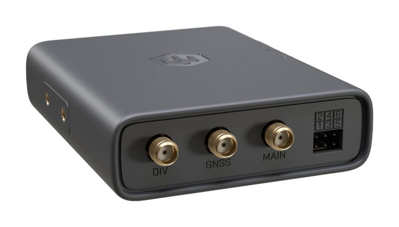

### [KNOT Embedded LTE4 Global](https://mikrotik.com/product/knot_emb_lte4_global) (EG25-G&KNe)

KNOT Embedded LTE4 is now available in a Global (EG25-G) version with expanded LTE band support for North America and other international markets. Industrial LTE/BLE/GNSS connectivity that fits anywhere. Originally designed for coffee and vending machines – perfect for all kinds of industrial automation. See the [KNOT Embedded LTE4 Global EG25-G&KNe product page](https://mikrotik.com/product/knot_emb_lte4_global) for full specifications and brochures.

## Quickstart

- Insert a SIM card into the slot as indicated on the device;
- Connect the device to the included power adapter;
- Connect the device to the computer using Ethernet cable;
- Configure your device using a web browser through **WebFig** or the **WinBox** tool at [https://mt.lv/winbox](https://mt.lv/winbox). **Multiple configuration methods are available to ensure accessibility;**
- Access **WebFig** by opening 192.168.188.1, and for **WinBox**, download the tool, navigate to the **Neighbors** tab, and click on the MAC address. The username is "**admin**" with no password (or, for some models, check user and wireless passwords on the sticker);
- Enter the PIN code, if required by your mobile network operator;
- Click the "Check for updates" button and update RouterOS to the latest version. Must have a valid SIM card inserted and active Internet connection;
- For a manual update of the device, visit mikrotik.com, select your model, and locate the required packages in the "Downloads" section;
- Upload downloaded packages to the WebFig or WinBox "Files" menu and reboot the device;
- By upgrading your RouterOS software to the latest version, you can ensure optimal performance, stability, and security updates;
- Set up your router password.

## Specifications

<table><thead><tr><th>Parameters</th><th>Description</th></tr></thead><tbody><tr><td>**Product Code**</td><td>EG25-G&KNe</td></tr><tr><td>**CPU**</td><td>ARM Cortex‑A7, 1 core, 800 MHz</td></tr><tr><td>**RAM / Storage**</td><td>256 MB RAM / 256 MB NAND</td></tr><tr><td>**OS**</td><td>RouterOS v7, License Level 3</td></tr><tr><td>**Mobile: 2G**</td><td>Class 12. 3 (1800MHz), 8 (900MHz) , 2 (1900MHz), 5 (850MHz</td></tr><tr><td>**Mobile: 3G**</td><td>R8 (42.2 Mbps ↓ / 5.76 Mbps ↑). Bands, 1 (2100MHz), 5 (850MHz), 8 (900MHz), 1 (2100MHz), 5 (850MHz), 8 (900MHz), 2 (1900MHz), 4 (1700MHz), 6 (850 MHz), 19 (800 MHz), 2 (1900MHz), 4 (1700MHz), 6 (850 MHz), 19 (800 MHz</td></tr><tr><td>**Mobile: LTE**</td><td>Category 4 (150 Mbps ↓ / 50 Mbps ↑)</td></tr><tr><td>**MIMO**</td><td>DL 2×2, UL 1×1</td></tr><tr><td>**LTE FDD Bands**</td><td>1 (2100MHz), 3 (1800MHz), 5 (850MHz), 7 (2600MHz), 8 (900 MHz), 20 (800MHz), 2 (1900MHz), 4 (1700MHz), 12 (700MHz), 13 (700 MHz), 18 (800 MHz), 19 (800 MHz), 25 (1900MHz), 26 (850MHz), 28 (700MHz</td></tr><tr><td>**LTE TDD Bands**</td><td>38 (2600MHz), 40 (2300MHz), 41 (2500MHz), 39 (1900MHz)</td></tr><tr><td>**TAC**</td><td>01673800</td></tr><tr><td>**GNSS**</td><td>GPS, GLONASS, BeiDou, Galileo (SMA‑female)</td></tr><tr><td>**Bluetooth**</td><td>5.4 (BLE)</td></tr><tr><td>**Ethernet**</td><td>1 × 1 GbE RJ45 (PoE‑in 802.3af/at, 12‑57 V)</td></tr><tr><td>**SIM**</td><td>Nano‑SIM & eSIM</td></tr><tr><td>**GPIO**</td><td>6‑pin header (24 V‑tolerant, analog & digital I/O)</td></tr><tr><td>**Power**</td><td>PoE‑in (12‑57 V) or USB‑C 5 V / 0.8 A, max 6 W</td></tr><tr><td>**Dimensions**</td><td>90 × 70 × 22 mm</td></tr><tr><td>**Operating Temp.**</td><td>–40 °C … +70 °C</td></tr><tr><td>**MTBF**</td><td>≈ 100 000 h @ 25 °C</td></tr></tbody></table>

## Mounting

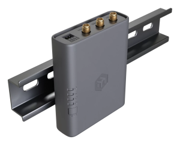

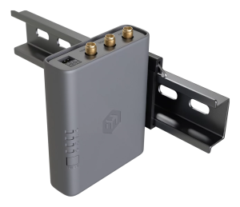

- The device can be mounted using the provided K-91 fastening set either on the back or on the side of the device using the DIN rail mount set. It is designed to fit standard 35 mm × 7.5 mm DIN rails. Attach the mount to the device using the two provided screws, then attach the device to the DIN rail. The DIN rail is not included in the package.
- Alternatively, it is possible to attach the device to a wall, using the provided screw holes on the back of the unit. The device should be mounted in a way that the cable openings are pointing downward as shown in the picture. *Warning! This equipment should be installed and operated with a minimum distance of 20 cm between the device and your body. The operation of this equipment in the residential environment could cause radio interference.* *Mounting and configuration of this device should be done by a qualified person.*

## Powering

- USB-C input Voltage: 5 V, 0.8 A.
- Ethernet port accepts 802.3af/at Power over Ethernet 12-57 V DC. The maximum power consumption can reach up to 6 W.

**Connecting to a PoE Adapter:**

- Connect an Ethernet cable from the device to the **PoE + DATA** port of the PoE adapter.
- Connect an Ethernet cable from your local network (LAN) to the **DATA** port of the PoE adapter.
- Connect the power cord to the adapter, then plug it into a power outlet.

## Antenna Connections

<table><thead><tr><th>**Port**</th><th>**Function**</th><th>**Role in Connectivity**</th><th>**Notes**</th></tr></thead><tbody><tr><td>**MAIN**</td><td>Primary cellular transmit & receive antenna</td><td>Required for all data transmission and reception</td><td>Must be connected for the modem to operate</td></tr><tr><td>**DIV (Diversity)**</td><td>Secondary cellular receive-only antenna</td><td>Improves signal quality and reliability by receiving the signal from a different spatial path</td><td>Optional, but recommended in weak-signal or mobile environments</td></tr><tr><td>**GNSS**</td><td>GNSS (GPS) receive antenna</td><td>Enables satellite positioning (GPS/GNSS) functionality</td><td>Required only if GNSS/location services are used</td></tr></tbody></table>

### How They Work Together

The **MAIN** antenna handles both transmission (TX) and reception (RX) and is mandatory for operation.The **DIV** antenna provides receive diversity, allowing the modem to select the better of two received signals, improving stability and potential throughput.

This configuration forms the device’s 2×2 MIMO implementation for cellular connectivity.

The **GNSS** antenna is independent of cellular operation and is used only for satellite positioning.

### Practical Considerations

- If only one cellular antenna is used, it must be connected to the **MAIN** port.
- Adding a **DIV** antenna is strongly recommended in weak-signal environments.
- For best performance, position MAIN and DIV antennas with some physical separation or different orientation.
- Install the **GNSS** antenna with clear sky visibility for accurate positioning.

### Extension Slots & Ports

<table><thead><tr><th>Port</th><th>Type</th><th>Function</th></tr></thead><tbody><tr><td>1 × 1 GbE RJ45</td><td>PoE‑in / data</td><td>Ethernet + power</td></tr><tr><td>1 × USB‑C</td><td>Power only</td><td>5 V input</td></tr><tr><td>1 × SIM slot</td><td>Nano‑SIM / eSIM</td><td>Cellular</td></tr><tr><td>3 × SMA</td><td>DIV / GNSS / MAIN</td><td>LTE & GNSS antennas</td></tr><tr><td>1 × Bluetooth antenna (internal)</td><td>2.4 GHz, 2 dBi gain</td><td>BLE</td></tr><tr><td>1 × GPIO header</td><td>6‑pin</td><td>Digital I/O, analog input</td></tr><tr><td>1 × microUSB 2.0 (for certain KNOT models)</td><td>Power / peripherals</td><td>–</td></tr></tbody></table>

## Cellular modem configuration

Sub-menu: /interface lteFor band selection, roaming, or advanced options, please refer to the LTE Guide.

## GNSS configuration

More details are available in the guide here.

## Buttons and jumpers

### Reset button

- Hold this button during boot time until the LED light starts flashing, release the button to reset RouterOS configuration (total 5 seconds).
- Keep holding for 5 more seconds, LED turns solid, release now to turn on CAP mode. The device will now look for a CAPsMAN server (total 10 seconds).
- Or keep holding the button for 5 more seconds until LED turns off, then release it to make the RouterBOARD look for Netinstall servers (total 15 seconds). Regardless of the above option used, the system will load the backup RouterBOOT loader if the button is pressed before power is applied to the device. Useful for RouterBOOT debugging and recovery.

## GPIO pinout

GPIO pins are located on the board under the case as shown in the picture:

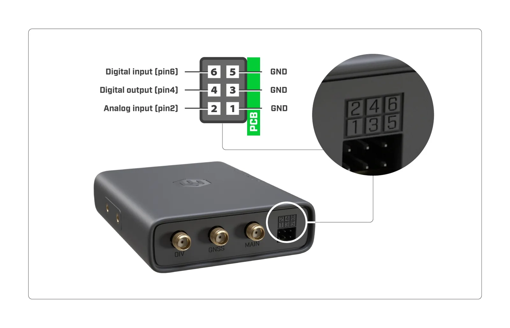

### ADC input/analog input (pin2)

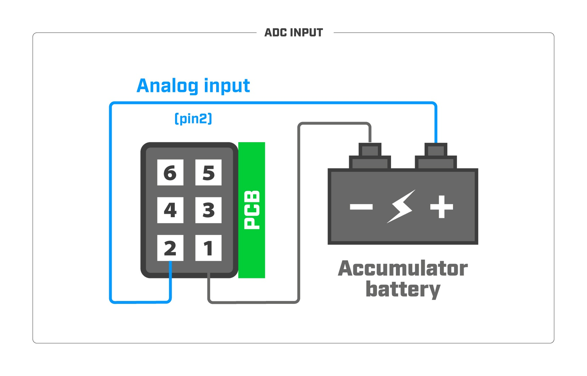

**note:** *Analog input voltage is 0-24 V. Theoretical resolution is 1.5 mV (14bit ADC). Analog input impedance is approximately 72K Ohm.*

#### Connected relays (pin4)

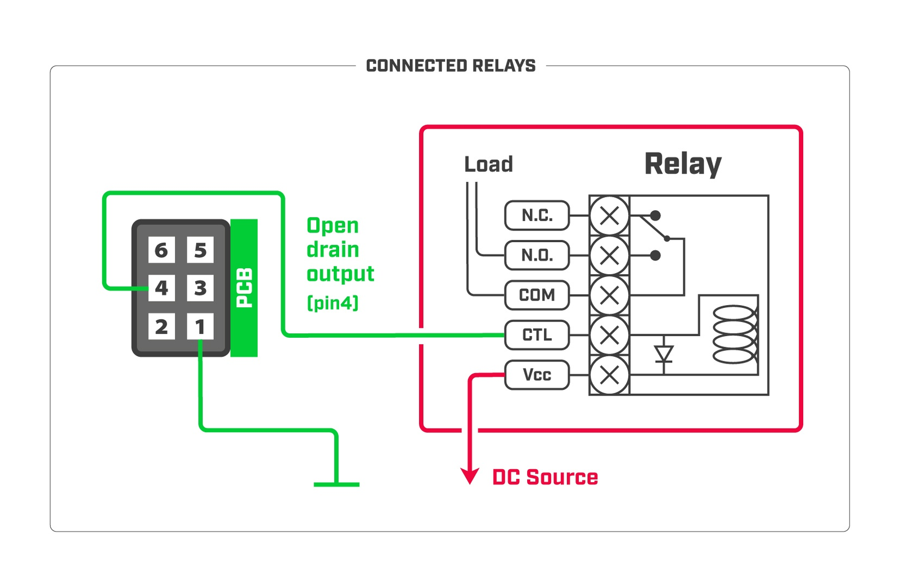

**note:** The maximum power dissipation (for digital output open drain transistor) is 0.48 W.It is recommended not to exceed 24V or 0.5A during continuous operation. Absolute maximum drain-source voltage is 30V , and the maximum amperage is 2.8A .*

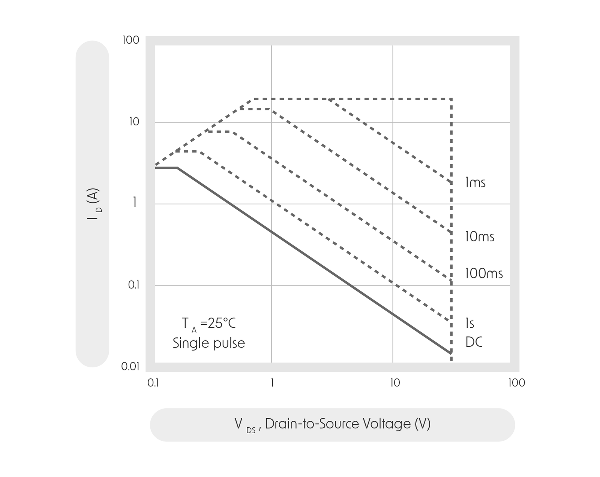

#### Tamper switch (pin6)

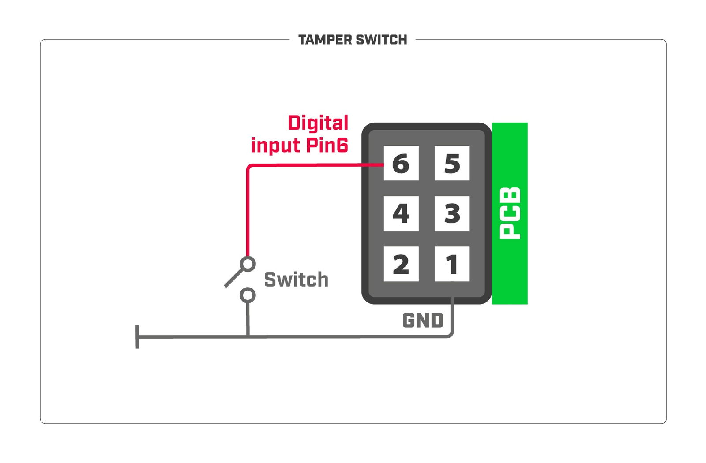

**note:** *Digital input voltage is 0-24 V max.*

Tamper switch: Input is equipped with internal Pull-up resistor. To receive a logical "0" on the pin, the voltage should be between 0-1.2 V;

To receive a logical "1" on the pin, the voltage should be between 1.2-24V.

## Accessories

The package includes the following accessories that come with the device:

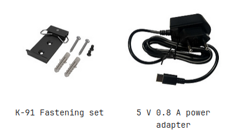

### Antennas can be purchased separately

<table><thead><tr><th>**HGO-LTE-W**</th><th>**ACGPSA**</th></tr></thead><tbody><tr><td>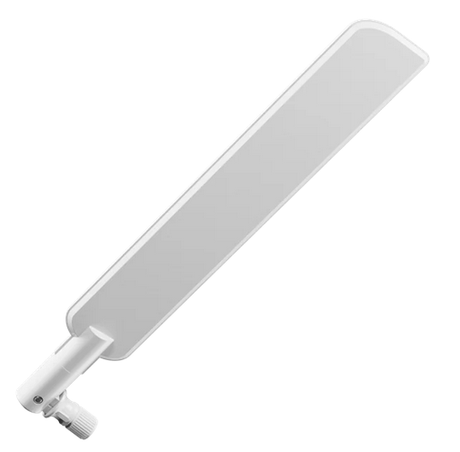</td><td>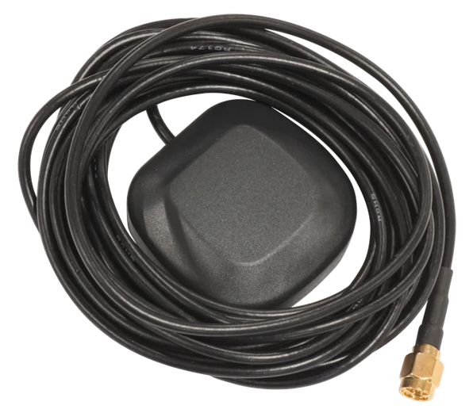</td></tr></tbody></table>

## Operating system support

The device supports RouterOS v7 and above. The specific factory-installed version is listed in /system resource. Other operating systems have not been tested.
