This guide can be downloaded as a [PDF file](https://manual.mikrotik.com/assets/files/knot-lr9-kit.pdf).

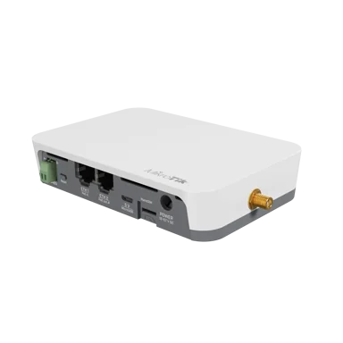

### [KNOT LR9 kit](https://mikrotik.com/product/knot_lr9) (RB924iR-2nD-BT5&BG77&R11e-LR9)

IoT Gateway for the most versatile and cost-effective setups. See the [KNOT LR9 kit product page](https://mikrotik.com/product/knot_lr9) for full specifications and brochures.

## Safety Warnings

- Before you work on any equipment, be aware of the hazards involved with electrical circuitry, and be familiar with standard practices for preventing accidents.
- Ultimate disposal of this product should be handled according to all national laws and regulations.
- The Installation of the equipment must comply with local and national electrical codes.
- This product is intended to be installed on a 35 mm DIN rail or mounted on a wall. Please read the mounting instructions carefully before beginning installation. Failure to use the correct hardware or to follow the correct procedures could result in a hazardous situation for people and damage to the system.
- This product is intended to be installed indoors. Keep this product away from water, fire, humidity, or hot environments.
- Use only the power supply and accessories approved by the manufacturer, and which can be found in the original packaging of this product.
- Read the installation instructions before connecting the system to the power source.
- We cannot guarantee that no accidents or damage will occur due to the improper use of the device. Please use this product with care and operate at your own risk!
- In the case of device failure, please disconnect it from power. The fastest way to do so is by unplugging the power plug from the power outlet.
- It is the customer's responsibility to follow local country regulations, including operation within legal frequency channels, output power, cabling requirements, and Dynamic Frequency Selection (DFS) requirements. All MikroTik radio devices must be professionally installed.

**Exposure to Radio Frequency Radiation:** This MikroTik equipment complies with the FCC, IC, and European Union radiation exposure limits set forth for an uncontrolled environment. This MikroTik device should be installed and operated no closer than 20 centimeters from your body, occupational user, or the general public.

## Quickstart

- Make sure your Internet service provider allows a hardware change and will issue an automatic IP address;
- Connect your ISP cable to the first Ethernet port;
- Connect the device to the power source;
- Open the network‑connections section on your computer and locate the wireless network named "MikroTik-…". Connect to it (check the wireless passwords on the sticker);
- Establish a connection using a mobile application. Alternatively, use WebFig in a web browser or the WinBox configuration tool at [https://mt.lv/winbox](https://mt.lv/winbox). **Multiple configuration methods are available to ensure accessibility;**
- Start configuration with the chosen tool, using the default IP address 192.168.88.1. If the IP address is unavailable, use WinBox and select the Neighbors tab to find the device;
- Connect using the MAC address. The username is “admin” and there is no password (or, for some models, check the user‑ and wireless‑passwords on the sticker);
- Click the Check for updates button and update RouterOS to the latest version.
- For a manual update, visit mikrotik.com, select your model, and download the required packages from the Downloads section;
- Upload the downloaded packages to the WebFig or WinBox Files menu and reboot the device;
- By upgrading RouterOS to the latest version you ensure optimal performance, stability, and security updates;
- In the Quick Set → WISP AP menu, choose your country to apply the appropriate regulatory settings;
- Set up your wireless‑network password;
- Set up your router password.

*U.FL to SMA pigtail and the external Bluetooth antenna are not provided with the package.*

## Specifications

<table><thead><tr><th>Parameters</th><th>Description</th></tr></thead><tbody><tr><td>**Product Code**</td><td>RB924iR-2nD-BT5&BG77&R11e-LR9</td></tr><tr><td>**Architecture**</td><td>MIPSBE</td></tr><tr><td>**CPU**</td><td>QCA9531, 1 core, 650 MHz</td></tr><tr><td>**RAM**</td><td>64 MB</td></tr><tr><td>**Storage**</td><td>128 MB NAND</td></tr><tr><td>**RouterOS License**</td><td>4</td></tr><tr><td>**Operating System**</td><td>RouterOS v7</td></tr><tr><td>**Ethernet**</td><td>2 × 10/100 (Auto MDI/X)</td></tr><tr><td>**PoE-In**</td><td>802.3af/at, 12–57 V DC</td></tr><tr><td>**PoE-Out**</td><td>Ether2, passive PoE up to 57 V</td></tr><tr><td>**Max Power Consumption**</td><td>20 W</td></tr><tr><td>**Wireless 2.4 GHz**</td><td>802.11b/g/n, 2×2, 1.5 dBi</td></tr><tr><td>**Bluetooth**</td><td>5.2</td></tr><tr><td>**USB**</td><td>1 × microUSB (type AB)</td></tr><tr><td>**SIM**</td><td>1 × nano-SIM</td></tr><tr><td>**Serial**</td><td>RS485</td></tr><tr><td>**LoRa Card**</td><td>R11e-LR9, 902–928 MHz (US), 20 dBm, Class A/C</td></tr><tr><td>**Dimensions**</td><td>122 × 87 × 26 mm</td></tr><tr><td>**Operating Temperature**</td><td>−40 °C … +70 °C</td></tr><tr><td>**IP Rating**</td><td>IP20</td></tr><tr><td>**MTBF**</td><td>≈ 100 000 h @ 25 °C</td></tr><tr><td>**Certifications**</td><td>CE, FCC, IC, EAC, RoHS</td></tr></tbody></table>

## Mounting

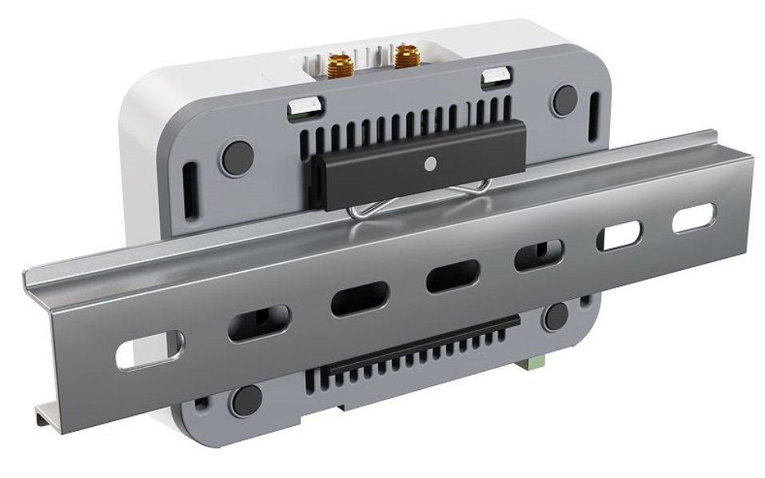

- The device can be mounted using provided DIN rail mount set. Designed to fit standard 35 mm x 7.5 mm DIN rails. Attach it with two provided screws to the device and attach the device to the DIN rail. The DIN rail is not provided in the package.
- Alternatively, it is possible to attach the device to a wall, using the provided screw holes on the back of the unit. The device should be mounted in a way that the cable openings are pointing downward as shown in the picture. **Warning:** This equipment should be installed and operated with a minimum distance of 20 cm between the device and your body. The operation of this equipment in the residential environment could cause radio interference. Mounting and configuration of this device should be done by a qualified person.

## Powering

- Direct-input power jack (5.5 mm outside and 2.1 mm inside, female, pin positive plug) accepts 12-57 V DC.
- microUSB port accepts 5 V powering.
- Ethernet port accepts 802.3af/at Power over Ethernet 12-57 V DC.
- The power consumption under maximum load with attachments can reach 20 W.
- Connecting to a PoE Adapter:

- Connect the Ethernet cable from the device to the PoE+DATA port of the PoE adapter.
- Connect an Ethernet cable from your local network (LAN) to the PoE adapter.
- Connect the power cord to the adapter, and then plug the power cord into a power outlet.

## Extension slots and ports

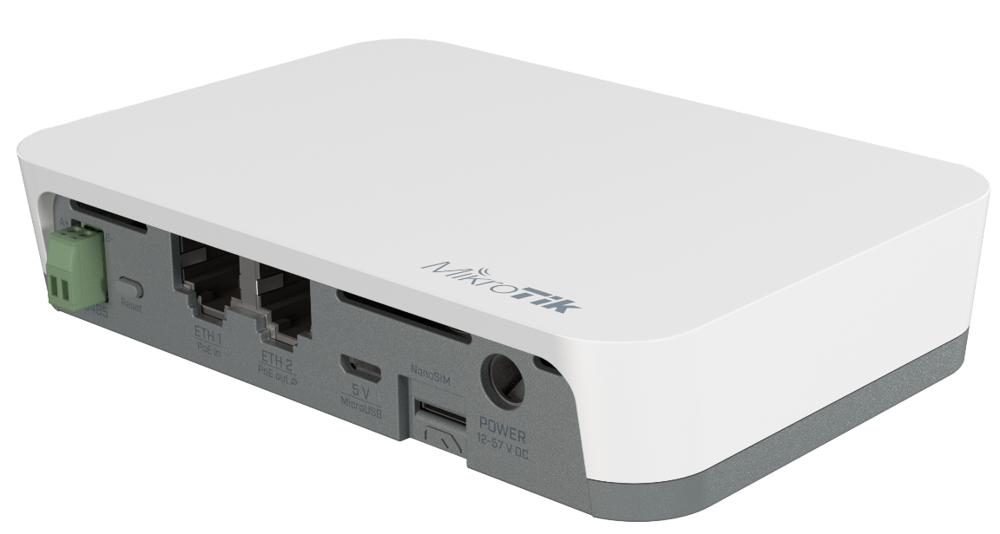

- 2.4 GHz, 802.11b/g/n, antenna gain 1.5 dBi.
- Built-in GPS module (GPS, GLONASS, BeiDou, Galileo) for KNOT, KNOT LR8 and KNOT LR9. KNOT LR8G/9G has a GPS module inside the LR card (which does not support GLONASS, BeiDou, Galileo).
- Two 10/100 Ethernet ports, supporting automatic cross/straight cable correction (Auto MDI/X). Either straight or crossover cable can be used for connecting to other network devices. The Ethernet port accepts 12-57 V DC power from an 802.3af/at PoE injector.
- One microUSB 2.0 port for powering (for KNOT LR8/LR8G and KNOT LR9/LR9G kits only the port can be also used for peripherals).
- One nano SIM slot.
- Bluetooth version 5.2, antenna gain 2 dBi.

**KNOT LR9 kit:**

- LR9 card.

## Modbus

KNOT's Modbus configuration guide.

## Bluetooth antenna

By default, the KNOT has a built-in internal antenna that can be used but it is also possible to connect an external antenna instead to increase Bluetooth operation range. This is relevant for the KNOT RB924i-2nD-BT5&BG77 devices.

For the KNOT LR8 kit, KNOT LR8G kit, KNOT LR9 kit and KNOT LR9G kit, Bluetooth external antenna pigtail placeholder is **not available** (there is already an SMA slot in place that is used by the LoRa).

To use an external antenna, you will need a U.FL (female) to SMA connector (pigtail) and a Bluetooth antenna (that can be attached to the SMA).

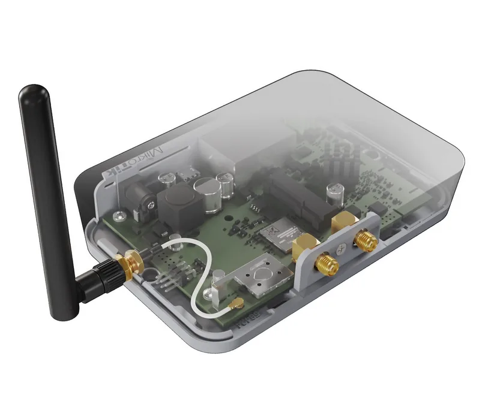

- Unscrew the screw between two SMA slots for CAT-M/NB and GNSS and remove the case.
- Connect U.FL (female) pigtail to the BT slot on the board (as shown in the picture above).
- Drill the hole in the board's case in the specific spot (circular outline from the inside of the case) as per the picture, and attach SMA to the case (where the hole was drilled).
- Connect Bluetooth antenna to the SMA slot. You will need to change the antenna that you wish to use (newly connected "external" or the build-in "internal") in the RouterOS settings (under IoT→ Bluetooth→Devices→double-click on the Bluetooth interface→ in the Antenna field):

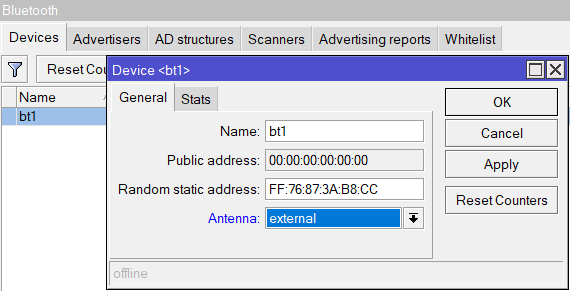

U.FL to SMA pigtail and the external Bluetooth antenna are not provided with the package.

## GPS and NB/CAT-M

Attach your antennas to the SMA connectors:

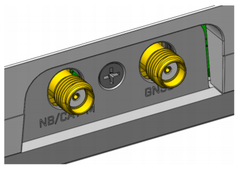

BG77 supports NB and GNSS. For the KNOT, KNOT LR8 and KNOT LR9 kit, both (NB+GNSS) cannot be used together simultaneously.

An example of the configuration to automate the switch between the cellular and GNSS priority is shown below under the **Cellular and GNSS priority switch automation** section. Please also check the [WWAN and GNSS priority automatization](/docs/mobile-networking/bg77-modem-at-commands/wwan-and-gnss-priority-automatization) guide.

External antennas must be connected to use the Narrow Band modem and GPS. Not provided with the package.

A port named "modem" is used for cellular connection (serial/PPP connection) and GNSS NMEA data:

```
/port print
Flags: I - INACTIVE
Columns: DEVICE, NAME, CHANNELS, USED-BY, BAUD-RATE
#   DEVICE  NAME    CHANNELS  USED-BY  BAUD-RATE
0           modbus         1                9600
1   1-1.4   modem          5              115200

```

Default modem port channel assignment:

1 - GNSS NMEA output port;

2 - AT/modem port;

4 - AUX AT/modem port - max bandwidth 115200bps, available only for KNOT LoRa kits and KNOT with an internal USB hub.

### Cellular modem configuration

Unlike LTE devices, the KNOT BG77 by default does not provide a direct IP modem interface (LTE interface), but provides AT/modem serial port which is used for serial/PPP connection.

BG77 modem AT commands can be found in the [BG77 AT Commands Manual](https://mikrotik.com/product/knot#tab0).

KNOT by default has a serial/PPP connection preset:

```
/interface ppp-client print
Flags: X - disabled; R - running
 0 R  name="ppp-out1" max-mtu=1500 max-mru=1500 mrru=disabled port=modem data-channel=2 info-channel=4 apn="internet"
      pin="" user="" password="" profile=default phone="" dial-command="ATDT" modem-init="AT+QGPSCFG="priority",1"
      null-modem=no dial-on-demand=yes add-default-route=yes default-route-distance=1 use-peer-dns=yes keepalive-timeout=30
      allow=pap,chap,mschap1,mschap2

```

For more details on modem port configuration please see the KNOT port configuration/map above.

For more details on serial/PPP connection please check the [PPP Client](/docs/mobile-networking/ppp) documentation.

### GNSS configuration

You can find more information by checking the GNSS configuration guide.

BG77 modem shares the same receiver for IoT cellular connectivity and GNSS signal reception. The preferred service can be prioritized by using the **modem-init** string (configured under /interface ppp-client) and GNSS service **init-string** (configured under /system gps).

AT commands are:

AT+QGPSCFG="priority",0 → to prioritize GNSS; AT+QGPSCFG="priority",1 → to prioritize cellular IoT connectivity;

AT+QGPSEND → to stop GNSS reception; AT+QGPS=1 → to start GNSS reception.

Additionally, you can configure Supported GNSS Constellations with the help of the AT command:

AT+QGPSCFG="gnssconfig"[,&lt;GNSS_config&gt;]

,which takes effect only after the module is rebooted and where &lt;GNSS_config&gt; represents the Constellations themselves (can be "1" to "5"):

- 1 → GPS + GLONASS
- 2 → GPS + BeiDou
- 3 → GPS + Galileo
- 4 → GPS + QZSS
- 5 → Variable - one of the options (1–4) is selected based on MCC of the camped network

### Cellular modem firmware upgrade

Please note that:

- DFOTA firmware check/upgrade can be done using any internet connection (including wi-fi and ethernet uplinks). As a result, the modem firmware can be upgraded for devices where BG77 does not have cellular connectivity, eg when its used as a GPS receiver only.
- Firmware upgrade is supported when BG77 modem serial/PPP interface is using the main AT/modem channel (data-channel=2). To check currently installed BG77 firmware version, specify "upgrade=no" parameter using the command:

```
/interface/ppp-client/firmware-upgrade ppp-out1 upgrade=no
  installed: BG77LAR02A04_01.001.01.001
     latest: BG77LAR02A04_01.009.01.009

```

To update BG77 modem firmware, set the parameter "upgrade=yes":

```
/interface/ppp-client/firmware-upgrade ppp-out1 upgrade=yes

```

### Cellular and GNSS priority switch automation

Automation can be achieved using ppp profile **on-down** script, **idle-timeout** features and PPP interface **dial on demand** setting.

When implemented, BG77 modem will use cellular data when there is internet traffic present (during this time GNSS coordinates are not received), and will automatically enable GPS reception when there is no internet traffic detected.

**Idle-timeout** parameter specifies the amount of time after which the link will be terminated if there is no activity present.

**On-down** script field allows you to configure a script that will be run every time the PPP interface goes down (including after **idle-timeout** inactivity). The script will set modem's priority to GNSS reception.

**Dial-on-demand** will make sure that PPP interface tries to establish the connection only when there is outgoing traffic present (additionally, the modem will automatically set WWAN/cellular connection priority). This will make sure that after **idle-timeout** occurs, the connection is not automatically reestablished unless outgoing packets are detected.

By combining the three features, you can achieve the scenario, where:

- If you have outgoing traffic, PPP interface is going to be up (because of the **dial on demand**) and the priority will be set to the cellular connection. PPP interface's modem initialization AT command (that is configured under PPP interface's modem-init="AT+QGPSCFG=\"priority\",1" setting) for WWAN priority is sent. During this time, GPS coordinates will not be received.
- If no traffic is detected after **idle-timeout** inactivity window, the PPP interface will go down and, because of the **dial on demand** setting, it will not establish the connection until outgoing packets are detected. This is where **on-down** script is run that switches WWAN priority to GNSS priority. In order to implement it, simply add a new PPP profile:

```
/ppp profile add idle-timeout=30s name=BG77 on-down="/interface ppp-client at-chat [find where modem-init=\"AT+QGPSCFG=\\\"priority\\\",1\"] input=\"AT+QGPSCFG=\\\"priority\\\",0\""

```

The example above, creates a new profile with the name "BG77", sets **idle-timeout** to 30 seconds, and enables the **on-down** script that will send GNSS priority AT command.

After that, make sure to apply this newly created profile onto the PPP interface:

```
/interface ppp-client set [find] profile=BG77

```

And confirm that it was applied (profile=BG77):

```
/interface ppp-client print
Flags: X - disabled; R - running
0 R name="ppp-out1" max-mtu=1500 max-mru=1500 mrru=disabled port=modem data-channel=2 info-channel=2
apn="internet" pin="" user="" password="" profile=BG77 phone="" dial-command="ATDT"
modem-init="AT+QGPSCFG="priority",1" null-modem=no dial-on-demand=yes add-default-route=yes
default-route-distance=1 use-peer-dns=yes keepalive-timeout=30 allow=pap,chap,mschap1,mschap2

```

## Buttons and jumpers

The reset button has three functions:

- Hold this button during boot time until the green LED light starts flashing, release the button to reset RouterOS configuration.
- Keep holding the reset button until the LED turns solid, then release it to enable CAP mode. The device will then start searching for a CAPsMAN server.
- To reinstall RouterOS using the [Netinstall](/docs/getting-started/installation-and-upgrade/netinstall) utility, enter the device into BOOTP mode. Two booter options are available: the **Regular Booter** and the **Backup Booter**. It is recommended to verify both options in case one does not work.

- **Regular Booter:** To enter etherboot mode, press the **Reset** button after powering on the device and waiting 1–2 seconds.
- **Backup Booter:** Power off the device. Press and hold the **Reset** button, then power on the device. Wait for the **LED** sequence (blinking → steady → off), then release the button. The device will boot into **BOOTP** mode, ready for RouterOS reinstallation via Netinstall. Depending on the model, this may be indicated by the **USR, USER, System**, or **ACT** LED, or by the SFP port LED.

Regardless of the above option used, the system will load the backup RouterBOOT loader if the button is pressed before power is applied to the device. Useful for RouterBOOT debugging and recovery.

## GPIO pinout

GPIO pins are located on the board under the case as shown in the picture:

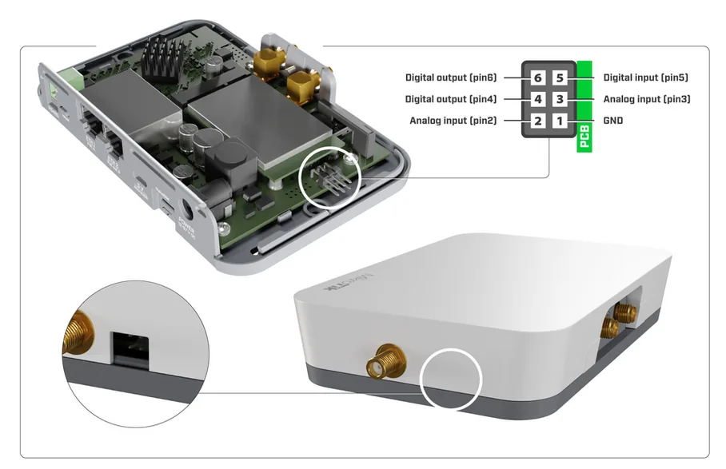

ADC input/analog input (pin2 or pin3):

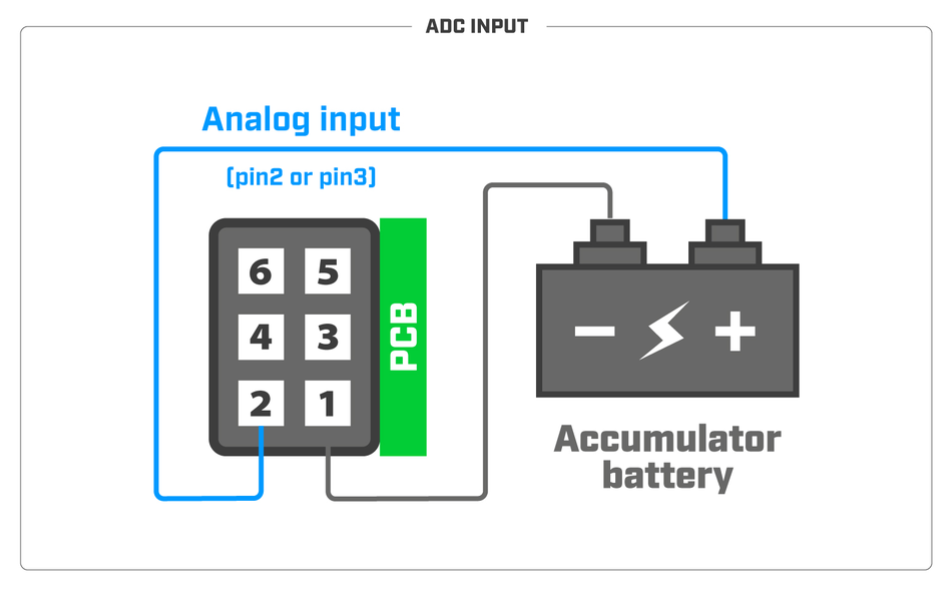

**Note:** *Analog input voltage is 0-60 V. Theoretical resolution is 4 mV (14bit ADC). Analog input impedance is approximately 72K Ohm.*

Connected relays (pin4 or pin6):

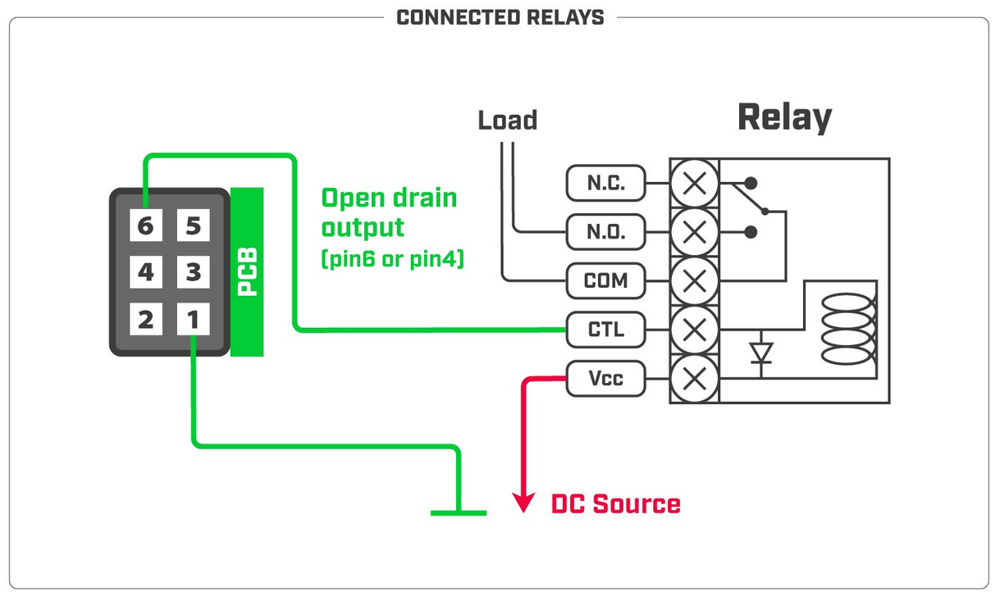

*note: The maximum power dissipation (for digital output open drain transistor) is 0.48 W.It is recommended not to exceed 24V or 0.5A during continuous operation. Absolute maximum drain-source voltage is 30V , and the maximum amperage is 2.8A .*

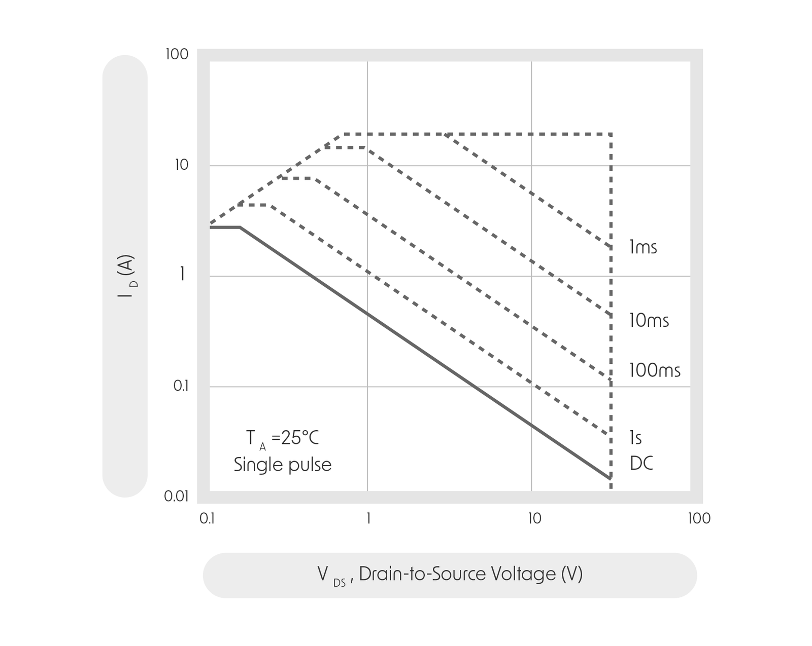

*GPIO output has an open drain configuration. **Logical state "0"** (open transistor state) sets the output transistor in a low resistance state and the output is ~0V. **Logical state "1"** (closed transistor state) sets the output transistor in a high resistance state and the output voltage depends on the external circuit.*

Tamper switch (pin5):

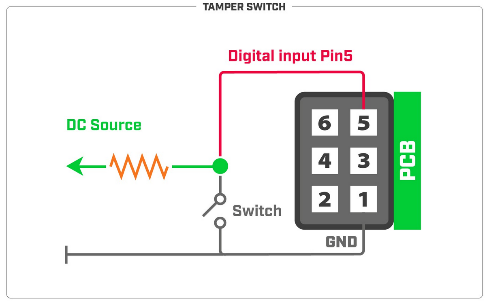

**Note:** *Digital input voltage is 0-2.5 V max.*

*Without PCB pull-up resistor:*

-

*to receive a logical "0" on the pin, the voltage should be between 0-1.47 V;*

-

*to receive a logical "1" on the pin, the voltage should be between 1.48-2.5 V.* *With PCB pull-up resistor:*

-

*to receive a logical "0" on the pin, the voltage should be between 0-1.34 V;*

-

*to receive a logical "1" on the pin, the voltage should be between 1.35-2.5 V.* *Newer routerboards will have a pull-up resistor on the PCB (on the board) - 10k ohm. Older boards (the first released batch) may need an external pull-up resistor.*

## Accessories

The package includes the following accessories that come with the device:

- ADAPT1_ EU/US Switching Power Supply 24V, 1.2A, 28.8W, 86.8%, VI.
- CAB1_ USB A Female to Micro B cable.
- SET1_ K-47 wall mount set, two screws, and dowels.
- SET2_ K-74 Din rail mount set.
- Modbus connector, A+, B-.

HGO-LTE-W antenna can be purchased separately.

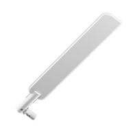

## Operating system support

The device supports RouterOS v7 and above. The specific factory-installed version is listed in /system resource. Other operating systems have not been tested.

## Configuration

RouterOS includes many configuration options in addition to what is described in this document. We suggest starting here to get yourself accustomed to the possibilities: [https://mt.lv/help](https://mt.lv/help). In case an IP connection is not available, the WinBox tool ([https://mt.lv/winbox](https://mt.lv/winbox)) can be used to connect to the MAC address of the device from the LAN side (all access is blocked from the internet port by default). For recovery purposes, it is possible to boot the device from the network, see [Netinstall](/docs/getting-started/installation-and-upgrade/netinstall) documentation.

**Note:** Make sure that the **iot** package is installed beforehand.

If you have LR8 or LR9 KNOT variant, and you are interested in using LoRa protocol, click on our LoRa guide.

To check other IoT features, visit IoT page.

## Overview

Protocols such as MQTT and HTTP are widely used to push data within M2M networks. M2M topologies can use different technologies, such as Wi-Fi or Bluetooth to send data within networks.

KNOT is a new addition to one of our IoT solutions. KNOT acts as an IoT gateway (that uses Narrow Band and CAT-M technology) and uses Bluetooth to scan broadcasted information. With the Bluetooth interface, you can use the KNOT for asset tracking and telemetry based on Bluetooth advertisement packets. KNOT supports any BLE tag that sends advertisement data. iBeacon, Eddystone, or any other format. It has powerful filters for forwarding only relevant packets and ignoring others. After the gateway processes the data that it receives, it can use an ISP connection to publish the data further to any subscriber or server that is configured accordingly.

All you need to do is to configure a script. The script can filter broadcasted information and push it to the internet.

This article explains how to configure KNOT to publish data using MQTT or http protocols.

External antennas must be connected to use the Narrow Band modem and GPS. Not provided with the package.

## Reports

Navigate to IoT &gt; Bluetooth.

You can find all broadcasting devices in the Advertising reports tab.

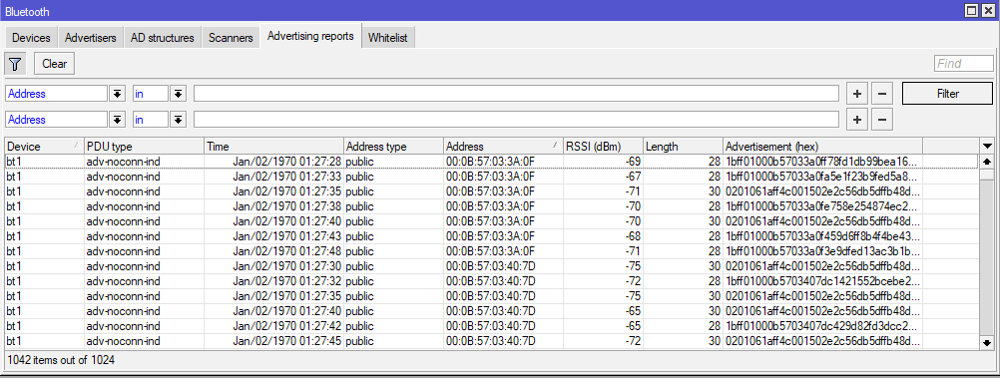

In this menu, you can set up a filter by pressing the Filter icon. For example, knowing the MAC address of the device, you can set up a filter to only show specific reports.

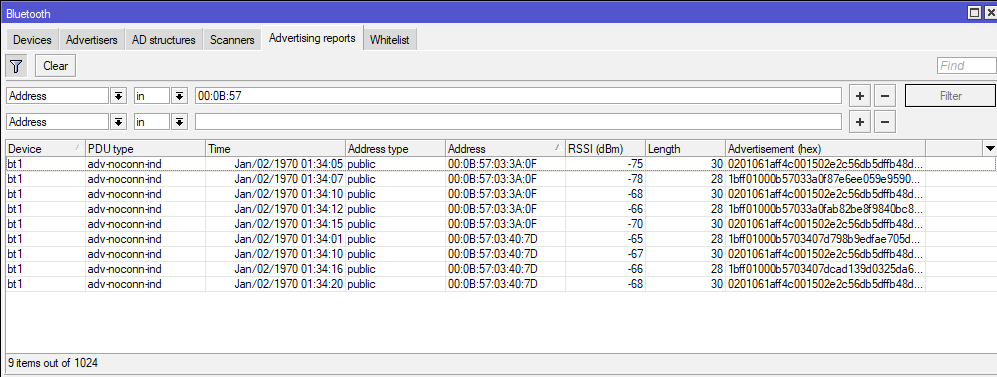

You can add more filter options using + icon.

You can remove filter options using - icon.

## MQTT Broker configuration

Navigate to IoT &gt; MQTT.

You can add a new broker via + button.

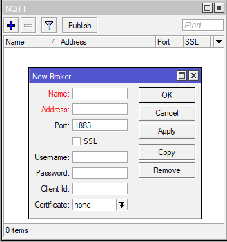

<table><thead><tr><th>Properties</th><th>Description</th></tr></thead><tbody><tr><td>Name</td><td>Identification. Brokers name.</td></tr><tr><td>Address</td><td>IP address or FQDN name of the MQTT broker without ssl:// or tcp:// prefix.</td></tr><tr><td>Port</td><td>Network port of the broker. Usually, 1883 or 8883 (for SSL).</td></tr><tr><td>SSL</td><td>Enable/Disable Secure Socket Layer. If the server uses a self-signed certificate or certificate signed by a non-trusted CA, you have to upload the server's certificates &lt;crt&gt; file to RouterOS. Upload .cer file to the Files menu and import the file to certificates in the System&gt;Certificates tab.</td></tr><tr><td>Username</td><td>Username for MQTT broker.</td></tr><tr><td>Password</td><td>Password for MQTT broker.</td></tr><tr><td>Client Id</td><td>A unique ID used for the connection. The broker uses this ID to identify the client.</td></tr><tr><td>Certificate</td><td>Chose a certificate if required for the two-way authentication.</td></tr></tbody></table>

**Note:** You do not have to specify servers certificate (.cer file) in the MQTT broker settings. The Certificate field is used for the client's certificate.

**Note:** Name, Address, and Port field configuration is required. Other parameters can be optional or required - depends on how the server/broker is set up.

## Publish

After you create a broker, click the Publish button. This box allows you to choose a broker and specify message information.

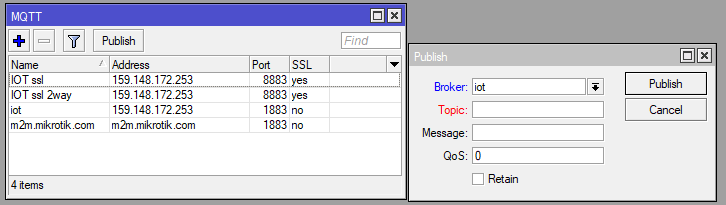

Select an already configured broker in the Broker field (scroll-down menu).

You can then specify the Topic (a string used by a broker to filter messages), Message (the message itself), QoS (indicates Quality of Service level for the message), and Retain (whether to retain the message or discard it) parameters.

**Note:** Broker and Topic field configuration is required. Message, QoS, and Retain can be optional or required - depends on how the server/broker is set up.

## MQTT with script scenario

MQTT broker can be configured with scripts.

Create a new script, use the template as a reference, change the parameters accordingly and run the script.

Every line that begins with a symbol "**#**" is instructional and it describes the parameter that is going to be configured below the line. Change the parameters within quotation marks "" that would apply to your specific case.

Script example:

```
## Required packages: iot

################################ Configuration ################################
## Name of an existing MQTT broker that should be used for publishing
:local broker "Demo Device"

## MQTT topic where the message should be published
:local topic "v1/devices/me/telemetry"

## Interface whose MAC should be used as 'Locator ID'
:local locatorIface "ether1"

## POSIX regex for filtering advertisement Bluetooth addresses. E.g. "^BC:33:AC"
## would only include addresses which start with those 3 octets.
## To disable this filter, set it to ""
:local addressRegex ""

## POSIX regex for filtering Bluetooth advertisements based on their data. Same
## usage as with 'addressRegex'.
:local advertisingDataRegex ""

## Signal strength filter. E.g. -40 would only include Bluetooth advertisements
## whose signal strength is stronger than -40dBm.
## To disable this filter, set it to ""
:local rssiThreshold ""

#################################### System ###################################
:put ("[*] Gathering system info...")
:local ifaceMac [/interface get [/interface find name=$locatorIface] mac-address]
:local cpuLoad [/system resource get cpu-load]
:local freeMemory [/system resource get free-memory]
:local usedMemory ([/system resource get total-memory] - $freeMemory)
:local rosVersion [/system package get value-name=version \
    [/system package find where name ~ "^routeros"]]
:local model [/system routerboard get value-name=model]
:local serialNumber [/system routerboard get value-name=serial-number]
## Health is a bit iffy since '/system health' does not have 'find' in ROS6
:local health [/system health print as-value]
:local supplyVoltage 0
:local boardTemp 0
:foreach entry in=$health do={
    :if ($entry->"name" = "voltage") do={:set $supplyVoltage ($entry->"value")}
    :if ($entry->"name" = "board-temperature1") do={:set $boardTemp ($entry->"value")}
}

################################## Bluetooth ##################################
:put ("[*] Gathering Bluetooth info...")
:global btOldestAdvertisementTimestamp
:if ([:typeof $btOldestAdvertisementTimestamp] = "nothing") do={
    # First time this script has been run since booting, need to initialize
    # persistent variables
    :set $btOldestAdvertisementTimestamp 0
}
:local btProcessingStart [/system clock get time]
:local advertisements [/iot bluetooth scanners advertisements print detail \
    as-value where \
        epoch > $btOldestAdvertisementTimestamp and \
        address ~ $addressRegex and \
        data ~ $advertisingDataRegex and \
        rssi > $rssiThreshold]
:local advJson ""
:local advCount 0
:local advSeparator ""
:local lastAdvTimestamp 0
## Remove semicolons from MAC/Bluetooth addresses
:local minimizeMac do={
    :local minimized
    :local lastIdx ([:len $address] - 1)
    :for idx from=0 to=$lastIdx step=1 do={
        :local char [:pick $address $idx]
        :if ($char != ":") do={
            :set $minimized "$minimized$char"
        }
    }
    :return $minimized
}

:foreach adv in=$advertisements do={
    :local address ($adv->"address")
    :local ts ($adv->"epoch")
    :local rssi ($adv->"rssi")
    :local ad ($adv->"data")
    :local obj "\
        {\
            \"id\":\"$[$minimizeMac address=$address]\",\
            \"ts\":$ts,\
            \"rssi\":$rssi,\
            \"ed\":{\
                \"ad\":\"$ad\"\
            }\
        }"
    :set $advCount ($advCount + 1)
    :set $lastAdvTimestamp $ts
    # Ensure that the last object is not terminated by a comma
    :set $advJson "$advJson$advSeparator$obj"
    :if ($advSeparator = "") do={
        :set $advSeparator ","
    }
}

:if ($advCount > 0) do={

    :set $btOldestAdvertisementTimestamp $lastAdvTimestamp

}

:put ("[*] Found $advCount new advertisements \
    (processing time: $[([/system clock get time] - $btProcessingStart)])")

#################################### MQTT #####################################
:local message \
    "{\
        \"clientId\":\"$[/iot mqtt brokers get value-name=client-id \
            [/iot mqtt brokers find name=$broker]]\",\
        \"t\":0,\
        \"v\":1,\
        \"OldestAdvertisementTimestamp\":$btOldestAdvertisementTimestamp,\
        \"locs\":[{\
            \"id\":\"$[$minimizeMac address=$ifaceMac]\",\
            \"tags\":[$advJson],\
            \"ed\":{\
                \"model\":\"$model\",\
                \"sn\":\"$serialNumber\",\
                \"ros\":\"$rosVersion\",\
                \"cpu\":$cpuLoad,\
                \"umem\":$usedMemory,\
                \"fmem\":$freeMemory,\
                \"psu\":$supplyVoltage,\
                \"temp\":$boardTemp\
            }\
        }]\
    }"
:log info "$message";
:put ("[*] Total message size: $[:len $message] bytes")
:put ("[*] Sending message to MQTT broker...")
/iot mqtt publish broker=$broker topic=$topic message=$message
:put ("[*] Done")

```

To run this script, the Broker should be pre-configured:

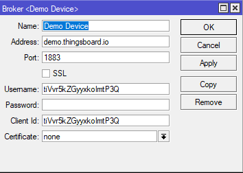

For example, thingsboard only requires settings that are shown in the screenshot above. When you successfully configure the broker, the only thing that needs to be changed in the script is:

```
:local broker "Demo Device"

```

line, where you should specify the broker's name within the quotation marks "".

Another line that should be taken into account is:

```
:local topic "v1/devices/me/telemetry"

```

, where you should specify the topic.

The rest of the script configuration depends on the overall requirements. The script explains which exact parameters are configured to be published.

Navigate to System &gt; Scripts and add a new script there (name it, for example, script1).

To run the script, you can use the command line:

/system script run script1

## HTTP fetch with script scenario

Another way to publish data is to use HTTP (instead of MQTT). This can be achieved using fetch tool.

The same principles apply:

Create a new script, use the template as a reference, change the parameters accordingly and run the script.

Every line that begins with a symbol "**#**" is instructional and it describes the parameter that is going to be configured below the line. Change the parameters within quotation marks "" that would apply to your specific case.

Script example:

```
## Required packages: iot

################################ Configuration ################################
## Interface whose MAC should be used as 'Locator ID'
:local locatorIface "ether1"

## POSIX regex for filtering advertisement Bluetooth addresses. E.g. "^BC:33:AC"
## would only include addresses which start with those 3 octets.
## To disable this filter, set it to ""
:local addressRegex ""

## POSIX regex for filtering Bluetooth advertisements based on their data. Same
## usage as with 'addressRegex'.
:local advertisingDataRegex ""

## Signal strength filter. E.g. -40 would only include Bluetooth advertisements
## whose signal strength is stronger than -40dBm.
## To disable this filter, set it to ""
:local rssiThreshold ""

#################################### System ###################################
:put ("[*] Gathering system info...")
:local ifaceMac [/interface get [/interface find name=$locatorIface] mac-address]
:local cpuLoad [/system resource get cpu-load]
:local freeMemory [/system resource get free-memory]
:local usedMemory ([/system resource get total-memory] - $freeMemory)
:local rosVersion [/system package get value-name=version \
    [/system package find where name ~ "^routeros"]]
:local model [/system routerboard get value-name=model]
:local serialNumber [/system routerboard get value-name=serial-number]
## Health is a bit iffy since '/system health' does not have 'find' in ROS6
:local health [/system health print as-value]
:local supplyVoltage 0
:local boardTemp 0
:foreach entry in=$health do={
    :if ($entry->"name" = "voltage") do={:set $supplyVoltage ($entry->"value")}
    :if ($entry->"name" = "board-temperature1") do={:set $boardTemp ($entry->"value")}
}

################################## Bluetooth ##################################
:put ("[*] Gathering Bluetooth info...")
:global btOldestAdvertisementTimestamp
:if ([:typeof $btOldestAdvertisementTimestamp] = "nothing") do={
    # First time this script has been run since booting, need to initialize
    # persistent variables
    :set $btOldestAdvertisementTimestamp 0
}
:local btProcessingStart [/system clock get time]
:local advertisements [/iot bluetooth scanners advertisements print detail \
    as-value where \
        epoch > $btOldestAdvertisementTimestamp and \
        address ~ $addressRegex and \
        data ~ $advertisingDataRegex and \
        rssi > $rssiThreshold]
:local advJson ""
:local advCount 0
:local advSeparator ""
:local lastAdvTimestamp 0
## Remove semicolons from MAC/Bluetooth addresses
:local minimizeMac do={
    :local minimized
    :local lastIdx ([:len $address] - 1)
    :for idx from=0 to=$lastIdx step=1 do={
        :local char [:pick $address $idx]
        :if ($char != ":") do={
            :set $minimized "$minimized$char"
        }
    }
    :return $minimized
}

:foreach adv in=$advertisements do={
    :local address ($adv->"address")
    :local ts ($adv->"epoch")
    :local rssi ($adv->"rssi")
    :local ad ($adv->"data")
    :local obj "\
        {\
            \"id\":\"$[$minimizeMac address=$address]\",\
            \"ts\":$ts,\
            \"rssi\":$rssi,\
            \"ed\":{\
                \"ad\":\"$ad\"\
            }\
        }"
    :set $advCount ($advCount + 1)
    :set $lastAdvTimestamp $ts
    # Ensure that the last object is not terminated by a comma
    :set $advJson "$advJson$advSeparator$obj"
    :if ($advSeparator = "") do={
        :set $advSeparator ","
    }
}

:if ($advCount > 0) do={

    :set $btOldestAdvertisementTimestamp $lastAdvTimestamp

}

:put ("[*] Found $advCount new advertisements \
    (processing time: $[([/system clock get time] - $btProcessingStart)])")

#################################### MQTT #####################################
:local message \
    "{\
        \"t\":0,\
        \"v\":1,\
        \"OldestAdvertisementTimestamp\":$btOldestAdvertisementTimestamp,\
        \"locs\":[{\
            \"id\":\"$[$minimizeMac address=$ifaceMac]\",\
            \"tags\":[$advJson],\
            \"ed\":{\
                \"model\":\"$model\",\
                \"sn\":\"$serialNumber\",\
                \"ros\":\"$rosVersion\",\
                \"cpu\":$cpuLoad,\
                \"umem\":$usedMemory,\
                \"fmem\":$freeMemory,\
                \"psu\":$supplyVoltage,\
                \"temp\":$boardTemp\
            }\
        }]\
    }"
:log info "$message";
:put ("[*] Total message size: $[:len $message] bytes")
/tool fetch http-method=post http-header-field="Content-Type:application/json" http-data=$message url="https://demo.thingsboard.io/api/v1/Q99YlBqv59NdzOel6tyP/telemetry"
:put ("[*] Done")

```

Change the URL accordingly (depends on the server configuration).

```
/tool fetch http-method=post http-header-field="Content-Type:application/json" http-data=$message url="https://demo.thingsboard.io/api/v1/Q99YlBqv59NdzOel6tyP/telemetry"

```

Navigate to System &gt; Scripts and add a new script there (name it, for example, script1).

To run the script, you can use the command line:

/system script run script1

## MikroTik mobile app

Use the MikroTik smartphone app to configure your router in the field, or to apply the most basic initial settings for your MikroTik home access point.


- Scan QR code and choose your preferred OS.
- Install and open the application.
- By default, the IP address and user name will be already entered.
- Click Connect to establish a connection to your device through a wireless network.
- Choose Quick setup and the application will guide you through all basic configuration settings in a couple of easy steps.
- An advanced menu is available to fully configure all necessary settings.

To avoid pollution of the environment, please separate the device from household waste and dispose of it in a safe manner, such as in designated waste disposal sites. Familiarize yourself with the procedures for the proper transportation of the equipment to the designated disposal sites in your area.

**Bluetooth Qualified Product**


This product has successfully completed Bluetooth Qualification Process. For more information on Bluetooth Qualified products please use the following link: [https://launchstudio.bluetooth.com/Listings/Search](https://launchstudio.bluetooth.com/Listings/Search)
