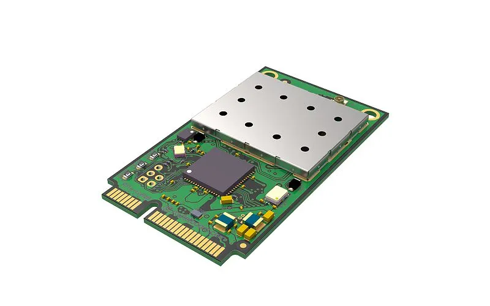
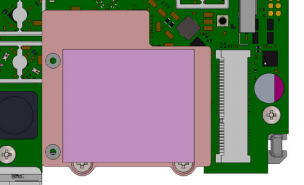
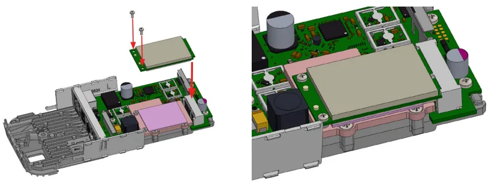
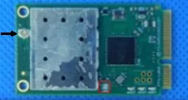

This guide can be downloaded as a [PDF file](https://manual.mikrotik.com/assets/files/r11e-lr8.pdf).

R11e-LR8 - LR mPCIe Gateway module. It can be integrated into a RouterBOARD product with mPCIe slot. Requires LR package installation to configure in RouterOS.

## Safety Warnings

- Before you work on any equipment, be aware of the hazards involved with electrical circuitry, and be familiar with standard practices for preventing accidents.
- Ultimate disposal of this product should be handled according to all national laws and regulations.
- The Installation of the equipment must comply with local and national electrical codes.
- Read the installation instructions before connecting the system to the power source.
- We cannot guarantee that no accidents or damage will occur due to the improper use of the device. Please use this product with care and operate at your own risk!
- It is the customer's responsibility to follow local country regulations, including operation within legal frequency channels, output power, cabling requirements, and Dynamic Frequency Selection (DFS) requirements. All MikroTik radio devices must be professionally installed.

**Exposure to Radio Frequency Radiation:** This MikroTik equipment complies with the European Union radiation exposure limits set forth for an uncontrolled environment. This MikroTik device should be installed and operated no closer than 20 centimeters from your body, occupational user, or the general public.

## Specifications

Low power-consuming with mini PCIe interface, for long-distance data, transmit:

- Interface – Mini-PCIe;
- Temperature Operating -40 / +70;
- Supports Class A and C;
- Frequency - 863-870MHz (EU);
- RF Output power - 862-870MHz (EU) @ 14dBm;
- *Receive max sensitivity - 137 dB @ SF12, Depends on the antenna used;*
- *Maximum power consumption 2 W.*

## Installing the module in your device

R11e-LR8 for professional use. Each of the cards comes in ESD protective packaging. When handling electrical equipment please observe the following safety precautions:

-

Use a wrist grounding strap when unpacking and working with electrical components to avoid electrical discharge (ESD) damage;

-

After unpacking please place the card on the anti-static mat;

-

When installing make sure there are no objects that can damage or touch the PCB plate;

-

The card can be installed in your desired device using the factory provided screw holes in a PCB plate; *Pictures added for illustration purposes, the device configuration, and the placement of the miniPCIe card may vary.*

-

Locate miniPCIe slot on your device;

-

Unscrew two factory attached screws;

- Optionally you can use the thermal pad by placing it under the card, the thermal pad is not included in the package;
- Install the module to the miniPCIe slot and secure it with previously removed screws. Tightening torque 0,3 Nm.

## Connecting to the antenna

If your device does not have internal antennas, it is possible to connect to the external antennas by adding cable connectors, product code — [ACSMAUFL](https://mikrotik.com/product/acsmaufl). Please connect and disconnect the antenna, when the device is turned off!

- Attach antenna cable to the connector on the module:

When installing outdoors please ensure that the device case is waterproof and is designed for outdoor use. The IP rating scale for this device is IP0. *Mounting and configuration of this device should be done by a qualified person.*

## Configuration for RouterOS

To set the configuration for LR please connect to the device and log in with your web browser, WinBox, or mobile application. Two easy steps to follow: **First step:**

-

Once logged in, Quick Set will be selected, please switch to WebFig on the right side of the screen. If the configuration is done through mobile application then click on the gear symbol on the right side of the screen to open up an advanced menu.

-

On the left side menu please find and select the section "Lora".

-

On the newly opened window select the Servers tab.

-

Click + to add a new server configuration.

-

A new window will appear and you will have to enter: Name: (Server name) Address: (Server address) Up port: (Usually it's 1700) Down port: (Usually it's 1700)

-

Click OK to save. **Second step:**

-

Select the Device tab on the previous window.

-

Double-click or tap on the line to configure.

-

Choose the previously entered network on the drop-down menu.

-

Click on the button Enable to enable the gateway.

-

Click OK to save.

-

The configuration is done.

## Specifications

The module can be installed on the miniPCIe to USB adapter and used in any of our devices with a USB slot and installed Lora package.

**To use the module in other devices packet forwarder from Semtech is required:** [packet_forwarder](https://github.com/Lora-net/packet_forwarder)

## Pinout

<table><thead><tr><th>Pin #</th><th>Value</th></tr></thead><tbody><tr><td>2</td><td>3V3</td></tr><tr><td>4</td><td>GND</td></tr><tr><td>9</td><td>GND</td></tr><tr><td>15</td><td>GND</td></tr><tr><td>18</td><td>GND</td></tr><tr><td>21</td><td>GND</td></tr><tr><td>22</td><td>PERST# (not used in RouterOS)</td></tr><tr><td>24</td><td>3V3</td></tr><tr><td>26</td><td>GND</td></tr><tr><td>27</td><td>GND</td></tr><tr><td>29</td><td>GND</td></tr><tr><td>34</td><td>GND</td></tr><tr><td>35</td><td>GND</td></tr><tr><td>36</td><td>USB_D-</td></tr><tr><td>37</td><td>GND</td></tr><tr><td>38</td><td>USB_D+</td></tr><tr><td>39</td><td>3V3</td></tr><tr><td>40</td><td>GND</td></tr><tr><td>41</td><td>3V3</td></tr><tr><td>43</td><td>GND</td></tr><tr><td>50</td><td>GND</td></tr><tr><td>51</td><td>Reserved</td></tr><tr><td>52</td><td>3V3</td></tr></tbody></table>

## Operating system support

The module supports RouterOS software version v6 and v7. Other operating systems have not been tested.

To avoid pollution of the environment, please separate the device from household waste and dispose of it in a safe manner, such as in designated waste disposal sites. Familiarize yourself with the procedures for the proper transportation of the equipment to the designated disposal sites in your area.

## UKCA marking

## Eurasian Conformity Mark

Информация о дате изготовления устройства указана в конце серийного номера на его наклейке через дробь. Первая цифра означает номер года (последняя цифра года), две последующие означают номер недели.

Изготовитель: MikroTikls SIA, Aizkraukles iela 23, Riga, LV-1006, Латвия, [support@mikrotik.com](mailto:support@mikrotik.com). Сделано в Китае, Латвии или Литве. Cм. на упаковке.

Для получения подробных сведений о гарантийном обслуживании обратитесь к продавцу. Информация об импортерах продукции MikroTik в Российскую Федерацию: [https://mikrotik.com/buy/europe/russia](https://mikrotik.com/buy/europe/russia)

Продукты MikroTik, которые поставляются в Евразийский таможенный союз, оцениваются с учетом соответствующих требований и помечены знаком EAC, как показано ниже:

## Norma Oficial Mexicana

EFICIENCIA ENERGETICA CUMPLE CON LA NOM-029-ENER-2017.

La operacion de este equipo esta sujeta a las siguientes dos condiciones:

- Es posible que este equipo o dispositivo no cause interferencia perjudicial y.
- Este equipo debe aceptar cualquier interferencia, incluyendo la que pueda causar su operacion no deseada. Fabricante: MikroTikls SIA, Brivibas gatve 214i, Riga, LV-1039, Latvia.

País De Origen: Letonia; Lituania; China (Republica Popular); Estados Unidos De America; Mexico.

Por favor contacte a su distribuidor local para preguntas regionales específicas. La lista de importadores se puede encontrar en nuestra página de inicio – [https://mikrotik.com/buy/latinamerica/mexico](https://mikrotik.com/buy/latinamerica/mexico).

## The National Commission for the State Regulation of Communications and Informatization by Ukraine

Виробник: MikroTikls SIA, Brivibas gatve 214i Рига, Латвія, LV1039.

Справжнім MikroTikls SIA заявляє, що маршрутизатор відповідає основним вимогам та іншим відповідним положенням директиви 2014/53/EC, а також суттєвим вимогам Технічного регламенту радіообладнання, затвердженого постановою Кабінету Міністрів України від 24 травня 2017 року № 355.

Для експлуатації в Україні необхідно отримати дозвіл на експлуатацію у порядку, затвердженому рішенням НКРЗІ від 01.11.2012 № 559, зареєстрованому в Міністерстві юстиції України 03.01.2013 за № 57/22589.

## CE Declaration of Conformity

Manufacturer: MikroTikls SIA, Brivibas gatve 214i Riga, Latvia, LV1039.

Hereby, Mikrotīkls SIA declares that the radio equipment type R11e-LR8 is in compliance with Directive 2014/53/EU. The full text of the EU declaration of conformity is available at the following internet address: [https://mikrotik.com/products](https://mikrotik.com/products)

### LR

<table><thead><tr><th>Operating Frequency / Maximum output power Betriebsfrequenz / maximale Ausgangsleistung Fréquence de fonctionnement / puissance de sortie maximale Frequenza operativa / massima potenza di uscita Frecuencia de funcionamiento / potencia de salida máxima Рабочая частота / максимальная выходная мощность</th><th>863 - 870 MHz / 14 dBm</th></tr></thead></table>

This MikroTik device meets Maximum transmit power limits per ETSI regulations. For more detailed information see Declaration of Conformity above / Dieses MikroTik-Gerät erfüllt die maximalen Sendeleistung Grenzwerte gemäß ETSI-Vorschriften. Weitere Informationen finden Sie oben in der Konformitätserklärung / Cet appareil MikroTik respecte les limites de puissance de transmission maximale conformément aux réglementations ETSI. Pour plus d'informations, voir la déclaration de conformité ci-dessus / Questo dispositivo MikroTik è conforme ai limiti di potenza massima di trasmissione in conformità con le normative ETSI. Per ulteriori informazioni, consultare la dichiarazione di conformità sopra / Este dispositivo MikroTik cumple con los valores límite de potencia máxima de transmisión de acuerdo con la normativa ETSI. Para obtener información más detallada, consulte la Declaración de conformidad anterior / Это устройство MikroTik соответствует предельным значениям максимальной мощности передачи в соответствии с правилами ETSI. Для получения более подробной информации см. Декларацию соответствия выше.
