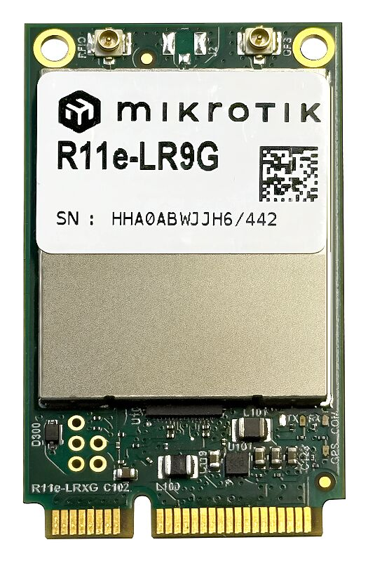
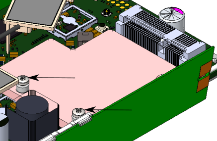
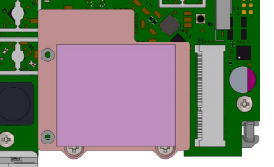
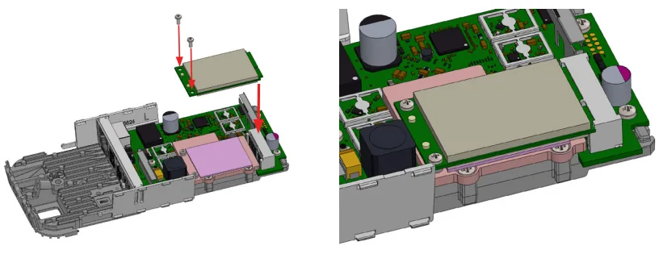
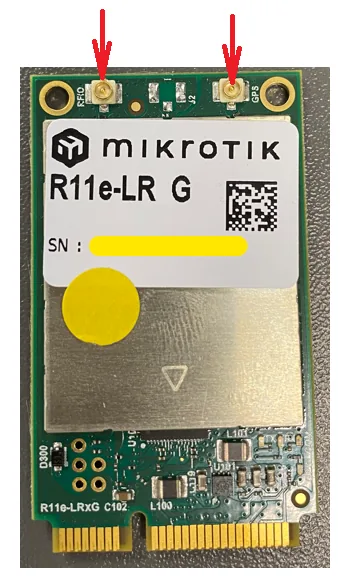
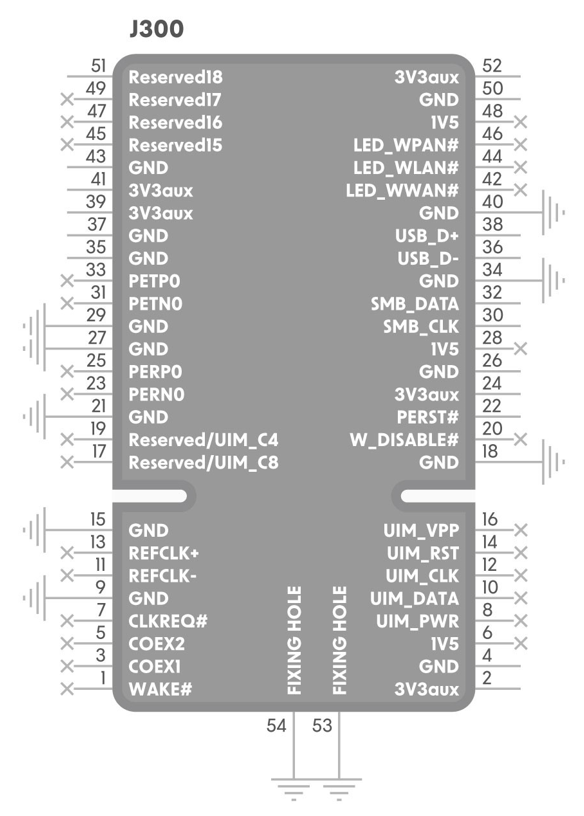
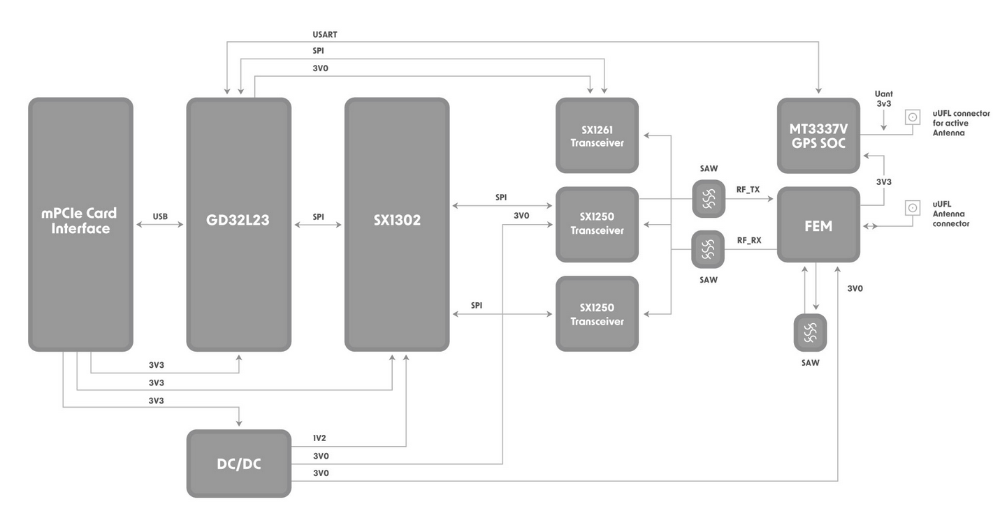

This guide can be downloaded as a [PDF file](https://manual.mikrotik.com/assets/files/r11e-lr9g.pdf).

R11e-LR9G - LR mPCIe Gateway module. It can be integrated into a RouterBOARD product with mPCIe slot. Requires LR package installation to configure in RouterOS.

## Safety Warnings

- Before you work on any equipment, be aware of the hazards involved with electrical circuitry, and be familiar with standard practices for preventing accidents.
- The product comes without enclosure and is meant to be installed into the MikroTik host device by trained and qualified personnel. For mounting instructions see the chosen MikroTik Host Product's Quick Guide. Do not attempt to disassemble, repair, or modify the device.
- Please read the mounting instructions carefully before beginning installation. Failure to use the correct hardware and configuration or to follow the correct procedures could result in a hazardous situation for people and damage to the system.
- Ultimate disposal of this product should be handled according to all national laws and regulations.
- The Installation of the equipment must comply with local and national electrical codes.
- Read the installation instructions before connecting the system to the power source.
- We cannot guarantee that no accidents or damage will occur due to the improper use of the device. Please use this product with care and operate at your own risk!
- Keep this mini PCIe card away from water, fire, humidity, or hot environments.
- It is the customer's responsibility to follow local country regulations, including operation within legal frequency channels, output power, cabling requirements, and Dynamic Frequency Selection (DFS) requirements. All MikroTik radio devices must be professionally installed.

**Exposure to Radio Frequency Radiation:** This MikroTik equipment complies with the European Union radiation exposure limits set forth for an uncontrolled environment. This MikroTik device should be installed and operated no closer than 20 centimeters from your body, occupational user, or the general public.

## Specifications

Low power-consuming with mini PCIe interface, for long-distance data, transmit:

- Interface – Mini-PCIe;
- Temperature Operating -40 / +70;
- Supports Class A and C;
- Frequency - 902-928MHz (US);
- RF Output power - 902-928MHz (US) up to 27dBm;
- *Receive max sensitivity - 141 dB @ SF12, Depends on the antenna used;*
- *Maximum power consumption 1.3 W.*
- GPS receiver U.FL slot (to connect external GPS antenna). GPS is supported (does not support GLONASS, BeiDou, Galileo).

## Installing the module in your device

R11e-LR9G for professional use. Each of the cards comes in ESD protective packaging. When handling electrical equipment please observe the following safety precautions:

-

Use a wrist grounding strap when unpacking and working with electrical components to avoid electrical discharge (ESD) damage;

-

After unpacking please place the card on the anti-static mat;

-

When installing make sure there are no objects that can damage or touch the PCB plate;

-

The card can be installed in your desired device using the factory provided screw holes in a PCB plate; *Pictures added for illustration purposes, the device configuration, and the placement of the miniPCIe card may vary.*

-

Locate miniPCIe slot on your device;

-

Unscrew two factory attached screws;

- Optionally you can use the thermal pad by placing it under the card, the thermal pad is not included in the package;
- Install the module to the miniPCIe slot and secure it with previously removed screws. Tightening torque 0,3 Nm.

## Connecting to the antenna

If your device does not have internal antennas, it is possible to connect to the external antennas by adding cable connectors, product code — [ACSMAUFL](https://mikrotik.com/product/acsmaufl). Please connect and disconnect the antenna, when the device is turned off!

Attach LoRa antenna cable to the "RFIO"-labeled connector for LoRa usage, and attach GPS antenna cable to the "GPS"-labeled connector for GPS usage:

When installing outdoors please ensure that the device case is waterproof and is designed for outdoor use. The IP rating scale for this device is IP0. *Mounting and configuration of this device should be done by a qualified person.*

## Configuration for RouterOS

To set the configuration for LR please connect to the device and log in with your web browser, WinBox, or mobile application. Two easy steps to follow: **First step:**

-

Once logged in, Quick Set will be selected, please switch to WebFig on the right side of the screen. If the configuration is done through mobile application then click on the gear symbol on the right side of the screen to open up an advanced menu.

-

On the left side menu please find and select the section "IoT&gt;Lora".

-

On the newly opened window select the Servers tab.

-

Click + to add a new server configuration.

-

A new window will appear and you will have to enter: Name: (Server name) Address: (Server address) Up port: (for LoRa UDP, 1700) Down port: (for LoRa UDP, 1700)

-

Click OK to save. **Second step:**

-

Select the Device tab on the previous window.

-

Double-click or tap on the line to configure.

-

Choose the previously entered network on the drop-down menu.

-

Click on the button Enable to enable the gateway.

-

Click OK to save.

-

The configuration is done.

## Specifications

The module can be installed on the miniPCIe to USB adapter and used in any of our devices with a USB slot and installed Lora package.

**To use the module in other devices packet forwarder from Semtech is required:** [packet_forwarder](https://github.com/Lora-net/packet_forwarder)

This warning only applies to mPCIe cards that are already preinstalled in MikroTik gateway devices, like WAP LR9. It is important to note here, that using **pins 39** and **41**is mandatory. If you want to use the card elsewhere, note that some USB to mPCIe adapters do not have mentioned pins connected and, without them, the LoRa card will not work. For a more detailed **pinout**, check the section below.

## Pinout

## Block diagram

## Operating system support

The module supports RouterOS software version v7. Other operating systems have not been tested.

To avoid pollution of the environment, please separate the device from household waste and dispose of it in a safe manner, such as in designated waste disposal sites. Familiarize yourself with the procedures for the proper transportation of the equipment to the designated disposal sites in your area.
