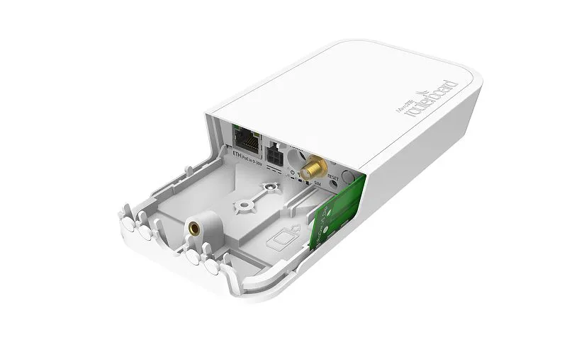
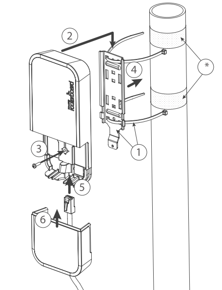
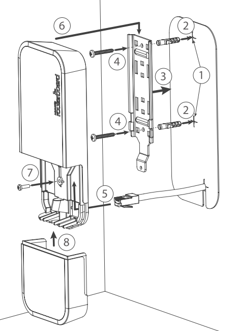
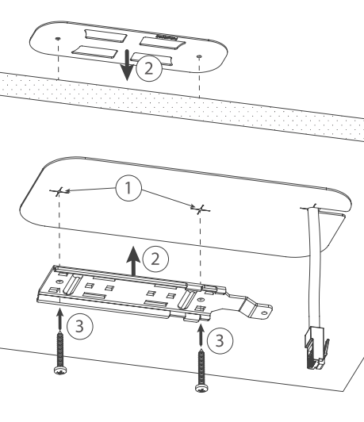
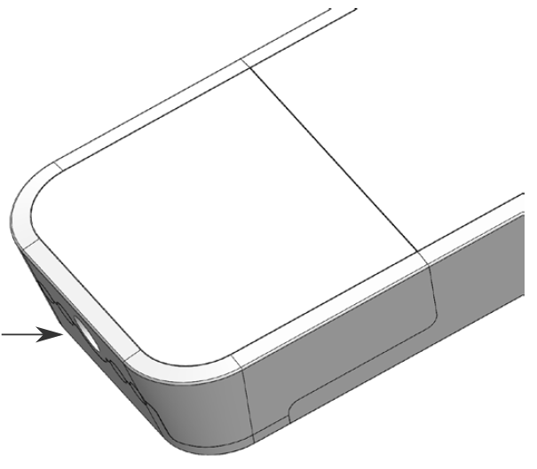
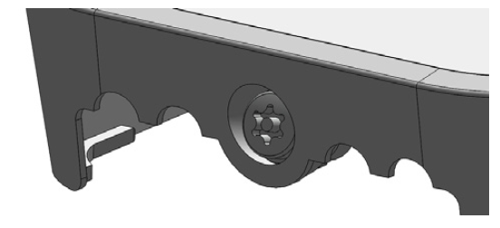
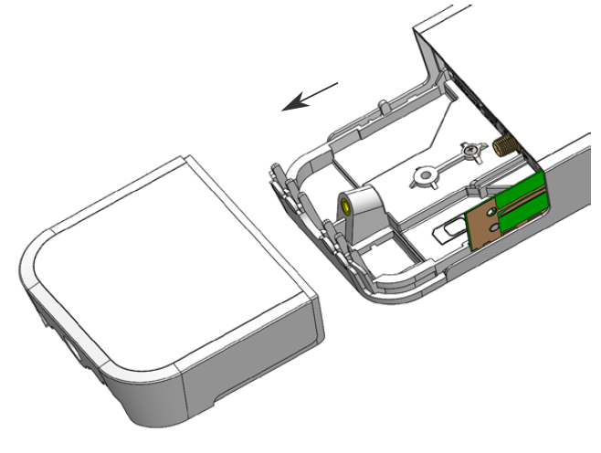
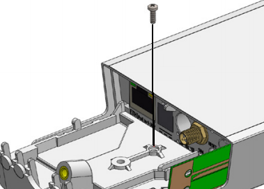
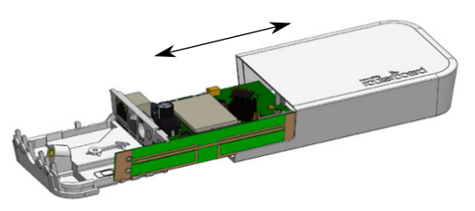
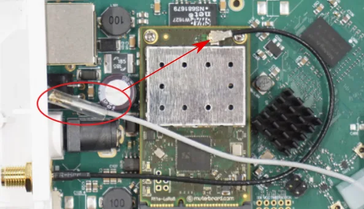

This guide can be downloaded as a [PDF file](https://manual.mikrotik.com/assets/files/wap-lr9-kit.pdf).

### [wAP LR9 kit](https://mikrotik.com/product/wap_lr9_kit) (RBwAPR-2nD&R11e-LR9)

The wAP is a small weatherproof device with an integrated LR9 card for UDP packet forwarding to the chosen server.

## Safety Warnings

- Before you work on any equipment, be aware of the hazards involved with electrical circuitry, and be familiar with standard practices for preventing accidents.
- Ultimate disposal of this product should be handled according to all national laws and regulations.
- All installation methods for mounting an access point on any wall surface is subject to the acceptance of local jurisdiction.
- The Installation of the equipment must comply with local and national electrical codes.
- This product is intended to be mounted outdoors on a pole but can also be installed indoors. Please read the mounting instructions carefully before beginning installation. Failure to use the correct hardware and configuration or to follow the correct procedures could result in a hazardous situation to people and damage to the system.
- Use only the power supply and accessories approved by the manufacturer, and which can be found in the original packaging of this product.
- Read the installation instructions before connecting the system to the power source.
- We cannot guarantee that no accidents or damage will occur due to the improper use of the device. Please use this product with care and operate at your own risk!
- In the case of device failure, please disconnect it from power. The fastest way to do so is by unplugging the power plug from the power outlet.
- It is the customer's responsibility to follow local country regulations, including operation within legal frequency channels, output power, cabling requirements, and Dynamic Frequency Selection (DFS) requirements. All MikroTik radio devices must be professionally installed.
- This is a class A device. In a domestic environment, this product might cause radio interference in which case the user might be required to take adequate measures.

**Exposure to Radio Frequency Radiation:** This MikroTik equipment complies with the European Union radiation exposure limits set forth for an uncontrolled environment. This MikroTik device should be installed and operated no closer than 20 centimeters from your body, occupational user, or the general public.

## Quickstart

- Make sure your ISP is allowing hardware change and will issue an automatic IP address.
- Open the bottom lid.
- Connect an external antenna to the SMA connector.
- Connect the device to the power source.
- Connect with your device to the MikroTik wireless network
- The configuration has to be done through the wireless network using a web browser or mobile app. Alternatively, you can use the WinBox configuration tool [https://mt.lv/winbox](https://mt.lv/winbox). By default, Ethernet port access is blocked by a firewall.
- Once connected to the wireless network, open 192.168.88.1 in your web browser to start the configuration.
- user name: a*dmin* and there is no password by default (or, for some models, check user and wireless passwords on the sticker).
- When using a mobile application choose Quick setup and it will guide you through all necessary configurations in six easy steps.
- Find your LR Gateway ID on the label within the product and register it in your Network Server.
- To make the device connect to the LR Network Server.
- Click the "Check for updates" button and update your RouterOS software to the latest version, the device needs to have an active Internet connection.
- After the update set your country, to apply country regulation settings.
- Set your WiFi password.
- Set the router password.
- The following RouterOS "npk" packages are required for the core functionality of the product: lora, system.

## Extension slots and ports

- 10/100 Ethernet port, supporting automatic cross/straight cable correction (Auto MDI/X). Either straight or crossover cable can be used for connecting to other network devices.
- External SMA antenna connector already connected to the LR card.
- LED indicating a power state of the device.
- LED Indicating the activity of Wireless network.
- Automotive connector. Pinout: A - reserved for future use (orange), B - reserved for future use (blue), C - ground (black), D – power in (red).
- MiniPCIe slot with integrated LR9 card.
- Integrated Wireless module operating at 2.4 GHz, 802.11b/g/n protocol.
- SIM slot.

## Powering

The device accepts power in the following ways:

- Ethernet port accepts passive PoE 9-30 V DC ⎓.
- Direct-input power jack (5.5 mm outside and 2 mm inside, female, pin positive plug) accepts 9-30 V DC⎓.
- Automotive connector 9-30 V DC⎓. The power consumption under maximum load can reach 7 W.

### Connecting to a PoE Adapter

- Connect the Ethernet cable from the device to the PoE+DATA port of the PoE adapter.
- Connect an Ethernet cable from your local network (LAN) to the PoE adapter.
- Connect the power cord to the adapter, and then plug the power cord into a power outlet.

## Mounting

The device can be mounted in several ways: pole, wall, ceiling or it can be placed in specially designed MikroTik holder which comes with the package. The package also includes a drill hole template with detailed mounting instructions, to help you with the Ethernet cable installation and attachment to a ceiling or a wall. Steel bracket to put on the other side of a dropdown ceiling tile and two screws and wall anchors. Zip ties or steel clamps for mounting on the pole.

The IP rating scale for this device is IP54. When mounting outdoors, please ensure that any cable openings are directed downwards. We recommend using POE injector and proper grounding with Cat6 shielded cable. When using and installing this device please pay attention to Maximum Permissible Exposure (MPE) safety distance with a minimum of 20 cm between the radiator and your body.

Mounting on the mast or pole:

It's recommended to use electrical tape to increase friction between materials.

- Mount plastic tie straps to steel brackets guiding them through holes.
- Mount bracket to the device.
- Secure them with a screw.
- Mount and align the device on the pole or mast.
- Guide Ethernet cable through the opening and connect to the Ethernet port.
- Close bottom latch and secure with a screw.

It's recommended to secure Ethernet cable to the pole using zip ties. With the distance from the device approximately 30 cm.

Mounting unit on the wall:

- Use included a template to mark spots for drilling holes. And if needed for Ethernet cable. Align accordingly, it will depend on how the device will be mounted finally.
- Insert dowels if needed, depends on wall structure and material.
- Place included a steel bracket on the wall.
- Use screws to secure it in the place.
- Extend your Ethernet cable through the opening and connect to the Ethernet port.
- Mount the device on the steel bracket
- Secure it in place with the screw.
- Close bottom latch.

Avoid mounting the device on the low ground spot, as you won't be able to attach and close the bottom latch.

Mounting on the ceiling:

A Special bracket is included in the package to mount on the drop ceiling. As it consists of two parts, to be attached on both sides of the ceiling tile.

-

Use the template to mark spots for holes.

-

Place both mounting brackets on the spot.

-

Secure them together using screws.

-

Continue assembling in the same manner if mounting on the wall.

-

Extend your Ethernet cable through the opening and connect to the Ethernet port.

-

Mount the device on the steel bracket.

-

Secure it in place with the screw.

-

Close bottom latch.

## Bottom Lid

- The bottom lid is secured in place with the captive screw.

- Use Torx T20 screwdriver to unscrew it, but do not remove the screw completely.

- Pull the cover in the opposite direction from the device to remove it.

- Reassemble.

## Configuration

To set the configuration for LR please connect to the device and log in with your web browser or use a mobile application. Two easy steps to follow: **First step:**

-

Once logged in, Quick Set will be selected, please switch to WebFig on the right side of the screen. If the configuration is done through mobile application then click on the gear symbol on the right side of the screen to open up an advanced menu.

-

On the left side menu please find and select the section "Lora".

-

On the newly opened window select the Servers tab.

-

Click + to add a new server configuration.

-

A new window will appear and you will have to enter: Name: (Server name) Address: (Server address) Up port: (Usually it's 1700) Down port: (Usually it's 1700)

-

Click OK to save. **Second step:**

-

Select the Device tab on the previous window.

-

Double-click or tap on the line to configure.

-

Choose the previously entered network on the drop-down menu.

-

Click on the button Enable to enable the gateway.

-

Click OK to save.

-

The configuration is done. We recommend clicking the "Check for updates" button in the QuickSet menu, as updating your RouterOS software to the latest version ensures the best performance and stability. For wireless models, please make sure you have selected the country where the device will be used, to conform with local regulations. RouterOS includes many configuration options in addition to what is described in this document. We suggest starting here to get yourself accustomed to the possibilities: [https://mt.lv/help](https://mt.lv/help) In case IP connection is not available, the WinBox tool ([https://mt.lv/winbox](https://mt.lv/winbox)) can be used to connect to the MAC address of the device from the LAN side (all access is blocked from the Internet port by default). For recovery purposes, it is possible to boot the device for reinstallation, see section .

## MikroTik mobile app

Use the MikroTik smartphone app to configure your router in the field, or to apply the most basic initial settings for your MikroTik home access point.

- Scan QR code and choose your preferred OS.
- Install and open application.
- By default, the IP address and user name will be already entered.
- Click Connect to establish a connection to your device through a wireless network.
- Choose Quick setup and application will guide you through all basic configuration settings in a couple of easy steps.
- An advanced menu is available to fully configure all necessary settings.

## Antenna usage

We recommend to use an external antenna, the "LoRa Antenna kit" - can be obtained separately. Antenna kit has pole mount and cable ready to use with LR cards. [https://mikrotik.com/product/lora_antenna_kit](https://mikrotik.com/product/lora_antenna_kit) SMA connector located under the bottom door is already connected to the LR card and ready to be used. Please see section on how to remove the door.

Please connect and disconnect the antenna, when the device is turned off!

**Internal antenna** 2 dBi can be used for setups where the distance to the gateway are closer than 1km. By default, the antenna is not connected to the card! To use an internal antenna:

- Open bottom door (see "").

- Use PH2 screwdriver to remove the screw.
- Disassemble upper case from the bottom by sliding them to opposite sides.

- Locate internal antenna cable and replace it with the SMA cable connector on the LR card.

- Reassembly.

## Buttons and jumpers

The reset button has three functions:

- Hold this button during boot time until LED light starts flashing, release the button to reset RouterOS configuration (total 5 seconds).
- Keep holding for 5 more seconds, LED turns solid, release now to turn on CAP mode. The device will now look for a CAPsMAN server (total 10 seconds).
- Or Keep holding the button for 5 more seconds until LED turns off, then release it to make the RouterBOARD look for Netinstall servers (total 15 seconds). Regardless of the above option used, the system will load the backup RouterBOOT loader if the button is pressed before power is applied to the device. Useful for RouterBOOT debugging and recovery.

## Accessories

Package includes the following accessories that come with the device:

- EU/US Switching Power Supply 24 V ⎓, 0.8 A, 19.2 W, 85.3 %, VI, cable:150 cm Hor CMC.
- WAP desk bracket.
- WAP outdoor case bracket AL, white.
- POE Injector cable.
- Cable (H4130-04PDB000R 3 mm 2x2P Housing) to (StripJacket 5 cm+WireEnd Strip/Tin 1 cm) 24 AWG.
- Hose Clamp, 35-70 mm, W4.
- K-52 fastening set.
- WAP-drill-template, paper brochure.

## Operating system support

The device supports RouterOS v7 and above. The specific factory-installed version is listed in /system resource. Other operating systems have not been tested. RouterOS LR support is limited to the MikroTik LR card, it does not support 3rd party Lora cards.

To avoid pollution of the environment, please separate the device from household waste and dispose of it in a safe manner, such as in designated waste disposal sites. Familiarize yourself with the procedures for the proper transportation of the equipment to the designated disposal sites in your area.

## Federal Communication Commission Interference Statement

<table><thead><tr><th>Model</th><th>FCC ID</th><th>Contains FCC ID</th></tr></thead><tbody><tr><td>RBwAPR-2nD&R11e-LoRa9</td><td>TV7WAPR2ND</td><td>TV7LR9</td></tr></tbody></table>

This equipment has been tested and found to comply with the limits for a Class A digital device, pursuant to Part 15 of the FCC Rules. These limits are designed to provide reasonable protection against harmful interference in a commercial installation.

This equipment generates, uses, and can radiate radio frequency energy and, if not installed and used in accordance with the instruction manual, may cause harmful interference to radio communications. Operation of this equipment in a residential area is likely to cause harmful interference in which case the user will be required to correct the interference at his own expense

**FCC Caution:** Any changes or modifications not expressly approved by the party responsible for compliance could void the user's authority to operate this equipment. This device complies with Part 15 of the FCC Rules. Operation is subject to the following two conditions: (1) This device may not cause harmful interference, and (2) this device must accept any interference received, including interference that may cause undesired operation. This device and its antenna must not be co-located or operation in conjunction with any other antenna or transmitter.

**IMPORTANT: Exposure to Radio Frequency Radiation.** This equipment complies with the FCC RF radiation exposure limits set forth for an uncontrolled environment. This equipment should be installed and operated with a minimum distance of 20 cm between the radiator and any part of your body.

## Innovation, Science and Economic Development Canada

<table><thead><tr><th>Model</th><th>IC</th><th>Contains IC</th></tr></thead><tbody><tr><td>RBwAPR-2nD&R11e-LoRa9</td><td>7442A-WAPR2ND</td><td>7442A-LR9</td></tr></tbody></table>

This device complies with Industry Canada licence-exempt RSS standard(s). Operation is subject to the following two conditions: (1) this device may not cause interference, and (2) this device must accept any interference, including interference that may cause undesired operation of the device. Le présent appareil est conforme aux CNR d'Industrie Canada applicables aux appareils radio exempts de licence. L'exploitation est autorisée aux deux conditions suivantes : (1) l'appareil ne doit pas produire de brouillage, et (2) l'utilisateur de l'appareil doit accepter tout brouillage radioélectrique subi, même si le brouillage est susceptible d'en compromettre le fonctionnement.

This Class A digital apparatus complies with Canadian ICES-003.

Cet appareil numérique de la classe [A] est conforme à la norme NMB-003 du Canada.

CAN ICES-003 (A) / NMB-003 (A)

**IMPORTANT: Exposure to Radio Frequency Radiation.** This equipment complies with the IC radiation exposure limits set forth for an uncontrolled environment. This equipment should be installed and operated with a minimum distance of 20 cm between the radiator and any part of your body. Cet équipement est conforme aux limites d'exposition au rayonnement IC définies pour un environnement non contrôlé. Cet équipement doit être installé et utilisé à une distance minimale de 20 cm entre le radiateur et toute partie de votre corps.

## UKCA marking

## Eurasian Conformity Mark

<table><thead><tr><th>Частотный диапазон</th><th>Мощность передатчика</th></tr></thead><tbody><tr><td>2400-2483.5 МГц</td><td>≤100 мВт</td></tr></tbody></table>

*Доступные частотные каналы могут различаться в зависимости от модели продукта и сертификации.

Информация о дате изготовления устройства указана в конце серийного номера на его наклейке через дробь. Первая цифра означает номер года (последняя цифра года), две последующие означают номер недели.

Изготовитель: MikroTikls SIA, Aizkraukles iela 23, Riga, LV-1006, Латвия, [support@mikrotik.com](mailto:support@mikrotik.com). Сделано в Китае, Латвии или Литве. Cм. на упаковке.

Для получения подробных сведений о гарантийном обслуживании обратитесь к продавцу. Информация об импортерах продукции MikroTik в Российскую Федерацию: [https://mikrotik.com/buy/europe/russia](https://mikrotik.com/buy/europe/russia)

Продукты MikroTik, которые поставляются в Евразийский таможенный союз, оцениваются с учетом соответствующих требований и помечены знаком EAC, как показано ниже:

## Norma Oficial Mexicana

Rango de frecuencia (potencia de salida máxima): 2400-2483.5 MHz (30 dBm). Los canales de frecuencia disponibles pueden variar según el modelo y la certificación del producto.

EFICIENCIA ENERGETICA CUMPLE CON LA NOM-029-ENER-2017.

La operacion de este equipo esta sujeta a las siguientes dos condiciones:

- Es posible que este equipo o dispositivo no cause interferencia perjudicial y.
- Este equipo debe aceptar cualquier interferencia, incluyendo la que pueda causar su operacion no deseada. Fabricante: MikroTikls SIA, Brivibas gatve 214i, Riga, LV-1039, Latvia.

País De Origen: Letonia; Lituania; China (Republica Popular); Estados Unidos De America; Mexico.

Por favor contacte a su distribuidor local para preguntas regionales específicas. La lista de importadores se puede encontrar en nuestra página de inicio – [https://mikrotik.com/buy/latinamerica/mexico](https://mikrotik.com/buy/latinamerica/mexico).

## The National Commission for the State Regulation of Communications and Informatization by Ukraine

Виробник: MikroTikls SIA, Brivibas gatve 214i Рига, Латвія, LV1039.

Робоча частота (Максимальна вихідна потужність): 2480-2483.5 МГц (20 дБм).

Справжнім MikroTikls SIA заявляє, що маршрутизатор відповідає основним вимогам та іншим відповідним положенням директиви 2014/53/EC, а також суттєвим вимогам Технічного регламенту радіообладнання, затвердженого постановою Кабінету Міністрів України від 24 травня 2017 року № 355.

Для експлуатації в Україні необхідно отримати дозвіл на експлуатацію у порядку, затвердженому рішенням НКРЗІ від 01.11.2012 № 559, зареєстрованому в Міністерстві юстиції України 03.01.2013 за № 57/22589.

## CE Declaration of Conformity

Manufacturer: MikroTikls SIA, Brivibas gatve 214i Riga, Latvia, LV1039.

Hereby, Mikrotīkls SIA declares that the radio equipment type RB912R-2nD-LTm is in compliance with Directive 2014/53/EU. The full text of the EU declaration of conformity is available at the following internet address: [https://mikrotik.com/products](https://mikrotik.com/products)

### WLAN / LR

<table><thead><tr><th>**WLAN**</th><th>Operating Frequency / Maximum output power Betriebsfrequenz / maximale Ausgangsleistung Fréquence de fonctionnement / puissance de sortie maximale Frequenza operativa / massima potenza di uscita Frecuencia de funcionamiento / potencia de salida máxima Рабочая частота / максимальная выходная мощность</th><th>2400-2483.5 MHz / 20 dBm</th></tr></thead><tbody><tr><td>**LR**</td><td>2403-2479 MHz / 20 dBm</td><td></td></tr></tbody></table>

This MikroTik device meets Maximum transmit power limits per ETSI regulations. For more detailed information see Declaration of Conformity above / Dieses MikroTik-Gerät erfüllt die maximalen Sendeleistung Grenzwerte gemäß ETSI-Vorschriften. Weitere Informationen finden Sie oben in der Konformitätserklärung / Cet appareil MikroTik respecte les limites de puissance de transmission maximale conformément aux réglementations ETSI. Pour plus d'informations, voir la déclaration de conformité ci-dessus / Questo dispositivo MikroTik è conforme ai limiti di potenza massima di trasmissione in conformità con le normative ETSI. Per ulteriori informazioni, consultare la dichiarazione di conformità sopra / Este dispositivo MikroTik cumple con los valores límite de potencia máxima de transmisión de acuerdo con la normativa ETSI. Para obtener información más detallada, consulte la Declaración de conformidad anterior / Это устройство MikroTik соответствует предельным значениям максимальной мощности передачи в соответствии с правилами ETSI. Для получения более подробной информации см. Декларацию соответствия выше.
