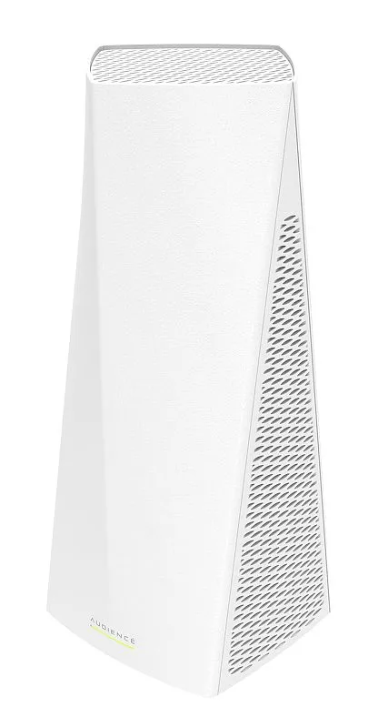
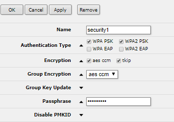
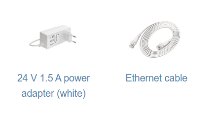

## [Audience LTE6 kit](https://mikrotik.com/product/audience_lte6_kit) (RBD25GR-5HPacQD2HPnD&R11e-LTE6)

The Audience LTE6 kit is a home access point with a built-in LTE modem. You can extend the wireless coverage by adding more Audience devices to the network — they form a single network with the same SSID, so your devices can roam freely within its range.

## Safety Warnings

- Before you work on any equipment, be aware of the hazards involved with electrical circuitry, and be familiar with standard practices for preventing accidents.
- Ultimate disposal of this product should be handled according to all national laws and regulations.
- The Installation of the equipment must comply with local and national electrical codes.
- This unit is intended to be installed in the rackmount. Read the mounting instructions carefully before beginning installation. Failure to use the correct hardware or to follow the correct procedures could result in a hazardous situation to people and damage to the system.
- This product is intended to be installed indoors. Keep this product away from water, fire, humidity or hot environments.
- Use only the power supply and accessories approved by the manufacturer, and which can be found in the original packaging of this product.
- Read the installation instructions before connecting the system to the power source.
- We cannot guarantee that no accidents or damage will occur due to the improper use of the device. Use this product with care and operate at your own risk!
- In the case of device failure, disconnect it from power. The fastest way to do so is by unplugging the power plug from the power outlet.
- It is the customer's responsibility to follow local country regulations, including operation within legal frequency channels, output power, cabling requirements, and Dynamic Frequency Selection (DFS) requirements. All MikroTik radio devices must be professionally installed.
- This is a class A device. In a domestic environment, this product might cause radio interference in which case the user might be required to take adequate measures.

**Exposure to Radio Frequency Radiation:** This MikroTik equipment complies with the FCC, IC, and European Union radiation exposure limits set forth for an uncontrolled environment. This MikroTik device should be installed and operated no closer than 20 centimeters from your body, occupational user, or the general public.

## Connecting

- Insert Micro SIM card see (SIM slot usage).
- Plug the included power adapter to start up the device (see "").
- The device will boot up, the front led indicator will light in solid blue, and the Wireless network will be available for connecting.
- Open network connections on your PC, mobile phone, or other device and search for MikroTik wireless network and connect to it.
- Once connected to the wireless network, open [https://192.168.88.1](https://192.168.88.1) in your web browser to start configuration, since there is no password by default, you will be logged in automatically (or, for some models, check user and wireless passwords on the sticker). For mobile phones use the application (see "").
- Select the "Check for updates" button and update your RouterOS software to the latest version, need to have a valid SIM card.
- Choose WebFig tab, on the left menu, choose CAPsMAN.
- Select the Security Cfg.
- Select to add new:Choose Authentication Type: WPA PSK, WPA2 PSK;Encryption: aes ccm;Passphrase: strongwirelesspassword;

- Select OK.
- Select the Configurations tab.
- Choose one interface example: cfg-2ghz.
- Find the Security and choose the previously created profile: security1.
- Find the Country and set your Country.
- Select OK.
- Same for the cfg-5ghz-ac interface.
- On the left menu choose System&gt;Password.
- Enter the password for the device and select Change. To add another Audience device to the network (see "").

## MikroTik mobile app

Use the MikroTik smartphone app to configure your router in the field, or to apply the most basic initial settings for your MikroTik home access point.

- Scan QR code and choose your preferred OS.
- Install and open application.
- By default, the IP address and user name will be already entered.
- Select Connect to establish a connection to your device through a wireless network.
- Choose Quick setup and the application will guide you through all basic configuration settings in a couple of easy steps.
- An advanced menu is available to fully configure all necessary settings.

## Powering

The device accepts power from the power jack or from the Ethernet port:

-

Provided direct-input power jack (5.5 mm outside and 2 mm inside, female, pin positive plug) accepts 12-57 V DC ⎓.

-

Ethernet 1 port accepts Passive PoE 24-57 V DC ⎓. The power consumption under maximum load can reach 30 W. **Connecting to a POE Adapter.** POE adapter is not included in a package, if you consider using it, follow these steps:

-

Connect the Ethernet cable from the Audience to the POE port of the POE adapter.

-

Connect an Ethernet cable from your LAN to the LAN port of the POE adapter, mind arrows for data and power flow.

-

Connect the power cord to the adapter, and then plug the power cord into a power outlet.

## Mounting

The device is designed to be used indoors and placed on a flat surface with all needed cables connecting to the back of the unit. The IPX rating scale of IPX0. You should use Cat6 shielded cable for Audience devices. *Warning! This equipment should be installed and operated with a minimum distance of 50 cm between the device and your body. The operation of this equipment in the residential environment could cause radio interference.*

## Configuration

Once logged in, you should select the "Check for updates" button in the QuickSet menu, as updating your RouterOS software to the latest version ensures the best performance and stability. For wireless models, make sure you have selected the country where the device will be used, to conform with local regulations. RouterOS includes many configuration options in addition to what is described in this document. We suggest starting here to get yourself accustomed to the possibilities: [https://mt.lv/help](https://mt.lv/help) In case an IP connection is not available, the WinBox tool ([https://mt.lv/winbox](https://mt.lv/winbox)) can be used to connect to the MAC address of the device from the LAN side (all access is blocked from the Internet port by default). For recovery purposes, it is possible to boot the device for reinstallation, see section .

## Extension slots and ports

- Two Gigabit Ethernet ports.
- Integrated Wireless 2.4 GHz 802.11b/g/n, antenna gain 3.5 dBi.
- Integrated Wireless 5.0 GHz 802.11a/n/ac, antenna gain 4.5 dBi. 5180 – 5320 MHz.
- Integrated Wireless 5.0 GHz 802.11a/n/ac, antenna gain 4.5 dBi. 5500 – 5825 MHz.
- Audience LTE6 kit - MiniPCIe slot with factory-installed R11e-LTE6 card and SIM slot.

## Buttons and jumpers

The reset button functions as described below:

- Hold this button before applying power, release after three seconds since powering, to load backup Boot loader. This might be necessary if the device is not operating because of a failed RouterBOOT upgrade. When you have started the device with the backup loader, you can either set RouterOS to force backup loader in the RouterBOARD settings or have a chance to reinstall the failed RouterBOOT from an fwf file (total 3 seconds).
- If you keep holding this button for 2 more seconds until the green LED light starts flashing, release the button to reset RouterOS configuration to default (total 5 seconds).
- To connect this device to a wireless network managed by CAPsMAN, keep holding the button for 5 more seconds, LED turns solid green, release now to turn on CAPs mode (total 10 seconds).
- Or Keep holding the button for 5 more seconds until the green LED turns off, then release it to make the RouterBOARD look for Netinstall servers. You can also simply keep the button pressed until the device shows up in the Netinstall program on Windows (total 15 seconds). Regardless of the above option used, the system will load the backup RouterBOOT loader if the button is pressed before power is applied to the device. Useful for RouterBOOT debugging and recovery.

### WPS Sync button

Use the WPS Sync button to expand your wireless repeater network coverage by adding multiple Audience devices to it.

- On the chosen Audience AP, push the "WPS-Sync" button once, to turn on WPS mode for two minutes and make it wait for Audience repeater. The status LED will blink green.
- The Audience repeater needs to be booted with pressed "WPS-Sync" button for the device to configure itself according to the "WPS-Sync" mode and to connect to the Audience AP. Release the "WPS-Sync" button when the status LED is blinking amber.
- If the Audience repeater fails to connect to the Audience AP, then connecting can be repeated through RouterOS or by pressing "WPS-Sync" button and releasing after 5 seconds, the device will turn on "WPS-Sync" mode for two minutes and search for Audience AP. Status LED will blink amber.
- To add a third Audience repeater to your network, push the "WPS-Sync" button on the second Audience in your network, then boot the third unit with the "WPS-Sync" button pressed. Repeat with as many units as needed, adding more devices to your network.

## Front status LED behavior

- Solid blue – the device is powered on.
- Blinking green – the device is in Access Point mode and waits for another Audience device to be connected.
- Blinking amber (Red + Green) – the device searches and tries to connect to another Audience device.
- Solid green – the device has established a connection in an Audience network.
- Blinking Red – the device runs radar detection for Dynamic Frequency Selection (DFS).

## SIM slot usage

SIM card slot is designed to use with Micro SIM cards.

- Nano SIM cards have different thickness, usage with adapters are not recommended.

## Accessories

## Specifications

For more information about this product, specifications, and pictures visit our web page: [https://mikrotik.com/product/audience_lte6_kit](https://mikrotik.com/product/audience_lte6_kit)

## Operating system support

The device supports RouterOS v7 and above. The specific factory-installed version is listed in /system resource. Other operating systems have not been tested.

## Notice

- The Frequency band 5.470-5.725 GHz isn’t allowed for commercial use.
- In case WLAN devices work with different ranges than the above regulations, then a customized firmware version from the manufacturer/supplier is required to be applied to the end-user equipment and also prevent the end-user from reconfiguration.
- For Outdoor Usage: End-user requires approval/license from the NTRA.
- Datasheet for any device is available on the official manufacturer website.
- Products with the letters “EG” at the end of their serial number have their wireless frequency range limited to 2.400 – 2.4835 GHz, the TX power is limited to 20dBm (EIRP).
- Products with the letters “EG” at the end of their serial number have their wireless frequency range limited to 5.150 – 5.250 GHz, the TX power is limited to 23dBm (EIRP).
- Products with the letters “EG” at the end of their serial number have their wireless frequency range limited to 5.250 – 5.350 GHz, the TX power is limited to 20dBm (EIRP).

make sure the device has a lock package (firmware version from the manufacturer) which is required to be applied to the end-user equipment to prevent the end-user from reconfiguration. The product will be marked with country code “-EG”. This device needs to be upgraded to the latest version to ensure compliance with local authority regulations! It is the end users' responsibility to follow local country regulations, including operation within legal frequency channels, output power, cabling requirements, and Dynamic Frequency Selection (DFS) requirements. All MikroTik radio devices must be professionally installed.

To avoid pollution of the environment, separate the device from household waste and dispose of it in a safe manner, such as in designated waste disposal sites. Familiarize yourself with the procedures for the proper transportation of the equipment to the designated disposal sites in your area.

## Federal Communication Commission Interference Statement

<table><thead><tr><th>Model</th><th>FCC ID</th><th>Contains FCC ID</th></tr></thead><tbody><tr><td>RBD25GR-5HPacQD2HPnD-US&R11e-LTE6</td><td>TV7D25-5HPQ2HP</td><td>TV7R11ELTE6</td></tr></tbody></table>

This equipment has been tested and found to comply with the limits for a Class B digital device, pursuant to Part 15 of the FCC Rules. These limits are designed to provide reasonable protection against harmful interference in a residential installation.

This equipment generates, uses, and can radiate radio frequency energy and, if not installed and used in accordance with the instructions, may cause harmful interference to radio communications. However, there is no guarantee that interference will not occur in a particular installation. If this equipment does cause harmful interference to radio or television reception, which can be determined by turning the equipment off and on, the user is encouraged to try to correct the interference by one or more of the following measures:

- Reorient or relocate the receiving antenna.
- Increase the separation between the equipment and receiver.
- Connect the equipment into an outlet on a circuit different from that to which the receiver is connected.
- Consult the dealer or an experienced radio/TV technician for help. FCC Caution: Any changes or modifications not expressly approved by the party responsible for compliance could void the user’s authority to operate this equipment.

This device complies with Part 15 of the FCC Rules. Operation is subject to the following two conditions: (1) This device may not cause harmful interference, and (2) this device must accept any interference received, including interference that may cause undesired operation.

Note: This unit was tested with shielded cables on the peripheral devices. Shielded cables must be used with the unit to ensure compliance.

## Innovation, Science and Economic Development Canada

<table><thead><tr><th>Model</th><th>IC</th><th>Contains IC</th></tr></thead><tbody><tr><td>RBD25GR-5HPacQD2HPnD-US&R11e-LTE6</td><td>7442A-D255HPQ2HP</td><td>7442A-R11ELTE6</td></tr></tbody></table>

This device contains license-exempt transmitter(s)/receiver(s) that comply with Innovation, Science, and Economic Development Canada’s license-exempt RSS(s). Operation is subject to the following two conditions: (1) This device may not cause interference. (2) This device must accept any interference, including interference that may cause undesired operation of the device.

L’émetteur/récepteur exempt de licence contenu dans le présent appareil est conforme aux CNR d’Innovation, Sciences et Développement économique Canada applicables aux appareils radio exempts de licence. L’exploitation est autorisée aux deux conditions suivantes: 1) L’appareil ne doit pas produire de brouillage; 2) L’appareil doit accepter tout brouillage radioélectrique subi, même si le brouillage est susceptible d’en compromettre le fonctionnement.

This Class B digital apparatus complies with Canadian ICES-003.

Cet appareil numérique de la classe [B] est conforme à la norme NMB-003 du Canada.

CAN ICES-003 (B) / NMB-003 (B)

The device for operation in the band 5150–5250 MHz is only for indoor use to reduce the potential for harmful interference to co-channel mobile satellite systems.

Les dispositifs fonctionnant dans la bande de 5 150 à 5 250 MHz sont réservés uniquement pour une utilisation à l'intérieur afin de réduire les risques de brouillage préjudiciable aux systèmes de satellites mobiles utilisant les mêmes canaux

## UKCA marking

## Eurasian Conformity Mark

<table><thead><tr><th>Частотный диапазон</th><th>Мощность передатчика</th></tr></thead><tbody><tr><td>2400-2483.5 МГц, 5150-5350 МГц, 5650-5850 МГц</td><td>≤100 мВт</td></tr></tbody></table>

*Доступные частотные каналы могут различаться в зависимости от модели продукта и сертификации.

Информация о дате изготовления устройства указана в конце серийного номера на его наклейке через дробь. Первая цифра означает номер года (последняя цифра года), две последующие означают номер недели.

Изготовитель: MikroTikls SIA, Aizkraukles iela 23, Riga, LV-1006, Латвия, [support@mikrotik.com](mailto:support@mikrotik.com). Сделано в Китае, Латвии или Литве. Cм. на упаковке.

Для получения подробных сведений о гарантийном обслуживании обратитесь к продавцу. Информация об импортерах продукции MikroTik в Российскую Федерацию: [https://mikrotik.com/buy/europe/russia](https://mikrotik.com/buy/europe/russia)

Продукты MikroTik, которые поставляются в Евразийский таможенный союз, оцениваются с учетом соответствующих требований и помечены знаком EAC, как показано ниже:

## Norma Oficial Mexicana

Rango de frecuencia (potencia de salida máxima): 2400-2483.5 MHz (30 dBm), 5725-5850 MHz (30 dBm). Los canales de frecuencia disponibles pueden variar según el modelo y la certificación del producto.

EFICIENCIA ENERGETICA CUMPLE CON LA NOM-029-ENER-2017.

La operacion de este equipo esta sujeta a las siguientes dos condiciones:

- Es posible que este equipo o dispositivo no cause interferencia perjudicial y.
- Este equipo debe aceptar cualquier interferencia, incluyendo la que pueda causar su operacion no deseada. Fabricante: MikroTikls SIA, Brivibas gatve 214i, Riga, LV-1039, Latvia.

País De Origen: Letonia; Lituania; China (Republica Popular); Estados Unidos De America; Mexico.

Por favor contacte a su distribuidor local para preguntas regionales específicas. La lista de importadores se puede encontrar en nuestra página de inicio – [https://mikrotik.com/buy/latinamerica/mexico](https://mikrotik.com/buy/latinamerica/mexico).

## The National Commission for the State Regulation of Communications and Informatization by Ukraine

Виробник: MikroTikls SIA, Brivibas gatve 214i Рига, Латвія, LV1039.

Робоча частота (Максимальна вихідна потужність): 2400-2483.5 МГц (20 дБм), 5150-5250 МГц (23 дБм), 5250-5350 МГц (20 дБм), 5470-5725 МГц (27 дБм).

Справжнім MikroTikls SIA заявляє, що маршрутизатор відповідає основним вимогам та іншим відповідним положенням директиви 2014/53/EC, а також суттєвим вимогам Технічного регламенту радіообладнання, затвердженого постановою Кабінету Міністрів України від 24 травня 2017 року № 355.

Для експлуатації в Україні необхідно отримати дозвіл на експлуатацію у порядку, затвердженому рішенням НКРЗІ від 01.11.2012 № 559, зареєстрованому в Міністерстві юстиції України 03.01.2013 за № 57/22589.

## CE Declaration of Conformity

Manufacturer: MikroTikls SIA, Brivibas gatve 214i Riga, Latvia, LV1039.

Hereby, Mikrotīkls SIA declares that the radio equipment type RBD25GR-5HPacQD2HPnD&R11e-LTE6 is in compliance with Directive 2014/53/EU. The full text of the EU declaration of conformity is available at the following internet address: [https://mikrotik.com/product/audience_lte6_kit](https://mikrotik.com/product/audience_lte6_kit)

### WLAN / WCDMA / LTE / 5G

<table><thead><tr><th>Operating Frequency / Maximum output power Betriebsfrequenz / maximale Ausgangsleistung Fréquence de fonctionnement / puissance de sortie maximale Frequenza operativa / massima potenza di uscita Frecuencia de funcionamiento / potencia de salida máxima Рабочая частота / максимальная выходная мощность</th><th>WLAN</th><th>2400-2483.5 MHz / 20 dBm</th></tr></thead><tbody><tr><td>5150-5250 MHz / 23 dBm</td><td></td><td></td></tr><tr><td>5250-5350 MHz / 20 dBm</td><td></td><td></td></tr><tr><td>5470-5725 MHz / 27 dBm</td><td></td><td></td></tr><tr><td>E-GSM-900</td><td>900 MHz / 33 dBm</td><td></td></tr><tr><td>DCS-1800</td><td>1800 MHz 30 dBm</td><td></td></tr><tr><td>WCDMA Band I</td><td>1922.4 MHz / 24 dBm ± 2.7 dB</td><td></td></tr><tr><td>WCDMA Band VIII</td><td>882.4 MHz / 24 dBm ± 2.7 dB</td><td></td></tr><tr><td>LTE Band 1</td><td>2100 MHz / 23dBm ± 2.7 dB</td><td></td></tr><tr><td>LTE Band 3</td><td>1800 MHz / 23dBm ± 2.7 dB</td><td></td></tr><tr><td>LTE Band 7</td><td>2600 MHz / 23dBm ± 2.7 dB</td><td></td></tr><tr><td>LTE Band 8</td><td>900 MHz / 23dBm ± 2.7 dB</td><td></td></tr><tr><td>LTE Band 20</td><td>800 MHz / 23dBm ± 2.7 dB</td><td></td></tr><tr><td>LTE Band 38</td><td>2600 MHz / 23dBm ± 2.7 dB</td><td></td></tr><tr><td>LTE Band 40</td><td>2300 MHz / 23dBm ± 2.7 dB</td><td></td></tr></tbody></table>

This MikroTik device meets Maximum WLAN and LTE transmit power limits per ETSI regulations. For more detailed information see Declaration of Conformity above / Dieses MikroTik-Gerät erfüllt die maximalen WLAN- und LTE-Sendeleistung Grenzwerte gemäß ETSI-Bestimmungen. Weitere Informationen finden Sie oben unter Konformitätserklärung / Cet appareil MikroTik respecte les limites maximales de puissance de transmission WLAN et LTE conformément aux réglementations ETSI. Pour plus d'informations, voir la déclaration de conformité ci-dessus / Questo dispositivo MikroTik è conforme ai limiti massimi di potenza di trasmissione WLAN e LTE in conformità con le normative ETSI. Per ulteriori informazioni, consultare la dichiarazione di conformità sopra / Este dispositivo MikroTik cumple con los límites máximos de potencia de transmisión WLAN y LTE de acuerdo con las regulaciones ETSI. Para obtener más información, consulte la declaración de conformidad anterior / Это устройство MikroTik соответствует максимальным пределам мощности передачи WLAN и LTE в соответствии с правилами ETSI. Для получения дополнительной информации см. Декларацию соответствия выше.

The WLAN function for this device is restricted to indoor use only when operating in the 5150 to 5350 MHz frequency range. / Die WLAN-Funktion dieses Geräts ist nur für die Verwendung in Innenräumen im Frequenzbereich 5150 bis 5350 MHz beschränkt. / La fonction WLAN de cet appareil est limitée à une utilisation en intérieur uniquement lorsqu'il fonctionne dans la gamme de fréquences 5150 à 5350 MHz. / La funzione WLAN per questo dispositivo è limitata all'uso interno solo quando si opera nella gamma di frequenza da 5150 a 5350 MHz. / La función WLAN para este dispositivo está restringida al uso en interiores solo cuando se opera en el rango de frecuencia de 5150 a 5350 MHz. / Функция WLAN для этого устройства ограничена использованием внутри помещения только при работе в диапазоне частот от 5150 до 5350 МГц.
