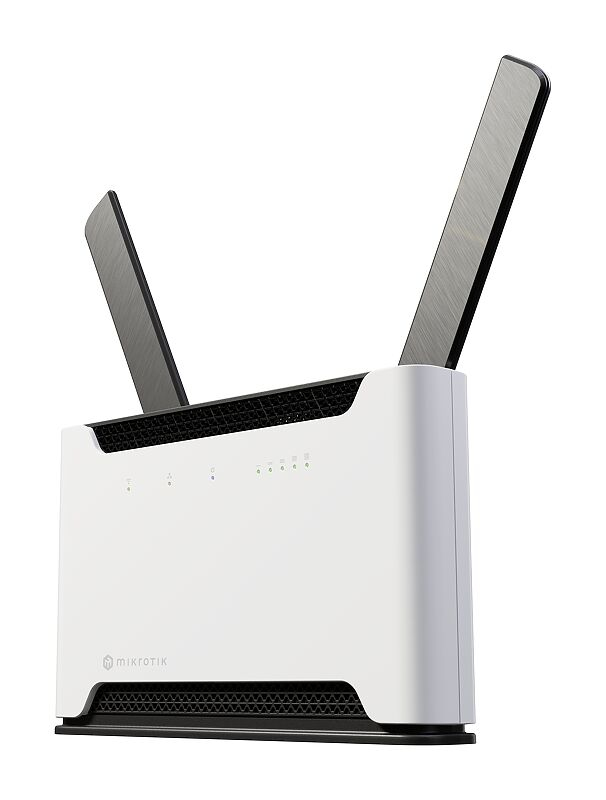
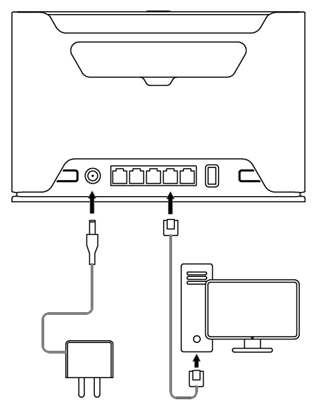
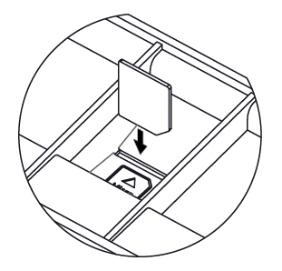
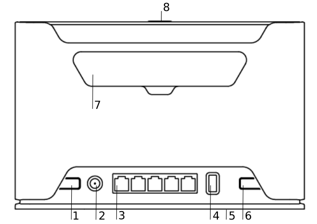
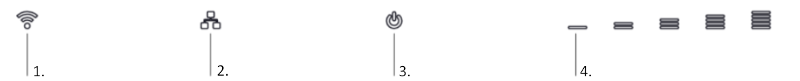
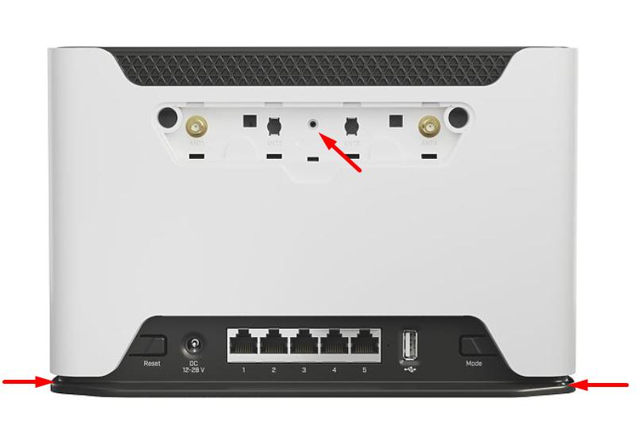
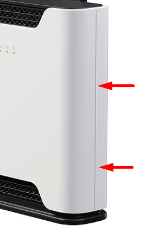

## [Chateau 5G R17 ax](https://mikrotik.com/product/chateau_5g_r17_ax) (S53UG+5HaxD2HaxD-TC&RG650E-EU)

Get online instantly – even without a SIM card. The iconic MikroTik 5G home router gets its smartest upgrade yet... full eSIM support! See the [Chateau 5G R17 ax product page](https://mikrotik.com/product/chateau_5g_r17_ax) for full specifications and brochures.

## Safety Warnings

- Before you work on any equipment, be aware of the hazards involved with electrical circuitry, and be familiar with standard practices for preventing accidents.
- Ultimate disposal of this product should be handled according to all national laws and regulations.
- The Installation of the equipment must comply with local and national electrical codes.
- This product is intended to be installed indoors. Keep this product away from water, fire, humidity, or hot environments.
- Use only the power supply and accessories approved by the manufacturer, which can be found in the original packaging of this product.
- Read the installation instructions before connecting the system to the power source.
- We cannot guarantee that no accidents or damage will occur due to the improper use of the device. Use this product with care and operate at your own risk!
- In the case of device failure, disconnect it from power. The fastest way to do so is by unplugging the power plug from the power outlet.
- It is the customer's responsibility to follow local country regulations, including operation within legal frequency channels, output power, cabling requirements, and Dynamic Frequency Selection (DFS) requirements. All MikroTik radio devices must be professionally installed.
- To avoid pollution of the environment, separate the device from household waste and dispose of it in a safe manner, such as at designated waste disposal sites. Familiarize yourself with the procedures for the proper transportation of the equipment to the designated disposal sites in your area.

**Exposure to Radio Frequency Radiation:** This MikroTik equipment complies with European Union radiation exposure limits set forth for an uncontrolled environment. This MikroTik device should be installed and operated no closer than 20 centimeters from your body, occupational user, or the general public.

## Quickstart

follow these quick steps to set up your device:

- Insert a SIM card into the slot as indicated on the device; if you want to use eSIM, read the eSIM section;

- Connect the device to the power source;
- Connect to the device through either one of the Ethernet ports or the wireless network "MikroTik-..." (ensure to check the wireless passwords on the sticker);
- Establish a connection using a mobile application. Alternatively, use WebFig in a web browser or the "WinBox" configuration tool at [https://mt.lv/winbox](https://mt.lv/winbox). **Multiple configuration methods are available to ensure accessibility;**
- Start configuration within the chosen tool, using the default IP address 192.168.88.1. If the IP address is unavailable, use WinBox and choose the "Neighbors" tab to find the device;
- Proceed to connect using the MAC address. The username is "admin", and there is no password (or, for some models, check user and wireless passwords on the sticker);
- Select the "Check for updates" button and update RouterOS to the latest version. A valid SIM card must be inserted or an eSIM set up, along with an active Internet connection, for updates to work;
- For a manual update of the device, visit mikrotik.com, select your model, and locate the required packages in the "Downloads" section;
- Upload downloaded packages to the WebFig or WinBox "Files" menu and reboot the device;
- By upgrading your RouterOS software to the latest version, you can ensure optimal performance, stability, and security updates;
- In the "QuickSet" menu set up the following: Choose your country, to apply country regulation settings;
- Set up your wireless network password in the left field;
- Set up your router password in the bottom field.

## Connecting with a mobile app

Use your smartphone to access your router through WiFi.

- Insert a SIM card into the slot as indicated on the device and power on the device; if you want to use eSIM, read the eSIM section;
- Scan the QR code and choose your preferred OS.
- Install and open the application.
- Select Connect to establish a connection to your device through a wireless network (check the wireless passwords on the sticker).
- The username is "**admin**" and there is no password (or, for some models, check user and wireless passwords on the sticker).
- Choose Quick Setup and the application will guide you through all basic configuration settings in a couple of easy steps.
- An advanced menu is available to fully configure all necessary settings.

## Extension slots and ports

- (link)DC jack 2.0 mm.
- Four Gigabit ports and one 2.5 Gigabit port, supporting automatic cross/straight cable correction (Auto MDI/X). Either straight or crossover cable can be used for connecting to other network devices.
- USB type-A.
- (link) for Micro SIM card.
- Mode button.
- Cover for external SMA antenna connector is not provided for models with antennas
- WPS (link)
- Product code: **S53UG+5HaxD2HaxD-TC&RG650E-EU**.
- CPU: Quad-Core IPQ-6010 1.8 GHz.
- CPU: architecture ARM 64bit.
- Size of RAM: 1 GB.
- RAM type: DDR3L.
- Storage: 128 MB, NAND.
- A number of 1G Ethernet ports: 4.
- A number of 2.5G Ethernet ports: 1.
- Micro SIM slots: 1.
- eSIM.
- USB: 1 USB 3.0 type A.
- Switch chip model: IPQ-6010.
- Wireless interface model: QCN-5022 (2.4 GHz), QCN-5052 (5 GHz).
- Wireless: 2.4 GHz 802.11b/g/n/ax dual-chain, 5 GHz 802.11a/n/ac/ax dual-chain.
- LTE category: 20 (2.0 Gbps Downlink, 211 Mbps Uplink).
- LTE modem: RG650E-EU.
- TAC: 86896506.
- 5G SA Category: 7.01 Gbps Downlink, 1.25 Gbps Uplink.
- 5G NSA Category: 5.47 Gbps Downlink, 730 Mbps Uplink.
- 3G Category: R8 (42.2Mbps Downlink, 5.76Mbps Uplink).
- MIMO DL: 4x4.
- MIMO UL: 1x1 (5G SA MIMO UL 2x2).
- 5G SA FDD bands: 1 (2100 MHz) / 3 (1800 MHz) / 5 (850 MHz) / 7 (2600 MHz) / 8 (900 MHz) / 20 (800 MHz) / 26 (850 MHz) / 28 (700 MHz) / 67 (700 MHz) / 75 (1500 MHz) / 76 (1500 MHz).
- 5G SA TDD bands: 38 (2600 MHz) / 40 (2300 MHz) / 41 (2500 MHz) / 77 (3700 MHz) / 78 (3500 MHz).
- 5G NSA FDD bands: 1 (2100 MHz) / 3 (1800 MHz) / 5 (850 MHz) / 7 (2600 MHz) / 8 (900 MHz) / 20 (800 MHz) / 26 (850 MHz) / 28 (700 MHz) / 67 (700 MHz) / 75 (1500 MHz) / 76 (1500 MHz).
- 5G NSA TDD bands: 38 (2600 MHz) / 40 (2300 MHz) / 41 (2500 MHz) / 77 (3700 MHz) / 78 (3500 MHz).
- LTE FDD bands: 1 (2100MHz) / 3 (1800MHz) / 5 (850MHz) / 7 (2600MHz) / 8 (900 MHz) / 20 (800MHz) / 28 (700MHz) / 32 (1500 MHz).
- LTE TDD bands: 38 (2600MHz) / 41 (2500MHz) / 42 (3500MHz) / 40 (2300MHz) / 43 (3700MHz).
- 3G bands: 1 (2100MHz) / 5 (850MHz) / 8 (900MHz).
- Dimensions: 240 x 156 x 44 mm.
- Operating system RouterOS: v7, License level 4.
- Operating temperature: -40°C to +70°C.

## Mounting

The device is designed to be used indoors, by placing it on the desktop.

You should use CAT5 shielded cable. When using and installing this device pay attention to the Maximum Permissible Exposure (MPE) safety distance with a minimum of 20 cm between the radiator and your body.

## Powering

- A number of DC inputs 1.
- DC jack input Voltage 12-28 V.
- Power adapter nominal voltage 24 V.
- Power adapter nominal current 1.2 A.
- Max power consumption without attachments is 18 W.
- Max power consumption 27 W.

## Configuration

Configuration can be done using a web browser via WebFig, the WinBox tool [https://mt.lv/winbox](https://mt.lv/winbox), or a (link). Multiple methods are available to ensure accessibility.

- To access WebFig, open [https://192.168.88.1](https://192.168.88.1) in your browser.
- For WinBox, download the tool, go to the Neighbors tab, and select the MAC address. The default username is "admin", **find the password on the device sticker**. You should check for updates frequently to ensure your RouterOS software remains up to date for the best performance and stability. Select the "Check for updates" button in WinBox or WebFig to update to the latest version.

A valid SIM card must be inserted or an eSIM set up, along with an active Internet connection, for updates to work.

RouterOS offers many additional configuration options beyond those described in this document. For more details, visit [https://mt.lv/help](https://mt.lv/help) For recovery purposes, the device can be booted into reinstallation mode. See the section (link) section for instructions.

## Mode button

The Mode button is located on the back of the unit, on the right-hand side. By default, the Mode button is configured to control dark mode.

To turn off all LEDs, briefly press the Mode button once.To turn the LEDs back on, press the button again.

The button can also be configured in RouterOS to execute user-defined scripts.

## Sync button

The sync button is located on the top of the unit. WPS Sync button, if configured on the wireless interface, can be used to connect new clients.

- Press and hold the WPS button for 1 – 5 seconds to enable WPS for wireless interfaces.

## Front LED status

- Wireless network activity.
- Ethernet port activity.
- System LED.
- Signal strength. Cellular connection technology based on the System LED color: Red: GSM Yellow: 3G Blue: LTE Green: 5G NSA Violet: 5G SA

When LTE is not connected to the network, the system LED will blink red to indicate that there is some issue with the LTE connection. If the LTE interface is intentionally disabled (not being used), the system LED will glow blue.

## SIM slot usage

SIM card slot is designed to use with Micro SIM cards. Nano SIM cards have different thicknesses, usage with an adapter is not recommended.

## eSIM settings

By default the device is configured to use the SIM slot. To use the on-board eSIM, switch the slot by using the following command: **/interface/lte/settings/set sim-slot=esim**

A single eSIM chip can store multiple eSIM profiles, the maximum profile count depends on the eSIM chip used.

See the [LTE eSIM](/docs/mobile-networking/lte-5g#lte-esim) page for details.

## Reset button

The reset button has three functions:

- Hold this button during boot time until the green LED light starts flashing, release the button to reset RouterOS configuration (total 5 seconds).
- Keep holding for 5 more seconds, LED turns solid, release now to turn on CAP mode. The device will now look for a CAPsMAN server (total of 10 seconds).
- To reinstall RouterOS using the Netinstall utility, enter the device into BOOTP mode. There are two types of booters available: the regular booter and the backup booter.Regular booter - Power on the device, wait 1-2 seconds, then press and hold the Reset button. Wait until the System LED is blinking green, then turns solid "On". When the green LED turns "Off", release the Reset button - the device will enter BOOTP mode.
- Backup booter – Power off the device, press and hold the Reset button, then power it on. Wait until the System LED is blinking green, then solid "On". When the green LED turns "Off", release the Reset button - the device will enter BOOTP mode using the backup booter. Regardless of the above option used, the system will load the backup RouterBOOT loader if the button is pressed before power is applied to the device. Useful for RouterBOOT debugging and recovery.

NetinstallWhen performing Netinstall, make sure to use the latest v7 version of both ROS files and the Netinstall software.

## Accessories

The package includes the following accessories that come with the device:

- ADAPT1_ EU/US Switching Power Supply 24V, 1.2A.
- CAB3_ CAT5E UTP Flat Cable, 8P8C, AWG32, 1.5m.

## Removing back cover to access PCB

In case there is a need to access PCB, the back cover can be removed.

- Remove center screw;

- Use a small screwdriver to pry open backplate in marked spots;
- Continue to pry it open by going up;

- At the end lift off the whole backplate.

## Operating system support

The device supports RouterOS v7 and above. The specific factory-installed version is listed in /system resource. Other operating systems have not been tested.

For important safety instructions and regulatory certifications, refer to the Safety and Regulatory Information document available for each product: to: Documents→ Safety and Regulatory Information
