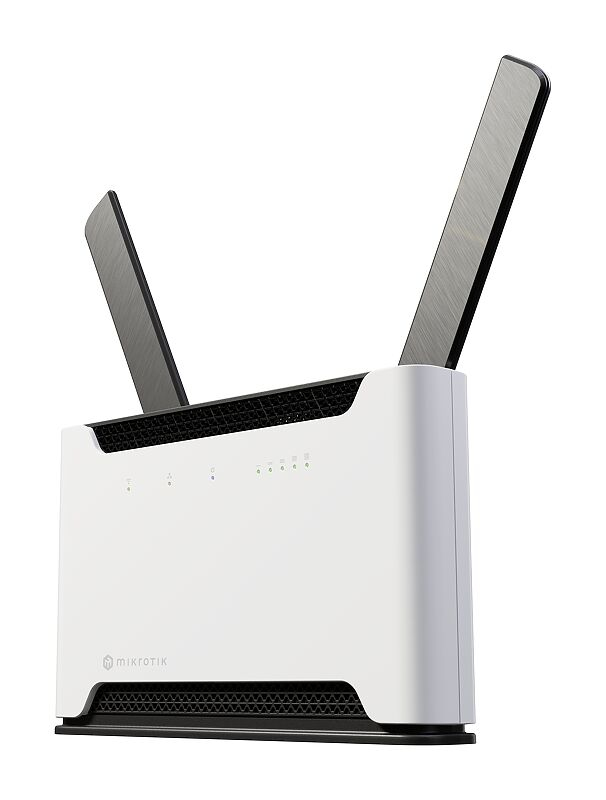
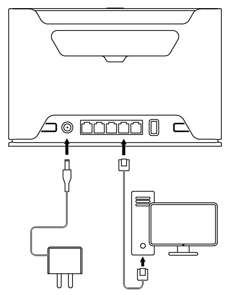
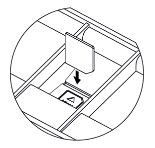
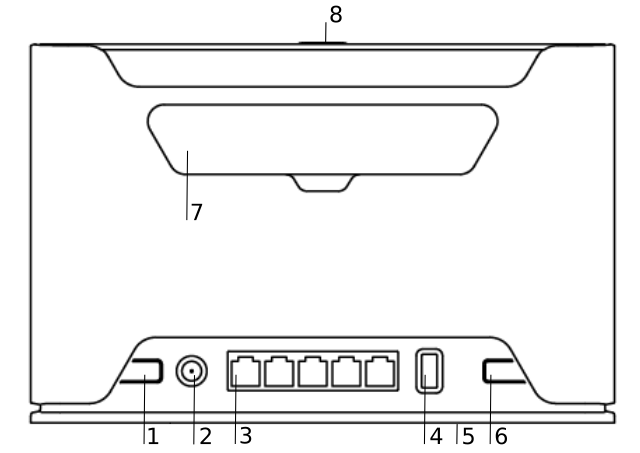
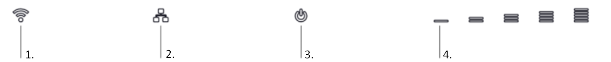
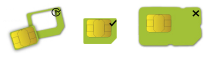
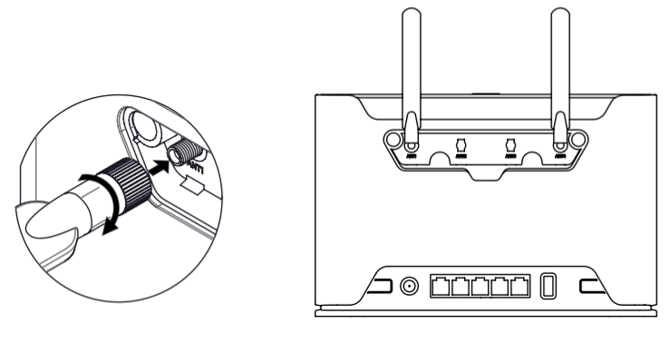
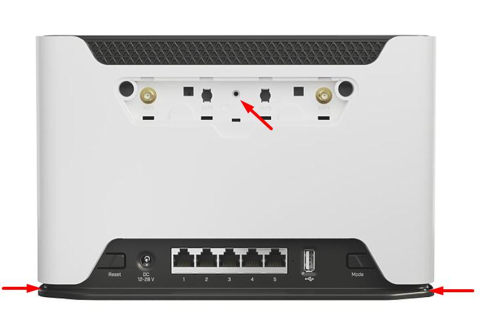
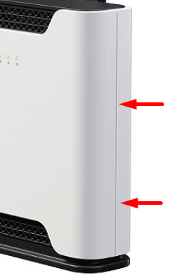

## [Chateau 5G](https://mikrotik.com/product/chateau_5g) (D53G-5HacD2HnD-TC&RG502Q-EA)

## Safety Warnings

- Before you work on any equipment, be aware of the hazards involved with electrical circuitry, and be familiar with standard practices for preventing accidents. See the [Chateau 5G product page](https://mikrotik.com/product/chateau_5g) for full specifications and brochures.
- Ultimate disposal of this product should be handled according to all national laws and regulations.
- The Installation of the equipment must comply with local and national electrical codes.
- This product is intended to be installed indoors. Keep this product away from water, fire, humidity or hot environments.
- Use only the power supply and accessories approved by the manufacturer, and which can be found in the original packaging of this product.
- Read the installation instructions before connecting the system to the power source.
- We cannot guarantee that no accidents or damage will occur due to the improper use of the device. Use this product with care and operate at your own risk!
- In the case of device failure, disconnect it from power. The fastest way to do so is by unplugging the power plug from the power outlet.
- It is the customer's responsibility to follow local country regulations, including operation within legal frequency channels, output power, cabling requirements, and Dynamic Frequency Selection (DFS) requirements. All MikroTik radio devices must be professionally installed.

**Exposure to Radio Frequency Radiation:** This MikroTik equipment complies with the FCC, IC, and European Union radiation exposure limits set forth for an uncontrolled environment. This MikroTik device should be installed and operated no closer than 20 centimeters from your body, occupational user, or the general public.

## Quickstart

follow these quick steps to set up your device:

- Connect an external antennas to the SMA connector (The antennas are provided in the package, see "(link)");
- Insert micro SIM card into the slot located under the device;

- Connect your computer to one of the Ethernet ports;
- Connect the power adapter to the DC jack;
- Once the device is powered on and PC connected to the device, open [https://192.168.88.1](https://192.168.88.1) in your web browser to start the configuration (or, for some models, check user and wireless passwords on the sticker);
- User name: a*dmin* and there is no password by default you will be logged in automatically to the Quick Set screen;
- You should select the "Check for updates" button on the right side and update your RouterOS software to the latest version to ensure the best performance and stability, Must have a valid SIM card inserted;
- To manually update the device, go to [https://mikrotik.com/download](https://mikrotik.com/download)
- Choose ARM packages for this device and download them to your PC.
- Upload downloaded packages to the WebFig "Files" menu and reboot the device.
- Updating your RouterOS software to the latest version will ensure the best performance, stability, and security updates.
- To personalize your wireless network, SSID can be changed in the fields "Network Name";
- Choose your country on the left side of the screen in the field "Country", to apply country regulation settings;
- Set up your wireless network password in the field "WiFi Password" the password must be at least eight symbols;
- Set up your router password in the bottom field "Password" to the right and repeat it in the field "Confirm Password", it will be used to log in next time;
- Select the "Apply Configuration" to save changes.

## Connecting with a mobile app

Use your smartphone to access your router through WiFi.

- Insert the SIM card and power on the device.
- Scan QR code with your smartphone and choose your preferred OS.
- Connect to the wireless network. SSID starts with MikroTik and has the last digits of the device's MAC address.
- Open application.
- By default, the IP address and user name will be already entered.
- Select Connect to establish a connection to your device through a wireless network.
- Choose Quick setup and the application will guide you through all basic configuration settings in a couple of easy steps.
- An advanced menu is available to fully configure all necessary settings.

## Extension slots and ports

- (link).
- (link) DC jack 2.0 mm.
- Five Gigabit ports, supporting automatic cross/straight cable correction (Auto MDI/X). Either straight or crossover cable can be used for connecting to other network devices.
- USB type-A.
- (link) for Micro sim card.
- Mode button.
- Cover for external (link) is not provided for models with antennas.
- WPS (link)
- Integrated Wireless module operating at 2.4 GHz, 802.11b/g/n protocol. Antenna gain 3 (dBi).
- Integrated Wireless module operating at 5 GHz, 802.11a/n/ac protocol. Antenna gain 4 (dBi).

## Mounting

The device is designed to be used indoors, by placing it on the desktop.

You should use Cat5 shielded cable. When using and installing this device pay attention to the Maximum Permissible Exposure (MPE) safety distance with a minimum of 20 cm between the radiator and your body.

## Powering

The device accepts power from an adapter:

- Direct-input power jack (5.5 mm outside and 2 mm inside, female, pin positive plug) 12-28 V DC⎓. The power consumption under maximum load can reach 17 W, with attachments of 23 W.

## Configuration

You should check for updates frequently to receive the latest updates for your RouterOS software to ensure the best performance and stability. RouterOS includes many configuration options in addition to what is described in this document. We suggest starting here to get yourself accustomed to the possibilities: [https://mt.lv/help](https://mt.lv/help) In case an IP connection is not available, the WinBox tool ([https://mt.lv/winbox](https://mt.lv/winbox)) can be used to connect to the MAC address of the device from the LAN side (all access is blocked from the Internet port by default). For recovery purposes, it is possible to boot the device for reinstallation, see section (link).

## Mode button

The mode button is located on the back of the unit, on the right side. The Default configuration for the Mode button is dark mode - to turn off all LEDs. The button can be configured in RouterOS to run any user-specified scripts.

## Sync button

The sync button is located on the top of the unit. WPS Sync button, if configured on the wireless interface, can be used to connect new clients.

- Press and hold the WPS button for 1 – 5 seconds to enable WPS for wireless interfaces.

## Front LED status

- Wireless network activity.
- Ethernet port activity.
- System LED with alternate mode for cellular modem status indication.
- Signal strength.

### System LED alternate modem mode indications

When cellular modem interface is enabled, System LED have have alternate indications:

blinking red - SIM card not inserted

yellow - established connection in 3G mode

blue - established connection in LTE mode

green - established connection in 5G NSA mode

violet - established connection in 5G SA mode

blinking - connection establishment in progress, modem registered in cellular network, APN is not activated yet

## SIM slot usage

SIM card slot is designed to use with Micro SIM cards. Nano SIM cards have different thicknesses, usage with an adapter is not recommended.

## Reset button

The reset button has three functions:

- Hold this button during boot time until the green LED light starts flashing, release the button to reset RouterOS configuration (total 5 seconds).
- Keep holding for 5 more seconds, LED turns solid, release now to turn on CAP mode. The device will now look for a CAPsMAN server (total of 10 seconds).
- To reinstall RouterOS using the Netinstall utility, enter the device into BOOTP mode. There are two types of booters available: the regular booter and the backup booter.Regular booter - Power on the device, wait 1-2 seconds, then press and hold the Reset button. Wait until the System LED is blinking green, then turns solid "On". When the green LED turns "Off", release the Reset button - the device will enter BOOTP mode.
- Backup booter – Power off the device, press and hold the Reset button, then power it on. Wait until the System LED is blinking green, then solid "On". When the green LED turns "Off", release the Reset button - the device will enter BOOTP mode using the backup booter. Regardless of the above option used, the system will load the backup RouterBOOT loader if the button is pressed before power is applied to the device. Useful for RouterBOOT debugging and recovery.

NetinstallWhen performing Netinstall, make sure to use the latest v7 version of both ROS files and the Netinstall software.

## Accessories

The package includes the following accessories that come with the device:

- ADAPT1_ EU/US Switching Power Supply 24V, 1.2A.
- CAB3_ CAT5E UTP Flat Cable, 8P8C, AWG32, 1.5m.
- ANT8-9_ external LTE antenna.

## Antenna usage

SMA connectors are for provided LTE antennas.

When connecting or disconnecting the external antennas device must be powered off, otherwise, the device may be damaged!

External antenna sockets are located on the back of the device.

- Screw both antennas to the SMA sockets (Follow the instructions in the illustrations).

## Removing back cover to access PCB

In case there is a need to access PCB, the back cover can be removed.

- Remove center screw;

- Use a small screwdriver to pry open backplate in marked spots;
- Continue to pry it open by going up;

- At the end lift off the whole backplate.

## Operating system support

The device supports RouterOS v7 and above. The specific factory-installed version is listed in /system resource. Other operating systems have not been tested.

To avoid pollution of the environment, separate the device from household waste and dispose of it in a safe manner, such as in designated waste disposal sites. Familiarize yourself with the procedures for the proper transportation of the equipment to the designated disposal sites in your area.

## UKCA marking

## Eurasian Conformity Mark

<table><thead><tr><th>Частотный диапазон</th><th>Мощность передатчика</th></tr></thead><tbody><tr><td>2400-2483.5 МГц, 5150-5350 МГц, 5650-5850 МГц</td><td>≤100 мВт</td></tr></tbody></table>

*Доступные частотные каналы могут различаться в зависимости от модели продукта и сертификации.

Информация о дате изготовления устройства указана в конце серийного номера на его наклейке через дробь. Первая цифра означает номер года (последняя цифра года), две последующие означают номер недели.

Изготовитель: MikroTikls SIA, Aizkraukles iela 23, Riga, LV-1006, Латвия, [support@mikrotik.com](mailto:support@mikrotik.com). Сделано в Китае, Латвии или Литве. Cм. на упаковке.

Для получения подробных сведений о гарантийном обслуживании обратитесь к продавцу. Информация об импортерах продукции MikroTik в Российскую Федерацию: [https://mikrotik.com/buy/europe/russia](https://mikrotik.com/buy/europe/russia)

Продукты MikroTik, которые поставляются в Евразийский таможенный союз, оцениваются с учетом соответствующих требований и помечены знаком EAC, как показано ниже:

## Norma Oficial Mexicana

Rango de frecuencia (potencia de salida máxima): 2400-2483.5 MHz (30 dBm), 5725-5850 MHz (30 dBm). Los canales de frecuencia disponibles pueden variar según el modelo y la certificación del producto.

EFICIENCIA ENERGETICA CUMPLE CON LA NOM-029-ENER-2017.

La operacion de este equipo esta sujeta a las siguientes dos condiciones:

- Es posible que este equipo o dispositivo no cause interferencia perjudicial y.
- Este equipo debe aceptar cualquier interferencia, incluyendo la que pueda causar su operacion no deseada. Fabricante: MikroTikls SIA, Brivibas gatve 214i, Riga, LV-1039, Latvia.

País De Origen: Letonia; Lituania; China (Republica Popular); Estados Unidos De America; Mexico.

Por favor contacte a su distribuidor local para preguntas regionales específicas. La lista de importadores se puede encontrar en nuestra página de inicio – [https://mikrotik.com/buy/latinamerica/mexico](https://mikrotik.com/buy/latinamerica/mexico).

## The National Commission for the State Regulation of Communications and Informatization by Ukraine

Виробник: MikroTikls SIA, Brivibas gatve 214i Рига, Латвія, LV1039.

Робоча частота (Максимальна вихідна потужність): 2480-2483.5 МГц (20 дБм), 5150-5250 МГц (23 дБм), 5250-5350 МГц (20 дБм), 5470-5725 МГц (27 дБм).

Справжнім MikroTikls SIA заявляє, що маршрутизатор відповідає основним вимогам та іншим відповідним положенням директиви 2014/53/EC, а також суттєвим вимогам Технічного регламенту радіообладнання, затвердженого постановою Кабінету Міністрів України від 24 травня 2017 року № 355.

Для експлуатації в Україні необхідно отримати дозвіл на експлуатацію у порядку, затвердженому рішенням НКРЗІ від 01.11.2012 № 559, зареєстрованому в Міністерстві юстиції України 03.01.2013 за № 57/22589.

## CE Declaration of Conformity

Manufacturer: MikroTikls SIA, Brivibas gatve 214i Riga, Latvia, LV1039.

Hereby, Mikrotīkls SIA declares that the radio equipment type D53G-5HacD2HnD-TC&RG502Q-EA is in compliance with Directive 2014/53/EU. The full text of the EU declaration of conformity is available at the following internet address: [https://mikrotik.com/products](https://mikrotik.com/products)

### WLAN / WCDMA / LTE / 5G

<table><thead><tr><th>Operating Frequency / Maximum output power Betriebsfrequenz / maximale Ausgangsleistung Fréquence de fonctionnement / puissance de sortie maximale Frequenza operativa / massima potenza di uscita Frecuencia de funcionamiento / potencia de salida máxima Рабочая частота / максимальная выходная мощность</th><th>WLAN 2.4 Ghz</th><th>2400-2483.5 MHz / 20 dBm</th></tr></thead><tbody><tr><td>WLAN 5Ghz</td><td>5150-5250 MHz / 23 dBm</td><td></td></tr><tr><td>WLAN 5Ghz</td><td>5250-5350 MHz / 20 dBm</td><td></td></tr><tr><td>WLAN 5Ghz</td><td>5470-5725 MHz / 27 dBm</td><td></td></tr><tr><td>WCDMA Band I</td><td>1922.4 MHz / 23dBm ± 2.7 dB</td><td></td></tr><tr><td>WCDMA Band III</td><td>1712.4 MHz / 23dBm ± 2.7 dB</td><td></td></tr><tr><td>WCDMA Band V</td><td>826.4 MHz / 23dBm ± 2.7 dB</td><td></td></tr><tr><td>WCDMA Band VIII</td><td>882.4 MHz / 23dBm ± 2.7 dB</td><td></td></tr><tr><td>LTE Band 1</td><td>2100 MHz / 23dBm ± 2.7 dB</td><td></td></tr><tr><td>LTE Band 3</td><td>1700 MHz / 23dBm ± 2.7 dB</td><td></td></tr><tr><td>LTE Band 5</td><td>850 MHz / 23dBm ± 2.7 dB</td><td></td></tr><tr><td>LTE Band 7</td><td>2600 MHz / 23dBm ± 2.7 dB</td><td></td></tr><tr><td>LTE Band 8</td><td>900 MHz / 23dBm ± 2.7 dB</td><td></td></tr><tr><td>LTE Band 20</td><td>800 MHz / 23dBm ± 2.7 dB</td><td></td></tr><tr><td>LTE Band 28</td><td>700 MHz / 23dBm ± 2.7 dB</td><td></td></tr><tr><td>LTE Band 32</td><td>1500 MHz / 23dBm ± 2.7 dB</td><td></td></tr><tr><td>LTE Band 34</td><td>2000 MHz / 23dBm ± 2.7 dB</td><td></td></tr><tr><td>LTE Band 38</td><td>2600 MHz / 23, 26dBm ± 2.7 dB</td><td></td></tr><tr><td>LTE Band 40</td><td>2300 MHz / 23, 26dBm ± 2.7 dB</td><td></td></tr><tr><td>LTE Band 41</td><td>2500 MHz / 23, 26dBm ± 2.7 dB</td><td></td></tr><tr><td>LTE Band 42</td><td>3500 MHz / 23, 26dBm ± 3 dB</td><td></td></tr><tr><td>LTE Band 43</td><td>3700 MHz / 23dBm ± 3 dB</td><td></td></tr><tr><td>5G NR Band n1</td><td>2100 MHz / 23dBm ± 2 dB</td><td></td></tr><tr><td>5G NR Band n3</td><td>1800 MHz / 23dBm ± 2 dB</td><td></td></tr><tr><td>5G NR Band n7</td><td>2600 MHz / 23dBm ± 2 dB</td><td></td></tr><tr><td>5G NR Band n8</td><td>900 MHz / 23dBm ± 2 dB</td><td></td></tr><tr><td>5G NR Band n20</td><td>800 MHz / 23dBm ± 2 dB</td><td></td></tr><tr><td>5G NR Band n28</td><td>700 MHz / 23dBm ± 2 dB</td><td></td></tr><tr><td>5G NR Band n38</td><td>2600 MHz / 23dBm ± 2 dB</td><td></td></tr><tr><td>5G NR Band n40</td><td>2300 MHz / 23dBm ± 2 dB</td><td></td></tr><tr><td>5G NR Band n41</td><td>2500 MHz / 26dBm ± 2 dB</td><td></td></tr><tr><td>5G NR Band n77</td><td>3700 MHz / 26dBm ± 2 dB</td><td></td></tr><tr><td>5G NR Band n78</td><td>3500 MHz / 26dBm ± 2 dB</td><td></td></tr></tbody></table>

This MikroTik device meets Maximum transmit power limits per ETSI regulations. For more detailed information see Declaration of Conformity above / Dieses MikroTik-Gerät erfüllt die maximalen Sendeleistung Grenzwerte gemäß ETSI-Vorschriften. Weitere Informationen finden Sie oben in der Konformitätserklärung / Cet appareil MikroTik respecte les limites de puissance de transmission maximale conformément aux réglementations ETSI. Pour plus d'informations, voir la déclaration de conformité ci-dessus / Questo dispositivo MikroTik è conforme ai limiti di potenza massima di trasmissione in conformità con le normative ETSI. Per ulteriori informazioni, consultare la dichiarazione di conformità sopra / Este dispositivo MikroTik cumple con los valores límite de potencia máxima de transmisión de acuerdo con la normativa ETSI. Para obtener información más detallada, consulte la Declaración de conformidad anterior / Это устройство MikroTik соответствует предельным значениям максимальной мощности передачи в соответствии с правилами ETSI. Для получения более подробной информации см. Декларацию соответствия выше.

The WLAN function for this device is restricted to indoor use only when operating in the 5150 to 5350 MHz frequency range. / Die WLAN-Funktion dieses Geräts ist nur für die Verwendung in Innenräumen im Frequenzbereich 5150 bis 5350 MHz beschränkt. / La fonction WLAN de cet appareil est limitée à une utilisation en intérieur uniquement lorsqu'il fonctionne dans la gamme de fréquences 5150 à 5350 MHz. / La funzione WLAN per questo dispositivo è limitata all'uso interno solo quando si opera nella gamma di frequenza da 5150 a 5350 MHz. / La función WLAN para este dispositivo está restringida al uso en interiores solo cuando se opera en el rango de frecuencia de 5150 a 5350 MHz. / Функция WLAN для этого устройства ограничена использованием внутри помещения только при работе в диапазоне частот от 5150 до 5350 МГц.
