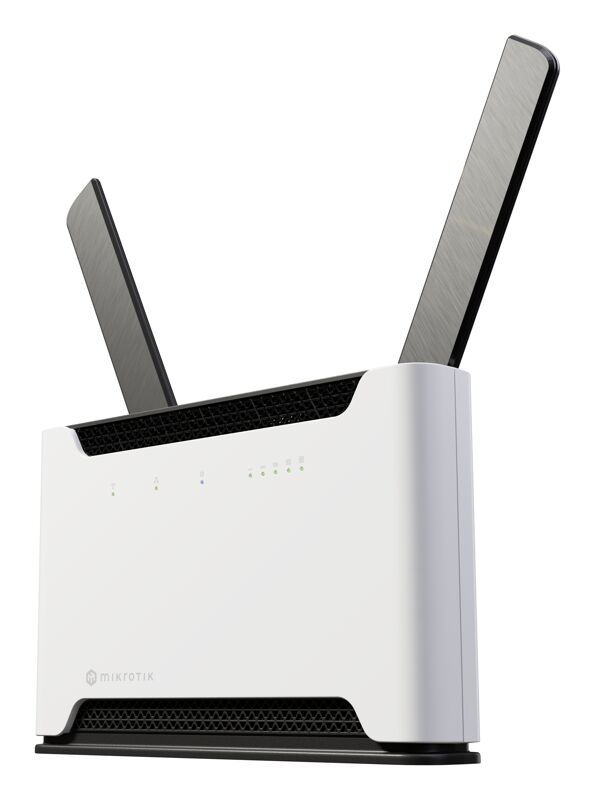
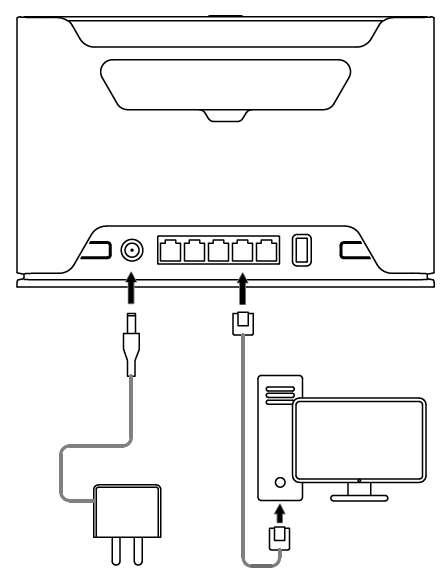
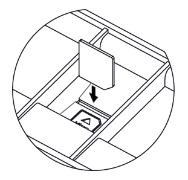
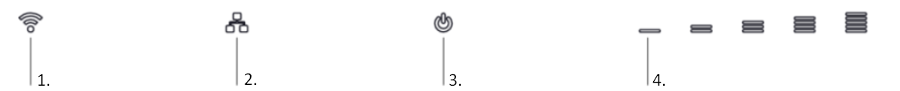

## [Chateau LTE7 ax](https://mikrotik.com/product/chateau_lte7_ax) (S53UG+5HaxD2HaxD-TC&R11e-LTE7)

Your favorite high-performance home and office LTE router just got a major upgrade. Chateau LTE7 ax keeps the same powerful hardware, sleek design, and Wi-Fi 6 performance – but now features an LTE Category 7 modem, expanded frequency support, and a significantly lower price than the previous LTE6 ax version. See the [Chateau LTE7 ax product page](https://mikrotik.com/product/chateau_lte7_ax) for full specifications and brochures.

## Quickstart

follow these quick steps to set up your device:

- Insert a Micro SIM card into the slot located under the device;

- Connect the device to the power source;
- Connect to the device through either one of the Ethernet ports or the wireless network "MikroTik-..." (ensure to check the wireless passwords on the sticker);
- Establish a connection using a mobile application. Alternatively, use WebFig in a web browser or the "WinBox" configuration tool at [https://mt.lv/winbox](https://mt.lv/winbox). **Multiple configuration methods are available to ensure accessibility.**
- Start configuration within the chosen tool, using the default IP address 192.168.88.1. If the IP address is unavailable, use WinBox and choose the "Neighbors" tab to find the device;
- Proceed to connect using the MAC address. The username is "admin" and there is no password (or, for some models, check user and wireless passwords on the sticker);
- Select the "Check for updates" button and update RouterOS to the latest version. Must have a valid SIM card inserted and active Internet connection;
- For a manual update of the device, visit mikrotik.com, select your model, and locate the required packages in the "Downloads" section;
- Upload downloaded packages to the WebFig or WinBox "Files" menu and reboot the device;
- By upgrading your RouterOS software to the latest version, you can ensure optimal performance, stability, and security updates;
- In the "QuickSet" menu set up the following: Choose your country, to apply country regulation settings;
- Set up your wireless network password in the left field;
- Set up your router password in the bottom field.

## Connecting with a mobile app

Use your smartphone to access your router through WiFi.

- Insert the SIM card and power on the device.
- Scan the QR code with your smartphone and choose your preferred OS.
- Connect to the wireless network. SSID starts with MikroTik and has the last digits of the device's MAC address.
- Open application.
- By default, the IP address and user name will be already entered.
- Select Connect to establish a connection to your device through a wireless network.
- Choose Quick setup and the application will guide you through all basic configuration settings in a couple of easy steps.
- An advanced menu is available to fully configure all necessary settings.

## Specifications

<table><thead><tr><th>**Parameter**</th><th>**Value**</th></tr></thead><tbody><tr><td>**Product Code**</td><td>S53UG+5HaxD2HaxD-TC&R11e-LTE7</td></tr><tr><td>**Architecture**</td><td>ARM 64bit</td></tr><tr><td>**CPU**</td><td>IPQ-6010</td></tr><tr><td>**CPU Core Count**</td><td>4</td></tr><tr><td>**CPU Threads Count**</td><td>4</td></tr><tr><td>**CPU Frequency**</td><td>Auto</td></tr><tr><td>**Switch Chip Model**</td><td>IPQ-6010</td></tr><tr><td>**RAM**</td><td>1 GB</td></tr><tr><td>**Storage**</td><td>128 MB NAND</td></tr><tr><td>**RouterOS License**</td><td>Level 4</td></tr><tr><td>**Operating System**</td><td>RouterOS v7</td></tr><tr><td>**MTBF**</td><td>~200,000 hours at 25°C</td></tr><tr><td>**Operating Temperature**</td><td>-40 °C to +70 °C</td></tr><tr><td>**10/100/1000 Ethernet Ports**</td><td>4</td></tr><tr><td>**2.5G Ethernet Ports**</td><td>1</td></tr><tr><td>**SIM Slots**</td><td>1 (Micro SIM)</td></tr><tr><td>**USB Ports**</td><td>1 × USB Type-A (power reset supported, max 1 A)</td></tr><tr><td>**Wireless 2.4 GHz**</td><td>574 Mbit/s, 2 chains, 802.11b/g/n/ax, 3 dBi, QCN-5022, Wi-Fi 6</td></tr><tr><td>**Wireless 5 GHz**</td><td>1200 Mbit/s, 2 chains, 802.11a/n/ac/ax, 6 dBi, QCN-5052, Wi-Fi 6</td></tr><tr><td>**3G Category**</td><td>R8 (DL 42.2 Mbps / UL 5.76 Mbps)</td></tr><tr><td>**3G Bands**</td><td>1 (2100MHz) / 3 (1800MHz) / 5 (850MHz) / 8 (900MHz)</td></tr><tr><td>**LTE category**</td><td>7 (DL 300 Mbps / UL 100 Mbps), 2×2 MIMO DL</td></tr><tr><td>**LTE modem**</td><td>R11e-LTE7</td></tr><tr><td>**TAC**</td><td>35312597</td></tr><tr><td>**MIMO DL**</td><td>2x2</td></tr><tr><td>**MIMO UL**</td><td>1x1</td></tr><tr><td>**LTE Bands (FDD)**</td><td>1 (2100MHz) / 3 (1800MHz) / 5 (850MHz) / 7 (2600MHz) / 8 (900 MHz) / 20 (800MHz) / 28 (700MHz) / 32 (1500 MHz)</td></tr><tr><td>**LTE Bands (TDD)**</td><td>38 (2600MHz) / 40 (2300MHz) / 41 (2500MHz)</td></tr><tr><td>**DC Inputs**</td><td>1 (DC jack)</td></tr><tr><td>**DC Voltage**</td><td>12–28 V</td></tr><tr><td>**Max Power Consumption**</td><td>21.5 W</td></tr><tr><td>**Max Power (no attachments)**</td><td>15.5 W</td></tr><tr><td>**Cooling**</td><td>Passive</td></tr><tr><td>**Monitoring**</td><td>CPU temp, PCB temp, voltage monitor</td></tr><tr><td>**Other**</td><td>Mode button</td></tr><tr><td>**Dimensions**</td><td>240 x 156 x 44 mm</td></tr><tr><td>**Certifications**</td><td>CE, EAC, RoHS</td></tr><tr><td>**Ingress Protection**</td><td>IP20</td></tr></tbody></table>

## Supported 2xCA combinations

<table><thead><tr><th>**Parameter**</th><th>**Value**</th></tr></thead><tbody><tr><td>B1+B1/3/5/7/8/20/28/32/40/41 (100MHz)</td><td>B20+B1/3/7/32/38/40</td></tr><tr><td>B3+B1/3/5/7/8/20/28/32/40/41 (100MHz)</td><td>B28+B1/3/5/7/32</td></tr><tr><td>B5+B1/3/5/7/28/40/41 (100MHz)</td><td>B40+B40</td></tr><tr><td>B8+B1/3/7/20/32/40/41 (100MHz)</td><td>B41+B41 (100MHz)</td></tr></tbody></table>

## Supported 2×CA (UL) LTE bands (Intra-band contiguous only)

<table><thead><tr><th>**Parameter**</th><th>**Value**</th></tr></thead><tbody><tr><td>B1+B1</td><td>B8+B8</td></tr><tr><td>B3+B3</td><td>B38+B38</td></tr><tr><td>B5+B5</td><td>B40+B40</td></tr><tr><td>B7+B7</td><td>B41+B41</td></tr></tbody></table>

## Wireless specifications

<table><thead><tr><th>Rate (2.4 GHz)</th><th>**Tx (dBm)**</th><th>**Receive Sensitivity**</th></tr></thead><tbody><tr><td>1MBit/s</td><td>23</td><td>-100</td></tr><tr><td>11MBit/s</td><td>23</td><td>-94</td></tr><tr><td>6MBit/s</td><td>24</td><td>-96</td></tr><tr><td>54MBit/s</td><td>21</td><td>-80</td></tr><tr><td>MCS0</td><td>24</td><td>-96</td></tr><tr><td>MCS7</td><td>20</td><td>-75</td></tr><tr><td>MCS9</td><td>19</td><td>-70</td></tr><tr><td>MCS11</td><td>17</td><td>-67</td></tr></tbody></table>

<table><thead><tr><th>Rate (5 GHz)</th><th>**Tx (dBm)**</th><th>**Receive Sensitivity**</th></tr></thead><tbody><tr><td>6MBit/s</td><td>24</td><td>-96</td></tr><tr><td>54MBit/s</td><td>21</td><td>-80</td></tr><tr><td>MCS0</td><td>24</td><td>-96</td></tr><tr><td>MCS7</td><td>20</td><td>-75</td></tr><tr><td>MCS9</td><td>19</td><td>-70</td></tr><tr><td>MCS11</td><td>17</td><td>-67</td></tr></tbody></table>

## Mounting

The device is designed to be used indoors, by placing it on the desktop.

You should use CAT5 shielded cable. When using and installing this device pay attention to the Maximum Permissible Exposure (MPE) safety distance with a minimum of 20 cm between the radiator and your body.

## Configuration

Configuration can be done using a web browser via WebFig, the WinBox tool [https://mt.lv/winbox](https://mt.lv/winbox), or a (link). Multiple methods are available to ensure accessibility.

- To access WebFig, open [https://192.168.88.1](https://192.168.88.1) in your browser.
- For WinBox, download the tool, go to the Neighbors tab, and select the MAC address. The default username is "admin", **find the password on the device sticker**. You should check for updates frequently to ensure your RouterOS software remains up to date for the best performance and stability. Select the "Check for updates" button in WinBox or WebFig to update to the latest version.

A valid SIM card must be inserted along with an active Internet connection, for updates to work.

RouterOS offers many additional configuration options beyond those described in this document. For more details, visit [https://mt.lv/help](https://mt.lv/help) For recovery purposes, the device can be booted into reinstallation mode. See the section (link) section for instructions.

## Mode button

The Mode button is located on the back of the unit, to the right side (see "") The Default configuration for the Mode button is dark mode - to turn off all LEDs. The button can be configured in RouterOS to run any user-specified scripts.

## Sync button

The Sync button is located on the top of the unit. The WPS Sync button, if configured on the wireless interface, can be used to connect new clients.

- Press and hold the WPS button for 1 – 5 seconds to enable WPS for wireless interfaces.

## Front LED status

- Wireless network activity.
- Ethernet port activity.
- System LED.
- Signal strength. Cellular connection technology based on the System LED color: Red: GSM Yellow: 3G Blue: LTE Green: 5G NSA Violet: 5G SA

When LTE is not connected to the network, the system LED will blink red to indicate that there is some issue with the LTE connection. If the LTE interface is intentionally disabled (not being used), the system LED will glow blue.

## SIM slot usage

SIM card slot is designed to be used with Micro SIM cards. Nano SIM cards have different thicknesses and usage with an adapter is not recommended.

## Reset button

The reset button has three functions:

- Hold this button during boot time until the green LED light starts flashing, release the button to reset RouterOS configuration (total 5 seconds).
- Keep holding for 5 more seconds, LED turns solid, release now to turn on CAP mode. The device will now look for a CAPsMAN server (total of 10 seconds).
- To reinstall RouterOS using the Netinstall utility, enter the device into BOOTP mode. There are two types of booters available: the regular booter and the backup booter.Regular booter - Power on the device, wait 1-2 seconds, then press and hold the Reset button. Wait until the System LED is blinking green, then turns solid "On". When the green LED turns "Off", release the Reset button - the device will enter BOOTP mode.
- Backup booter – Power off the device, press and hold the Reset button, then power it on. Wait until the System LED is blinking green, then solid "On". When the green LED turns "Off", release the Reset button - the device will enter BOOTP mode using the backup booter. Regardless of the above option used, the system will load the backup RouterBOOT loader if the button is pressed before power is applied to the device. Useful for RouterBOOT debugging and recovery.

NetinstallWhen performing Netinstall, make sure to use the latest v7 version of both RouterOS. Updating your RouterOS software to the latest version will ensure the best performance, stability, and security updates.

## Accessories

The package includes the following accessories that come with the device:

- EU/US Switching Power Supply 24 V ⎓, 1.2 A.
- CAT5E UTP Flat Cable, 8P8C, AWG32, 1.5m, Black color.

## Operating system support

The device supports RouterOS v7 and above. The specific factory-installed version is listed in /system resource. Other operating systems have not been tested.

For important safety instructions and regulatory certifications, refer to the Safety and Regulatory Information document available for each product: to: Documents→ Safety and Regulatory Information
