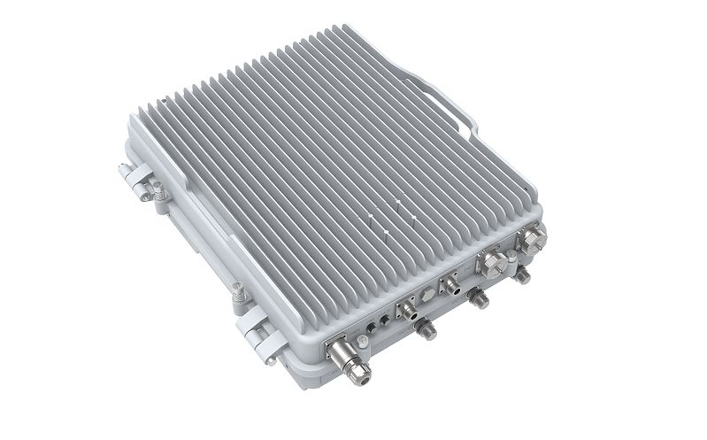

The Intercell 10 B38+B39 is an outdoor dual-carrier time-division duplex LTE (TDD-LTE) base station. Each carrier supports 2×2 MIMO with 10 W output power per radio frequency (RF) channel, for a total output power of 40 W across four RF channels.

## Quick start

- Connect the external antennas and Ethernet cable to the connectors described in **Expansion slots and ports**.
- Connect a 48 V DC power supply as described in **Powering**.
- Connect your laptop to the device for configuration. The device supports DHCP and static IP address assignment.
- For access through the default maintenance IP address, set your laptop's IP address to 192.168.200.100/24 and open https://192.168.200.200 in a web browser.
- Sign in with username admin and password MikroTik.
- Configure the network, backhaul, and radio parameters as described in **Configuration**.

## Powering

The power connector accepts **48 V DC**. The package includes a power cable and connector, but **does not include a power supply**. Power consumption can reach **200 W** under maximum load.

- Connect the supplied cable to your 48 V DC power source.
- Connect the cable connector to the device.

Use the supplied RBGESP surge protector with the Ethernet connection.

## Configuration

Configure the device through its web interface. Installation and configuration must be performed by a qualified person.

### Network architecture

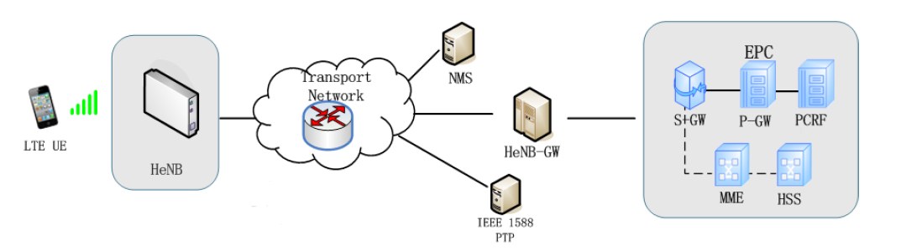

The network components have the following roles:

- **Home eNodeB (HeNB):** The LTE base station provides service to user equipment (UE).
- **Network management system (NMS) / HeNB management system (HeMS):** The management system provides small-cell lifecycle management and supports the TR-181 and TR-196 data models.
- **HeNB-GW:** The gateway between the HeNB and the Mobility Management Entity (MME) aggregates control and user-plane traffic and provides S1/X2 proxy functions.

### Configuration flow

Configure network access first, followed by the backhaul and radio parameters. Enable RF transmission after completing the configuration.

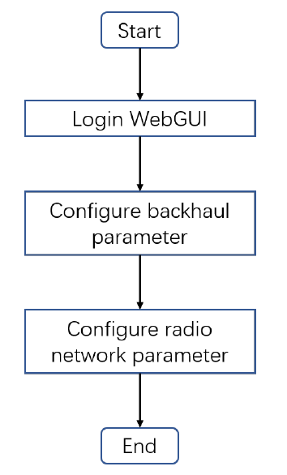

The **WAN** interface is the SFP port, identified as **ID1** in the network configuration. The **LAN** interface is the Ethernet port, identified as **ID2**. If the device receives an IP address through DHCP, use a MAC scan to find it.

For static IP address assignment:

-

Set your computer's IP address to 192.168.200.100/24.

-

Connect directly to the HeNB WAN interface and open https://192.168.200.200. Sign in with username admin and password MikroTik.

-

In the network configuration, set **Address Type** to **Static**, then enter the **IPv4 address** and **Mask** for your network.

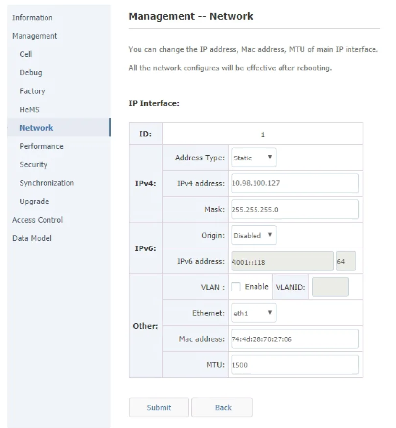

-

Check the configured interfaces and IP addresses.

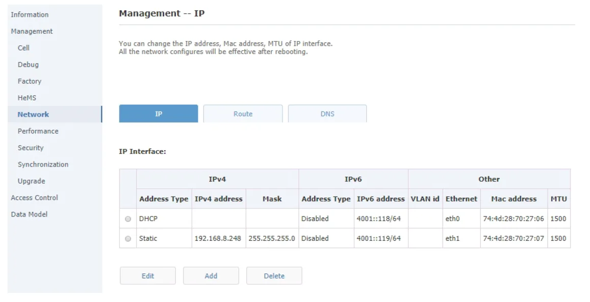

-

Select **Submit**. The HeNB reboots to apply the configuration.

-

Reconnect the HeNB WAN interface to your network and sign in through HTTPS at its configured IP address.

### Backhaul parameters

Open **Management → Cell** and set **S1SigLinkServer** to the IP address of your MME or HeNB gateway.

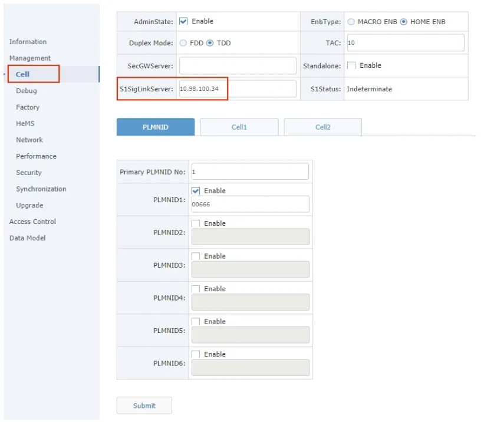

### Radio parameters

The values in this section are examples. Set the network identifiers and radio parameters to match your LTE network.

#### Calculate transmit power

Calculate the transmit power from **ReferenceSignalPower** and the bandwidth-dependent base value:

- **Per antenna:** ReferenceSignalPower + Base, in dBm.
- **Two antennas combined:** ReferenceSignalPower + Base + 3, in dBm.

<table><thead><tr><th>Bandwidth</th><th>Base (dB)</th></tr></thead><tbody><tr><td>1 MHz</td><td>19</td></tr><tr><td>3 MHz</td><td>23</td></tr><tr><td>5 MHz</td><td>25</td></tr><tr><td>10 MHz</td><td>28</td></tr><tr><td>15 MHz</td><td>30</td></tr><tr><td>20 MHz</td><td>31</td></tr></tbody></table>

:::warning warning

Do not exceed **40 dBm per antenna**. Calculate the transmit power before enabling RF transmission; excessive power can damage the power amplifier.

:::

At 20 MHz, **ReferenceSignalPower** of -14 gives -14 + 31 = 17 dBm per antenna. A value of 9 gives 9 + 31 = 40 dBm, the maximum for this product.

In **Management → Cell**, configure the common parameters:

<table><thead><tr><th>Parameter</th><th>Example value</th></tr></thead><tbody><tr><td>Duplex Mode</td><td>TDD</td></tr><tr><td>TAC</td><td>10</td></tr><tr><td>PLMNID</td><td>00666</td></tr></tbody></table>

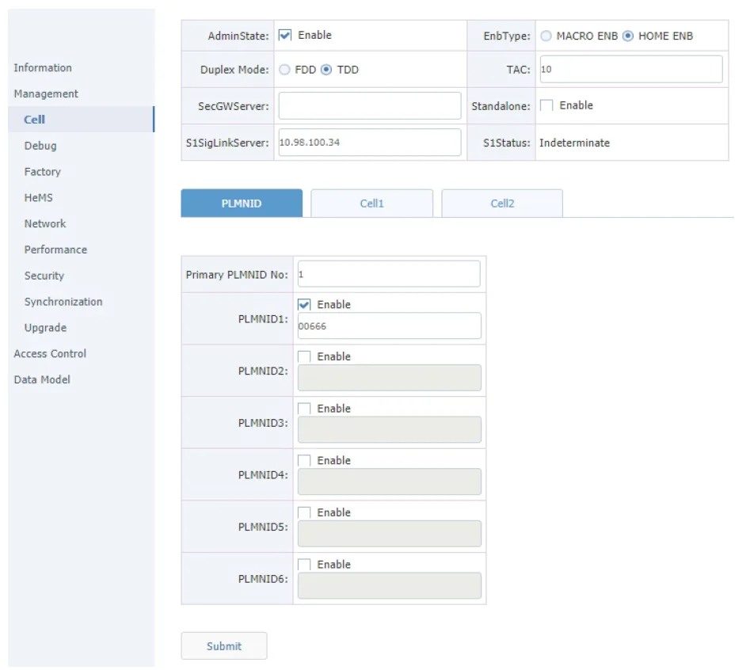

#### Configure Cell 1 radio parameters

Open the **Cell1** tab and configure the following example values:

<table><thead><tr><th>Parameter</th><th>Example value</th></tr></thead><tbody><tr><td>CellIdentity</td><td>257</td></tr><tr><td>CandidateARFCNList</td><td>38400</td></tr><tr><td>CandidatePCIList</td><td>0..503</td></tr><tr><td>FreqBandIndicator</td><td>39</td></tr><tr><td>DL Bandwidth</td><td>100</td></tr><tr><td>UL Bandwidth</td><td>100</td></tr><tr><td>ReferenceSignalPower</td><td>-14</td></tr></tbody></table>

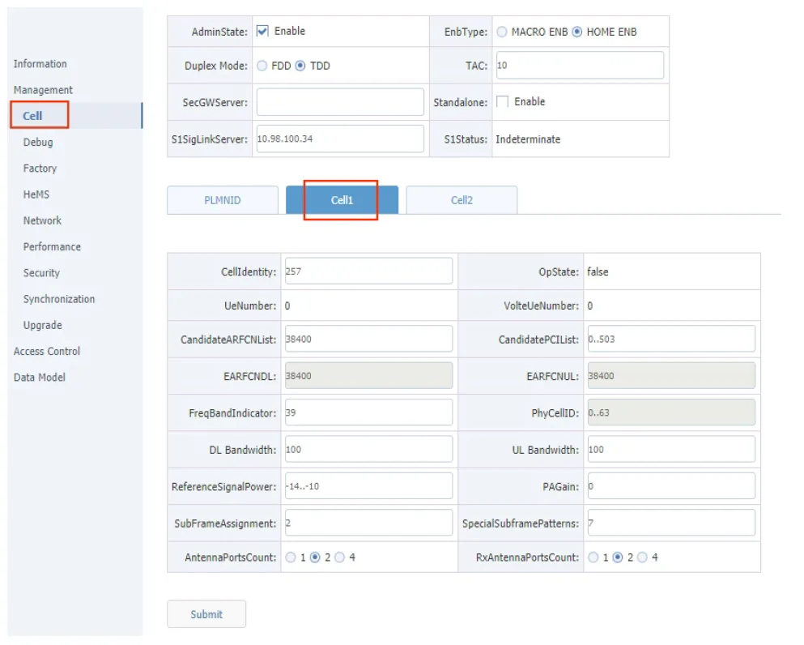

**CandidateARFCNList** specifies the downlink E-UTRA absolute radio frequency channel number (EARFCN); the HeNB configures the uplink EARFCN automatically. The HeNB selects a physical cell identifier (PCI) from **CandidatePCIList**, in the range 0..503.

The bandwidth fields use resource-block values: **20 MHz → 100**, **15 MHz → 75**, **10 MHz → 50**, and **5 MHz → 25**. Set **UL Bandwidth** equal to **DL Bandwidth**.

#### Configure Cell 2 radio parameters

Open the **Cell2** tab and configure the following example values. The EARFCN, PCI, and bandwidth conventions are the same as for Cell1.

<table><thead><tr><th>Parameter</th><th>Example value</th></tr></thead><tbody><tr><td>CellIdentity</td><td>258</td></tr><tr><td>CandidateARFCNList</td><td>37900</td></tr><tr><td>CandidatePCIList</td><td>0..503</td></tr><tr><td>FreqBandIndicator</td><td>38</td></tr><tr><td>DL Bandwidth</td><td>100</td></tr><tr><td>UL Bandwidth</td><td>100</td></tr><tr><td>ReferenceSignalPower</td><td>-14</td></tr></tbody></table>

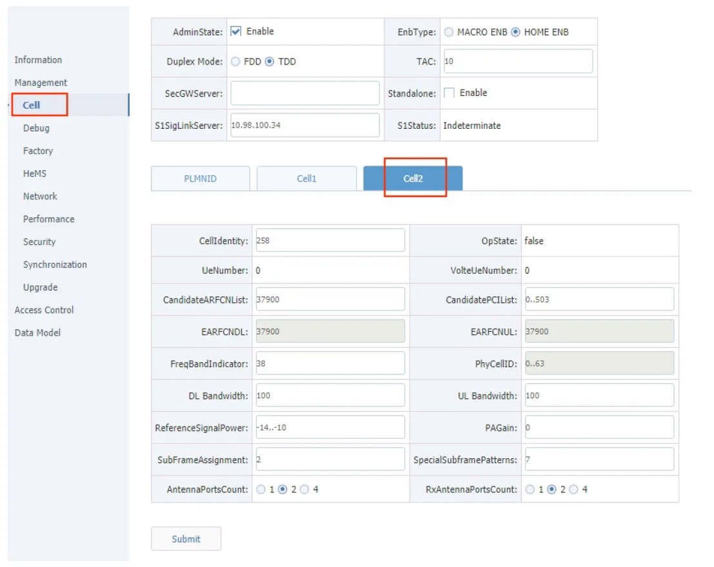

After configuring both cells and checking the transmit power, enable **AdminState** to turn on RF transmission. Select **Submit**; the HeNB reboots to apply the configuration.

#### Checking the RF status

Open **Management → Cell** and check **OpState** on both the **Cell1** and **Cell2** tabs. A value of **True** indicates the radio cell has been established successfully.

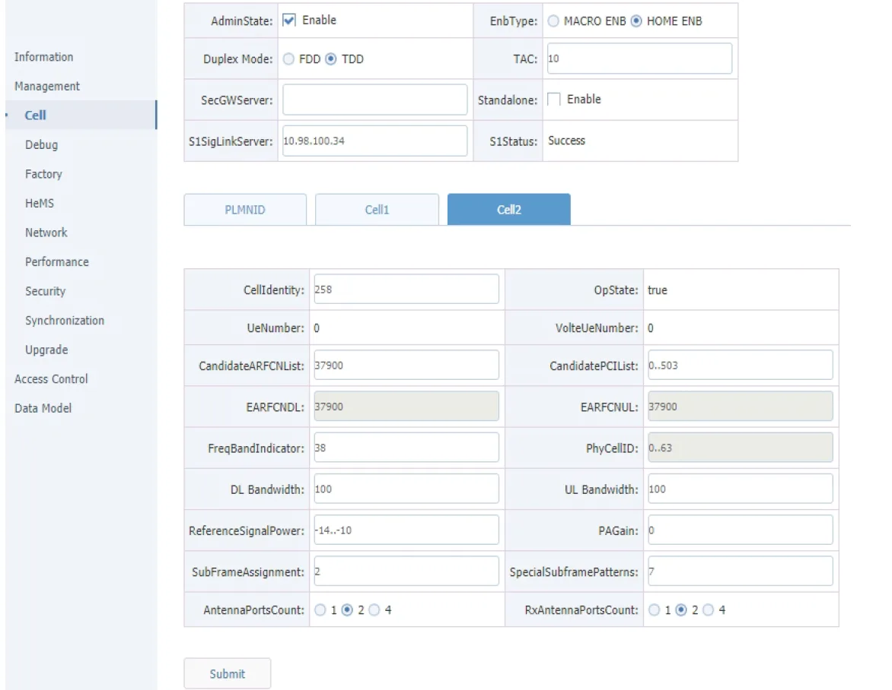

## Mounting

The device is designed for outdoor use and has an **IP66** rating. Mount it with the cable feed pointing downwards and use shielded Cat6 cables. The supplied mounting hardware supports wall mounting or pole mounting with a pole diameter of **50–120 mm**.

:::warning warning

The device weighs **25 kg**. Installation must be performed by a qualified person.

:::

-

Unpack the mounting frame and accessories.

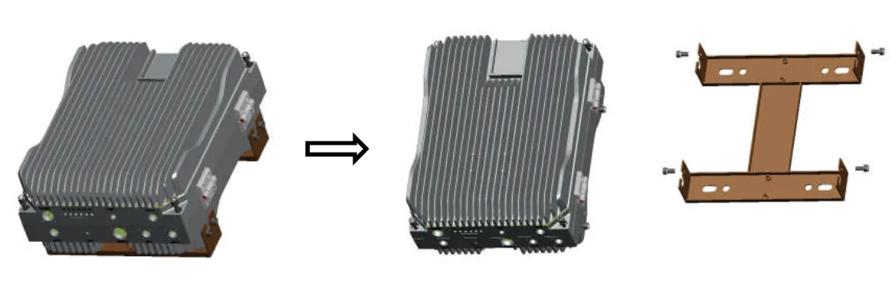

-

For pole mounting, attach the frame with the four fixing plates, four M12 bolts, and four M12 nuts. Pass each bolt through the mounting frame, fixing plate, and cradle, then secure it.

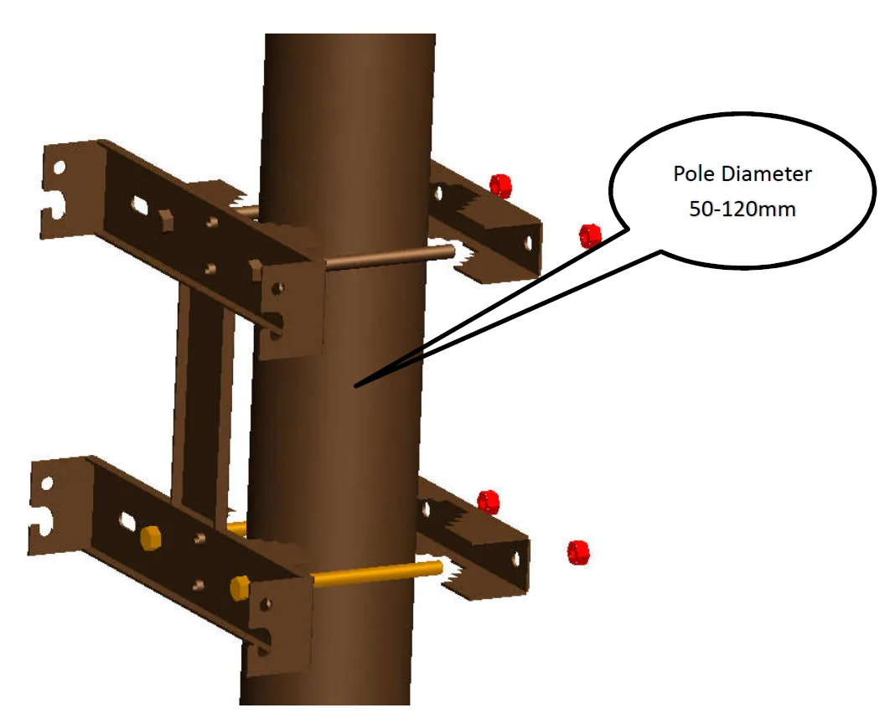

-

Leave a **3 mm** gap under the four fixing screws near the lower side of the chassis so they can engage the mounting frame.

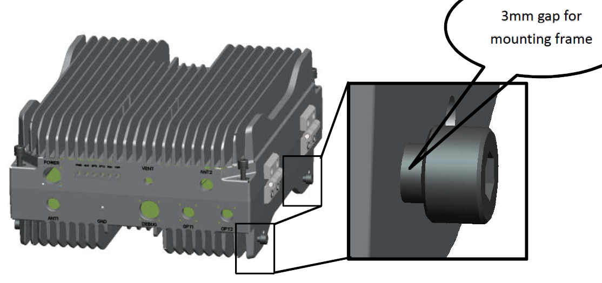

-

Position the chassis on the frame so the screws on both sides engage the fixing holes.

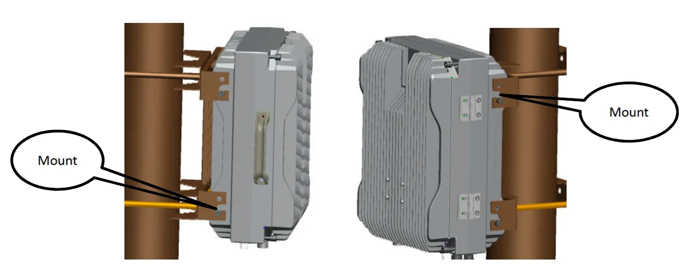

-

Tighten and secure all eight screws to complete the installation.

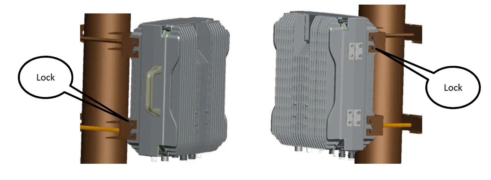

## Grounding

Ground both the installation infrastructure, including towers and masts, and the device. Attach a grounding wire to the device's grounding screw and connect its other end to the grounded mast.

Power-interface lightning protection standards: **GB/T 17626.5** and **IEC 61000-4-5**.

## Expansion slots and ports

The numbers in the diagram identify the connectors and indicators:

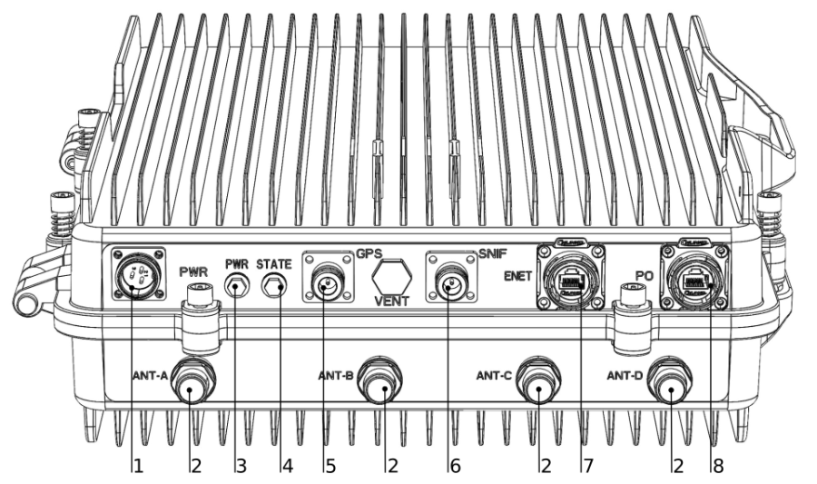

- Power supply connector.
- Antenna connectors.
- Power indicator LED.
- Activity indicator LED.
- GPS antenna connector.
- SNIFF antenna connector.
- Ethernet connector.
- SFP connector.

## Hardware specifications

<table><thead><tr><th>Specification</th><th>Value</th></tr></thead><tbody><tr><td>LTE bands</td><td>TDD B38: 2570–2620 MHz. TDD B39: 1880–1920 MHz.</td></tr><tr><td>Channel bandwidth</td><td>5, 10, 15, or 20 MHz.</td></tr><tr><td>Peak rate per carrier at 20 MHz</td><td>Downlink: 140 Mbps (256QAM, SF2). Uplink: 30 Mbps (64QAM, SF1).</td></tr><tr><td>Peak rate with carrier aggregation at 20 MHz</td><td>Downlink: 280 Mbps (256QAM, SF2). Uplink: 60 Mbps (64QAM, SF1).</td></tr><tr><td>User capacity</td><td>2 × 196 RRC-connected users and 2 × 96 active users.</td></tr><tr><td>Synchronization</td><td>GPS, IEEE 1588v2, and network listening.</td></tr><tr><td>Backhaul interfaces</td><td>One RJ45 Gigabit Ethernet port and one optical SFP port.</td></tr><tr><td>RF connectors</td><td>Six: four antenna connectors, one sniffer connector, and one GPS/BeiDou connector.</td></tr><tr><td>Maximum output power</td><td>40 ± 1 dBm per antenna. Configure transmit power to stay within the 40 dBm limit.</td></tr></tbody></table>

## Accessories

The package includes:

- Power cable with a plug. The power supply is not included.
- [S-31DLC20D SFP module](https://mikrotik.com/product/S-31DLC20D-181).
- [RBGESP Ethernet surge protector](https://mikrotik.com/product/rbgesp).
- N/SMA-JK converter.
- Lightning protection for the GPS and sniffer connectors.
- Installation bracket.
- Large-pole installation accessories.

See the [MikroTik wired interface compatibility table](/docs/7.24/wired-connections/mikrotik-wired-interface-compatibility) for SFP module compatibility.

## Upgrade example

[Download the firmware upgrade example (PDF)](https://manual.mikrotik.com/assets/files/intercell-upgrade-example.pdf), with screenshots for checking the firmware version, selecting an image, and verifying the upgrade.

## B38 configuration example

[Download the B38 configuration example (PDF)](https://manual.mikrotik.com/assets/files/intercell-b38-cfg-example.pdf), with screenshots for adapting the cell configuration to band 38 and rebooting the device.

## Intercell built-in EPC

[Download the built-in EPC configuration document (PDF)](https://manual.mikrotik.com/assets/files/intercell-built-in-epc.pdf), covering network topology, Evolved Packet Core (EPC) parameters, and subscriber configuration.

## Reset configuration through the serial console

[Download the serial-console reset instructions (PDF)](https://manual.mikrotik.com/assets/files/intercell-reset-serial-console.pdf), including chassis access, serial connection, and configuration-file removal.

:::warning warning

The serial-console procedure removes configuration files and restores the default configuration after a reboot.

:::

## Configuration import

[Download the configuration import example (PDF)](https://manual.mikrotik.com/assets/files/intercell-cfg-import.pdf), covering data-model version matching and import of the Device and Cndata configuration files.

## Monitoring

[Download the protocol-stack log viewer document (PDF)](https://manual.mikrotik.com/assets/files/intercell-monitoring.pdf), covering the monitoring tool and log analysis.

## Full dual-carrier configuration

[Download the full dual-carrier configuration document (PDF)](https://manual.mikrotik.com/assets/files/intercell-dual-carrier-configuration.pdf), covering initial setup, network and radio configuration, and maintenance.

## Operating system support

The device runs Intercell HeNB software. RouterOS is not supported.
