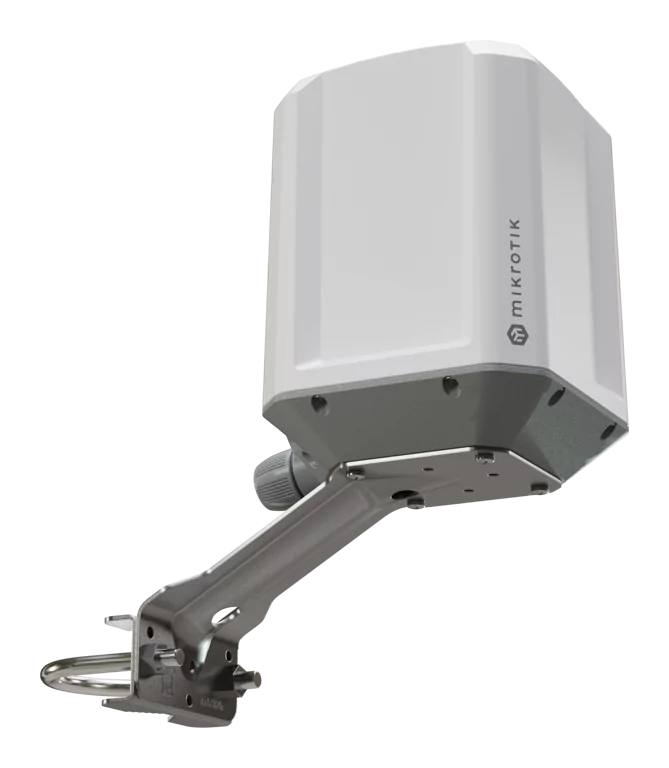
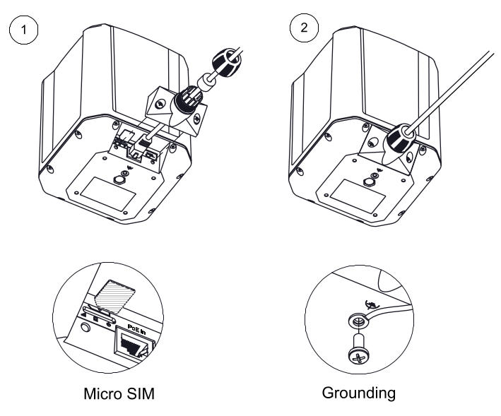
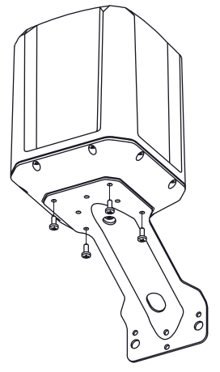
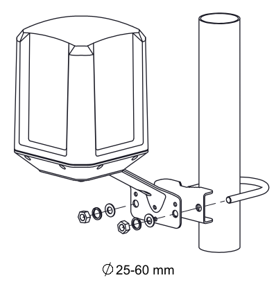
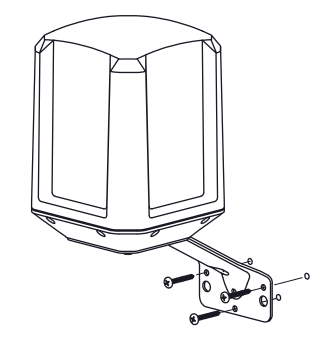
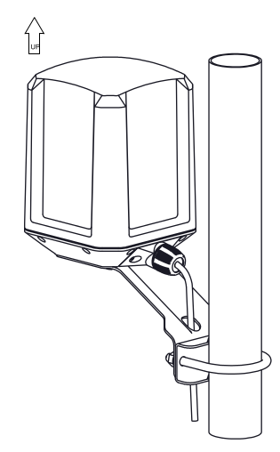

## [LAMP 5G R16](https://mikrotik.com/product/lamp_5g_r16) (LAMPGM&RG520F-EU)

A rugged outdoor 5G device that uses omnidirectional antennas and built-in eSIM support to automatically connect to the best available tower – no antenna alignment or physical SIM swaps required. IP67, maritime durability, GNSS, PoE-in. See the [LAMP 5G R16 product page](https://mikrotik.com/product/lamp_5g_r16) for full specifications and brochures.

## Safety Warnings

- Before you work on any MikroTik equipment, be aware of the hazards involved with electrical circuitry, and be familiar with standard practices for preventing accidents. The installer should be familiar with network structures, terms, and concepts.
- Use only the power supply and accessories approved by the manufacturer, and which can be found in the original packaging of this product.
- This equipment is to be installed by trained and qualified personnel, as per these installation instructions. The installer is responsible for making sure, that the Installation of the equipment is compliant with local and national electrical codes.
- Do not attempt to disassemble, repair, or modify the device. If service is needed, contact MikroTik support.
- This product is intended to be mounted outdoors on a pole. Read the mounting instructions carefully before beginning installation. Failure to use the correct hardware and configuration or to follow the correct procedures could result in a hazardous situation for people and damage to the system.
- We cannot guarantee that no accidents or damage will occur due to the improper use of the device. Use this product with care and operate at your own risk!
- The socket-outlet shall be installed near the equipment and shall be easily accessible.
- In the case of device failure, disconnect it from power. The fastest way to do so is by unplugging the power adapter from the power outlet.
- This is a Class A product. In a domestic environment, this product might cause radio interference in which case the user might be required to take adequate measures.
- To avoid contamination of the environment, separate the device from household waste and dispose of it in a safe manner, for example, in designated areas. Become familiar with procedures for properly transporting the equipment to designated collection points in your area

## Quickstart

- Open the Ethernet port door;
- Insert a SIM card into the slot as indicated on the device;
- Connect the device to the included PoE injector with an Ethernet cable to the data+power end;
- Connect the data end of the PoE injector to the computer;
- Connect the power adapter to the PoE injector;
- Configure your device using a web browser through WebFig or the WinBox tool at [https://mt.lv/WinBox](https://mt.lv/WinBox); multiple configuration methods are available to ensure accessibility;
- Access WebFig by opening [https://192.168.188.1](https://192.168.188.1), and for WinBox, download the tool, navigate to the Neighbors tab, and select the MAC address. The username is "admin" with no password (or, for some models, check user and wireless passwords on the sticker);
- select the "Check for updates" button and update RouterOS to the latest version. Must have a valid SIM card inserted and active Internet connection;
- For a manual update of the device, visit mikrotik.com, select your model, and locate the required packages in the "Downloads" section;
- Upload downloaded packages to the WebFig or WinBox "Files" menu and reboot the device;
- By upgrading your RouterOS software to the latest version, you can ensure optimal performance, stability, and security updates;
- Set up your router password.

## Powering

- Number of DC inputs: 1 (PoE-IN).
- PoE in: 802.3 af/at.
- PoE in input Voltage: 12-56 V.
- Power adapter rated current: 0.5 A.
- Maximum power consumption without accessories: 10 W.
- Maximum power consumption: 10 W.

## Mounting

### Pole Mounting

- Attach the mounting bracket to the device using the supplied screws.

- Secure the bracket to the pole using the U-bolt and supplied washers and nuts.

- Attach the unit to a pole, with the Ethernet port pointing downward.
- Use a PH2 screwdriver to tighten the rings.
- The supported pole diameter is Ø 25–60 mm.

### Wall Mounting

- Attach the mounting bracket to the device using the supplied screws.

- Drill Ø 6 mm holes for the wall plugs.

- Insert the wall plugs and secure the mounting bracket to the wall using the supplied screws.

:::warning warning

Mount the product vertically, as shown.

:::

- Fix the Ethernet cable to the pole using zip ties, less than one meter from the unit, to avoid the cable being pulled out of the port. To use a patched Ethernet cable, the rubber seal must first be cut. Alternatively, insert the cable through the rubber seal before attaching the RJ45 connector.
- Do not use a cable without the rubber seal, as this will compromise the IP67 rating.
- Check mounting angle and positioning.
- When mounting outdoors, ensure that any cable openings are directed downwards. Use a PoE injector and proper grounding, this device has a specially-designed grounding connector under the port cover. Recommended using shielded Cat5/6 cable. The IP rating scale for this device is IP67.

## Configuration

Configuration can be done using a web browser through WebFig, the WinBox tool [https://mt.lv/winbox](https://mt.lv/winbox) methods are available to ensure accessibility.

- To access WebFig, open [https://192.168.188.1](https://192.168.188.1) in your browser.
- For WinBox, download the tool, go to the Neighbors tab, and select the MAC address. The default username is "admin", **find the password on the device sticker**.
- You should check for updates frequently to ensure your RouterOS software remains up to date for the best performance and stability. select the "Check for updates" button in WinBox or WebFig to update to the latest version.

A valid SIM card must be inserted or an eSIM set up, along with an active Internet connection, for updates to work.

RouterOS provides a wide range of configuration options beyond what's described in this document. We suggest visiting [https://mt.lv/help](https://mt.lv/help) explore these features.

For recovery purposes, it is possible to boot the device for reinstallation, see section .

## eSIM settings

By default the device is configured to use the SIM slot. To use the on-board eSIM, switch the slot by using the following command: **/interface/lte/settings/set sim-slot=esim**

A single eSIM chip can store multiple eSIM profiles, the maximum profile count depends on the eSIM chip used.

See the [LTE eSIM](/docs/mobile-networking/lte-5g#lte-esim) page for details.

## Reset button

The reset button has three functions:

- Hold this button during boot time until the green LED light starts flashing, release the button to reset RouterOS configuration (total 5 seconds).
- Keep holding for 5 more seconds, LED turns solid, release now to turn on CAP mode. The device will now look for a CAPsMAN server (total of 10 seconds).
- Reinstall RouterOS using Netinstall. To reinstall RouterOS using the Netinstall utility, enter the device into BOOTP mode. There are two types of booters available: the regular booter and the backup booter. Regular booter - Power on the device, wait 1-2 seconds, then press and hold the Reset button. Wait until the "USR" LED is blinking, then turns solid "On". When the "USR" LED turns "Off", release the Reset button - the device will enter BOOTP mode.
- Backup booter – Power off the device, press and hold the Reset button, then power it on. Wait until the "USR" LED is blinking, then turns solid "On". When the "USR" LED turns "Off", release the Reset button - the device will enter BOOTP mode using the backup booter.

Regardless of the above option used, the system will load the backup RouterBOOT loader if the button is pressed before power is applied to the device. Useful for RouterBOOT debugging and recovery.

Netinstall: When performing Netinstall, make sure to use the latest v7 version of both ROS files and the Netinstall software.

## Grounding

The device includes a grounding connection (marked ⏚) which you should connect to the grounding installation of the tower or building where the device will be used. This is to substantially reduce the risk of ESD and lightning damage.

## Accessories

The package includes the following accessories that come with the device:

- 24 V 0.5 A power adapter
- LAMP mount
- Gigabit PoE injector

## Extension slots and ports

- Product code: **LAMPGM&RG520F-EU.**
- CPU Dual-core: 88F3720 800 MHz
- CPU architecture: ARM 64bit
- Size of RAM: 512 MB
- RAM type: DDR3L
- Storage: 32 MB, Flash
- Number of 1G Ethernet ports: 1
- LTE Category: 20 (2.0 Gbps Downlink, 200 Mbps Uplink)
- LTE modem: RG520F-EU
- TAC: 86945405
- 5G SA Category: 4.2 Gbps Downlink, 900 Mbps Uplink.
- 5G NSA Category: 5.0 Gbps Downlink, 650 Mbps Uplink.
- 3G Category: R8 (42.2Mbps Downlink, 5.76Mbps Uplink).
- MIMO DL: 4x4.
- 5G SA FDD bands: 1 (2100 MHz) / 3 (1800 MHz) / 5 (850 MHz) / 7 (2600 MHz) / 8 (900 MHz) / 20 (800 MHz) / 28 (700 MHz).
- 5G SA TDD bands: 38 (2600 MHz) / 40 (2300 MHz) / 41 (2500 MHz) / 75 (1500 MHz) / 76 (1500 MHz) / 77 (3700 MHz) / 78 (3500 MHz).
- 5G NSA FDD bands: 1 (2100 MHz) / 3 (1800 MHz) / 5 (850 MHz) / 7 (2600 MHz) / 8 (900 MHz) / 20 (800 MHz) / 28 (700 MHz).
- 5G NSA TDD bands: 38 (2600 MHz) / 40 (2300 MHz) / 41 (2500 MHz) / 75 (1500 MHz) / 76 (1500 MHz) / 77 (3700 MHz) / 78 (3500 MHz).
- LTE FDD bands: 1 (2100 MHz) / 3 (1800 MHz) / 5 (850 MHz) / 7 (2600 MHz) / 8 (900 MHz) / 20 (800 MHz) / 28 (700 MHz) / 32 (1500 MHz).
- LTE TDD bands: 38 (2600 MHz) / 40 (2300 MHz) / 41 (2500 MHz) / 42 (3500 MHz) / 43 (3700 MHz).
- 3G bands: 1 (2100 MHz) / 5 (850 MHz) / 8 (900 MHz).
- Dimensions: 311 x 311 x 179 mm.
- Operating system: RouterOS version 7, License level 3
- Operating temperature -40°C to +70°C

## SIM slot usage

SIM card slot is designed to be used with Micro SIM cards. Nano SIM cards have different thicknesses and usage with an adapter is not recommended.

## Specifications

<table><thead><tr><th>Parameters</th><th>Description</th></tr></thead><tbody><tr><td>Product Code</td><td>LAMPGM&RG520F-EU</td></tr><tr><td>**Architecture**</td><td>ARM 64bit</td></tr><tr><td>**CPU**</td><td>88F3720</td></tr><tr><td>**CPU Core Count**</td><td>2</td></tr><tr><td>**CPU Nominal Frequency**</td><td>800 MHz</td></tr><tr><td>**CPU Threads Count**</td><td>2</td></tr><tr><td>**RouterOS License**</td><td>Level 3</td></tr><tr><td>**Operating System**</td><td>RouterOS v7</td></tr><tr><td>**RAM**</td><td>512 MB</td></tr><tr><td>**Storage**</td><td>32 MB FLASH</td></tr><tr><td>**MTBF**</td><td>Approximately 200'000 hours at 25°C</td></tr><tr><td>**Operating Temperature**</td><td>-40°C to +70°C</td></tr><tr><td>**Max Power Consumption**</td><td>10 W</td></tr><tr><td>**Max Power Consumption without attachments**</td><td>10 W</td></tr><tr><td>**Power**</td><td>PoE-IN, 12–56 V</td></tr><tr><td>**PoE in**</td><td>802.3af/at</td></tr><tr><td>**Cooling**</td><td>Passive</td></tr><tr><td>**Ethernet**</td><td>1 × 10/100/1000 Mbps</td></tr><tr><td>**Number of 1G Ethernet ports with Reverse PoE (PoE-in)**</td><td>1</td></tr><tr><td>**SIM**</td><td>1 Modem (Micro SIM)</td></tr><tr><td>**eSIM**</td><td>Yes</td></tr><tr><td>**M.2 Slots**</td><td>1</td></tr><tr><td>**Mobile: 3G**</td><td>Category R8 (DL: 42.2 Mbps; UL: 5.76 Mbps)</td></tr><tr><td>**3G Bands**</td><td>1 (2100 MHz), 5 (850 MHz), 8 (900 MHz)</td></tr><tr><td>**Mobile: LTE**</td><td>Category 20 (DL: 2.0 Gbps; UL: 200 Mbps)</td></tr><tr><td>**MIMO**</td><td>DL 4×4, UL 2×2</td></tr><tr><td>**LTE FDD Bands**</td><td>1 (2100 MHz), 3 (1800 MHz), 5 (850 MHz), 7 (2600 MHz), 8 (900 MHz), 20 (800 MHz), 28 (700 MHz), 32 (1500 MHz)</td></tr><tr><td>**LTE TDD Bands**</td><td>38 (2600 MHz), 40 (2300 MHz), 41 (2500 MHz), 42 (3500 MHz), 43 (3700 MHz)</td></tr><tr><td>**5G NSA FDD Bands**</td><td>1 (2100 MHz), 3 (1800 MHz), 5 (850 MHz), 7 (2600 MHz), 8 (900 MHz), 20 (800 MHz), 28 (700 MHz)</td></tr><tr><td>**5G NSA TDD Bands**</td><td>38 (2600 MHz), 40 (2300 MHz), 41 (2500 MHz), 75 (1500 MHz), 76 (1500 MHz), 77 (3700 MHz), 78 (3500 MHz)</td></tr><tr><td>**5G SA FDD Bands**</td><td>1 (2100 MHz), 3 (1800 MHz), 5 (850 MHz), 7 (2600 MHz), 8 (900 MHz), 20 (800 MHz), 28 (700 MHz)</td></tr><tr><td>**5G SA TDD Bands**</td><td>38 (2600 MHz), 40 (2300 MHz), 41 (2500 MHz), 75 (1500 MHz), 76 (1500 MHz), 77 (3700 MHz), 78 (3500 MHz)</td></tr><tr><td>**TAC**</td><td>86945405</td></tr><tr><td>**IP Rating**</td><td>IP67</td></tr><tr><td>**Certifications**</td><td>CE, EAC, ROHS</td></tr></tbody></table>

## Operating system support

The device supports RouterOS v7 and above. The specific factory-installed version is listed in /system resource. Other operating systems have not been tested.

For important safety instructions and regulatory certifications, refer to the Safety and Regulatory Information document available on [https://mikrotik.com/products](https://mikrotik.com/products). Navigate to: Support & Downloads → Safety and Regulatory Information
