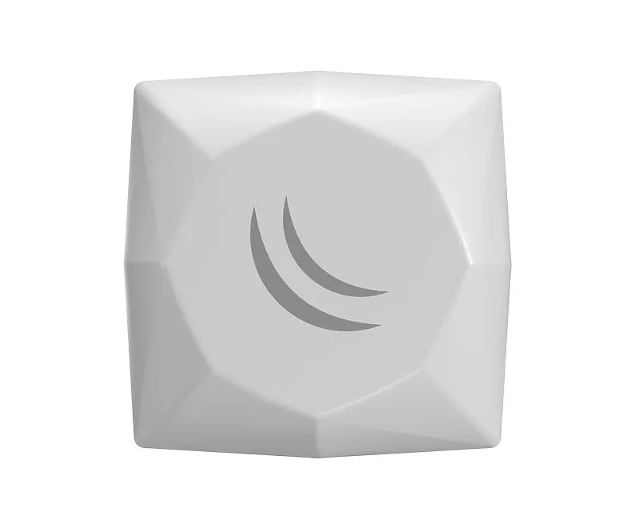
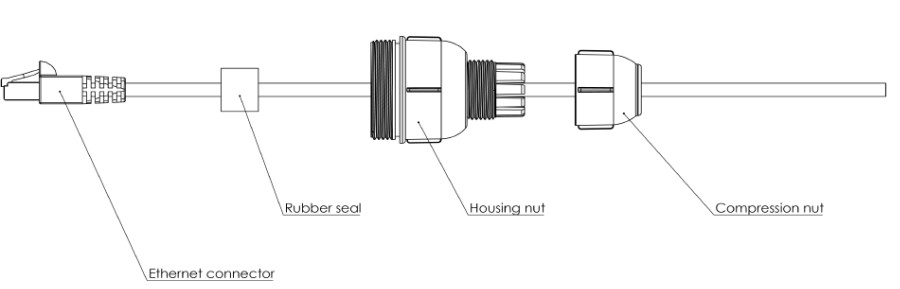
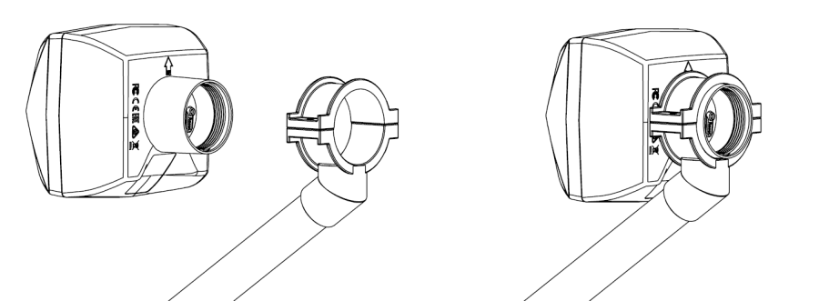
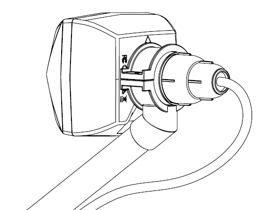
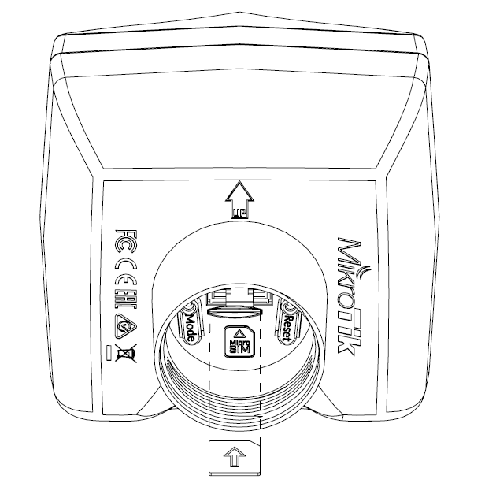
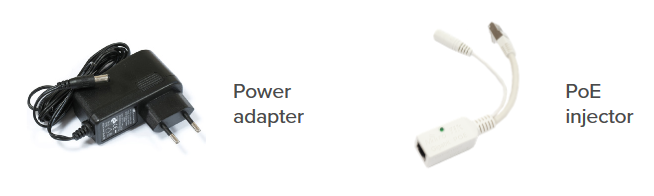

## [LDF LTE6 kit](https://mikrotik.com/product/ldf_lte6_kit) (RBLDFR&R11e-LTE6)

The LDF (Lite dish feed) is an outdoor LTE system, meant to be installed on an offset dish. The device comes with a modem and is ready to use. See the [LDF LTE6 kit product page](https://mikrotik.com/product/ldf_lte6_kit) for full specifications and brochures.

## Safety Warnings

-

Before you work on any equipment, be aware of the hazards involved with electrical circuitry, and be familiar with standard practices for preventing accidents.

-

Ultimate disposal of this product should be handled according to all national laws and regulations.

-

All installation methods for mounting an access point on any wall surface are subject to the acceptance of local jurisdiction.

-

The Installation of the equipment must comply with local and national electrical codes.

-

This product is intended to be mounted outdoors on a pole. Read the mounting instructions carefully before beginning installation. Failure to use the correct hardware and configuration or to follow the correct procedures could result in a hazardous situation for people and damage to the system.

-

Use only the power supply and accessories approved by the manufacturer, which can be found in the original packaging of this product.

-

Read the installation instructions before connecting the system to the power source.

-

We cannot guarantee that no accidents or damage will occur due to the improper use of the device. Use this product with care and operate at your own risk!

-

In the case of device failure, disconnect it from power. The fastest way to do so is by unplugging the power plug from the power outlet.

-

It is the customer's responsibility to follow local country regulations, including operation within legal frequency channels, output power, cabling requirements, and Dynamic Frequency Selection (DFS) requirements. All MikroTik radio devices must be professionally installed.

**Exposure to Radio Frequency Radiation:** This MikroTik equipment complies with the FCC, IC, and European Union radiation exposure limits set forth for an uncontrolled environment. This MikroTik device should be installed and operated no closer than 20 centimeters from your body, occupational user, or the general public.

## Quickstart

- Open the Ethernet port door;
- Insert the SIM card into the slot, with the chip facing UP;
- Connect the device to the included PoE injector with Ethernet cable to the data+power end;
- Connect the data end of the PoE injector to the computer;
- Connect the power adapter to the PoE injector;
- Open the [https://192.168.88.1](https://192.168.88.1) in your web browser;
- User name: **admin**, and there is no password (or, for some models, check user and wireless passwords on the sticker);
- Use the check for update option to upgrade the device to the latest version. You must have an active SIM card with available data;
- The device will reboot;
- Connect again and in the **QuickSet** menu set your country, to apply country regulation settings;
- Secure your device and set a strong password.

## Powering

The device accepts PoE 802.3af/at 12-57 V DC ⎓. A PoE injector is included in the package. Maximum power consumption 6 W.

### Connecting to a PoE Adapter

- Connect the Ethernet cable from the device to the PoE+DATA port of the PoE adapter.
- Connect an Ethernet cable from your local network (LAN) to the PoE adapter.
- Connect the power cord to the adapter, and then plug the power cord into a power outlet.

## Assembly and Mounting

The device is compatible with standard offset dishes. Assemble Ethernet cable with cover as shown in the illustration:

- The rubber seal has been cut on the side so you can attach it to the Ethernet cable. It needs to be inside the Housing nut when assembling the compression nut will compress it to the Ethernet cable.

- Attach the unit to your dish, LDF mounting diameter is 40 mm. Please, ensure placement with an arrow facing upwards.

- Plugin Ethernet cable and tighten the cover by screwing it clockwise. The device is designed to be used outdoors and mounted on the dish, with an Ethernet cable connecting to the back of the unit. ensure to mount the LDF unit on the offset mount in the proper position - the unit facing upwards to the dish. The dish will act as a reflector, amplifying the signal. The final position of your assembly should be placed and installed on the pole. For pole mounting instructions refer to your dish mounting instructions. ensure that the cable feed is pointing downwards. The IPX rating scale of this device is IP54.

Warning! This equipment should be installed and operated with a minimum distance of 20 cm between the device and your body. The operation of this equipment in the residential environment could cause radio interference.

*The mounting and configuration of this device should be done by a qualified person.*

## Sim slot usage

The Sim slot is located under the cover, insert the micro-SIM card accordingly as shown in the picture. With the chip facing up!

## Extension slots and ports

- One Ethernet port, supports automatic cross/straight cable correction (Auto MDI/X), so you can use either straight or cross-over cables for connecting to other network devices.
- MiniPCIe slot with an integrated modem.
- Mode button.

## Reset button

The reset button has three functions:

- Hold this button during boot time until LED light starts flashing, release the button to reset RouterOS configuration (total 5 seconds).
- Keep holding for 5 more seconds, LED turns solid, release now to turn on CAP mode. The device will now look for a CAPsMAN server (total 10 seconds).
- Or Keep holding the button for 5 more seconds until LED turns off, then release it to make the RouterBOARD look for Netinstall servers (total 15 seconds). Regardless of the above option used, the system will load the backup RouterBOOT loader if the button is pressed before power is applied to the device. Useful for RouterBOOT debugging and recovery.

## Included parts

## Operating system support

The device supports RouterOS v7 and above. The specific factory-installed version is listed in /system resource. Other operating systems have not been tested.

To avoid pollution of the environment, separate the device from household waste and dispose of it in a safe manner, such as at designated waste disposal sites. Familiarize yourself with the procedures for the proper transportation of the equipment to the designated disposal sites in your area.

## Federal Communication Commission Interference Statement

<table><thead><tr><th>Model</th><th>Contains FCCID</th></tr></thead><tbody><tr><td>RBLDFR&R11e-LTE6</td><td>TV7R11ELTE6</td></tr></tbody></table>

This equipment has been tested and found to comply with the limits for a Class B digital device, pursuant to Part 15 of the FCC Rules. These limits are designed to provide reasonable protection against harmful interference in a residential installation.

This equipment generates, uses, and can radiate radio frequency energy and, if not installed and used in accordance with the instructions, may cause harmful interference to radio communications. However, there is no guarantee that interference will not occur in a particular installation. If this equipment does cause harmful interference to radio or television reception, which can be determined by turning the equipment off and on, the user is encouraged to try to correct the interference by one of the following measures:

- Reorient or relocate the receiving antenna.
- Increase the separation between the equipment and receiver.
- Connect the equipment into an outlet on a circuit different from that to which the receiver is connected.
- Consult the dealer or an experienced radio/TV technician for help. **FCC Caution:** Any changes or modifications not expressly approved by the party responsible for compliance could void the user's authority to operate this equipment. This device complies with Part 15 of the FCC Rules. Operation is subject to the following two conditions: (1) This device may not cause harmful interference, and (2) this device must accept any interference received, including interference that may cause undesired operation. This device and its antenna must not be co-located or operated in conjunction with any other antenna or transmitter. **IMPORTANT: Exposure to Radio Frequency Radiation.** This equipment complies with the FCC RF radiation exposure limits set forth for an uncontrolled environment. This equipment should be installed and operated with a minimum distance of 20 cm between the radiator and any part of your body. *For use of CBRS bands, the CBSD Category of the final Host equipment will be dependent on the power settings and antenna gain used.*

## Innovation, Science and Economic Development Canada

<table><thead><tr><th>Model</th><th>Contains IC</th></tr></thead><tbody><tr><td>RBLDFR&R11e-LTE6</td><td>7442A-R11ELTE6</td></tr></tbody></table>

This device contains license-exempt transmitter(s)/receiver(s) that comply with Innovation, Science and Economic Development Canada's license-exempt RSS(s). Operation is subject to the following two conditions:

-

This device may not cause interference;

-

This device must accept any interference, including interference that may cause undesired operation of the device. L'émetteur/récepteur exempt de licence contenu dans le présent appareil est conforme aux CNR d'Innovation, Sciences et Développement économique Canada applicables aux appareils radio exempts de licence. L'exploitation est autorisée aux deux conditions suivantes:

-

L'appareil ne doit pas produire de brouillage;

-

L'appareil doit accepter tout brouillage radioélectrique subi, mźme si le brouillage est. This Class B digital apparatus complies with Canadian ICES-003.

Cet appareil numérique de la classe [B] est conforme à la norme NMB-003 du Canada.

CAN ICES-003 (B) / NMB-003 (B)

**IMPORTANT: Exposure to Radio Frequency Radiation.** This equipment complies with the IC radiation exposure limits set forth for an uncontrolled environment. This equipment should be installed and operated with a minimum distance of 20 cm between the radiator and any part of your body. Cet equipement est conforme aux limites d'exposition au rayonnement IC definies pour un environnement non controle. Cet equipement doit etre installe et utilise a une distance minimale de 20 cm entre le radiateur et toute partie de votre corps.

## UKCA marking

## Eurasian Conformity Mark

Информация о дате изготовления устройства указана в конце серийного номера на его наклейке через дробь. Первая цифра означает номер года (последняя цифра года), две последующие означают номер недели.

Изготовитель: MikroTikls SIA, Aizkraukles iela 23, Riga, LV-1006, Латвия, [support@mikrotik.com](mailto:support@mikrotik.com). Сделано в Китае, Латвии или Литве. Cм. на упаковке.

Для получения подробных сведений о гарантийном обслуживании обратитесь к продавцу. Информация об импортерах продукции MikroTik в Российскую Федерацию: [https://mikrotik.com/buy/europe/russia](https://mikrotik.com/buy/europe/russia)

Продукты MikroTik, которые поставляются в Евразийский таможенный союз, оцениваются с учетом соответствующих требований и помечены знаком EAC, как показано ниже:

## Norma Oficial Mexicana

EFICIENCIA ENERGETICA CUMPLE CON LA NOM-029-ENER-2017.

La operacion de este equipo esta sujeta a las siguientes dos condiciones:

- Es posible que este equipo o dispositivo no cause interferencia perjudicial y.
- Este equipo debe aceptar cualquier interferencia, incluyendo la que pueda causar su operacion no deseada. Fabricante: MikroTikls SIA, Brivibas gatve 214i, Riga, LV-1039, Latvia.

País De Origen: Letonia; Lituania; China (Republica Popular); Estados Unidos De America; Mexico.

Por favor contacte a su distribuidor local para preguntas regionales específicas. La lista de importadores se puede encontrar en nuestra página de inicio – [https://mikrotik.com/buy/latinamerica/mexico](https://mikrotik.com/buy/latinamerica/mexico).

## The National Commission for the State Regulation of Communications and Informatization by Ukraine

Виробник: MikroTikls SIA, Brivibas gatve 214i Рига, Латвія, LV1039.

Справжнім MikroTikls SIA заявляє, що маршрутизатор відповідає основним вимогам та іншим відповідним положенням директиви 2014/53/EC, а також суттєвим вимогам Технічного регламенту радіообладнання, затвердженого постановою Кабінету Міністрів України від 24 травня 2017 року № 355.

Для експлуатації в Україні необхідно отримати дозвіл на експлуатацію у порядку, затвердженому рішенням НКРЗІ від 01.11.2012 № 559, зареєстрованому в Міністерстві юстиції України 03.01.2013 за № 57/22589.

## CE Declaration of Conformity

Manufacturer: MikroTikls SIA, Brivibas gatve 214i Riga, Latvia, LV1039.

Hereby, Mikrotīkls SIA declares that the radio equipment type RBLDFR&R11e-LTE6 is in compliance with Directive 2014/53/EU. The full text of the EU declaration of conformity is available at the following internet address: [https://mikrotik.com/products](https://mikrotik.com/products)

<table><thead><tr><th>Operating Frequency / Maximum output power Betriebsfrequenz / maximale Ausgangsleistung Fréquence de fonctionnement / puissance de sortie maximale Frequenza operativa / massima potenza di uscita Frecuencia de funcionamiento / potencia de salida máxima Рабочая частота / максимальная выходная мощность</th><th>E-GSM-900</th><th>900 MHz / 33 dBm</th></tr></thead><tbody><tr><td>DCS-1800</td><td>1800 MHz / 30 dBm</td><td></td></tr><tr><td>WCDMA Band I</td><td>1922.4 MHz / 24dB ± 2.7 dB</td><td></td></tr><tr><td>WCDMA Band VIII</td><td>882.4 MHz / 24dB ± 2.7 dB</td><td></td></tr><tr><td>LTE Band 1</td><td>2100 MHz / 23dB ± 2.7 dB</td><td></td></tr><tr><td>LTE Band 3</td><td>1700 MHz / 23dB ± 2.7 dB</td><td></td></tr><tr><td>LTE Band 7</td><td>2600 MHz / 23dB ± 2.7 dB</td><td></td></tr><tr><td>LTE Band 8</td><td>900 MHz / 23dB ± 2.7 dB</td><td></td></tr><tr><td>LTE Band 20</td><td>800 MHz / 23dB ± 2.7 dB</td><td></td></tr><tr><td>LTE Band 38</td><td>2600 MHz / 23dB ± 2.7 dB</td><td></td></tr><tr><td>LTE Band 40</td><td>2300 MHz / 23dB ± 2.7 dB</td><td></td></tr></tbody></table>

This MikroTik device meets Maximum WLAN and LTE transmit power limits per ETSI regulations. For more detailed information see Declaration of Conformity above / Dieses MikroTik-Gerät erfüllt die maximalen WLAN- und LTE-Sendeleistung Grenzwerte gemäß ETSI-Bestimmungen. Weitere Informationen finden Sie oben unter Konformitätserklärung / Cet appareil MikroTik respecte les limites maximales de puissance de transmission WLAN et LTE conformément aux réglementations ETSI. Pour plus d'informations, voir la déclaration de conformité ci-dessus / Questo dispositivo MikroTik è conforme ai limiti massimi di potenza di trasmissione WLAN e LTE in conformità con le normative ETSI. Per ulteriori informazioni, consultare la dichiarazione di conformità sopra / Este dispositivo MikroTik cumple con los límites máximos de potencia de transmisión WLAN y LTE de acuerdo con las regulaciones ETSI. Para obtener más información, consulte la declaración de conformidad anterior / Это устройство MikroTik соответствует максимальным пределам мощности передачи WLAN и LTE в соответствии с правилами ETSI. Для получения дополнительной информации см. Декларацию соответствия выше.

- It is the customer's responsibility to follow local country regulations, including operation within legal frequency channels, output power, cabling requirements, and Dynamic Frequency Selection (DFS) requirements. All MikroTik radio devices must be professionally installed!
