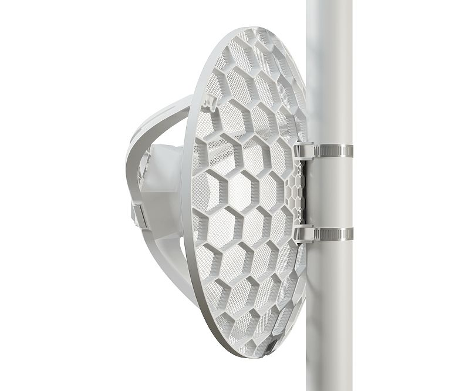
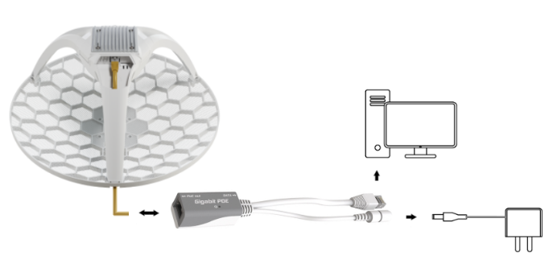
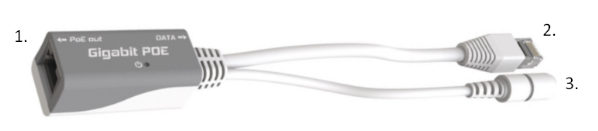
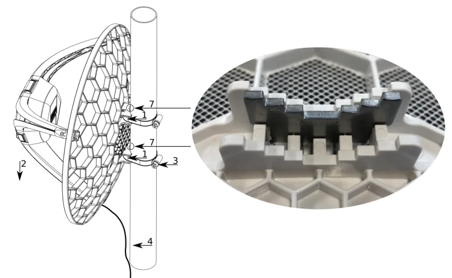
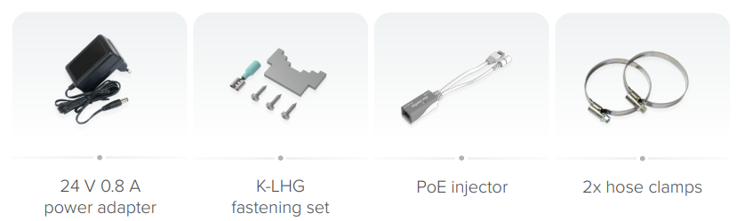

## [LHG LTE18 kit](https://mikrotik.com/product/lhg_lte18) (LHGGM&EG18-EA)

Great distances, even greater speed – with the power of the ultra fast LTE Category 18 modem. Speeds up to one Gbps! Last-mile-internet solution for the most remote areas. See the [LHG LTE18 kit product page](https://mikrotik.com/product/lhg_lte18) for full specifications and brochures.

## Safety Warnings

- Before you work on any equipment, be aware of the hazards involved with electrical circuitry, and be familiar with standard practices for preventing accidents.
- Ultimate disposal of this product should be handled according to all national laws and regulations.
- All installation methods for mounting an access point on any wall surface are subject to the acceptance of local jurisdiction.
- The Installation of the equipment must comply with local and national electrical codes.
- This product is intended to be mounted outdoors on a pole. Read the mounting instructions carefully before beginning installation. Failure to use the correct hardware and configuration or to follow the correct procedures could result in a hazardous situation for people and damage to the system.
- Use only the power supply and accessories approved by the manufacturer, which can be found in the original packaging of this product.
- Read the installation instructions before connecting the system to the power source.
- We cannot guarantee that no accidents or damage will occur due to the improper use of the device. Use this product with care and operate at your own risk!
- In the case of device failure, disconnect it from power. The fastest way to do so is by unplugging the power plug from the power outlet.
- It is the customer's responsibility to follow local country regulations, including operation within legal frequency channels, output power, cabling requirements, and Dynamic Frequency Selection (DFS) requirements. All MikroTik radio devices must be professionally installed.
- This is a class A device. In a domestic environment, this product might cause radio interference in which case the user might be required to take adequate measures.

**Exposure to Radio Frequency Radiation:** This MikroTik equipment complies with the European Union radiation exposure limits set forth for an uncontrolled environment. This MikroTik device should be installed and operated no closer than 56.5 centimeters from your body, occupational user, or the general public.

## Quickstart

- While holding the unit by its central column, apply force to the tab, which holds the latch closed, until the latch pops open.
- Insert the SIM card into the slot, with chips facing UP.
- Assemble the case by attaching legs to the base of the unit, see the (link) paragraph.
- Mount the unit in your desired place, see the (link) paragraph.
- Set LAN computer IP configuration to *automatic* (DHCP).
- Open [https://192.168.188.1](https://192.168.188.1) in your web browser to start the configuration.
- User name: admin and password on the label (or, for some models, check user and wireless passwords on the sticker).
- Update the device by selecting the "Check for updates" button on the right side and updating your RouterOS software to the latest version to ensure the best performance and stability. Must have a valid SIM card inserted.
- To manually update the device, go to [https://mikrotik.com/download](https://mikrotik.com/download)
- Choose ARM64 packages for this device and download them to your PC.
- Upload downloaded packages to the WebFig "Files" menu and reboot the device.
- Updating your RouterOS software to the latest version will ensure the best performance, stability, and security updates.
- Set up your router password in the bottom field "Password" to the right and repeat it in the field "Confirm Password", it will be used to log in next time.
- Select the "Apply Configuration" to save changes.

## Case assembly

- Attach the two legs to the LHG case by sliding them onto the respective sides, the legs are different and cannot be exchanged (when looking at the product place it that the cover for the Ethernet port is in front of you, leg marked R is for the right side, leg marked L is for the left side).
- Snap the assembled LHG unit to the grid in the appropriate central location.
- Fix the two legs in place with included two self-thread screws (Phillips screwdriver PH2). The package also contains a grounding cable connector and a 5-degree angle adapter, for easier up or downward tilt adjustment. See paragraph.

## Powering

The device accepts powering from:

PoE in 802.3af/at Supported input Voltage 12-57 V Power adapter nominal voltage 24 V Power adapter nominal current 0.8 A Max power consumption 8 W

### Connecting to a PoE Adapter

- Connect the Ethernet cable from the device to the PoE+DATA port of the PoE adapter;
- Connect PoE adapter to the PC or other network device by using the adapter Ethernet cable marked DATA;
- Connect the power cord to the adapter, and then plug the power cord into a power outlet.

## Mounting

- Slide the included metallic mounting rings into the two slots on the back of the antenna dish.
- Attach the unit to a pole, with the Ethernet port pointing downward.
- Use a PH2 screwdriver to tighten the rings.
- Fix the Ethernet cable to the pole using zip ties, less than one meter from the unit, to avoid the cable being pulled out of the port.
- Check mounting angle and positioning.
- Optional: If required, before mounting the unit, you can insert the included 5-degree adjustment adapter into the top or bottom slot where the mounting ring is inserted. This will create an additional upward or downward angle when the unit is tightened to a vertical pole.
- Insert a 5-degree angle adapter to one of the slots and remount the unit. When mounting outdoors, ensure that any cable openings are directed downwards. Use POE injector and proper grounding, this device has a specially designed grounding connector under the port cover. Recommended using shielded Cat5/6 cable. The IP rating scale for this device is IP54. *Warning! This equipment should be installed and operated with a minimum distance of 120 cm between the device and your body. The operation of this equipment in the residential environment could cause radio interference.*

## Configuration

Once logged in, you should select the "Check for updates" button in the QuickSet menu, as updating your RouterOS software to the latest version ensures the best performance and stability. For wireless models, make sure you have selected the country where the device will be used, to conform to local regulations. RouterOS includes many configuration options in addition to what is described in this document. We suggest starting here to get yourself accustomed to the possibilities: [https://mt.lv/help](https://mt.lv/help) In case an IP connection is not available, the WinBox tool ([https://mt.lv/winbox](https://mt.lv/winbox)) can be used to connect to the MAC address of the device from the LAN side (all access is blocked from the Internet port by default). For recovery purposes, it is possible to boot the device for reinstallation, see a section .

## Accessories

The package includes the following accessories that come with the device:

## Extension slots and ports

- Product code LHGGM&EG18-EA
- CPU 88F3720 800 MHz
- CPU architecture ARM 64bit
- Size of RAM 256 MB
- Storage 16 MB flash
- Number of 1G Ethernet ports 1
- LTE modem R11mL-EG18-EA
- TAC 86981604
- LTE category 18 (1.2Gbps Downlink, 150Mbps Uplink)
- LTE FDD bands 1 (2100MHz) / 3 (1800MHz) / 7 (2600MHz) / 8 (900 MHz) / 20 (800MHz) / 28 (700MHz) / 38 (2600MHz) / 40 (2300MHz)
- 3G category R8 (42.2Mbps Downlink, 11.2Mbps Uplink)
- 3G bands 1 (2100MHz) / 3 (1800MHz) / 5 (850MHz) / 8 (900MHz)
- Micro SIM slot 1
- Dimensions 391 x 391 x 227 mm
- Operating system RouterOS v7, License level 3
- Operating temperature -40°C to +70°C

## SIM slot usage

SIM card slot is designed to be used with Micro SIM cards. Nano SIM cards have different thicknesses and usage with an adapter is not recommended.

## Reset button

The reset button has three functions:

- Hold this button during boot time until LED light starts flashing, release the button to reset RouterOS configuration (total 5 seconds);
- Keep holding for 5 more seconds, LED turns solid, release now to turn on CAP mode. The device will now look for a CAPsMAN server (total of 10 seconds);
- Or Keep holding the button for 5 more seconds until LED turns off, then release it to make the RouterBOARD look for Netinstall servers (total of 15 seconds); Regardless of the above option used, the system will load the backup RouterBOOT loader if the button is pressed before power is applied to the device. Useful for RouterBOOT debugging and recovery.

## Operating system support

The device supports RouterOS v7 and above. The specific factory-installed version is listed in /system resource. Other operating systems have not been tested.

To avoid pollution of the environment, separate the device from household waste and dispose of it in a safe manner, such as designated waste disposal sites. Familiarize yourself with the procedures for the proper transportation of the equipment to the designated disposal sites in your area.

### UKCA marking

### Eurasian Conformity Mark

Информация о дате изготовления устройства указана в конце серийного номера на его наклейке через дробь. Первая цифра означает номер года (последняя цифра года), две последующие означают номер недели.

Изготовитель: MikroTikls SIA, Aizkraukles iela 23, Riga, LV-1006, Латвия, [support@mikrotik.com](mailto:support@mikrotik.com). Сделано в Китае, Латвии или Литве. Cм. на упаковке.

Для получения подробных сведений о гарантийном обслуживании обратитесь к продавцу. Информация об импортерах продукции MikroTik в Российскую Федерацию: [https://mikrotik.com/buy/europe/russia](https://mikrotik.com/buy/europe/russia)

Продукты MikroTik, которые поставляются в Евразийский таможенный союз, оцениваются с учетом соответствующих требований и помечены знаком EAC, как показано ниже:

### Norma Oficial Mexicana

EFICIENCIA ENERGETICA CUMPLE CON LA NOM-029-ENER-2017.

La operacion de este equipo esta sujeta a las siguientes dos condiciones:

- Es posible que este equipo o dispositivo no cause interferencia perjudicial y.
- Este equipo debe aceptar cualquier interferencia, incluyendo la que pueda causar su operacion no deseada. Fabricante: MikroTikls SIA, Brivibas gatve 214i, Riga, LV-1039, Latvia.

País De Origen: Letonia; Lituania; China (Republica Popular); Estados Unidos De America; Mexico.

Por favor contacte a su distribuidor local para preguntas regionales específicas. La lista de importadores se puede encontrar en nuestra página de inicio – [https://mikrotik.com/buy/latinamerica/mexico](https://mikrotik.com/buy/latinamerica/mexico).

### The National Commission for the State Regulation of Communications and Informatization by Ukraine

Виробник: MikroTikls SIA, Brivibas gatve 214i Рига, Латвія, LV1039.

Справжнім MikroTikls SIA заявляє, що маршрутизатор відповідає основним вимогам та іншим відповідним положенням директиви 2014/53/EC, а також суттєвим вимогам Технічного регламенту радіообладнання, затвердженого постановою Кабінету Міністрів України від 24 травня 2017 року № 355.

Для експлуатації в Україні необхідно отримати дозвіл на експлуатацію у порядку, затвердженому рішенням НКРЗІ від 01.11.2012 № 559, зареєстрованому в Міністерстві юстиції України 03.01.2013 за № 57/22589.

### CE Declaration of Conformity

Hereby, Mikrotīkls SIA declares that the radio equipment type LHGGM&EG18-EA is in compliance with Directive 2014/53/EU. The full text of the EU declaration of conformity is available at the following internet address: [https://mikrotik.com/products](https://mikrotik.com/products)

Manufacturer: MikroTikls SIA, Brivibas gatve 214i Riga, Latvia, LV1039.

<table><thead><tr><th>Operating Frequency / Maximum output power Betriebsfrequenz / maximale Ausgangsleistung Fréquence de fonctionnement / puissance de sortie maximale Frequenza operativa / massima potenza di uscita Frecuencia de funcionamiento / potencia de salida máxima Рабочая частота / максимальная выходная мощность</th><th>WCDMA Band I</th><th>2100 MHz / 24dBm ± 2.7 dB</th></tr></thead><tbody><tr><td>WCDMA Band III</td><td>1800 MHz / 24dBm ± 2.7 dB</td><td></td></tr><tr><td>WCDMA Band VIII</td><td>900 MHz / 24dBm ± 2.7 dB</td><td></td></tr><tr><td>LTE Band 1</td><td>2100 MHz / 23dBm ± 2.7 dB</td><td></td></tr><tr><td>LTE Band 3</td><td>1700 MHz / 23dBm ± 2.7 dB</td><td></td></tr><tr><td>LTE Band 7</td><td>2600 MHz / 23dBm ± 2.7 dB</td><td></td></tr><tr><td>LTE Band 8</td><td>900 MHz / 23dBm ± 2.7 dB</td><td></td></tr><tr><td>LTE Band 20</td><td>800 MHz / 23dBm ± 2.7 dB</td><td></td></tr><tr><td>LTE Band 28</td><td>700 MHz / 23dBm ± 2.7 dB</td><td></td></tr><tr><td>LTE Band 38</td><td>2600 MHz / 23dBm ± 2.7 dB</td><td></td></tr><tr><td>LTE Band 40</td><td>2300 MHz / 23dBm ± 2.7 dB</td><td></td></tr></tbody></table>

This MikroTik device meets Maximum TX power limits per ETSI regulations. For more detailed information see Declaration of Conformity above / Dieses MikroTik-Gerät erfüllt die maximalen Sendeleistungsgrenzwerte gemäß ETSI-Bestimmungen. Weitere Informationen finden Sie oben in der Konformitätserklärung. Nähere Informationen finden Sie oben in der Konformitätserklärung / Cet appareil MikroTik respecte les limites de puissance TX maximale via les réglementations ETSI. Pour plus d'informations, voir la déclaration de conformité ci-dessus / Questo dispositivo MikroTik soddisfa i limiti di potenza massima TX tramite le normative ETSI. Per informazioni più dettagliate consultare la Dichiarazione di conformità sopra / Este dispositivo MikroTik cumple con los límites máximos de potencia TX a través de las normas ETSI. Para obtener información más detallada, consulte la Declaración de conformidad anterior / Это устройство MikroTik соответствует ограничениям максимальной мощности передачи согласно правилам ETSI. Для получения более подробной информации см. Декларацию соответствия выше.
