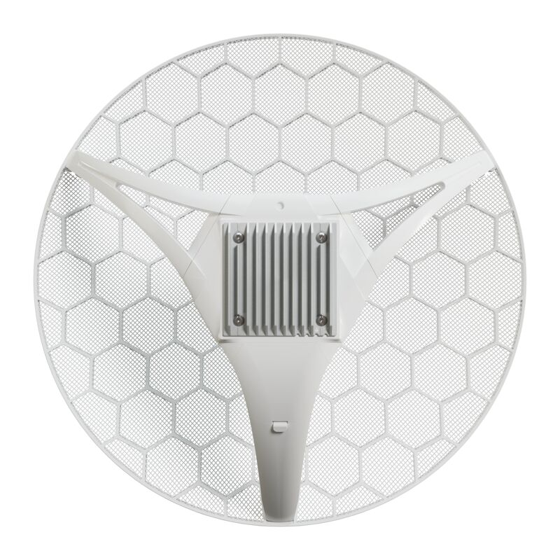
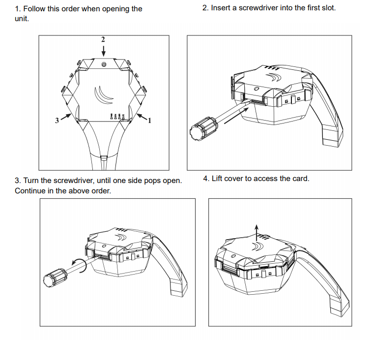
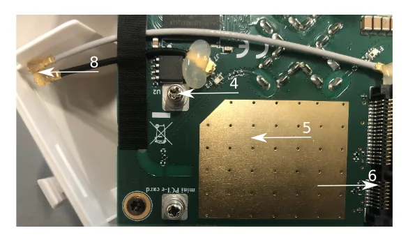
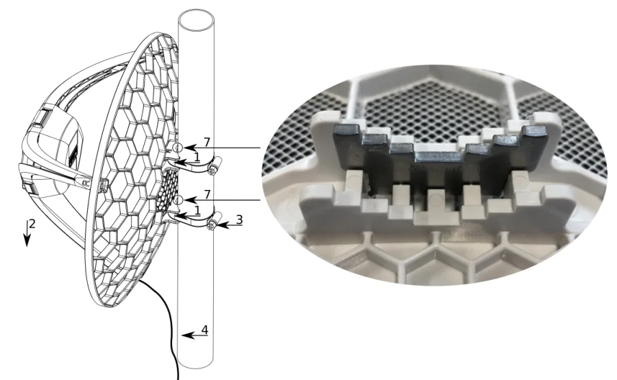
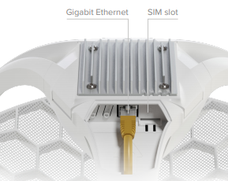

## [LHGG LTE6 kit](https://mikrotik.com/product/lhgg_lte6_kit) (RBLHGGR&R11e-LTE6)

## Safety Warnings

- Before you work on any equipment, be aware of the hazards involved with electrical circuitry, and be familiar with standard practices for preventing accidents. See the [LHGG LTE6 kit product page](https://mikrotik.com/product/lhgg_lte6_kit) for full specifications and brochures.
- Ultimate disposal of this product should be handled according to all national laws and regulations.
- All installation methods for mounting an access point on any wall surface is subject to the acceptance of local jurisdiction.
- The Installation of the equipment must comply with local and national electrical codes.
- This product is intended to be mounted outdoors on a pole. Read the mounting instructions carefully before beginning installation. Failure to use the correct hardware and configuration or to follow the correct procedures could result in a hazardous situation for people and damage to the system.
- Use only the power supply and accessories approved by the manufacturer, and which can be found in the original packaging of this product.
- Read the installation instructions before connecting the system to the power source.
- We cannot guarantee that no accidents or damage will occur due to the improper use of the device. Use this product with care and operate at your own risk!
- In the case of device failure, disconnect it from power. The fastest way to do so is by unplugging the power plug from the power outlet.
- It is the customer's responsibility to follow local country regulations, including operation within legal frequency channels, output power, cabling requirements, and Dynamic Frequency Selection (DFS) requirements. All MikroTik radio devices must be professionally installed.
- This is a class A device. In a domestic environment, this product might cause radio interference in which case the user might be required to take adequate measures.

**Exposure to Radio Frequency Radiation:** This MikroTik equipment complies with the FCC, IC, and European Union radiation exposure limits set forth for an uncontrolled environment. This MikroTik device should be installed and operated no closer than 130 centimeters from your body, occupational user, or the general public.

## Quickstart

- Open the Ethernet port door;
- Insert the SIM card into the slot, with the chip facing UP;
- Connect the device to the included PoE injector with Ethernet cable to the data+power end;
- Connect the data end of the PoE injector into the computer;
- Connect the power adapter to the PoE injector;
- Open the [https://192.168.188.1](https://192.168.188.1) in your web browser;
- User name: **admin**, and there is no password (or, for some models, check user and wireless passwords on the sticker);
- Enter the PIN code, if required by your mobile network operator;
- Use the check for update option to upgrade the device to the latest version. You must have an active SIM card with available data;
- The device will reboot;
- Connect again and in the **QuickSet** menu set a strong password.

## Case assembly

- Attach the two legs to the LHG case by sliding them onto the respective sides, legs are different and cannot be exchanged (when looking at the product place it that cover for Ethernet port is in front of you, leg marked R is for the right side, leg marked L is for the left side).
- Snap the assembled LHG unit to the grid in the appropriate central location.
- Fix the two legs in place with included two self thread screws (Phillips screwdriver PH2). The package also contains a grounding cable connector and a 5-degree angle adapter, for easier up or downward tilt adjustment.

## Opening the case cover

Optional - to access the miniPCIe slot, the opening of the unit top cover is required. As an opening tool, you can use a large size flat head screwdriver or a small coin. Be extremely cautious when opening, because the incorrect opening of the clip can break it off! *Mounting and configuration of this device should be done by a qualified person.* Follow these steps:

Additional Caution when lifting up the cover, do not force it with sharp objects.

## miniPCIe slot usage

The device is equipped with a miniPCIe slot and has already installed an LTE6 modem. One SIM slot is provided for use together with a miniPCIe modem. The SIM slot is not used separately. Replacing a miniPCIe module should be done by a qualified person, follow safety precautions when handling electrical equipment:

- Use a wrist grounding strap when unpacking and working with electrical components to avoid electrical discharge (ESD) damage;
- Open the upper cover as shown in instruction previously;

- The antenna is located underneath PCB;
- Locate the miniPCIe slot on the PCB and remove two factory attached screws;
- Attach provided a thick thermal pad to the card, and install the card into miniPCIe slot so that thermal pad is between PCB and card;
- Insert your desired card;
- The secure card in place using previously removed two screws;
- Attach the grey uFL connector to the MAIN antenna connector of the modem, attach the black cable to the secondary (or AUX) connector;
- Attach a thinner thermal pad to the top of the card;
- Reassemble. After reassembly, slide in the SIM card from your mobile operator into the SIM slot, with the chips facing up as shown on the port label. The slot accepts MicroSIM (3FF).

## Powering

The device can be powered from 12-57 V 802.3af/at sources and also Passive PoE injectors (one power supply and PoE injector are included). Maximum power consumption 6 W.

### Connecting to a PoE Adapter

- Connect the Ethernet cable from the device to the PoE+DATA port of the PoE adapter;
- Connect an Ethernet cable from your local network (LAN) to the PoE adapter;
- Connect the power cord to the adapter, and then plug the power cord into a power outlet.

## Mounting

- Slide the included metallic mounting rings into the two slots on the back of the antenna dish.
- Attach the unit to a pole, with the Ethernet port pointing downward.
- Use a PH2 screwdriver to tighten the rings.
- Fix the Ethernet cable to the pole using zip ties, less than one meter from the unit, to avoid the cable being pulled out of the port.
- Check mounting angle and positioning.
- Optional: If required, before mounting the unit, you can insert the included 5-degree adjustment adapter into the top or bottom slot where the mounting ring is inserted. This will create an additional upward or downward angle when the unit is tightened to a vertical pole.
- Insert a 5-degree angle adapter to one of the slots and remount the unit. When mounting outdoors, ensure that any cable openings are directed downwards. Use POE injector and proper grounding, this device has a specially designed grounding connector under the port cover. Recommended using shielded Cat5/6 cable. The IP rating scale for this device is IP54. *Warning! This equipment should be installed and operated with a minimum distance of 120 cm between the device and your body. Operation of this equipment in the residential environment could cause radio interference.*

## Configuration

Once logged in, you should select the "Check for updates" button in the QuickSet menu, as updating your RouterOS software to the latest version ensures the best performance and stability. For wireless models, make sure you have selected the country where the device will be used, to conform with local regulations. RouterOS includes many configuration options in addition to what is described in this document. We suggest starting here to get yourself accustomed to the possibilities: [https://mt.lv/help](https://mt.lv/help) In case IP connection is not available, the WinBox tool ([https://mt.lv/winbox](https://mt.lv/winbox)) can be used to connect to the MAC address of the device from the LAN side (all access is blocked from the Internet port by default).

## Accessories

Package includes the following accessories and parts that come with the device:

- ADAPT1_ EU/US Switching Power Supply 24V, 0.8A;
- CLAMP1,2_ Hose Clamp SUS304 (philips type; 9mm; clamping diameter range 25-70mm) with EPE bag;
- POE1_ Gigabit POE injector;
- K-SET_K_Set for LHGGR&R11e-LTE6;
- CASE1_ LHG-LTE-RHLEG-R0;
- CASE2_ LHG-LTE-LHLEG-R0;
- CASE10_ LHG-5G-390mm Dish 3,0x2.5x0,5mm;
- Assembled LHGGR main leg.

## Extension slots and ports

- One Gigabit Ethernet port, supporting automatic cross/straight cable correction (Auto MDI/X). Either straight or crossover cable can be used for connecting to other network devices. The Ethernet port accepts 9-30 V DC powering from a passive PoE injector.
- MiniPCIe slot with LTE6 modem.
- SIM slot (can't be used separately).

## Reset button

The reset button has three functions:

- Hold this button during boot time until LED light starts flashing, release the button to reset RouterOS configuration (total 5 seconds);
- Keep holding for 5 more seconds, LED turns solid, release now to turn on CAP mode. The device will now look for a CAPsMAN server (total 10 seconds);
- Or Keep holding the button for 5 more seconds until LED turns off, then release it to make the RouterBOARD look for Netinstall servers (total 15 seconds); Regardless of the above option used, the system will load the backup RouterBOOT loader if the button is pressed before power is applied to the device. Useful for RouterBOOT debugging and recovery.

## Mode button

The action of the mode buttons can be configured from RouterOS software to execute any user-supplied RouterOS script. You can also disable this button. The mode button can be configured in RouterOS menu /system routerboard mode-button.

## Operating system support

The device supports RouterOS v7 and above. The specific factory-installed version is listed in /system resource. Other operating systems have not been tested.

To avoid pollution of the environment, separate the device from household waste and dispose of it in a safe manner, such as in designated waste disposal sites. Familiarize yourself with the procedures for the proper transportation of the equipment to the designated disposal sites in your area.

## Federal Communication Commission Interference Statement

<table><thead><tr><th>Model</th><th>Contains FCC ID</th></tr></thead><tbody><tr><td>RBLHGGR&R11e-LTE6</td><td>TV7R11ELTE6</td></tr></tbody></table>

This equipment has been tested and found to comply with the limits for a Class A digital device, pursuant to Part 15 of the FCC Rules. These limits are designed to provide reasonable protection against harmful interference in a commercial installation.

This equipment generates, uses, and can radiate radio frequency energy and, if not installed and used in accordance with the instruction manual, may cause harmful interference to radio communications. Operation of this equipment in a residential area is likely to cause harmful interference in which case the user will be required to correct the interference at his own expense.

FCC Caution: Any changes or modifications not expressly approved by the party responsible for compliance could void the user’s authority to operate this equipment.

This device complies with Part 15 of the FCC Rules. Operation is subject to the following two conditions: (1) This device may not cause harmful interference, and (2) this device must accept any interference received, including interference that may cause undesired operation.

Note: This unit was tested with shielded cables on the peripheral devices. Shielded cables must be used with the unit to ensure compliance.

## Innovation, Science and Economic Development Canada

<table><thead><tr><th>Model</th><th>Contains IC</th></tr></thead><tbody><tr><td>RBLHGGR&R11e-LTE6</td><td>7442A-R11ELTE6</td></tr></tbody></table>

This device contains license-exempt transmitter(s)/receiver(s) that comply with Innovation, Science, and Economic Development Canada’s license-exempt RSS(s). Operation is subject to the following two conditions: (1) This device may not cause interference. (2) This device must accept any interference, including interference that may cause undesired operation of the device.

L’émetteur/récepteur exempt de licence contenu dans le présent appareil est conforme aux CNR d’Innovation, Sciences et Développement économique Canada applicables aux appareils radio exempts de licence. L’exploitation est autorisée aux deux conditions suivantes : 1) L’appareil ne doit pas produire de brouillage; 2) L’appareil doit accepter tout brouillage radioélectrique subi, même si le brouillage est susceptible d’en compromettre le fonctionnement.

This Class A digital apparatus complies with Canadian ICES-003.

Cet appareil numérique de la classe [A] est conforme à la norme NMB-003 du Canada.

CAN ICES-003 (A) / NMB-003 (A)

## UKCA marking

## Eurasian Conformity Mark

Информация о дате изготовления устройства указана в конце серийного номера на его наклейке через дробь. Первая цифра означает номер года (последняя цифра года), две последующие означают номер недели.

Изготовитель: MikroTikls SIA, Aizkraukles iela 23, Riga, LV-1006, Латвия, [support@mikrotik.com](mailto:support@mikrotik.com). Сделано в Китае, Латвии или Литве. Cм. на упаковке.

Для получения подробных сведений о гарантийном обслуживании обратитесь к продавцу. Информация об импортерах продукции MikroTik в Российскую Федерацию: [https://mikrotik.com/buy/europe/russia](https://mikrotik.com/buy/europe/russia)

Продукты MikroTik, которые поставляются в Евразийский таможенный союз, оцениваются с учетом соответствующих требований и помечены знаком EAC, как показано ниже:

## Norma Oficial Mexicana

EFICIENCIA ENERGETICA CUMPLE CON LA NOM-029-ENER-2017.

La operacion de este equipo esta sujeta a las siguientes dos condiciones:

- Es posible que este equipo o dispositivo no cause interferencia perjudicial y.
- Este equipo debe aceptar cualquier interferencia, incluyendo la que pueda causar su operacion no deseada. Fabricante: MikroTikls SIA, Brivibas gatve 214i, Riga, LV-1039, Latvia.

País De Origen: Letonia; Lituania; China (Republica Popular); Estados Unidos De America; Mexico.

Por favor contacte a su distribuidor local para preguntas regionales específicas. La lista de importadores se puede encontrar en nuestra página de inicio – [https://mikrotik.com/buy/latinamerica/mexico](https://mikrotik.com/buy/latinamerica/mexico).

## The National Commission for the State Regulation of Communications and Informatization by Ukraine

Виробник: MikroTikls SIA, Brivibas gatve 214i Рига, Латвія, LV1039.

Справжнім MikroTikls SIA заявляє, що маршрутизатор відповідає основним вимогам та іншим відповідним положенням директиви 2014/53/EC, а також суттєвим вимогам Технічного регламенту радіообладнання, затвердженого постановою Кабінету Міністрів України від 24 травня 2017 року № 355.

Для експлуатації в Україні необхідно отримати дозвіл на експлуатацію у порядку, затвердженому рішенням НКРЗІ від 01.11.2012 № 559, зареєстрованому в Міністерстві юстиції України 03.01.2013 за № 57/22589.

## CE Declaration of Conformity

Manufacturer: MikroTikls SIA, Brivibas gatve 214i Riga, Latvia, LV1039.

Hereby, Mikrotīkls SIA declares that the radio equipment type RBLHGGR&R11e-LTE6 is in compliance with Directive 2014/53/EU. The full text of the EU declaration of conformity is available at the following internet address: [https://mikrotik.com/products](https://mikrotik.com/products)

### GSM / WCDMA / LTE

<table><thead><tr><th>Operating Frequency / Maximum output power Betriebsfrequenz / maximale Ausgangsleistung Fréquence de fonctionnement / puissance de sortie maximale Frequenza operativa / massima potenza di uscita Frecuencia de funcionamiento / potencia de salida máxima Рабочая частота / максимальная выходная мощность</th><th>E-GSM-900</th><th>900 MHz / 33dBm</th></tr></thead><tbody><tr><td>DCS-1800</td><td>1800 MHz / 30dBm</td><td></td></tr><tr><td>WCDMA Band I</td><td>1922.4 MHz / 24dBm ± 2.7 dB</td><td></td></tr><tr><td>WCDMA Band VIII</td><td>882.4 MHz / 24dBm ± 2.7 dB</td><td></td></tr><tr><td>LTE Band 1</td><td>2100 MHz / 23dBm ± 2.7 dB</td><td></td></tr><tr><td>LTE Band 3</td><td>1700 MHz / 23dBm ± 2.7 dB</td><td></td></tr><tr><td>LTE Band 7</td><td>2600 MHz / 23dBm ± 2.7 dB</td><td></td></tr><tr><td>LTE Band 8</td><td>900 MHz / 23dBm ± 2.7 dB</td><td></td></tr><tr><td>LTE Band 20</td><td>800 MHz / 23dBm ± 2.7 dB</td><td></td></tr><tr><td>LTE Band 38</td><td>2600 MHz / 23dBm ± 2.7 dB</td><td></td></tr><tr><td>LTE Band 40</td><td>2300 MHz / 23dBm ± 2.7 dB</td><td></td></tr></tbody></table>

This MikroTik device meets Maximum WLAN and LTE transmit power limits per ETSI regulations. For more detailed information see Declaration of Conformity above / Dieses MikroTik-Gerät erfüllt die maximalen WLAN- und LTE-Sendeleistung Grenzwerte gemäß ETSI-Bestimmungen. Weitere Informationen finden Sie oben unter Konformitätserklärung / Cet appareil MikroTik respecte les limites maximales de puissance de transmission WLAN et LTE conformément aux réglementations ETSI. Pour plus d'informations, voir la déclaration de conformité ci-dessus / Questo dispositivo MikroTik è conforme ai limiti massimi di potenza di trasmissione WLAN e LTE in conformità con le normative ETSI. Per ulteriori informazioni, consultare la dichiarazione di conformità sopra / Este dispositivo MikroTik cumple con los límites máximos de potencia de transmisión WLAN y LTE de acuerdo con las regulaciones ETSI. Para obtener más información, consulte la declaración de conformidad anterior / Это устройство MikroTik соответствует максимальным пределам мощности передачи WLAN и LTE в соответствии с правилами ETSI. Для получения дополнительной информации см. Декларацию соответствия выше.

The WLAN function for this device is restricted to indoor use only when operating in the 5150 to 5350 MHz frequency range. / Die WLAN-Funktion dieses Geräts ist nur für die Verwendung in Innenräumen im Frequenzbereich 5150 bis 5350 MHz beschränkt. / La fonction WLAN de cet appareil est limitée à une utilisation en intérieur uniquement lorsqu'il fonctionne dans la gamme de fréquences 5150 à 5350 MHz. / La funzione WLAN per questo dispositivo è limitata all'uso interno solo quando si opera nella gamma di frequenza da 5150 a 5350 MHz. / La función WLAN para este dispositivo está restringida al uso en interiores solo cuando se opera en el rango de frecuencia de 5150 a 5350 MHz. / Функция WLAN для этого устройства ограничена использованием внутри помещения только при работе в диапазоне частот от 5150 до 5350 МГц.
