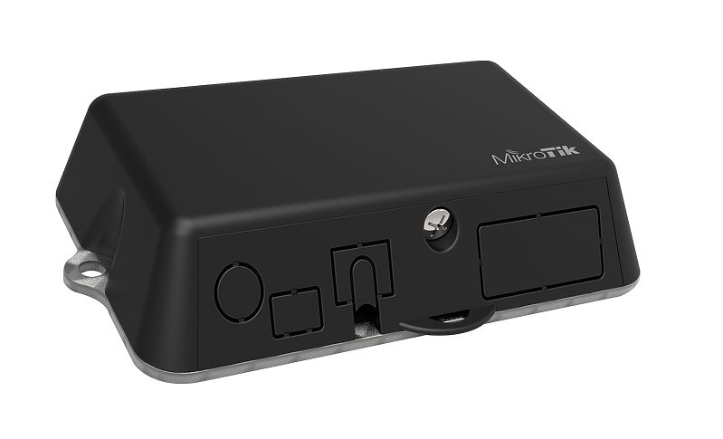
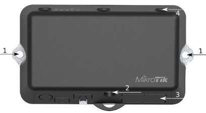
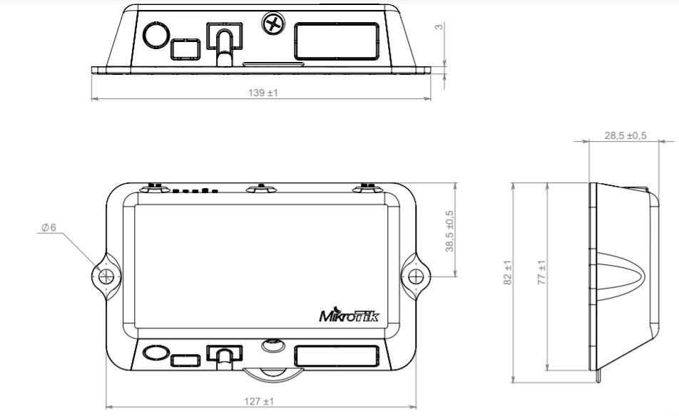
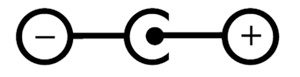
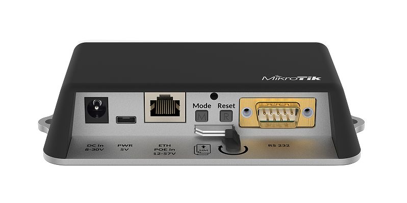
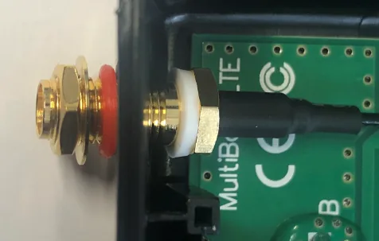
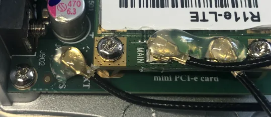

## [LtAP mini](https://mikrotik.com/product/ltap_mini) (RB912R-2nD-LTm)

The LtAP mini is a wireless access point with two SIM card slots for 3G/LTE data. The LtAP mini is designed for use with your own modem.

## Safety Warnings

-

Before you work on any equipment, be aware of the hazards involved with electrical circuitry, and be familiar with standard practices for preventing accidents.

-

Ultimate disposal of this product should be handled according to all national laws and regulations.

-

All installation methods for mounting an access point on any wall surface is subject to the acceptance of local jurisdiction.

-

The Installation of the equipment must comply with local and national electrical codes.

-

This product is intended to be mounted outdoors on a pole but can also be installed indoors. Read the mounting instructions carefully before beginning installation. Failure to use the correct hardware and configuration or to follow the correct procedures could result in a hazardous situation to people and damage to the system.

-

Use only the power supply and accessories approved by the manufacturer, and which can be found in the original packaging of this product.

-

Read the installation instructions before connecting the system to the power source.

-

We cannot guarantee that no accidents or damage will occur due to the improper use of the device. Use this product with care and operate at your own risk!

-

In the case of device failure, disconnect it from power. The fastest way to do so is by unplugging the power plug from the power outlet.

-

It is the customer's responsibility to follow local country regulations, including operation within legal frequency channels, output power, cabling requirements, and Dynamic Frequency Selection (DFS) requirements. All MikroTik radio devices must be professionally installed.

-

The equipment is not tested for Outdoor use by UL.

**Exposure to Radio Frequency Radiation:** This MikroTik equipment complies with the FCC, IC, and European Union radiation exposure limits set forth for an uncontrolled environment. This MikroTik device should be installed and operated no closer than 20 centimeters from your body, occupational user, or the general public.

## Connecting

- Install your desired modem (see "").
- If the intent to use GPS, an external antenna is required (see "").
- Choose your powering solution (see "").
- Connect your Internet cable to the Ethernet port.
- Set your computer IP configuration to *automatic* (DHCP).
- Connect your direct input power jack if not using PoE, to start up the device.
- The device will boot up and the Wireless network will be available for connecting.
- Open network connections on your PC, mobile phone, or other device and search for MikroTik wireless network and connect to it.
- Once connected to the wireless network, open [https://192.168.88.1](https://192.168.88.1) in your web browser to start configuration, since there is no password by default, you will be logged in automatically (or, for some models, check user and wireless passwords on the sticker). The configuration also can be done using a mobile app (see ""), and WinBox configuration tool [https://mt.lv/winbox](https://mt.lv/winbox).
- You should select the "Check for updates" button and update your RouterOS software to the latest version to ensure the best performance and stability.
- Choose your country, to apply country regulation settings, and set up your password on the screen that loads.
- *The following RouterOS "npk" packages are required for the core functionality of the product: gps, system.

## Mounting

- It is possible to attach the device to a wall, using the provided screw holes on the sides of the unit. The device should be mounted in a way that the cable openings are pointing downward as shown in the picture.
- The ports are protected with a small door, that is held in place with one screw. Use the Philips PH2 screwdriver to access the ports.
- The door has cut-out places for all available ports, but only break out the openings that you will use. The device can be used both indoors and outdoors. The IP rating scale for this device is IP54.
- The device enclosure has places where you can drill openings for external LTE and GPS antennas. Use a drill to make holes that are appropriate for the antenna cable used. Alternatively, you can obtain a "DINrail Pro" - mounting bracket, designed to fit standard 35 mm x 7.5 mm DIN rails. [https://mikrotik.com/product/dinrail_pro](https://mikrotik.com/product/dinrail_pro)

When mounting outdoors, ensure that any cable openings are directed downwards. Use a PoE injector and proper grounding. Recommended using Cat6 cable.

*Warning! This equipment should be installed and operated with a minimum distance of 20 cm between the device and your body. The operation of this equipment in the residential environment could cause radio interference.* *The mounting and configuration of this device should be done by a qualified person.*

## Powering

All voltages are in compliance with ES1 and max. PS2/LPS according to EN IEC 62368-1.

<table><thead><tr><th>**Input Voltage**</th><th>DC plug: 8-30 VDC  USB: 5 VDC PoE: 8-57 VDC</th></tr></thead><tbody><tr><td>**Input Power**</td><td>9W</td></tr></tbody></table>

- Direct-input power jack (5.5 mm outside and 2 mm inside, female, pin positive plug) accepts 8-30 V DC.
- microUSB port accepts 5 V powering.
- Ethernet port accepts passive and 802.3af/at Power over Ethernet 8-57 V DC (compensate for loss on cable, so more than 12 V recommended). The power consumption under maximum load with attachments can reach 9 W.

### Connecting to a PoE Adapter

- Connect the Ethernet cable from the device to the PoE+DATA port of the PoE adapter.
- Connect an Ethernet cable from your local network (LAN) to the PoE adapter.
- Connect the power cord to the adapter, and then plug the power cord into a power outlet.

## Extension slots and ports

- Built-in 2 GHz wireless access point module, AP/station/bridge/p2p modes are supported. Onboard PIF antennas built-in. Antenna gain1.5 dBi.
- miniPCIe slot and two SIM slots (can't be used without a modem installed, can't be used both at the same time) to be used with a 3G/4G/LTE modem. Onboard antennas available, but openings for external antennas are provided on the case.
- Built-in GPS module - uFL connector provided for an external antenna. To enable, set the port to serial0 (this disables the DB9 port on the unit). Supports - GPS, GLONASS, BeiDou, Galileo).
- One 10/100 Ethernet port, supporting automatic cross/straight cable correction (Auto MDI/X). Either straight or crossover cable can be used for connecting to other network devices. The Ethernet port accepts 12-57 V DC powering from a passive PoE injector.
- One DB9 RS232 serial port for serial console access. Configured as 115200 bit/s, 8 data bits, 1 stop bit, no parity. Can't be used if built-in GPS is enabled on serial0.
- One microUSB 2.0 port for powering only.

## Configuration

RouterOS includes many configuration options in addition to what is described in this document. We suggest starting here to get yourself accustomed to the possibilities: [https://mt.lv/help](https://mt.lv/help) In case IP connection is not available, the WinBox tool ([https://mt.lv/winbox](https://mt.lv/winbox)) can be used to connect to the MAC address of the device from the LAN side (all access is blocked from the internet port by default). For recovery purposes, it is possible to boot the device from the network, see section .

## miniPCIe slot usage

The device is equipped with a miniPCIe slot to be used with a 3G/4G/LTE modem. Two SIM slots are provided for use together with a miniPCIe modem. The SIM slot is not used separately. In this case, an internal antenna is not connected (located inside the enclosure). Installing a miniPCIe module should be done by a qualified person, follow safety precautions when handling electrical equipment:

- Use a wrist grounding strap when unpacking and working with electrical components to avoid electrical discharge (ESD) damage.
- Open the front cover by unscrewing one screw with the Philips PH2 screwdriver.
- Remove four screws on the bottom of the case and lift off the top part of the case. You will see the antenna attached to it.
- Locate the mini PCIe slot on the PCB and remove two factory attached screws.
- Attach provided a thick thermal pad to the card, and install the card into miniPCIe slot so that the thermal pad is between PCB and card.
- The secure card in place using previously removed two screws.
- Attach the grey uFL connector to the MAIN antenna connector of the modem, attach the black cable to the secondary (or AUX) connector.
- To use external antennas, attach antenna connectors and use a 6.5 mm drill bit to drill holes on the side of the unit. (see "") description 4.
- see the picture below on how to place rubber seals for the best water protection.

- Attach antenna connectors to the installed card and GPS connector on the PCB, as additional rubber silicone can be used to secure connectors in place on card and PCB board.

- Attach a thinner thermal pad to the top of the card.
- Reassembly in backorder. After you have reinserted the device into the case and secured it with the screws that were removed earlier, slide in the SIM cards from your mobile operator into the SIM slots, with the chips facing as shown on the port label. The slot accepts miniSIM (2FF). Close the black latch for SIM cards, to secure them in the slots.

## GPS usage

In order to use GPS, an external antenna is needed to connect. Use the "ACGPSA" - can be obtained separately. ACGPSA is a standalone active GPS antenna, that works in the 1575.4 MHz spectrum. Antenna size is 46.5 mm x 26.5 mm x 12.5 mm with an IP67 rating and includes an internal magnet and double-sided tape, so it can easily be attached to various surfaces. It has a long 5m cable with an SMA connector, to be connected to LtAP mini via the ACSMAUFL pigtail (not included, product code ACSMAUFL) [https://mikrotik.com/product/acgpsa](https://mikrotik.com/product/acgpsa) [https://mikrotik.com/product/acsmaufl](https://mikrotik.com/product/acsmaufl) To connect a GPS antenna, see "miniPCIe slot usage" step 10.

**Supports - GPS, GLONASS, BeiDou, Galileo).**

Configuration information - [GPS manual, basic examples](/docs/mobile-networking/gps/#basic-examples)

The GPS uses an active antenna, connect only when power is turned off.

## Buttons and jumpers

### Reset button

- Hold this button during boot time until LED light starts flashing, release the button to reset RouterOS configuration (total 5 seconds).
- Keep holding for 5 more seconds, LED turns solid, release now to turn on CAP mode. The device will now look for a CAPsMAN server (total 10 seconds).
- Or keep holding the button for 5 more seconds until LED turns off, then release it to make the RouterBOARD look for Netinstall servers (total 15 seconds). Regardless of the above option used, the system will load the backup RouterBOOT loader if the button is pressed before power is applied to the device. Useful for RouterBOOT debugging and recovery.

### Mode button

The action of the mode buttons can be configured from RouterOS software to execute any user-supplied RouterOS script. You can also disable this button. The mode button can be configured in RouterOS menu /system routerboard mode-button

## Accessories

Package includes the following accessories that come with the device:

- DC ⎓ Switching Power Supply 24 V, 1.2 A, 28.8 W, 86.8 %, VI, cable:220 cm RA DC.
- Cable DC ⎓ plug RA 5.5x2.1x10.5 to Striped 2*24 AWG Tin 8 mm, length 0.35 m.
- PoE Injector with shielded Ethernet cable/connector (RBPoE).
- DC ⎓ 24 V 1.2 A power adapter.
- Mounting kit K-55 VMS.
- Elastic thermal pad, 25x40x3.5 mm.

## Specifications

For more information about this product, specification and pictures visit our web page: [https://mikrotik.com/product/ltap_mini](https://mikrotik.com/product/ltap_mini)

## Operating system support

The device supports RouterOS v7 and above. The specific factory-installed version is listed in /system resource. Other operating systems have not been tested.

## MikroTik mobile app

Use the MikroTik smartphone app to configure your router in the field, or to apply the most basic initial settings for your MikroTik home access point.

- Scan QR code and choose your preferred OS.
- Install and open application.
- By default, the IP address and user name will be already entered.
- Select Connect to establish a connection to your device through a wireless network.
- Choose Quick setup and application will guide you through all basic configuration settings in a couple of easy steps.
- An advanced menu is available to fully configure all necessary settings.

To avoid pollution of the environment, separate the device from household waste and dispose of it in a safe manner, such as in designated waste disposal sites. Familiarize yourself with the procedures for the proper transportation of the equipment to the designated disposal sites in your area.

## Federal Communication Commission Interference Statement

<table><thead><tr><th>Model</th><th>FCCID</th></tr></thead><tbody><tr><td>RB912R-2nD-LTm</td><td>TV7RB912R-2NDLTM</td></tr></tbody></table>

This equipment has been tested and found to comply with the limits for a Class B digital device, pursuant to Part 15 of the FCC Rules. These limits are designed to provide reasonable protection against harmful interference in a residential installation.

This equipment generates, uses, and can radiate radio frequency energy and, if not installed and used in accordance with the instructions, may cause harmful interference to radio communications. However, there is no guarantee that interference will not occur in a particular installation. If this equipment does cause harmful interference to radio or television reception, which can be determined by turning the equipment off and on, the user is encouraged to try to correct the interference by one of the following measures:

- Reorient or relocate the receiving antenna.
- Increase the separation between the equipment and receiver.
- Connect the equipment into an outlet on a circuit different from that to which the receiver is connected.
- Consult the dealer or an experienced radio/TV technician for help. **FCC Caution:** Any changes or modifications not expressly approved by the party responsible for compliance could void the user's authority to operate this equipment. This device complies with Part 15 of the FCC Rules. Operation is subject to the following two conditions: (1) This device may not cause harmful interference, and (2) this device must accept any interference received, including interference that may cause undesired operation. This device and its antenna must not be co-located or operation in conjunction with any other antenna or transmitter.

**IMPORTANT: Exposure to Radio Frequency Radiation.** This equipment complies with the FCC RF radiation exposure limits set forth for an uncontrolled environment. This equipment should be installed and operated with a minimum distance of 20 cm between the radiator and any part of your body.

## Innovation, Science and Economic Development Canada

<table><thead><tr><th>Model</th><th>IC</th></tr></thead><tbody><tr><td>RB912R-2nD-LTm</td><td>7442A-912R2NDLTM</td></tr></tbody></table>

This device complies with Industry Canada's licence-exempt RSS standard(s). Operation is subject to the following two conditions: (1) this device may not cause interference, and (2) this device must accept any interference, including interference that may cause undesired operation of the device. Le présent appareil est conforme aux CNR d'Industrie Canada applicables aux appareils radio exempts de licence. L'exploitation est autorisée aux deux conditions suivantes : (1) l'appareil ne doit pas produire de brouillage, et (2) l'utilisateur de l'appareil doit accepter tout brouillage radioélectrique subi, même si le brouillage est susceptible d'en compromettre le fonctionnement.

This Class B digital apparatus complies with Canadian ICES-003.

Cet appareil numérique de la classe [B] est conforme à la norme NMB-003 du Canada.

CAN ICES-003 (B) / NMB-003 (B)

**IMPORTANT: Exposure to Radio Frequency Radiation.** This equipment complies with the IC radiation exposure limits set forth for an uncontrolled environment. This equipment should be installed and operated with a minimum distance of 20 cm between the radiator and any part of your body. Cet équipement est conforme aux limites d'exposition au rayonnement IC définies pour un environnement non contrôlé. Cet équipement doit être installé et utilisé à une distance minimale de 20 cm entre le radiateur et toute partie de votre corps.

## UKCA marking

## Eurasian Conformity Mark

<table><thead><tr><th>Частотный диапазон</th><th>Мощность передатчика</th></tr></thead><tbody><tr><td>2400-2483.5 МГц</td><td>≤100 мВт</td></tr></tbody></table>

*Доступные частотные каналы могут различаться в зависимости от модели продукта и сертификации.

Информация о дате изготовления устройства указана в конце серийного номера на его наклейке через дробь. Первая цифра означает номер года (последняя цифра года), две последующие означают номер недели.

Изготовитель: MikroTikls SIA, Aizkraukles iela 23, Riga, LV-1006, Латвия, [support@mikrotik.com](mailto:support@mikrotik.com). Сделано в Китае, Латвии или Литве. Cм. на упаковке.

Для получения подробных сведений о гарантийном обслуживании обратитесь к продавцу. Информация об импортерах продукции MikroTik в Российскую Федерацию: [https://mikrotik.com/buy/europe/russia](https://mikrotik.com/buy/europe/russia)

Продукты MikroTik, которые поставляются в Евразийский таможенный союз, оцениваются с учетом соответствующих требований и помечены знаком EAC, как показано ниже:

## Norma Oficial Mexicana

Rango de frecuencia (potencia de salida máxima): 2400-2483.5 MHz (30 dBm). Los canales de frecuencia disponibles pueden variar según el modelo y la certificación del producto.

EFICIENCIA ENERGETICA CUMPLE CON LA NOM-029-ENER-2017.

La operacion de este equipo esta sujeta a las siguientes dos condiciones:

- Es posible que este equipo o dispositivo no cause interferencia perjudicial y.
- Este equipo debe aceptar cualquier interferencia, incluyendo la que pueda causar su operacion no deseada. Fabricante: MikroTikls SIA, Brivibas gatve 214i, Riga, LV-1039, Latvia.

País De Origen: Letonia; Lituania; China (Republica Popular); Estados Unidos De America; Mexico.

Por favor contacte a su distribuidor local para preguntas regionales específicas. La lista de importadores se puede encontrar en nuestra página de inicio – [https://mikrotik.com/buy/latinamerica/mexico](https://mikrotik.com/buy/latinamerica/mexico).

## The National Commission for the State Regulation of Communications and Informatization by Ukraine

Виробник: MikroTikls SIA, Brivibas gatve 214i Рига, Латвія, LV1039.

Робоча частота (Максимальна вихідна потужність): 2480-2483.5 МГц (20 дБм).

Справжнім MikroTikls SIA заявляє, що маршрутизатор відповідає основним вимогам та іншим відповідним положенням директиви 2014/53/EC, а також суттєвим вимогам Технічного регламенту радіообладнання, затвердженого постановою Кабінету Міністрів України від 24 травня 2017 року № 355.

Для експлуатації в Україні необхідно отримати дозвіл на експлуатацію у порядку, затвердженому рішенням НКРЗІ від 01.11.2012 № 559, зареєстрованому в Міністерстві юстиції України 03.01.2013 за № 57/22589.

## CE Declaration of Conformity

Manufacturer: MikroTikls SIA, Brivibas gatve 214i Riga, Latvia, LV1039.

Hereby, Mikrotīkls SIA declares that the radio equipment type RB912R-2nD-LTm is in compliance with Directive 2014/53/EU. The full text of the EU declaration of conformity is available at the following internet address: [https://mikrotik.com/products](https://mikrotik.com/products)

### Frequency bands terms of use

<table><thead><tr><th>Frequency range (for applicable models)</th><th>Channels used</th><th>Maximum Output Power (EIRP)</th><th>Restriction</th></tr></thead><tbody><tr><td>2400-2483.5 MHz</td><td>1 - 13</td><td>20 dBm</td><td>Without any restriction to use in all EU Member States</td></tr></tbody></table>

** It is the customer's responsibility to follow local country regulations, including operation within legal frequency channels, output power, cabling requirements, and Dynamic Frequency Selection (DFS) requirements. All MikroTik radio devices must be professionally installed!*

This MikroTik device meets Maximum WLAN transmit power limits per ETSI regulations. For more detailed information see Declaration of Conformity above / Dieses MikroTik-Gerät erfüllt die maximalen WLAN- Sendeleistung Grenzwerte gemäß ETSI-Bestimmungen. Weitere Informationen finden Sie oben unter Konformitätserklärung / Cet appareil MikroTik respecte les limites maximales de puissance de transmission WLAN conformément aux réglementations ETSI. Pour plus d'informations, voir la déclaration de conformité ci-dessus / Questo dispositivo MikroTik è conforme ai limiti massimi di potenza di trasmissione WLAN in conformità con le normative ETSI. Per ulteriori informazioni, consultare la dichiarazione di conformità sopra / Este dispositivo MikroTik cumple con los límites máximos de potencia de transmisión WLAN de acuerdo con las regulaciones ETSI. Para obtener más información, consulte la declaración de conformidad anterior / Это устройство MikroTik соответствует максимальным пределам мощности передачи WLAN в соответствии с правилами ETSI. Для получения дополнительной информации см. Декларацию соответствия выше.
