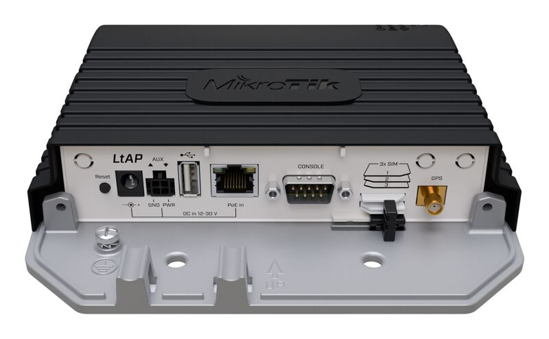
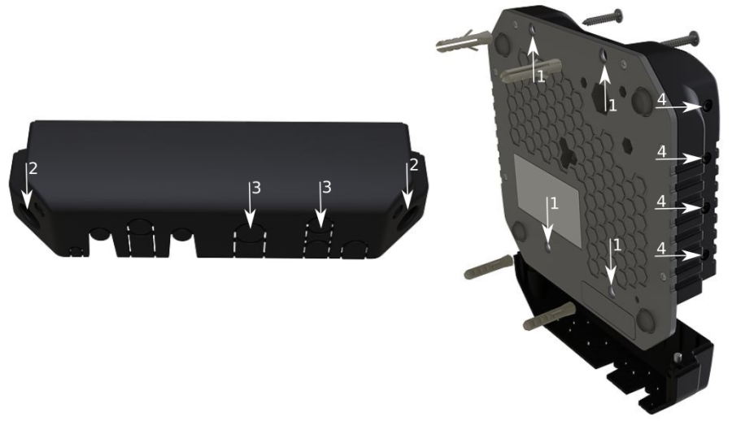
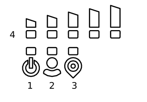
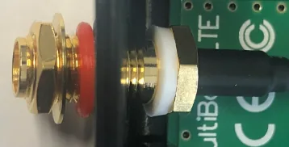

## [LtAP](https://mikrotik.com/product/ltap) (RBLtAP-2HnD)

The LtAP is a wireless access point with three SIM card slots for cellular data modems.

## Safety Warnings

- Before you work on any equipment, be aware of the hazards involved with electrical circuitry, and be familiar with standard practices for preventing accidents.
- Read the installation instructions before connecting the system to the power source.
- This equipment is to be installed by trained and qualified personnel, as per these installation instructions. The installer is responsible for obtaining any required local or national safety inspections of the structural integrity of the installation by the local authority/inspection department.
- All installation methods for mounting an access point on any wall surface is subject to the acceptance of local jurisdiction.
- The Installation of the equipment must comply with local and national electrical codes.
- This product is intended to be mounted outdoors on a pole but can also be installed indoors. Read the mounting instructions carefully before beginning installation. Failure to use the correct hardware and configuration or to follow the correct procedures could result in a hazardous situation to people and damage to the system.
- We cannot guarantee that no accidents or damage will occur due to the improper use of the device. Use this product with care and operate at your own risk.

**Exposure to Radio Frequency Radiation:** This MikroTik equipment complies with the FCC, IC, and European Union radiation exposure limits set forth for an uncontrolled environment. This MikroTik device should be installed and operated no closer than 120 centimeters from your body, occupational user, or the general public.

## Quickstart

follow these quick steps to set up your device:

- Unscrew two screws and remove doors to access all ports. See the (link) slot usage (optional).
- Insert the SIM card into the slot (optional) (see (link)).
- Connect GPS antenna (optional).
- Mount unit in your desired place, see paragraph.
- Choose your powering solution, see the section for possibilities.
- Download the WinBox configuration tool [https://mt.lv/winbox](https://mt.lv/winbox) There is no default IP address set, user name: **admin** and there is no password (or, for some models, check user and wireless passwords on the sticker), use the Neighbors tab and connect through the MAC address;
- You should select the "Check for updates" button and update your RouterOS software to the latest version to ensure the best performance and stability.
- Choose your country, to apply country regulation settings, and set up your password on the screen that loads.
- Set the *Installation* to indoors or outdoors, depending on the usage type.
- *The following RouterOS "npk" packages are required for the core functionality of the product: gps, system.

## Extension slots and ports

- Built-in 2 GHz wireless access point module, AP/station/bridge/p2p modes are supported. Onboard PIF antennas built-in, as well as MMCX connectors for external antennas (software selectable).
- Two miniPCIe slots and three SIM slots.
- Built-in GPS module with an external SMA connector. Supports - GPS, GLONASS, BeiDou, Galileo).
- Gigabit Ethernet port, supporting automatic cross/straight cable correction (Auto MDI/X). Either straight or crossover cable can be used for connecting to other network devices. The Ethernet port accepts 12-30 V DC powering from a passive PoE injector.
- One DB9 RS232 serial port for serial console access. Configured as 115200 bit/s, 8 data bits, 1 stop bit, no parity.
- One USB 2.0 port for storage devices or cellular modems.

## Mounting

- It is possible to attach the device to a wall, using the provided four screws and designed four holes on the unit.
- The ports are protected with a small door, that is held in place with two screws. Remove to access Ethernet ports, antenna connector, SIM slots, etc.
- The door has cut-out places for all available ports, so you can guide through all necessary cables, but only break out the openings that you will use.
- Several places for external antennas are provided on the case, use an appropriate size drill, to make them available. Be careful and measure the chosen antenna, so that it does not touch the internal PCB board when installed.

The device can be used both indoors and outdoors. The IP rating scale of IP54. If you intend to mount outdoors, ensure that any cable openings are directed downwards. The Mounting direction is indicated on the device with an arrow pointing up. Use POE injector and proper grounding. Recommended using Cat6 shielded cable. Warning! This equipment should be installed and operated with a minimum distance of 30 cm between the device and your body. Operation of this equipment in the residential environment could cause radio interference.

## Configuration

You should select the "Check for updates" button and update your RouterOS software to the latest version to ensure the best performance and stability. RouterOS includes many configuration options in addition to what is described in this document. We suggest starting here to get yourself accustomed to the possibilities: [https://mt.lv/help](https://mt.lv/help) In case IP connection is not available, the WinBox tool ([https://mt.lv/winbox](https://mt.lv/winbox)) can be used to connect to the MAC address of the device from the LAN side (all access is blocked from the internet port by default). For recovery purposes, it is possible to boot the device from a network, see the section .

## GPS

The built-in GPS module requires an external antenna to be used (SMA connector is already mounted behind the unit door). See the section on how to remove the door. **Attention** the GPS uses an active antenna, only connect and disconnect the antenna, when the device is turned off!

**Supports - GPS, GLONASS, BeiDou, Galileo).** Make sure that the GPS package is installed on your device. Check by following command /system package print. If not installed download extra packages at our download page accordingly to your RouterOS version and install GPS package by dragging it to the Files menu. Enable GPS and start working:

- Enabling - /system gps set enable=yes;
- Setting antenna to external - /system gps set gps-antenna-select=external;
- Checking configuration - /system gps print. Configuration information - [GPS manual, basic examples](/docs/7.24/mobile-networking/gps/#basic-examples)

## Powering

- Direct-input power jack (5.5 mm outside and 2 mm inside, female, pin positive plug) accepts 12-30 V DC ⎓ with provided 24 V, 1.2 A adapter.
- Ethernet port accepts passive Power over Ethernet 12-30 V DC ⎓ (compensate for the loss on cable, so more than 12 V recommended).
- The automotive connector can be used to power the device from regular 12/24 V ⎓ connections in automobiles and buses. The plug has four pins: bottom left (black) is the ground, bottom right is power in (red). The upper two (AUX) are reserved for future use. The power consumption under maximum load can reach 12 W without attachments. Attach ground (earth) wire to the screw under the door.

### Connecting to a PoE Adapter: (Not included)

- Connect the Ethernet cable from the device to the POE out port of the POE adapter.
- Connect an Ethernet cable from your LAN to the POE adapter.
- Connect the power cord to the adapter, and then plug the power cord into a power outlet.

## Front status LED behavior

- Solid Blue – the device is powered on.
- Solid Green – user-defined LED, can be configured in system settings.
- Solid Green – state of GPS module.
- Solid Green– the set of five green LED, shows the signal strength of the cellular network.

## miniPCIe slot

### SIM card connectivity

- MiniPCIe 1 (top slot) supports PCIe and USB 2.0 cards but is shared with the USB 2.0 type A port (can use either the USB port or miniPCIe slot at the same time). It can be used only for SIM slot #1.
- MiniPCIe 2 (bottom slot) supports only USB (2.0 and 3.0) miniPCIe modems (no PCIe support). Uses SIM slot #2 and SIM slot #3. By default uses SIM slot #2.
- USB 2.0 type A port (can only be used if miniPCIe 1 is not used).
- To use the top miniPCIe slot with a USB type miniPCIe card, switch the USB connections to the miniPCIe slot: /system routerboard usb set type=mini-PCIe This will disable the USB 2.0 port on the front of the unit.
- Insert the SIM card into the top slot by a chip on the SIM card facing down. Bottom slots – with the chip facing up. check if you are using the correct SIM slot. For the modem inserted in the bottom mini-pcie slot, you need to use either sim slot 2 or sim slot 3. And the used sim slot needs to be selected in RouterOS. CLI command to select the sim slot: */system routerboard modem set sim-slot=2*

### Modem installation

This LtAP version is without a modem installed. In this case, an internal antenna is not connected. Installing a miniPCIe module should be done by a qualified person, follow safety precautions when handling electrical equipment, the device supports two LR cards:

- Use a wrist grounding strap when unpacking and working with electrical components to avoid electrical discharge (ESD) damage;
- Remove six screws on the bottom of the case and lift off the top part of the case.
- Locate the miniPCIe slot and remove two factory attached screws;
- Attach provided a thick thermal pad to the card, and install the card into miniPCIe slot so that thermal pad is between PCB and card;
- The secure card in place using previously removed two screws;
- Connect internal antenna cables to your modem. Or guide your antenna cables through openings near the GPS connector and connect to the modem. Recommended using silicone rubber to secure connectors in place.
- Attach a thinner thermal pad to the top of the card;
- When using external antennas, connectors can be attached on the case sides, to make openings use a 6.5 mm drill bit, see section part 4;
- see the picture below for reference on how to place rubber seals for best water protection;

- Reassembly in backorder. Tightening torque for PCB screws 0.3 Nm, case cover/enclosure screws 0.5 Nm. After you have reinserted the device into the case and secured it with the screws that were removed earlier, slide in the SIM cards from your mobile operator into the SIM slots, with the chips facing as shown on the port label. The slot accepts miniSIM (2FF). SIM slots 2 and 3 apply to the bottom miniPCIe slot and can be switched in RouterOS "/system routerboard sim" menu.

## Reset button

- Hold this button during boot time until LED light starts flashing, release the button to reset RouterOS configuration (total 5 seconds).
- Keep holding for 5 more seconds, LED turns solid, release now to turn on CAP mode. The device will now look for a CAPsMAN server (total 10 seconds).
- Or keep holding the button for 5 more seconds until LED turns off, then release it to make the RouterBOARD look for Netinstall servers (total 15 seconds). Regardless of the above option used, the system will load the backup RouterBOOT loader if the button is pressed before power is applied to the device. Useful for RouterBOOT debugging and recovery.

## Accessories

Package includes accessories that come with the device:

- K-67 fastening set. Includes four screws 4x25 mm, four dowels 6x30 mm.
- Cable DC ⎓ (H4130-04PDB000R 3 mm 2x2P Housing) to (StripJacket 5 cm+WireEnd Strip/Tin 1 cm) 24 AWG (Black/Red/Blue/Orange) 0.35 m.
- EU/US Switching Power Supply 24 V, 1.2 A, 28.8 W, 86.8%, VI, DC ⎓ cable: 220 cm RA DC plug mod Hor CMC shorter plug.
- Elastic thermal pads - 25x40x3.5mm +30x45x1mm in Ziplock bag.

## Operating system support

The device supports RouterOS v7 and above. The specific factory-installed version is listed in /system resource. Other operating systems have not been tested.

## Specifications

For more information about this product, specifications, pictures, downloads, and test results visit our web page: [https://mikrotik.com/product/ltap](https://mikrotik.com/product/ltap)

## MikroTik mobile app

Use the MikroTik smartphone app to configure your router in the field, or to apply the most basic initial settings for your MikroTik home access point.

- Scan QR code and choose your preferred OS.
- Install and open application.
- By default, the IP address and user name will be already entered.
- Select Connect to establish a connection to your device through a wireless network.
- Choose Quick setup and the application will guide you through all basic configuration settings in a couple of easy steps.
- An advanced menu is available to fully configure all necessary settings.

## Notice

- The Frequency band 5.470-5.725 GHz isn’t allowed for commercial use.
- In case WLAN devices work with different ranges than the above regulations, then a customized firmware version from the manufacturer/supplier is required to be applied to the end-user equipment and also prevent the end-user from reconfiguration.
- For Outdoor Usage: End-user requires approval/license from the NTRA.
- Datasheet for any device is available on the official manufacturer website.
- Products with the letters “EG” at the end of their serial number have their wireless frequency range limited to 2.400 – 2.4835 GHz, the TX power is limited to 20dBm (EIRP).
- Products with the letters “EG” at the end of their serial number have their wireless frequency range limited to 5.150 – 5.250 GHz, the TX power is limited to 23dBm (EIRP).
- Products with the letters “EG” at the end of their serial number have their wireless frequency range limited to 5.250 – 5.350 GHz, the TX power is limited to 20dBm (EIRP).

make sure the device has a lock package (firmware version from the manufacturer) which is required to be applied to the end-user equipment to prevent the end-user from reconfiguration. The product will be marked with country code “-EG”. This device needs to be upgraded to the latest version to ensure compliance with local authority regulations! It is the end users responsibility to follow local country regulations, including operation within legal frequency channels, output power, cabling requirements, and Dynamic Frequency Selection (DFS) requirements. All MikroTik radio devices must be professionally installed.

To avoid pollution of the environment, separate the device from household waste and dispose of it in a safe manner, such as in designated waste disposal sites. Familiarize yourself with the procedures for the proper transportation of the equipment to the designated disposal sites in your area.

## Federal Communication Commission Interference Statement

<table><thead><tr><th>Model</th><th>FCCID</th></tr></thead><tbody><tr><td>RBLtAP-2HnD</td><td>TV7LTAP2HND</td></tr></tbody></table>

This equipment has been tested and found to comply with the limits for a Class B digital device, pursuant to Part 15 of the FCC Rules. These limits are designed to provide reasonable protection against harmful interference in a residential installation. This equipment generates, uses, and can radiate radio frequency energy and, if not installed and used in accordance with the instructions, may cause harmful interference to radio communications. However, there is no guarantee that interference will not occur in a particular installation. If this equipment does cause harmful interference to radio or television reception, which can be determined by turning the equipment off and on, the user is encouraged to try to correct the interference by one of the following measures:

- Reorient or relocate the receiving antenna.
- Increase the separation between the equipment and receiver.
- Connect the equipment into an outlet on a circuit different from that to which the receiver is connected.
- Consult the dealer or an experienced radio/TV technician for help. **FCC Caution:** Any changes or modifications not expressly approved by the party responsible for compliance could void the user's authority to operate this equipment. This device complies with Part 15 of the FCC Rules. Operation is subject to the following two conditions: (1) This device may not cause harmful interference, and (2) this device must accept any interference received, including interference that may cause undesired operation. This device and its antenna must not be co-located or operation in conjunction with any other antenna or transmitter.

**IMPORTANT: Exposure to Radio Frequency Radiation.** This equipment complies with the FCC RF radiation exposure limits set forth for an uncontrolled environment. This equipment should be installed and operated with a minimum distance of 30 cm between the radiator and any part of your body. This enclosed device complies with 47CFR paragraph 15 C of the FCC rules and regulations. Operation is subject to the following two conditions: (1) this device may not cause harmful interference, and (2) this device must accept any interference received, including interference that may cause undesired operation.

*For use of CBRS bands, the CBSD Category of the final Host equipment will be dependent on the power settings and antenna gain used.*

## Innovation, Science and Economic Development Canada

<table><thead><tr><th>Model</th><th>FCCID</th></tr></thead><tbody><tr><td>RBLtAP-2HnD</td><td>7442A-LTAP2HND</td></tr></tbody></table>

This device complies with Industry Canada's license-exempt RSS standard(s). Operation is subject to the following two conditions: (1) this device may not cause interference, and (2) this device must accept any interference, including interference that may cause undesired operation of the device. Le présent appareil est conforme aux CNR d'Industrie Canada applicables aux appareils radio exempts de licence. L'exploitation est autorisée aux deux conditions suivantes: (1) l'appareil ne doit pas produire de brouillage, et (2) l'utilisateur de l'appareil doit accepter tout brouillage radioélectrique subi, même si le brouillage est susceptible d'en compromettre le fonctionnement.

This Class B digital apparatus complies with Canadian ICES-003.

Cet appareil numérique de la classe [B] est conforme à la norme NMB-003 du Canada.

CAN ICES-003 (B) / NMB-003 (B)

**IMPORTANT: Exposure to Radio Frequency Radiation.** This equipment complies with the IC radiation exposure limits set forth for an uncontrolled environment. This equipment should be installed and operated with a minimum distance of 20 cm between the radiator and any part of your body.

## UKCA marking

## Eurasian Conformity Mark

<table><thead><tr><th>Частотный диапазон</th><th>Мощность передатчика</th></tr></thead><tbody><tr><td>2412-2472 МГц</td><td>≤100 мВт</td></tr></tbody></table>

*Доступные частотные каналы могут различаться в зависимости от модели продукта и сертификации.

Информация о дате изготовления устройства указана в конце серийного номера на его наклейке через дробь. Первая цифра означает номер года (последняя цифра года), две последующие означают номер недели.

Изготовитель: MikroTikls SIA, Aizkraukles iela 23, Riga, LV-1006, Латвия, [support@mikrotik.com](mailto:support@mikrotik.com). Сделано в Китае, Латвии или Литве. Cм. на упаковке.

Для получения подробных сведений о гарантийном обслуживании обратитесь к продавцу. Информация об импортерах продукции MikroTik в Российскую Федерацию: [https://mikrotik.com/buy/europe/russia](https://mikrotik.com/buy/europe/russia)

Продукты MikroTik, которые поставляются в Евразийский таможенный союз, оцениваются с учетом соответствующих требований и помечены знаком EAC, как показано ниже:

## Norma Oficial Mexicana

Rango de frecuencia (potencia de salida máxima): 2412-2472 MHz (30 dBm). Los canales de frecuencia disponibles pueden variar según el modelo y la certificación del producto.

EFICIENCIA ENERGETICA CUMPLE CON LA NOM-029-ENER-2017.

La operacion de este equipo esta sujeta a las siguientes dos condiciones:

- Es posible que este equipo o dispositivo no cause interferencia perjudicial y.
- Este equipo debe aceptar cualquier interferencia, incluyendo la que pueda causar su operacion no deseada. Fabricante: MikroTikls SIA, Brivibas gatve 214i, Riga, LV-1039, Latvia.

País De Origen: Letonia; Lituania; China (Republica Popular); Estados Unidos De America; Mexico.

Por favor contacte a su distribuidor local para preguntas regionales específicas. La lista de importadores se puede encontrar en nuestra página de inicio – [https://mikrotik.com/buy/latinamerica/mexico](https://mikrotik.com/buy/latinamerica/mexico).

## The National Commission for the State Regulation of Communications and Informatization by Ukraine

Виробник: MikroTikls SIA, Brivibas gatve 214i Рига, Латвія, LV1039.

Робоча частота (Максимальна вихідна потужність): 2412-2472 МГц (20 дБм).

Справжнім MikroTikls SIA заявляє, що маршрутизатор відповідає основним вимогам та іншим відповідним положенням директиви 2014/53/EC, а також суттєвим вимогам Технічного регламенту радіообладнання, затвердженого постановою Кабінету Міністрів України від 24 травня 2017 року № 355.

Для експлуатації в Україні необхідно отримати дозвіл на експлуатацію у порядку, затвердженому рішенням НКРЗІ від 01.11.2012 № 559, зареєстрованому в Міністерстві юстиції України 03.01.2013 за № 57/22589.

## CE Declaration of Conformity

Manufacturer: MikroTikls SIA, Brivibas gatve 214i Riga, Latvia, LV1039.

Hereby, Mikrotīkls SIA declares that the radio equipment type RBLtAP-2HnD is in compliance with Directive 2014/53/EU. The full text of the EU declaration of conformity is available at the following internet address: [https://mikrotik.com/products](https://mikrotik.com/products)

### Frequency bands terms of use

<table><thead><tr><th>Frequency range (for applicable models)</th><th>Channels used</th><th>Maximum Output Power (EIRP)</th><th>Restriction</th></tr></thead><tbody><tr><td>2412-2472 MHz</td><td>1 - 13</td><td>20 dBm</td><td>Without any restriction to use in all EU Member States</td></tr></tbody></table>

** It is the customer's responsibility to follow local country regulations, including operation within legal frequency channels, output power, cabling requirements, and Dynamic Frequency Selection (DFS) requirements. All MikroTik radio devices must be professionally installed!*
