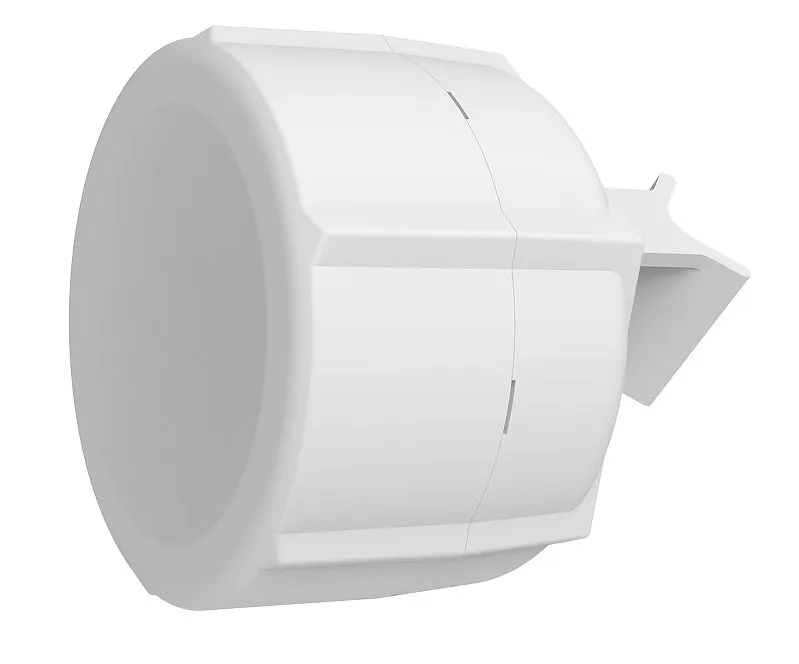
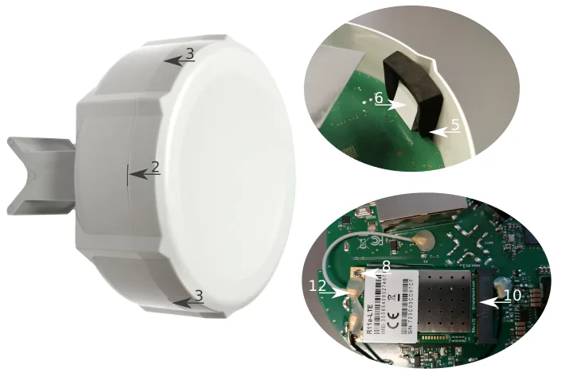
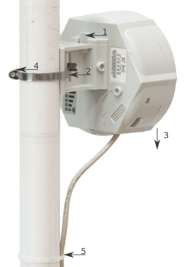
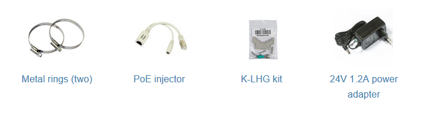

## [SXT R](https://mikrotik.com/product/sxt_r) (RBSXTR)

The SXT R comes without modem, it has built-in LTE antenna, two 10/100 Ethernet connectors which support MDI-X auto-detection. There are two micro SIM card slots available, to switch between cell providers. See the [SXT R product page](https://mikrotik.com/product/sxt_r) for full specifications and brochures.

## Safety Warnings

- Before you work on any equipment, be aware of the hazards involved with electrical circuitry, and be familiar with standard practices for preventing accidents.
- Ultimate disposal of this product should be handled according to all national laws and regulations.
- All installation methods for mounting an access point on any wall surface is subject to the acceptance of local jurisdiction.
- The Installation of the equipment must comply with local and national electrical codes.
- This product is intended to be mounted outdoors on a pole. Read the mounting instructions carefully before beginning installation. Failure to use the correct hardware and configuration or to follow the correct procedures could result in a hazardous situation for people and damage to the system.
- Use only the power supply and accessories approved by the manufacturer, and which can be found in the original packaging of this product.
- Read the installation instructions before connecting the system to the power source.
- We cannot guarantee that no accidents or damage will occur due to the improper use of the device. Use this product with care and operate at your own risk!
- In the case of device failure, disconnect it from power. The fastest way to do so is by unplugging the power plug from the power outlet.
- It is the customer's responsibility to follow local country regulations, including operation within legal frequency channels, output power, cabling requirements, and Dynamic Frequency Selection (DFS) requirements. All MikroTik radio devices must be professionally installed.

**Exposure to Radio Frequency Radiation:** This MikroTik equipment complies with the FCC, IC, and European Union radiation exposure limits set forth for an uncontrolled environment. This MikroTik device should be installed and operated no closer than 45 centimeters from your body, occupational user, or the general public.

## First use

- Open the bottom lid.
- Install the desired card into miniPCIe slot, refer to paragraph (link).
- Insert the micro-SIM cards into the micro-SIM slots (SIM A slot is a default).
- Connect the device to the power source (see "SXT kit-series#Powering").
- Once the device is powered on and PC connected to the device, open [https://192.168.88.1](https://192.168.88.1)

in your web browser or WinBox to start the configuration (or, for some models, check user and wireless passwords on the sticker).

- User name: a*dmin* and there is no password by default you will be logged in automatically to the Quick Set screen.
- You should select the "Check for updates" button on the right side and update your RouterOS software to the latest version to ensure the best performance and stability. Must have an internet connection and a valid SIM card.
- To manually update the device, go to our web page and download the latest (MIPSBE) software packages to your PC.
- Open Web browser or WinBox and upload packages to the Files menu and reboot the device.
- Set up your router password in the bottom field "Password" to the right and repeat it in the field "Confirm Password", it will be used to login next time.
- Select the "Apply Configuration" to save changes.

## Extension slots and ports

- Two 10/100 Ethernet port, supporting automatic cross/straight cable correction (Auto MDI/X). Either straight or crossover cable can be used for connecting to other network devices.
- MiniPCIe slot and two SIM slots (can't be used separately) to be used with a 3G/4G/LTE modems.
- The Mode button allows you to run any script when the button is pushed.

## Powering

The device accepts 18-57 V DC passive and 802.3af/at PoE power from the Ethernet port ETH1. The package contains a 24 V adapter and a passive PoE injector. Power consumption without attachments up to 6 W.

### Connecting to a PoE Adapter

- Connect the Ethernet cable from the device to the POE port of the POE adapter.
- Connect an Ethernet cable from your LAN to the LAN port of the POE adapter, mind arrows for data and power flow.
- Connect the power cord to the adapter, and then plug the power cord into a power outlet.

## Configuration

Once logged in, you should select the "Check for updates" button in the QuickSet menu, as updating your RouterOS software to the latest version ensures the best performance and stability. For wireless models, make sure you have selected the country where the device will be used, to conform with local regulations. RouterOS includes many configuration options in addition to what is described in this document. We suggest starting here to get yourself accustomed to the possibilities: [https://mt.lv/help](https://mt.lv/help) In case IP connection is not available, the WinBox tool ([https://mt.lv/winbox](https://mt.lv/winbox)) can be used to connect to the MAC address of the device from the LAN side (all access is blocked from the Internet port by default). For recovery purposes, it is possible to boot the device from the network, see a section .

## MiniPCIe slot usage

This SXT version is without a factory modem installed. In order to install the module, you will need to remove the plastic top and withdraw the PCB plate from the bottom case. Installing a miniPCIe module should be done by a qualified person, follow safety precautions when handling electrical equipment:

- Use a wrist grounding strap when unpacking and working with electrical components to avoid electrical discharge (ESD) damage.
- Removing the top cover, insert plastic tool in one of the six holes, turn slightly to the side and twitch carefully to slightly release the cover from holding into the place.
- Continue to work around until all of the clamps are released.
- Remove the top cover by lifting it up.
- You will access the upper side of PCB and antenna, remove two black soft pads to access PCB holders.
- Push both plastic holders to opposite sides to release the PCB board from its position.
- Remove the PCB board, carefully lift it up and place it on the anti-static mat.
- Locate the mini PCIe slot on the bottom of the PCB and remove two factory attached screws.
- Attach provided a thick thermal pad to the card.
- Install the card into a miniPCIe slot so that the thermal pad is between PCB and card.
- The secure card in place using previously removed two screws.
- Attach the grey uFL connector to the MAIN antenna connector of the modem, attach the black cable to the secondary (or AUX) connector. Use silicone type rubber to secure wiring in place.
- Attach a thinner thermal pad to the top of the card.
- Reassembly in backorder. After you have reinserted the device into the case, slide in the SIM cards from your mobile operator into the SIM slots, with the chips facing down.

## Mounting

SXT designed to be mounted on the pole, the package includes mounting bracket and steel clamp.

- With the clip pointed forward, slide the mounting bracket into the rail on the bottom of the case, until the clip clicks into place.
- Guide the clamp through the opening in the bracket.
- Attach the unit to a pole, with the Ethernet port pointing downward.
- Use a PH2 screwdriver to tighten the rings when alignment is complete.
- Fix the Ethernet cable to the pole using zip ties, less than one meter from the unit, to avoid the cable being pulled out of the port.
- Check mounting angle and positioning. When mounting outdoors, ensure that any cable openings are directed downwards. Use POE injector and proper grounding, this device has specially designed grounding connector under the port cover. Recommended using Cat5/6 cable. The IP rating scale for this device is IP54. The SXT device has a sliding door, behind which the Ethernet ports and the reset buttons are located. This door can be also secured shut with a screw in the provided screw hole. When using both Ethernet ports, make sure to cut a wider cable opening in the plastic door. You can use pliers to tear out the plastic piece that is protecting the cable opening. When closing the plastic door, make sure to apply pressure, until it "clicks" into place. *Mounting and configuration of this device should be done by a qualified person.*

## Grounding

The installation infrastructure (towers and masts), as well as the router itself, must be properly grounded. The device includes a grounding wire attachment screw behind the case door. Attach your grounding wire to the grounding screw, then attach the other end of the grounding wire to the grounded mast. This is to substantially reduce the risk of ESD and lightning damage.

## LED indicators

- The power LED indicates that the unit is receiving power in the ETH1 port.
- LTE LED indicates that the device is currently connected to a cellular tower.
- LTE Signal LEDs display the strength of the cellular signal.
- PoE LED indicates that the ETH2 port is currently powering another device with PoE.

## Reset button

The routerBOOT reset button has the following functions. Press the button and apply the power, then:

- Release the button when green LED starts flashing, to reset RouterOS configuration to defaults.
- Release the button when the LED turns solid green to clear all configuration and defaults.
- Release the button after LED is no longer lit (~20 seconds) to cause a device to look for Netinstall servers (required for reinstalling RouterOS over the network). Regardless of the above option used, the system will load the backup RouterBOOT loader if the button is pressed before power is applied to the device. Useful for RouterBOOT debugging and recovery.

## Mode button

The action of the mode buttons can be configured from RouterOS software to execute any user-supplied RouterOS script. You can also disable this button. The mode button can be configured in RouterOS menu /system routerboard mode-button.

## Accessories

Package includes the following accessories that come with the device:

## Specifications

For more information about this product, specification and pictures visit our web page: [https://mikrotik.com/product/sxt_r](https://mikrotik.com/product/sxt_r)

## Operating system support

The device supports RouterOS v7 and above. The specific factory-installed version is listed in /system resource. Other operating systems have not been tested.

## SIM slot usage

SIM card slot is designed to use with Micro SIM cards.

Nano SIM cards have different thickness, usage with adapter are not recommended.

250

To avoid pollution of the environment, separate the device from household waste and dispose of it in a safe manner, such as in designated waste disposal sites. Familiarize yourself with the procedures for the proper transportation of the equipment to the designated disposal sites in your area.

## Federal Communication Commission Interference Statement

This equipment has been tested and found to comply with the limits for a Class B digital device, pursuant to Part 15 of the FCC Rules. These limits are designed to provide reasonable protection against harmful interference in a residential installation.

This equipment generates, uses and can radiate radio frequency energy and, if not installed and used in accordance with the instructions, may cause harmful interference to radio communications. However, there is no guarantee that interference will not occur in a particular installation. If this equipment does cause harmful interference to radio or television reception, which can be determined by turning the equipment off and on, the user is encouraged to try to correct the interference by one of the following measures:

- Reorient or relocate the receiving antenna.
- Increase the separation between the equipment and receiver.
- Connect the equipment into an outlet on a circuit different from that to which the receiver is connected.
- Consult the dealer or an experienced radio/TV technician for help. **FCC Caution:** Any changes or modifications not expressly approved by the party responsible for compliance could void the user's authority to operate this equipment. This device complies with Part 15 of the FCC Rules. Operation is subject to the following two conditions: (1) This device may not cause harmful interference, and (2) this device must accept any interference received, including interference that may cause undesired operation. This device and its antenna must not be co-located or operation in conjunction with any other antenna or transmitter.

## Innovation, Science and Economic Development Canada

This device complies with Industry Canada licence-exempt RSS standard(s). Operation is subject to the following two conditions: (1) this device may not cause interference, and (2) this device must accept any interference, including interference that may cause undesired operation of the device. Le présent appareil est conforme aux CNR d'Industrie Canada applicables aux appareils radio exempts de licence. L'exploitation est autorisée aux deux conditions suivantes : (1) l'appareil ne doit pas produire de brouillage, et (2) l'utilisateur de l'appareil doit accepter tout brouillage radioélectrique subi, même si le brouillage est susceptible d'en compromettre le fonctionnement.

This Class B digital apparatus complies with Canadian ICES-003.

Cet appareil numérique de la classe [B] est conforme à la norme NMB-003 du Canada.

CAN ICES-003 (B) / NMB-003 (B)

## UKCA marking

## Eurasian Conformity Mark

Информация о дате изготовления устройства указана в конце серийного номера на его наклейке через дробь. Первая цифра означает номер года (последняя цифра года), две последующие означают номер недели.

Изготовитель: MikroTikls SIA, Aizkraukles iela 23, Riga, LV-1006, Латвия, [support@mikrotik.com](mailto:support@mikrotik.com). Сделано в Китае, Латвии или Литве. Cм. на упаковке.

Для получения подробных сведений о гарантийном обслуживании обратитесь к продавцу. Информация об импортерах продукции MikroTik в Российскую Федерацию: [https://mikrotik.com/buy/europe/russia](https://mikrotik.com/buy/europe/russia)

Продукты MikroTik, которые поставляются в Евразийский таможенный союз, оцениваются с учетом соответствующих требований и помечены знаком EAC, как показано ниже:

## Norma Oficial Mexicana

EFICIENCIA ENERGETICA CUMPLE CON LA NOM-029-ENER-2017.

La operacion de este equipo esta sujeta a las siguientes dos condiciones:

- Es posible que este equipo o dispositivo no cause interferencia perjudicial y.
- Este equipo debe aceptar cualquier interferencia, incluyendo la que pueda causar su operacion no deseada. Fabricante: MikroTikls SIA, Brivibas gatve 214i, Riga, LV-1039, Latvia.

País De Origen: Letonia; Lituania; China (Republica Popular); Estados Unidos De America; Mexico.

Por favor contacte a su distribuidor local para preguntas regionales específicas. La lista de importadores se puede encontrar en nuestra página de inicio – [https://mikrotik.com/buy/latinamerica/mexico](https://mikrotik.com/buy/latinamerica/mexico).

## The National Commission for the State Regulation of Communications and Informatization by Ukraine

Виробник: MikroTikls SIA, Brivibas gatve 214i Рига, Латвія, LV1039.

Справжнім MikroTikls SIA заявляє, що маршрутизатор відповідає основним вимогам та іншим відповідним положенням директиви 2014/53/EC, а також суттєвим вимогам Технічного регламенту радіообладнання, затвердженого постановою Кабінету Міністрів України від 24 травня 2017 року № 355.

Для експлуатації в Україні необхідно отримати дозвіл на експлуатацію у порядку, затвердженому рішенням НКРЗІ від 01.11.2012 № 559, зареєстрованому в Міністерстві юстиції України 03.01.2013 за № 57/22589.

### CE Declaration of Conformity

Manufacturer: MikroTikls SIA, Brivibas gatve 214i Riga, Latvia, LV1039.

Hereby, Mikrotīkls SIA declares that the radio equipment type RBSXTR is in compliance with Directive 2014/53/EU. The full text of the EU declaration of conformity is available at the following internet address: [https://mikrotik.com/products](https://mikrotik.com/products)
