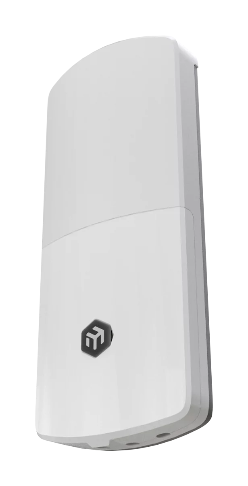

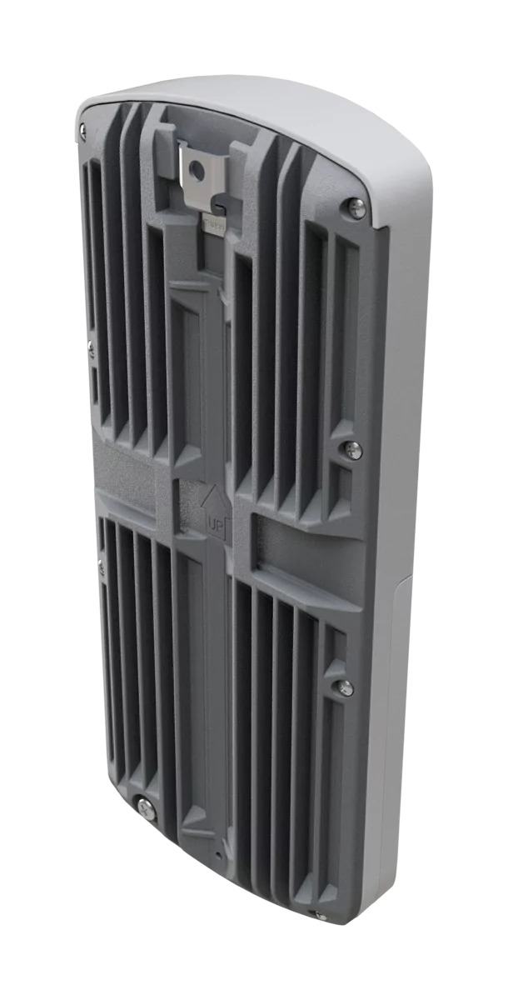

## [wAP ax LTE7 kit](https://mikrotik.com/product/wap_ax_lte7) (wAPGR-5HaxD2HaxD&R11e-LTE7)

The new wAP LTE7 kit is an evolution of the popular wAP ac LTE6. Now – with Wi-Fi 6, CAT7 LTE, a stronger ARM platform, and improved antenna gain. The unit comes in our improved next-gen IP66 weatherproof enclosure.

## Safety Warnings

- Before you work on any MikroTik equipment, be aware of the hazards involved with electrical circuitry, and be familiar with standard practices for preventing accidents. The installer should be familiar with network structures, terms, and concepts.
- Use only the power supply and accessories approved by the manufacturer, and which can be found in the original packaging of this product.
- This equipment is to be installed by trained and qualified personnel, as per these installation instructions. The installer is responsible for making sure, that the Installation of the equipment is compliant with local and national electrical codes.
- Do not attempt to disassemble, repair, or modify the device. If service is needed, contact MikroTik support.
- This product can be used both indoors and outdoors. Read the mounting instructions carefully before beginning installation. Failure to use the correct hardware and configuration or to follow correct procedures could result in hazardous situation to people and damage to the system.
- We cannot guarantee that no accidents or damage will occur due to the improper use of the device. Use this product with care and operate at your own risk!
- The socket-outlet shall be installed near the equipment and shall be easily accessible.
- In the case of device failure, disconnect it from power. The fastest way to do so is by unplugging the power adapter from the power outlet.
- This is a Class A product. In a domestic environment, this product might cause radio interference in which case the user might be required to take adequate measures.
- To avoid contamination of the environment, separate the device from household waste and dispose of it in a safe manner, for example, in designated areas. Become familiar with procedures for properly transporting the equipment to designated collection points in your area

## Quickstart

- Open the bottom lid;
- Insert a SIM card into the slot as indicated on the device;
- Connect the device to the included PoE injector with an Ethernet cable to the *"data+power"* end;
- Connect the data end of the PoE injector to the computer;
- Connect the power adapter to the PoE injector;
- Navigate to the network connections section on your computer and locate the wireless network named "*MikroTik-...*". Proceed to connect to it (check the wireless passwords on the sticker);
- Establish a connection using a mobile application. Alternatively, use WebFig in a web browser or the "WinBox" configuration tool at [https://mt.lv/winbox/](https://mt.lv/winbox/) **multiple configuration methods are available to ensure accessibility;**
- Start configuration within the chosen tool, using the default IP address 192.168.88.1. If the IP address is unavailable, use WinBox and choose the "Neighbors" tab to find the device;
- Proceed to connect using the MAC address. The username is "admin", and there is no password (or, for some models, check user and wireless passwords on the sticker);
- Select the "Check for updates" button and update RouterOS to the latest version;
- For a manual update of the device, visit mikrotik.com, select your model, and locate the required packages in the "Downloads" section;
- Upload downloaded packages to the WebFig or WinBox "Files" menu and reboot the device;
- By upgrading your RouterOS software to the latest version, you can ensure optimal performance, stability, and security updates;
- In the "QuickSet" menu set up the following: Choose your country, to apply country regulation settings;
- Set up your wireless network password in the left field;
- Set up your router password in the bottom field.

## Mounting

The device can be mounted in several ways: wall, ceiling, pole or it can be placed in specially designed MikroTik holder which comes with the package. The package includes a drill hole template with instructions, to help you with the Ethernet cable installation and attachment to a ceiling or a wall. The package also includes a steel bracket to put on the other side of a dropdown ceiling tile and two screws and wall anchors. The Unit can be attached to the pole using zip ties or steel clamp. To prevent the bottom lid for opening the different screw can be used. One Torx T20 security screw is included for optional use. Use it with the included L-shaped wrench to fix it into the bottom lid. Detailed instructions of replacing the screw are in the package.

When using and installing this device pay attention to Maximum Permissible Exposure (MPE) safety distance with a minimum of 31 cm between the radiator and your body.

### Pole mounting

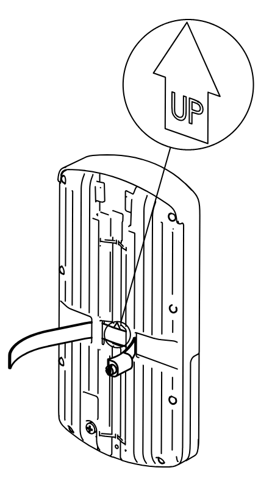

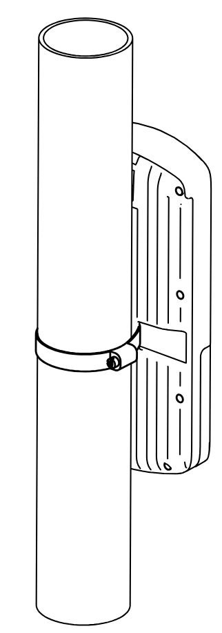

** It's recommended to use electrical tape to increase friction between materials.*

- Mount plastic tie straps to steel brackets guiding them through holes.
- Mount bracket to the device.
- Secure them with a screw.
- Mount and align the device on the pole or mast.
- Guide Ethernet cable through the opening and connect to the Ethernet port.
- Close bottom latch and secure with a screw. It's recommended to secure Ethernet cable to the pole using zip ties. With the distance from the device approximately 30 cm.

### Wall/ceiling mounting

- Place the mounting template on the wall or ceiling and mark the drilling positions.

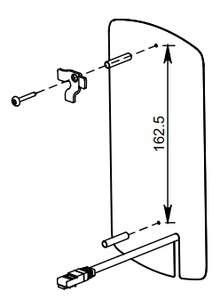

- Distance between mounting holes: **162.5 mm**
- Drill the mounting holes:**Ø 6 mm** holes for the supplied wall plugs, or
- **Ø 5 mm** holes if mounting directly into a cable conduit.
- Insert the supplied wall plugs if required.
- Secure the mounting bracket using the supplied screws from the K-95 kit.
- Remove the rubber seal from the device.
- Loosen the enclosure screw using a PH2 screwdriver.

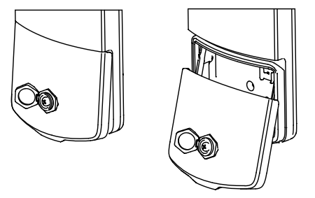

- Open the enclosure and route the Ethernet cable through the cable entry.

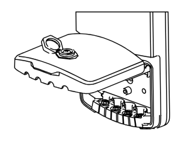

- If installing an ETH jack, drill a hole using a **13 mm** bit.
- If only routing a cable, drill a hole using an **8 mm** bit.*(Note: This modification reduces the device's IP rating classification.)*

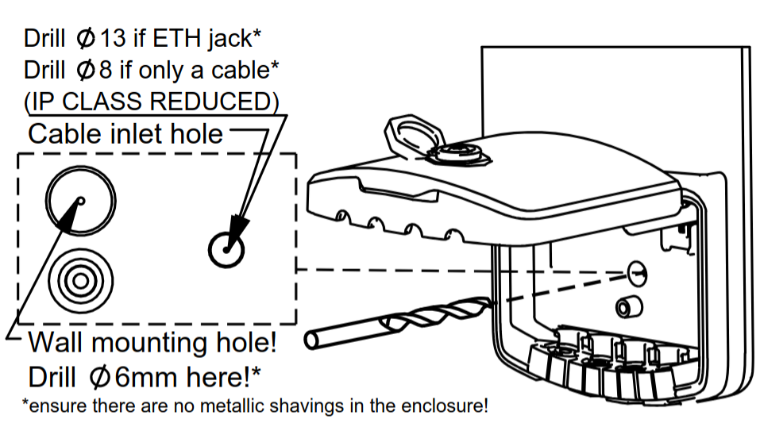

- Mount the device onto the bracket:

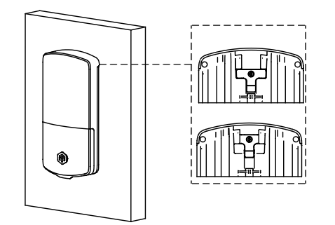

Hook the upper mounting points onto the bracket.

- Slide the device downward until it locks into place.
- Install the rubber seal from K-95 kit for environmental protection.

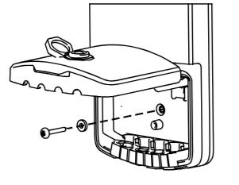

- Connect the Ethernet cable and complete the installation.
- Tighten the enclosure screw and reinstall the rubber seal.
- For outdoor installations, use the protective seal to ensure environmental protection.

:::warning warning

- Ensure that there are no metal objects or utilities hidden inside the wall before drilling.
- Verify that the mounting surface can support the weight of the device.
- For outdoor installations, use the supplied weather-protection accessories where applicable.

This format is more concise and easier to follow than describing each picture individually.

:::

### Cable Installation

#### Preparing the Cable Entry

- Open the device enclosure.
- Identify the required cable entry position on the rubber seal.
- Using a sharp knife or scalpel, carefully cut the rubber seal along the indicated cutting grooves.
- Make only the cuts necessary for the cables being installed to maintain the highest possible ingress protection.

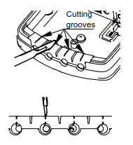

#### Installing Ethernet Cables

- Route the Ethernet cable through the prepared opening in the rubber seal.

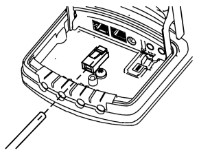

- Crimp the Ethernet cable with the appropriate connector after routing it through the seal.

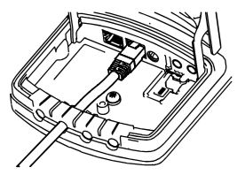

- Connect the Ethernet cable to the desired Ethernet port inside the device.

### Alternative Cable Routing

#### Bare Cable Installation

- If a bare cable is routed directly from the wall, drill a **Ø 8 mm** hole through the enclosure at the indicated location.

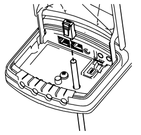

- Route the cable through the hole and terminate it inside the device.

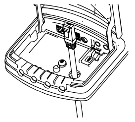

#### Pre-Terminated Ethernet Cable Installation

- If using a cable with a pre-installed RJ45 connector, drill a **Ø 13 mm** hole through the enclosure at the indicated location.
- Route the connector through the hole and connect it to the desired Ethernet port. Drilling additional holes reduces the ingress protection (IP) rating. Seal all openings with suitable silicone or sealant. Ensure that no metal shavings remain inside the device after drilling.

### Installing a microSIM Card (if applicable)

- Insert the microSIM card into the SIM card holder.

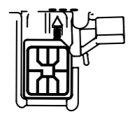

- Use the SIM holder lever to push the card into position until it clicks.

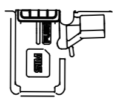

- Verify that the lever is fully locked.

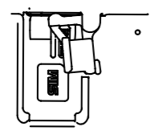

#### Securing the Installation

- Arrange and secure all cables inside the device using zip ties.

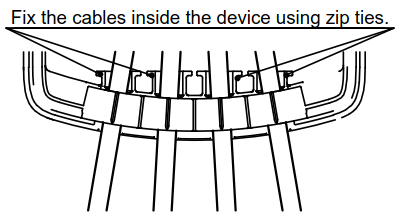

- Close the enclosure cover.
- Tighten the enclosure screw using a PH2 screwdriver to **0.8 Nm**.

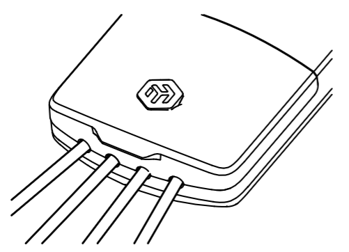

- Reinstall the rubber plug over the screw.

### Final Check

- Ensure all cable entries are properly sealed.
- Verify that the side marked **"This side faces the wall"** is oriented correctly during installation.

## Extension slots and ports

<table><thead><tr><th>**Parameter**</th><th>Value</th></tr></thead><tbody><tr><td>**Product Code**</td><td>wAPGR-5HaxD2HaxD&R11e-LTE7</td></tr><tr><td>**Architecture**</td><td>ARM 64bit</td></tr><tr><td>**CPU**</td><td>IPQ-5010</td></tr><tr><td>**CPU Core Count**</td><td>2</td></tr><tr><td>**CPU Threads Count**</td><td>2</td></tr><tr><td>**CPU Frequency**</td><td>800 MHz</td></tr><tr><td>**RAM**</td><td>256 MB</td></tr><tr><td>**Storage**</td><td>128 MB NAND</td></tr><tr><td>**1G Ethernet ports**</td><td>2</td></tr><tr><td>**SIM Slot**</td><td>1 × Micro SIM slot</td></tr><tr><td>**MiniPCIe Slot**</td><td>1 × MiniPCIe slot occupied by the LTE modem</td></tr><tr><td>**3G Category**</td><td>R8 (DL 42.2 Mbps / UL 5.76 Mbps)</td></tr><tr><td>**3G Bands**</td><td>1 (2100 MHz) / 3 (1800 MHz) / 5 (850 MHz) / 8 (900 MHz)</td></tr><tr><td>**LTE Category**</td><td>7 (DL 300 Mbps / UL 100 Mbps)</td></tr><tr><td>**LTE Modem**</td><td>R11e-LTE7</td></tr><tr><td>**TAC**</td><td>35312597</td></tr><tr><td>**MIMO DL**</td><td>2×2</td></tr><tr><td>**MIMO UL**</td><td>1×1</td></tr><tr><td>**LTE Bands (FDD)**</td><td>1 (2100 MHz) / 3 (1800 MHz) / 5 (850 MHz) / 7 (2600 MHz) / 8 (900 MHz) / 20 (800 MHz) / 28 (700 MHz) / 32 (1500 MHz)</td></tr><tr><td>**LTE Bands (TDD)**</td><td>38 (2600 MHz) / 40 (2300 MHz) / 41 (2500 MHz)</td></tr><tr><td>**Wireless 2.4 GHz**</td><td>574 Mbit/s, 2 chains, 802.11b/g/n/ax, 6.9 dBi, IPQ-5010, Wi-Fi 6</td></tr><tr><td>**Wireless 5 GHz**</td><td>1200 Mbit/s, 2 chains, 802.11a/n/ac/ax, 7 dBi, QCN-6102, Wi-Fi 6</td></tr><tr><td>**Antenna (2.4 GHz)**</td><td>Integrated antenna, 6.9 dBi gain</td></tr><tr><td>**Antenna (5 GHz)**</td><td>Integrated antenna, 7 dBi gain</td></tr><tr><td>**LTE Antennas**</td><td>Integrated directional LTE antennas</td></tr><tr><td>**Reset Button**</td><td>Multifunction reset button for configuration reset, CAP mode, and Netinstall</td></tr><tr><td>**Mode Button**</td><td>Configurable software-controlled button</td></tr><tr><td>**LED Indicators**</td><td>User LED and interface status LEDs</td></tr><tr><td>**PoE-In**</td><td>802.3af/at PoE-In supported on Ethernet port 1</td></tr><tr><td>**DC Power Input**</td><td>DC jack, 12–57 V input range</td></tr><tr><td>**Ingress Protection**</td><td>IP66</td></tr></tbody></table>

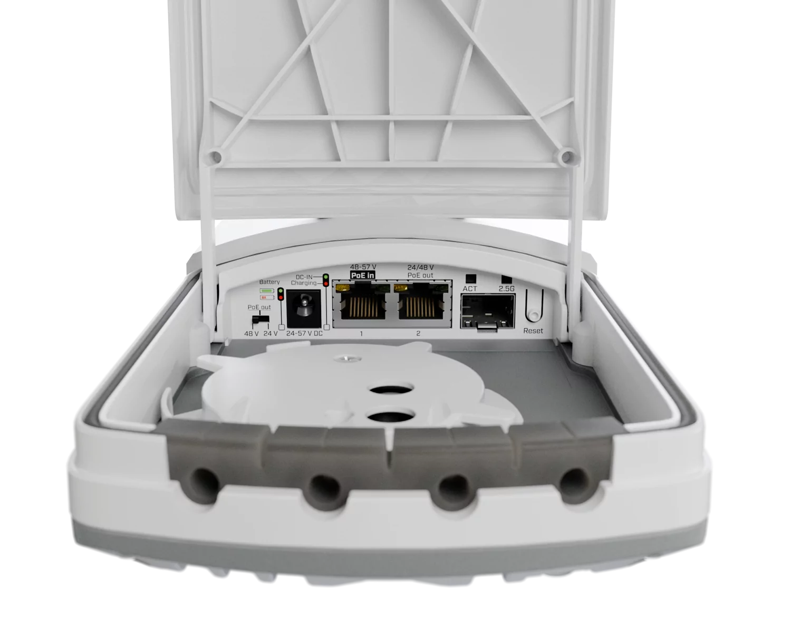

## Configuration

Full RouterOS documentation is located here: [https://mt.lv/help](https://mt.lv/help). The device comes pre-configured as an LTE CPE router: the **LTE interface** acts as the protected WAN with DHCP, while the LAN bridge 192.168.88.1/24 provides DHCP and DNS services. Dual-band outdoor Wi-Fi (2.4 GHz and 5 GHz ax) is enabled with WPA2/WPA3 security.

To access the device, connect via any Ethernet port or join the default Wi‑Fi network named "MikroTik‑…". The Wi‑Fi password is printed on the sticker attached to the device.

You can manage the device via the mobile app, WebFig in a web browser, or the WinBox tool (available at [https://mt.lv/winbox/](https://mt.lv/winbox/)) using the default IP address **192.168.88.1**. If that address is unreachable, open WinBox, go to the Neighbors tab, and discover the device.

For recovery, the firmware can be reinstalled over the network using the Reset button.

## Buttons and jumpers

The reset button has three functions:

- Hold this button during boot time until the green LED light starts flashing, release the button to reset RouterOS configuration.
- Keep holding the reset button until the LED turns solid, then release it to enable CAP mode. The device will then start searching for a CAPsMAN server.
- To reinstall RouterOS using the [Netinstall](/docs/getting-started/installation-and-upgrade/netinstall/) utility, enter the device into BOOTP mode. Two booter options are available: the **Regular Booter** and the **Backup Booter**. It is recommended to verify both options in case one does not work.

- **Regular Booter:** To enter etherboot mode, press the **Reset** button after powering on the device and waiting 1–2 seconds.
- **Backup Booter:** Power off the device. Press and hold the **Reset** button, then power on the device. Wait for the **LED** sequence (blinking → steady → off), then release the button. The device will boot into **BOOTP** mode, ready for RouterOS reinstallation via Netinstall. Depending on the model, this may be indicated by the **USR, USER, System**, or **ACT** LED, or by the SFP port LED.

Regardless of the above option used, the system will load the backup RouterBOOT loader if the button is pressed before power is applied to the device. Useful for RouterBOOT debugging and recovery.

## Included parts

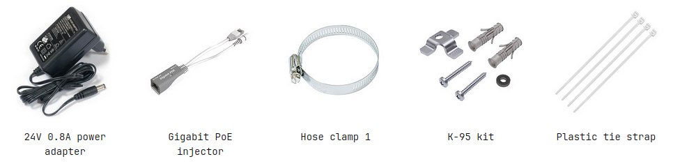

## Operating System Support

The device supports RouterOS v7 and above. The specific factory-installed version is listed in **/system resource**. Other operating systems have not been tested.
