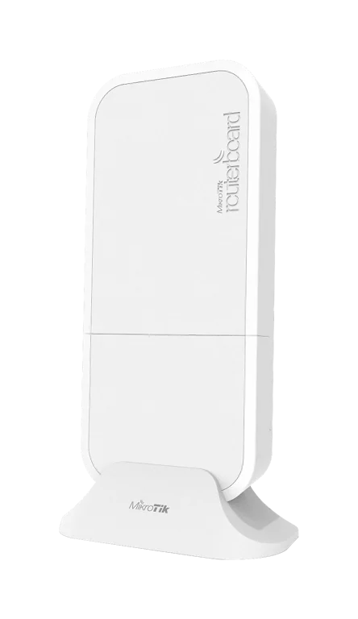
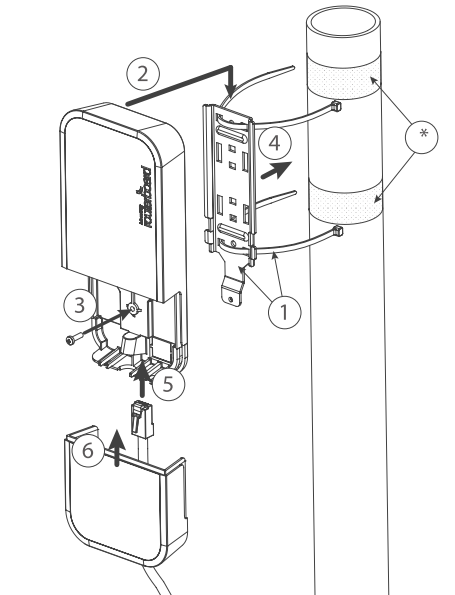
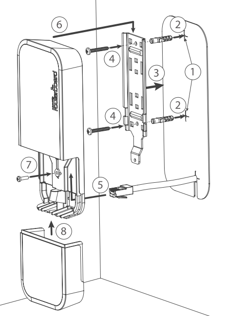
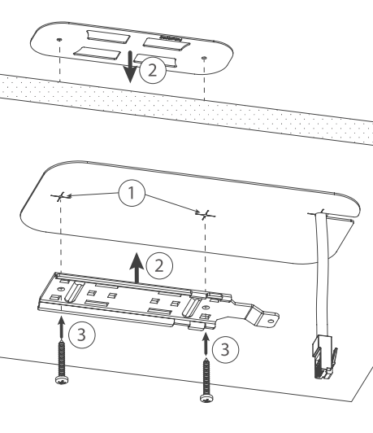
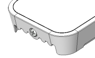
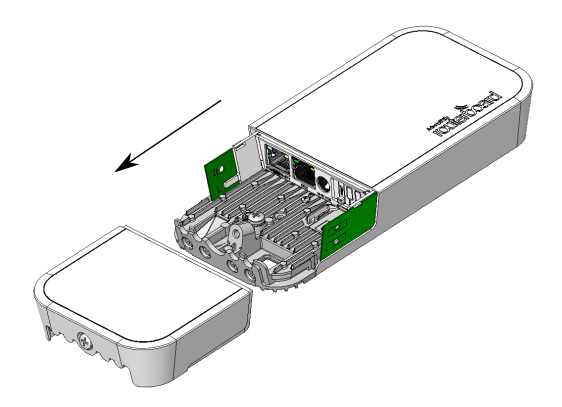

:::info This article covers

- **[wAP LTE kit](https://mikrotik.com/product/wap_lte_kit_2024)**
- **wAP LTE kit US**
- **wAP 4G kit**

:::

This device needs to be upgraded to RouterOS v6.44.6 or the latest version to ensure compliance with local authority regulations.

It is the customer's responsibility to follow local country regulations, including operation within legal frequency channels, output power, cabling requirements, and Dynamic Frequency Selection (DFS) requirements. All MikroTik radio devices must be professionally installed.

## Safety Warnings

- Before you work on any equipment, be aware of the hazards involved with electrical circuitry, and be familiar with standard practices for preventing accidents.
- Ultimate disposal of this product should be handled according to all national laws and regulations.
- All installation methods for mounting an access point on any wall surface is subject to the acceptance of local jurisdiction.
- The Installation of the equipment must comply with local and national electrical codes.
- This product is intended to be mounted outdoors on a pole but can also be installed indoors. Read the mounting instructions carefully before beginning installation. Failure to use the correct hardware and configuration or to follow the correct procedures could result in a hazardous situation to people and damage to the system.
- Use only the power supply and accessories approved by the manufacturer, and which can be found in the original packaging of this product.
- Read the installation instructions before connecting the system to the power source.
- We cannot guarantee that no accidents or damage will occur due to the improper use of the device. Use this product with care and operate at your own risk!
- In the case of device failure, disconnect it from power. The fastest way to do so is by unplugging the power plug from the power outlet.
- It is the customer's responsibility to follow local country regulations, including operation within legal frequency channels, output power, cabling requirements, and Dynamic Frequency Selection (DFS) requirements. All MikroTik radio devices must be professionally installed.
- This is a class A device. In a domestic environment, this product might cause radio interference in which case the user might be required to take adequate measures.

**Exposure to Radio Frequency Radiation:** This MikroTik equipment complies with the FCC, IC, and European Union radiation exposure limits set forth for an uncontrolled environment. This MikroTik device should be installed and operated no closer than 38 centimeters from your body, occupational user, or the general public.

## Quickstart

- Use a Phillips head screwdriver to loosen the screw, which secures the bottom lid (see ).
- Insert the SIM card.
- Choose your powering solution, see the section for possibilities.
- Connect the Ethernet cable to the PoE and connect the other end of the Ethernet cable to this MikroTik router. Plug the provided power supply into the PoE injector.
- Wireless AP mode is enabled by default, you can connect from your computer to the SSID that begins with "MikroTik". The configuration interface is available via a web browser. The address is [https://192.168.88.1](https://192.168.88.1).
- Connect to the wireless network, open [https://192.168.88.1](https://192.168.88.1) in your web browser to start the configuration.
- User name: a*dmin* and there is no password by default you will be logged in automatically to the Quick Set screen (or, for some models, check user and wireless passwords on the sticker).
- Select the "Check for updates" button on the right side and update your RouterOS software to the latest version to ensure the best performance and stability. Must have a valid SIM card inserted.
- To personalize your wireless network, SSID can be changed in the fields "Network Name";
- Choose your country on the left side of the screen in the field "Country", to apply country regulation settings.
- Set up your wireless network password in the field "WiFi Password" the password must be at least eight symbols.
- Set up your router password in the bottom field "Password" to the right and repeat it in the field "Confirm Password", it will be used to login next time.
- Select the "Apply Configuration" to save changes.
- To manually update the device if no Internet connection is available.
- Download the latest RouterOS software from [https://mikrotik.com/download](https://mikrotik.com/download).
- Choose MIPSBE packages, and save them to your PC.
- Connect again and in **Files** menu upload downloaded packages.
- Restart the device.

## MikroTik mobile app

Use the MikroTik smartphone app to configure your router in the field, or to apply the most basic initial settings for your MikroTik home access point.

- Scan QR code and choose your preferred OS.
- Install and open application.
- By default, the IP address and user name will be already entered.
- Select Connect to establish a connection to your device through a wireless network.
- Choose Quick setup and application will guide you through all basic configuration settings in a couple of easy steps.
- An advanced menu is available to fully configure all necessary settings.

## Powering

**PoE Input**

The ethernet port accepts 9-30 V passive PoE power. The box contains a 24 V adapter and a PoE injector. Plug the included PoE injector into the first or internet port of the router that you will use in your LAN (or directly into your laptop) and attach an ethernet cable to the PoE injector. Connect the other end of this ethernet cable to the wAP LTE device. Plug the power supply into the PoE injector

**Power jack**

The DC jack (5.5 mm outside and 2 mm inside diameter, female, pin positive plug) supports 9-30 V power, the the device comes with a 24 V 1.2 A power adapter

**Automotive connector**

The automotive connector can be used to power the device from regular 12/24 V connections in automobiles and buses. The plug has four pins: bottom left (black) is the ground, bottom right is power in (red). The upper two are reserved for future use. Maximum power consumption at 24 V is 6 W without miniPCIe, and 8 W with a full load on the miniPCIe card.

## Mounting

The device can be mounted in several ways: pole, wall, ceiling or it can be placed in specially designed MikroTik holder which comes with the package. The package also includes a drill hole template with detailed mounting instructions, to help you with the Ethernet cable installation and attachment to a ceiling or a wall. Steel bracket to put on the other side of a dropdown ceiling tile and two screws and wall anchors. Zip ties or steel clamps for mounting on the pole. The IP rating scale for this device is IP54. When mounting outdoors, ensure that any cable openings are directed downwards. You should use the POE injector and proper grounding with Cat6 shielded cable. When using and installing this device pay attention to Maximum Permissible Exposure (MPE) safety distance with a minimum of 35 cm between the radiator and your body. **Mounting on the mast or pole:**

** It's recommended to use electrical tape to increase friction between materials.*

- Mount plastic tie straps to steel brackets guiding them through holes.
- Mount bracket to the device.
- Secure them with a screw.
- Mount and align the device on the pole or mast.
- Guide Ethernet cable through the opening and connect to the Ethernet port.
- Close bottom latch and secure with a screw.

It's recommended to secure Ethernet cable to the pole using zip ties. With the distance from the device approximately 38 cm.

**Mounting unit on the wall:**

- Use included a template to mark spots for drilling holes. And if needed for Ethernet cable. Align accordingly, it will depend on how the device will be mounted finally.
- Insert dowels if needed, depends on wall structure and material.
- Place included a steel bracket on the wall.
- Use screws to secure it in the place.
- Extend your Ethernet cable through the opening and connect to the Ethernet port.
- Mount the device on the steel bracket
- Secure it in place with the screw.
- Close bottom latch.

Avoid mounting the device on the low ground spot, as you won't be able to attach and close the bottom latch. **Mounting on the ceiling:**

A Special bracket is included in the package to mount on the drop ceiling. As it consists of two parts, to be attached on both sides of the ceiling tile.

-

Use the template to mark spots for holes.

-

Place both mounting brackets on the spot.

-

Secure them together using screws. Continue assembling in the same manner if mounting on the wall.

-

Extend your Ethernet cable through the opening and connect to the Ethernet port.

-

Mount the device on the steel bracket.

-

Secure it in place with the screw.

-

Close bottom latch. 150

## Bottom Lid

- The bottom lid is secured in place with the captive screw.
- Use the Philips PH2 screwdriver to unscrew it, but do not remove the screw completely.

- Pull the cover in the opposite direction from the device to remove it.

- Reassemble.

## Extension slots and ports

- Built-in 2 GHz wireless access point module, AP/station/bridge/p2p modes are supported.
- One 10/100 Ethernet port, supporting automatic cross/straight cable correction (Auto MDI/X). Either straightor crossover cable can be used for connecting to other network devices. The ethernet port accepts 9-30 VDC powering from a passive PoE injector.
- miniPCIe slot and SIM slot (can’t be used separately) to be used with a 3G/4G/LTE modem (some kitsinclude it).

## MiniPCIe slot usage

The device is equipped with a miniPCIe slot (a kit with preinstalled modem also available) to be used with a 3G/4G/LTE modem. A SIM slot is provided for use together with a miniPCIe modem. SIM slot is not used separately. To install the miniPCIe module, remove both screws below the power jack and slide out the wAP PCB board. Insert the miniPCIe modem, and secure it with two Philips screws which are already in place. Attach the grey uFL connector to the MAIN antenna connector of the modem, attach the black cable to the other (or AUX) connector. It is possible to use external antennas for the modem, two SMA mounting holes are provided next to the reset button, or if you prefer to attach antennas to the case directly, SMA antennas can be mounted on the bottom of the case if you remove the two plastic hole covers first. After you have reinserted the wAP board into the case and secured it with the screws that were removed earlier, slide in the SIM card from your mobile operator into the SIM slot, with the chip facing up. The slot accepts miniSIM (2FF). The SIM slot protects the SIM card from falling out with a plastic latch. You can press the latch and then pull the SIM out using tweezers or a similar tool.

## Buttons and jumpers

The reset button has three functions:

- Hold this button during boot time until LED light starts flashing, release the button to reset RouterOS configuration (total 5 seconds).
- Keep holding for 5 more seconds, LED turns solid, release now to turn on CAP mode. The device will now look for a CAPsMAN server (total 10 seconds).
- Or Keep holding the button for 5 more seconds until LED turns off, then release it to make the RouterBOARD look for Netinstall servers (total 15 seconds). Regardless of the above option used, the system will load the backup RouterBOOT loader if the button is pressed before power is applied to the device. Useful for RouterBOOT debugging and recovery.

## Configuration

You should select the "Check for updates" button and update your RouterOS software to the latest version to ensure the best performance and stability. RouterOS includes many configuration options in addition to what is described in this document. We suggest visiting the RouterOS documentation page to get yourself accustomed to the possibilities: [https://mt.lv/help](https://mt.lv/help) In case IP connection is not available, the WinBox tool ([https://mt.lv/winbox](https://mt.lv/winbox)) can be used to connect to the MAC address of the device from the LAN side (all access is blocked from the internet port by default). It is possible to boot the device from a network, for reinstalling RouterOS for recovery purposes. This can be done from the first Ethernet port. See above how to do this.

## Operating system support

The device supports RouterOS v7 and above. The specific factory-installed version is listed in /system resource. Other operating systems have not been tested.

## Notice

- The Frequency band 5.470-5.725 GHz isn’t allowed for commercial use.
- In case WLAN devices work with different ranges than the above regulations, then a customized firmware version from the manufacturer/supplier is required to be applied to the end-user equipment and also prevent the end-user from reconfiguration.
- For Outdoor Usage: End-user requires approval/license from the NTRA.
- Datasheet for any device is available on the official manufacturer website.
- Products with the letters “EG” at the end of their serial number have their wireless frequency range limited to 2.400 – 2.4835 GHz, the TX power is limited to 20dBm (EIRP).
- Products with the letters “EG” at the end of their serial number have their wireless frequency range limited to 5.150 – 5.250 GHz, the TX power is limited to 23dBm (EIRP).
- Products with the letters “EG” at the end of their serial number have their wireless frequency range limited to 5.250 – 5.350 GHz, the TX power is limited to 20dBm (EIRP).

make sure the device has a lock package (firmware version from the manufacturer) which is required to be applied to the end-user equipment to prevent the end-user from reconfiguration. The product will be marked with country code “-EG”. This device needs to be upgraded to the latest version to ensure compliance with local authority regulations! It is the end users responsibility to follow local country regulations, including operation within legal frequency channels, output power, cabling requirements, and Dynamic Frequency Selection (DFS) requirements. All MikroTik radio devices must be professionally installed.

To avoid pollution of the environment, separate the device from household waste and dispose of it in a safe manner, such as in designated waste disposal sites. Familiarize yourself with the procedures for the proper transportation of the equipment to the designated disposal sites in your area.

## Federal Communication Commission Interference Statement

This equipment has been tested and found to comply with the limits for a Class A digital device, pursuant to Part 15 of the FCC Rules. These limits are designed to provide reasonable protection against harmful interference in a commercial installation.

This equipment generates, uses, and can radiate radio frequency energy and, if not installed and used in accordance with the instruction manual, may cause harmful interference to radio communications. Operation of this equipment in a residential area is likely to cause harmful interference in which case the user will be required to correct the interference at his own expense

FCC Caution: Any changes or modifications not expressly approved by the party responsible for compliance could void the user's authority to operate this equipment. This device complies with Part 15 of the FCC Rules. Operation is subject to the following two conditions: (1) This device may not cause harmful interference, and (2) this device must accept any interference received, including interference that may cause undesired operation. This device and its antenna must not be co-located or operation in conjunction with any other antenna or transmitter.

**IMPORTANT: Exposure to Radio Frequency Radiation.** This equipment complies with the FCC RF radiation exposure limits set forth for an uncontrolled environment. This equipment should be installed and operated with a minimum distance of 38 cm between the radiator and any part of your body.

<table><thead><tr><th>**Model**</th><th>**FCC ID**</th><th>**Contains FCC ID**</th></tr></thead><tbody><tr><td>wAP LTE kit</td><td>TV7WAPR2ND</td><td>TV7R11ELTE</td></tr><tr><td>wAP 4G kit</td><td>TV7WAPR2ND</td><td>TV7R11E4G</td></tr></tbody></table>

*For use of CBRS bands, the CBSD Category of the final Host equipment will be dependent on the power settings and antenna gain used.*

## Innovation, Science and Economic Development Canada

This device contains license-exempt transmitter(s)/receiver(s) that comply with Innovation, Science, and Economic Development Canada's license-exempt RSS(s). Operation is subject to the following two conditions:

-

This device may not cause interference;

-

This device must accept any interference, including interference that may cause undesired operation of the device. L'émetteur/récepteur exempt de licence contenu dans le présent appareil est conforme aux CNR d'Innovation, Sciences et Développement économique Canada applicables aux appareils radio exempts de licence. L'exploitation est autorisée aux deux conditions suivantes:

-

L'appareil ne doit pas produire de brouillage;

-

L'appareil doit accepter tout brouillage radioélectrique subi, mźme si le brouillage est. This Class A digital apparatus complies with Canadian ICES-003.

Cet appareil numérique de la classe [A] est conforme à la norme NMB-003 du Canada.

CAN ICES-003 (A) / NMB-003 (A)

**IMPORTANT: Exposure to Radio Frequency Radiation.** This equipment complies with the IC radiation exposure limits set forth for an uncontrolled environment. This equipment should be installed and operated with a minimum distance of 38 cm between the radiator and any part of your body. Cet equipement est conforme aux limites d'exposition au rayonnement IC definies pour un environnement non controle. Cet equipement doit etre installe et utilise a une distance minimale de 38 cm entre le radiateur et toute partie de votre corps.

<table><thead><tr><th>**Model**</th><th>**IC**</th><th>**Contains IC**</th></tr></thead><tbody><tr><td>wAP LTE kit</td><td>7442A-WAPR2ND</td><td>TV7R11ELTE</td></tr><tr><td>wAP 4G kit</td><td>7442A-WAPR2ND</td><td>7442A-R11E4G</td></tr></tbody></table>

## UKCA marking

## Eurasian Conformity Mark

<table><thead><tr><th>Частотный каналы</th><th>Мощность передатчика</th></tr></thead><tbody><tr><td>2400-2483.5 МГц</td><td>≤10 Вт</td></tr></tbody></table>

*Доступные частотные каналы могут различаться в зависимости от модели продукта и сертификации.

Информация о дате изготовления устройства указана в конце серийного номера на его наклейке через дробь. Первая цифра означает номер года (последняя цифра года), две последующие означают номер недели.

Изготовитель: MikroTikls SIA, Aizkraukles iela 23, Riga, LV-1006, Латвия, [support@mikrotik.com](mailto:support@mikrotik.com). Сделано в Китае, Латвии или Литве. Cм. на упаковке.

Для получения подробных сведений о гарантийном обслуживании обратитесь к продавцу. Информация об импортерах продукции MikroTik в Российскую Федерацию: [https://mikrotik.com/buy/europe/russia](https://mikrotik.com/buy/europe/russia)

Продукты MikroTik, которые поставляются в Евразийский таможенный союз, оцениваются с учетом соответствующих требований и помечены знаком EAC, как показано ниже:

## Norma Oficial Mexicana

Rango de frecuencia (potencia de salida máxima): 2400-2483.5 MHz (30 dBm). Los canales de frecuencia disponibles pueden variar según el modelo y la certificación del producto.

EFICIENCIA ENERGETICA CUMPLE CON LA NOM-029-ENER-2017.

La operacion de este equipo esta sujeta a las siguientes dos condiciones:

- Es posible que este equipo o dispositivo no cause interferencia perjudicial y.
- Este equipo debe aceptar cualquier interferencia, incluyendo la que pueda causar su operacion no deseada. Fabricante: MikroTikls SIA, Brivibas gatve 214i, Riga, LV-1039, Latvia.

País De Origen: Letonia; Lituania; China (Republica Popular); Estados Unidos De America; Mexico.

Por favor contacte a su distribuidor local para preguntas regionales específicas. La lista de importadores se puede encontrar en nuestra página de inicio – [https://mikrotik.com/buy/latinamerica/mexico](https://mikrotik.com/buy/latinamerica/mexico).

## The National Commission for the State Regulation of Communications and Informatization by Ukraine

Виробник: MikroTikls SIA, Brivibas gatve 214i Рига, Латвія, LV1039.

Робоча частота (Максимальна вихідна потужність): 2400-2483.5 МГц (20 дБм).

Справжнім MikroTikls SIA заявляє, що маршрутизатор відповідає основним вимогам та іншим відповідним положенням директиви 2014/53/EC, а також суттєвим вимогам Технічного регламенту радіообладнання, затвердженого постановою Кабінету Міністрів України від 24 травня 2017 року № 355.

Для експлуатації в Україні необхідно отримати дозвіл на експлуатацію у порядку, затвердженому рішенням НКРЗІ від 01.11.2012 № 559, зареєстрованому в Міністерстві юстиції України 03.01.2013 за № 57/22589.

## CE Declaration of Conformity

Manufacturer: MikroTikls SIA, Brivibas gatve 214i Riga, Latvia, LV1039.

Hereby, Mikrotīkls SIA declares that the radio equipment type RouterBOARD is in compliance with Directive 2014/53/EU. The full text of the EU declaration of conformity is available at the following internet address: [https://mikrotik.com/products](https://mikrotik.com/products)

### WLAN/ GSM / WCDMA / LTE /

<table><thead><tr><th>Operating Frequency / Maximum output power Betriebsfrequenz / maximale Ausgangsleistung Fréquence de fonctionnement / puissance de sortie maximale Frequenza operativa / massima potenza di uscita Frecuencia de funcionamiento / potencia de salida máxima Рабочая частота / максимальная выходная мощность</th><th>WLAN</th><th>2400-2483.5 MHz / / 20 dBm</th></tr></thead><tbody><tr><td>E-GSM-900</td><td>900 MHz / 33 dBm</td><td></td></tr><tr><td>DCS-1800</td><td>1800 MHz / 30 dBm</td><td></td></tr><tr><td>WCDMA Band I</td><td>1922.4 MHz / 24 dBm ± 2.7 dB</td><td></td></tr><tr><td>WCDMA Band VIII</td><td>882.4 MHz / 24 dBm ± 2.7 dB</td><td></td></tr><tr><td>LTE Band 1 (except 4G kit)</td><td>2100 MHz / 23dBm ± 2.7 dB</td><td></td></tr><tr><td>LTE Band 3</td><td>1800 MHz / 23dBm ± 2.7 dB</td><td></td></tr><tr><td>LTE Band 7</td><td>2600 MHz / 23dBm ± 2.7 dB</td><td></td></tr><tr><td>LTE Band 8 (except 4G kit)</td><td>900 MHz / 23dBm ± 2.7 dB</td><td></td></tr><tr><td>LTE Band 20</td><td>800 MHz / 23dBm ± 2.7 dB</td><td></td></tr><tr><td>LTE Band 31 (only 4G kit)</td><td>450 MHz / 23 dBm ± 2.7 dB</td><td></td></tr><tr><td>LTE Band 38</td><td>2600 MHz / 23dBm ± 2.7 dB</td><td></td></tr><tr><td>LTE Band 40</td><td>2300 MHz / 23dBm ± 2.7 dB</td><td></td></tr><tr><td>LTE Band 42 (only 4G kit)</td><td>3500 MHz / 23dBm ± 2.7 dB</td><td></td></tr><tr><td>LTE Band 43 (only 4G kit)</td><td>3700 MHz / 23dBm ± 2.7 dB</td><td></td></tr></tbody></table>

This MikroTik device meets Maximum WLAN and LTE transmit power limits per ETSI regulations. For more detailed information see Declaration of Conformity above / Dieses MikroTik-Gerät erfüllt die maximalen WLAN- und LTE-Sendeleistung Grenzwerte gemäß ETSI-Bestimmungen. Weitere Informationen finden Sie oben unter Konformitätserklärung / Cet appareil MikroTik respecte les limites maximales de puissance de transmission WLAN et LTE conformément aux réglementations ETSI. Pour plus d'informations, voir la déclaration de conformité ci-dessus / Questo dispositivo MikroTik è conforme ai limiti massimi di potenza di trasmissione WLAN e LTE in conformità con le normative ETSI. Per ulteriori informazioni, consultare la dichiarazione di conformità sopra / Este dispositivo MikroTik cumple con los límites máximos de potencia de transmisión WLAN y LTE de acuerdo con las regulaciones ETSI. Para obtener más información, consulte la declaración de conformidad anterior / Это устройство MikroTik соответствует максимальным пределам мощности передачи WLAN и LTE в соответствии с правилами ETSI. Для получения дополнительной информации см. Декларацию соответствия выше.
