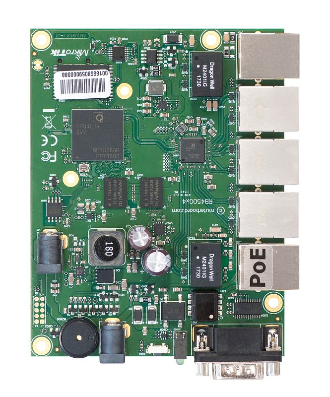

Four core 716MHz CPU, 1GB RAM, 5xGigabit Ethernet, PoE out on port #5, RouterOS L5. See the [RB450Gx4 product page](https://mikrotik.com/product/rb450gx4) for full specifications and brochures.

## Safety Warnings

Before you work on any equipment, be aware of the hazards involved with electrical circuitry, and be familiar with standard practices for preventing accidents. Ultimate disposal of this product should be handled according to all national laws and regulations. The Installation of the equipment must comply with local and national electrical codes. This product is intended to be mounted outdoors on a pole but can also be installed indoors. Please read the mounting instructions carefully before beginning installation. Failure to use the correct hardware and configuration or to follow the correct procedures could result in a hazardous situation to people and damage to the system. Use only the power supply and accessories approved by the manufacturer, and which can be found in the original packaging of this product. Read the installation instructions before connecting the system to the power source. We cannot guarantee that no accidents or damage will occur due to the improper use of the device. Please use this product with care and operate at your own risk! In the case of device failure, please disconnect it from power. The fastest way to do so is by unplugging the power plug from the power outlet. It is the customer's responsibility to follow local country regulations, including operation within legal frequency channels, output power, cabling requirements, and Dynamic Frequency Selection (DFS) requirements. All MikroTik devices must be professionally installed. This is a class A device. In a domestic environment, this product might cause radio interference in which case the user might be required to take adequate measures.

## First use

The RB450Gx4 is an Ethernet router with five Gigabit Ethernet ports, a serial port, two power jacks, and a microSD card slot. It is powered by MikroTik RouterOS. It comes without an enclosure, you are free to use it on your own.

- Install the board in a case.
- Connect Ethernet cables and plug in the microSD card (optional).
- Plug-in power cable or PoE powered ethernet cable in Ether1 to turn on the device.

## Powering

The device accepts power in the following ways:

- direct-input power jacks J1/J2 (5.5mm outside and 2mm inside diameter, female, pin positive plug) both accept 10-57V DC.
- Ether1 Ethernet port accepts 12-57V DC input (at the board; higher voltage needed to compensate for power loss on long cables) from 802.3af/at or passive Power over Ethernet sources. Max total power consumption with all interfaces loaded is 5 W. You can use any or all inputs at the same time, they will work in failover mode.

## Booting process

RouterOS is the operating system of all RouterBOARD routers. Please see documentation: [https://mt.lv/help](https://mt.lv/help) This device is not preconfigured other than an IP address on the ethernet port. Another configuration has to be applied according to the documentation manual linked above. The initial connection has to be done via the ethernet cable, using the MikroTik WinBox utility. WinBox should be used to connect to the default IP address of 192.168.88.1 with the username admin and no password (or, for some models, check user and wireless passwords on the sticker). In case you wish to boot the device from the network, for example, to use MikroTik Netinstall, hold the reset button of the device when starting it until the LED light turns off, and the device will start to look for Netinstall servers. In case the IP connection is not available, the WinBox utility can also be used to connect to the MAC address of the device. More information in the documentation.

## Extension slots and ports

- Five Gigabit Ethernet ports (Auto MDI/X). The first Ethernet port accepts 8-30V DC powering from a passive PoE injector or 802.3af/at PoE switch. Use 12V or more to compensate for any losses in cables. The other four Ethernet ports do not support PoE input.
- The Ether5 port is capable of powering another RouterBOARD device with passive PoE (up to 57 V). The maximum output current is 500 mA.
- Onboard DB9 RS232C asynchronous serial port is set by default to 115200bit/s, 8 data bits, 1 stop bit, no parity. Note that the device does not fully implement the hardware (RTS/CTS) flow control, so it is suggested to try to disable hardware flow control in the terminal emulation program.
- microSD card for additional file storage.

## Buttons and jumpers

**RouterBOOT reset button.** This button has the following functions:

- To use the reset button, hold it and then turn on the device, while still holding the button.
- Release the button when the green LED starts flashing, to reset RouterOS configuration. To not load backup bootloader, you can start holding the button after power is already applied.
- Release the button after LED is no longer flashing (~20 seconds) to cause the device to look for Netinstall servers (required for reinstalling RouterOS over the network). You can also release the button at the time when the device has appeared in the Netinstall utility device list. Regardless of the above option used, the system will load the backup RouterBOOT loader if the button is pressed before power is applied to the device. Useful for RouterBOOT debugging and recovery.

## Operating system support

The device only supports RouterOS software with the version number at or above what is indicated in the RouterOS menu /system resource. Other operating systems have not been tested.

To avoid pollution of the environment, please separate the device from household waste and dispose of it in a safe manner, such as in designated waste disposal sites. Familiarize yourself with the procedures for the proper transportation of the equipment to the designated disposal sites in your area.

## Federal Communication Commission Interference Statement

This equipment has been tested and found to comply with the limits for a Class A digital device, pursuant to Part 15 of the FCC Rules. These limits are designed to provide reasonable protection against harmful interference in a commercial installation.

This equipment generates, uses, and can radiate radio frequency energy and, if not installed and used in accordance with the instruction manual, may cause harmful interference to radio communications. Operation of this equipment in a residential area is likely to cause harmful interference in which case the user will be required to correct the interference at his own expense.

**FCC Caution:** Any changes or modifications not expressly approved by the party responsible for compliance could void the user's authority to operate this equipment. This device complies with Part 15 of the FCC Rules. Operation is subject to the following two conditions: (1) This device may not cause harmful interference, and (2) this device must accept any interference received, including interference that may cause undesired operation. Note: This unit was tested with shielded cables on the peripheral devices. Shielded cables must be used with the unit to ensure compliance.

## Innovation, Science and Economic Development Canada

This device complies with Industry Canada's license-exempt RSS standard(s). Operation is subject to the following two conditions: (1) this device may not cause interference, and (2) this device must accept any interference, including interference that may cause undesired operation of the device. Le présent appareil est conforme aux CNR d'Industrie Canada applicables aux appareils radio exempts de licence. L'exploitation est autorisée aux deux conditions suivantes: (1) l'appareil ne doit pas produire de brouillage, et (2) l'utilisateur de l'appareil doit accepter tout brouillage radioélectrique subi, même si le brouillage est susceptible d'en compromettre le fonctionnement.

This Class A digital apparatus complies with Canadian ICES-003.

Cet appareil numérique de la classe [A] est conforme à la norme NMB-003 du Canada.

CAN ICES-003 (A) / NMB-003 (A)

## UKCA marking

## Eurasian Conformity Mark

Информация о дате изготовления устройства указана в конце серийного номера на его наклейке через дробь. Первая цифра означает номер года (последняя цифра года), две последующие означают номер недели.

Изготовитель: MikroTikls SIA, Aizkraukles iela 23, Riga, LV-1006, Латвия, [support@mikrotik.com](mailto:support@mikrotik.com). Сделано в Китае, Латвии или Литве. Cм. на упаковке.

Для получения подробных сведений о гарантийном обслуживании обратитесь к продавцу. Информация об импортерах продукции MikroTik в Российскую Федерацию: [https://mikrotik.com/buy/europe/russia](https://mikrotik.com/buy/europe/russia)

Продукты MikroTik, которые поставляются в Евразийский таможенный союз, оцениваются с учетом соответствующих требований и помечены знаком EAC, как показано ниже:

## Norma Oficial Mexicana

EFICIENCIA ENERGETICA CUMPLE CON LA NOM-029-ENER-2017.

La operacion de este equipo esta sujeta a las siguientes dos condiciones:

- Es posible que este equipo o dispositivo no cause interferencia perjudicial y.
- Este equipo debe aceptar cualquier interferencia, incluyendo la que pueda causar su operacion no deseada. Fabricante: MikroTikls SIA, Brivibas gatve 214i, Riga, LV-1039, Latvia.

País De Origen: Letonia; Lituania; China (Republica Popular); Estados Unidos De America; Mexico.

Por favor contacte a su distribuidor local para preguntas regionales específicas. La lista de importadores se puede encontrar en nuestra página de inicio – [https://mikrotik.com/buy/latinamerica/mexico](https://mikrotik.com/buy/latinamerica/mexico).

## CE Declaration of Conformity

Manufacturer: MikroTikls SIA, Brivibas gatve 214i Riga, Latvia, LV1039.

The full text of the EU Declaration of Conformity is available at the following internet address: [https://mikrotik.com/products](https://mikrotik.com/products)
