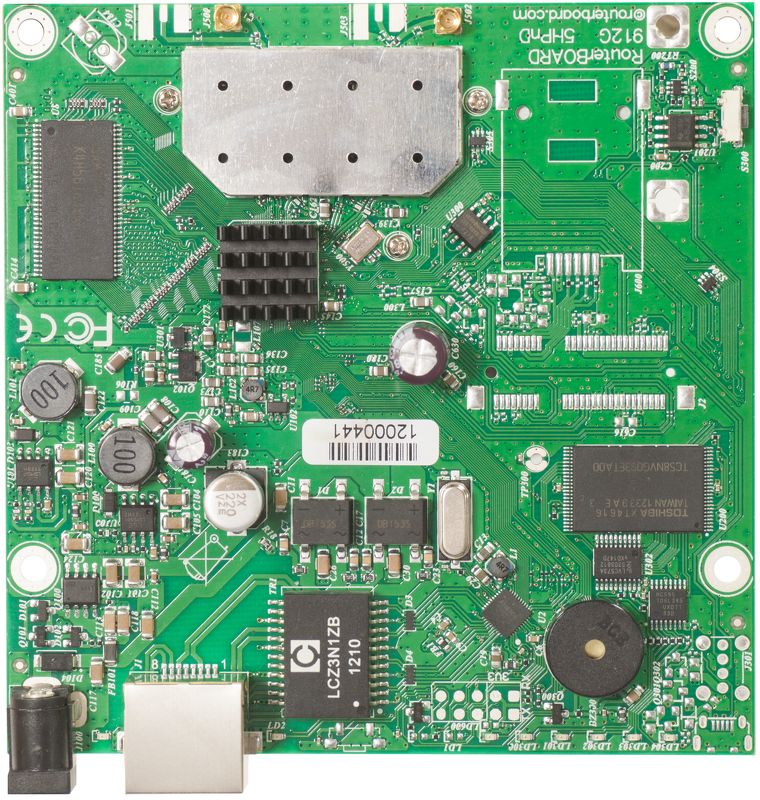

:::info This article covers

- **911 Lite5**
- **911 Lite5 Dual**
- **911 Lite5 ac**
- **RB911G-2HPnD**
- **[RB911G-5HPnD](https://mikrotik.com/product/RB911G-5HPnD)**
- **RB911G-5HPacD**

:::

## Safety Warnings

Before you work on any equipment, be aware of the hazards involved with electrical circuitry, and be familiar with standard practices for preventing accidents. Ultimate disposal of this product should be handled according to all national laws and regulations. The Installation of the equipment must comply with local and national electrical codes. This product can be mounted outdoors on a pole. Failure to use the correct hardware and configuration or to follow the correct procedures could result in a hazardous situation for people and damage to the system. Use only the power supply and accessories approved by the manufacturer, and which can be found in the original packaging of this product. Read the installation instructions before connecting the system to the power source. We cannot guarantee that no accidents or damage will occur due to the improper use of the device. Please use this product with care and operate at your own risk! In the case of device failure, please disconnect it from power. The fastest way to do so is by unplugging the power plug from the power outlet. It is the customer's responsibility to follow local country regulations, including operation within legal frequency channels, output power, cabling requirements, and Dynamic Frequency Selection (DFS) requirements. All MikroTik radio devices must be professionally installed.

This is a class A device. In a domestic environment, this product might cause radio interference in which case the user might be required to take adequate measures.

## First use

- (Optional) Install the device in a case.
- Connect and Ethernet cable to the Ethernet port.
- Plug-in power cable to turn on the device.
- Open network connections on your PC, mobile phone or other device and search for MikroTik wireless network and connect to it.
- The configuration has to be done through the wireless network using a web browser or mobile app - (see ""). Alternatively, you can use the WinBox configuration tool [https://mt.lv/winbox](https://mt.lv/winbox).
- Once connected to the wireless network, open [https://192.168.88.1](https://192.168.88.1) in your web browser to start configuration, user name: a*dmin* and there is no password by default (or, for some models, check user and wireless passwords on the sticker).
- We recommend clicking the "Check for updates" button and updating your RouterOS software to the latest version to ensure the best performance and stability.
- Choose your country, to apply country regulation settings and set up your password on the screen that loads.

## Assembly

911 series router for professional use. Each of the devices comes in ESD protective packaging. When handling electrical equipment please observe the following safety precautions:

- Use a wrist grounding strap when unpacking and working with electrical components to avoid electrical discharge (ESD) damage;
- After unpacking please place the router on the anti-static mat;
- When mounting unit make sure there are no objects that can damage or touch the PCB plate. The device can be mounted in your desired location using the factory provided four holes in a PCB plate, located on each side of the device.

The IPX rating scale of this device is IPX0. When installing for outdoor applications please ensure the water protection for the device. We recommend using Cat6 shielded cables. The installation infrastructure (towers and masts), as well as the router itself, must be properly grounded.

## Powering

The device accepts power with the following modes:

- Passive 10-30 V DC ⎓ PoE to Ethernet port. The higher the voltage needed to compensate for power loss on long cables. At least 18 V is suggested.
- Direct input to the power jack 10-30 V. DC ⎓.

### Connecting to a PoE Adapter

- Connect the Ethernet cable from the device to the PoE+DATA port of the PoE adapter.
- Connect an Ethernet cable from your local network (LAN) to the PoE adapter.
- Connect the power cord to the adapter, and then plug the power cord into a power outlet.

## Booting process

RouterOS is the operating system of all RouterBOARD routers. Please see documentation here: [https://mt.lv/help](https://mt.lv/help) This device is not preconfigured other than an IP address on the Ethernet port. Another configuration has to be applied according to the documentation manual linked above. The initial connection has to be done via the Ethernet cable, using the MikroTik WinBox utility. WinBox should be used to connect to the default IP address of 192.168.88.1 with the username admin and no password. In case you wish to boot the device from the network, for example, to use MikroTik Netinstall, hold the reset button of the device when starting it until the LED light turns off, and the device will start to look for Netinstall servers. In case the IP connection is not available, the WinBox utility can also be used to connect to the MAC address of the device. More information in the documentation.

## Extension slots and ports

- RB911-5HnD – 5 GHz, 802.11a/n, consumption 7 W.
- RB911-5Hn – 5 GHz, 802.11a/n, consumption 5 W.
- RB911G-5HPacD – 5 GHz, 802.11a/n/ac, consumption 12 W, Gigabit Ethernet.
- RB911G-2HPnD – 2.4 GHz,802.11b/g/n, consumption 10 W, Gigabit Ethernet.
- RB911-5HacD - 5 GHz, 802.11a/n/ac, consumption 7 W.
- RB911G-5HPnD – 5 GHz, 802.11a/n, consumption 11 W, Gigabit Ethernet.

## Buttons and jumpers

RouterBOOT reset button has the following functions:

- Hold this button during boot time until LED light starts flashing, release the button to reset RouterOS configuration (total 5 seconds).
- Keep holding for 5 more seconds, LED turns solid, release now to turn on CAPs mode (total 10 seconds).* Keep holding the button for 5 more seconds until LED turns off, then release it to make the RouterBOARD look for Netinstall servers (total 15 seconds). Regardless of the above option used, the system will load the backup RouterBOOT loader if the button is pressed before power is applied to the device. Useful for RouterBOOT debugging and recovery.

## MikroTik mobile app

Use the MikroTik smartphone app to configure your router in the field, or to apply the most basic initial settings for your MikroTik home access point.

- Scan QR code and choose your preferred OS.
- Install and open application.
- By default, the IP address and user name will be already entered.
- Click Connect to establish a connection to your device through a wireless network.
- Choose Quick setup and application will guide you through all basic configuration settings in a couple of easy steps.
- An advanced menu is available to fully configure all necessary settings.

## Operating system support

The device supports RouterOS v7 and above. The specific factory-installed version is listed in /system resource. Other operating systems have not been tested.

To avoid pollution of the environment, please separate the device from household waste and dispose of it in a safe manner, such as in designated waste disposal sites. Familiarize yourself with the procedures for the proper transportation of the equipment to the designated disposal sites in your area.

## Federal Communication Commission Interference Statement

FCC ID: TV7RB911-5HNDM

This equipment has been tested and found to comply with the limits for a Class A digital device, pursuant to Part 15 of the FCC Rules. These limits are designed to provide reasonable protection against harmful interference in a commercial installation.

This equipment generates, uses, and can radiate radio frequency energy and, if not installed and used in accordance with the instruction manual, may cause harmful interference to radio communications. Operation of this equipment in a residential area is likely to cause harmful interference in which case the user will be required to correct the interference at his own expense

FCC Caution: Any changes or modifications not expressly approved by the party responsible for compliance could void the user's authority to operate this equipment. This device complies with Part 15 of the FCC Rules. Operation is subject to the following two conditions: (1) This device may not cause harmful interference, and (2) this device must accept any interference received, including interference that may cause undesired operation.This device and its antenna must not be co-located or operation in conjunction with any other antenna or transmitter. IMPORTANT: Exposure to Radio Frequency Radiation. 20 cm minimum distance has to be maintained between the antenna and user. Under such configuration, the FCC radiation exposure limits set forth for an population/uncontrolled environment can be satisfied. Antenna Installation. WARNING: It is installer's responsibility to ensure that when using the authorized antennas in the United States (or where FCC rules apply); only those antennas certified with the product are used. The use of any antenna other than those certified with the product is expressly forbidden in accordance to FCC rules CFR47 part 15.204. The installer should configure the output power level of antennas, according to country regulations and per antenna type. Professional installation is required of equipment with connectors to ensure compliance with health and safety issues.

## Innovation, Science and Economic Development Canada

IC:7442A-9115HND This device complies with Industry Canada licence-exempt RSS standard(s). Operation is subject to the following two conditions: (1) this device may not cause interference, and (2) this device must accept any interference, including interference that may cause undesired operation of the device. Le présent appareil est conforme aux CNR d'Industrie Canada applicables aux appareils radio exempts de licence. L'exploitation est autorisée aux deux conditions suivantes : (1) l'appareil ne doit pas produire de brouillage, et (2) l'utilisateur de l'appareil doit accepter tout brouillage radioélectrique subi, même si le brouillage est susceptible d'en compromettre le fonctionnement.

This Class A digital apparatus complies with Canadian ICES-003.

Cet appareil numérique de la classe [A] est conforme à la norme NMB-003 du Canada.

CAN ICES-003 (A) / NMB-003 (A)

The device for operation in the band 5150–5250 MHz is only for indoor use to reduce the potential for harmful interference to co-channel mobile satellite systems.

Les dispositifs fonctionnant dans la bande de 5 150 à 5 250 MHz sont réservés uniquement pour une utilisation à l'intérieur afin de réduire les risques de brouillage préjudiciable aux systèmes de satellites mobiles utilisant les mêmes canaux.

## UKCA marking

## Eurasian Conformity Mark

<table><thead><tr><th>Частотный диапазон</th><th>Мощность передатчика</th></tr></thead><tbody><tr><td>2400-2483.5 МГц, , 5150-5350 МГц, 5650-5850 МГц</td><td>≤100 мВт</td></tr></tbody></table>

*Доступные частотные каналы могут различаться в зависимости от модели продукта и сертификации.

Информация о дате изготовления устройства указана в конце серийного номера на его наклейке через дробь. Первая цифра означает номер года (последняя цифра года), две последующие означают номер недели.

Изготовитель: MikroTikls SIA, Aizkraukles iela 23, Riga, LV-1006, Латвия, [support@mikrotik.com](mailto:support@mikrotik.com). Сделано в Китае, Латвии или Литве. Cм. на упаковке.

Для получения подробных сведений о гарантийном обслуживании обратитесь к продавцу. Информация об импортерах продукции MikroTik в Российскую Федерацию: [https://mikrotik.com/buy/europe/russia](https://mikrotik.com/buy/europe/russia)

Продукты MikroTik, которые поставляются в Евразийский таможенный союз, оцениваются с учетом соответствующих требований и помечены знаком EAC, как показано ниже:

## Norma Oficial Mexicana

Rango de frecuencia (potencia de salida máxima): 2400-2483.5 MHz (30 dBm), ), 5725-5850 MHz (30 dBm). Los canales de frecuencia disponibles pueden variar según el modelo y la certificación del producto.

EFICIENCIA ENERGETICA CUMPLE CON LA NOM-029-ENER-2017.

La operacion de este equipo esta sujeta a las siguientes dos condiciones:

- Es posible que este equipo o dispositivo no cause interferencia perjudicial y.
- Este equipo debe aceptar cualquier interferencia, incluyendo la que pueda causar su operacion no deseada. Fabricante: MikroTikls SIA, Brivibas gatve 214i, Riga, LV-1039, Latvia.

País De Origen: Letonia; Lituania; China (Republica Popular); Estados Unidos De America; Mexico.

Por favor contacte a su distribuidor local para preguntas regionales específicas. La lista de importadores se puede encontrar en nuestra página de inicio – [https://mikrotik.com/buy/latinamerica/mexico](https://mikrotik.com/buy/latinamerica/mexico).

## The National Commission for the State Regulation of Communications and Informatization by Ukraine

Виробник: MikroTikls SIA, Brivibas gatve 214i Рига, Латвія, LV1039.

Робоча частота (Максимальна вихідна потужність): 2400-2483.5 МГц (20 дБм), 5150-5250 МГц (23 дБм), 5250-5350 МГц (20 дБм), 5470-5725 МГц (27 дБм).

Справжнім MikroTikls SIA заявляє, що маршрутизатор відповідає основним вимогам та іншим відповідним положенням директиви 2014/53/EC, а також суттєвим вимогам Технічного регламенту радіообладнання, затвердженого постановою Кабінету Міністрів України від 24 травня 2017 року № 355.

Для експлуатації в Україні необхідно отримати дозвіл на експлуатацію у порядку, затвердженому рішенням НКРЗІ від 01.11.2012 № 559, зареєстрованому в Міністерстві юстиції України 03.01.2013 за № 57/22589.

## CE Declaration of Conformity

Manufacturer: MikroTikls SIA, Brivibas gatve 214i Riga, Latvia, LV1039.

Hereby, Mikrotīkls SIA declares that the radio equipment type RouterBOARD is in compliance with Directive 2014/53/EU. The full text of the EU declaration of conformity is available at the following internet address: [https://mikrotik.com/products](https://mikrotik.com/products)

### Frequency bands terms of use

<table><thead><tr><th>Frequency range (for applicable models)</th><th>Channels used</th><th>Maximum Output Power (EIRP)</th><th>Restriction</th></tr></thead><tbody><tr><td>2412-2472 MHz</td><td>1 - 13</td><td>20 dBm</td><td>Without any restriction to use in all EU Member States</td></tr><tr><td>5150-5250 MHz</td><td>26 - 48</td><td>23 dBm</td><td>Restricted to indoor use only*</td></tr><tr><td>5250-5350 MHz</td><td>52 - 64</td><td>20 dBm</td><td>Restricted to indoor use only*</td></tr><tr><td>5470-5725 MHz</td><td>100 - 140</td><td>27 dBm</td><td>Without any restriction to use in all EU Member States</td></tr></tbody></table>

** It is the customer's responsibility to follow local country regulations, including operation within legal frequency channels, output power, cabling requirements, and Dynamic Frequency Selection (DFS) requirements. All MikroTik radio devices must be professionally installed!*

This MikroTik device meets Maximum WLAN transmit power limits per ETSI regulations. For more detailed information see Declaration of Conformity above / Dieses MikroTik-Gerät erfüllt die maximalen WLAN- Sendeleistung Grenzwerte gemäß ETSI-Bestimmungen. Weitere Informationen finden Sie oben unter Konformitätserklärung / Cet appareil MikroTik respecte les limites maximales de puissance de transmission WLAN conformément aux réglementations ETSI. Pour plus d'informations, voir la déclaration de conformité ci-dessus / Questo dispositivo MikroTik è conforme ai limiti massimi di potenza di trasmissione WLAN in conformità con le normative ETSI. Per ulteriori informazioni, consultare la dichiarazione di conformità sopra / Este dispositivo MikroTik cumple con los límites máximos de potencia de transmisión WLAN de acuerdo con las regulaciones ETSI. Para obtener más información, consulte la declaración de conformidad anterior / Это устройство MikroTik соответствует максимальным пределам мощности передачи WLAN в соответствии с правилами ETSI. Для получения дополнительной информации см. Декларацию соответствия выше.

The WLAN function for this device is restricted to indoor use only when operating in the 5150 to 5350 MHz frequency range. / Die WLAN-Funktion dieses Geräts ist nur für die Verwendung in Innenräumen im Frequenzbereich 5150 bis 5350 MHz beschränkt. / La fonction WLAN de cet appareil est limitée à une utilisation en intérieur uniquement lorsqu'il fonctionne dans la gamme de fréquences 5150 à 5350 MHz. / La funzione WLAN per questo dispositivo è limitata all'uso interno solo quando si opera nella gamma di frequenza da 5150 a 5350 MHz. / La función WLAN para este dispositivo está restringida al uso en interiores solo cuando se opera en el rango de frecuencia de 5150 a 5350 MHz. / Функция WLAN для этого устройства ограничена использованием внутри помещения только при работе в диапазоне частот от 5150 до 5350 МГц.

**BG. Инструкци**
