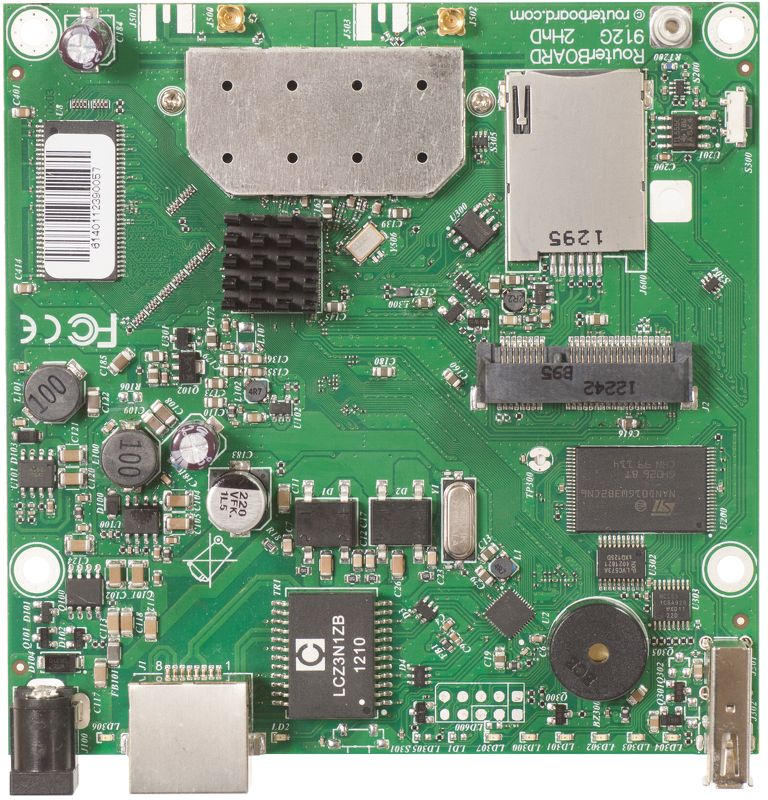

:::info This article covers

- **[RB912UAG-5HPnD](https://mikrotik.com/product/RB912UAG-5HPnD)**
- **[RB912UAG-2HPnD](https://mikrotik.com/product/RB912UAG-2HPnD)**

:::

## Safety Warnings

Before you work on any equipment, be aware of the hazards involved with electrical circuitry, and be familiar with standard practices for preventing accidents. Read the installation instructions before connecting the system to the power source. This equipment is to be installed by trained and qualified personnel, as per these installation instructions. The installer is responsible for obtaining any required local or national safety inspections of the structural integrity of the installation by the local authority/inspection department. All installation methods for mounting an access point on any wall surface are subject to the acceptance of local jurisdiction. The Installation of the equipment must comply with local and national electrical codes. Please read the mounting instructions carefully before beginning installation. Failure to use the correct hardware and configuration or to follow the correct procedures could result in a hazardous situation to people and damage to the system. We cannot guarantee that no accidents or damage will occur due to the improper use of the device. Please use this product with care and operate at your own risk.

This is a class A device. In a domestic environment, this product might cause radio interference in which case the user might be required to take adequate measures.

## Mounting

912UAG series router for professional use. Each of the devices comes in ESD protective packaging. When handling electrical equipment please observe the following safety precautions:

- use a wrist grounding strap when unpacking and working with electrical components to avoid electrical discharge (ESD) damage,
- after unpacking please place the router on the anti-static mat,
- when mounting unit make sure there are no objects that can damage or touch the PCB plate,
- note that ETH, USB port and DC jack are extending over the perimeter of the PCB plate. The device can be mounted in your desired location using the factory provided four holes in a PCB plate, located on each side of the device. *Warning! This equipment should be installed and operated with a minimum distance of 380 cm between the device and your body. Operation of this equipment in the residential environment could cause radio interference.*

## Connecting

- Choose your powering solution, please see Powering section for possibilities.
- If needed, connect accessories to the miniPCIe slot, antenna cables to the miniPCIe card and insert SIM card.
- Connect your ethernet cable to the gigabit ethernet port.
- Connect your direct input power jack if not using POE, to start up the device.
- The device will boot up and after short beep Wireless network will be available for connecting.
- Open network connections on your pc, mobile phone or other device and search for MikroTik wireless network and connect to it.
- Once connected to the wireless network, open [https://192.168.88.1](https://192.168.88.1) in your web browser to start configuration, since there is no password by default, you will be logged in automatically (or, for some models, check user and wireless passwords on the sticker).
- We recommend clicking the "Check for updates" button and updating your RouterOS software to the latest version to ensure the best performance and stability.
- Choose your country, to apply country regulation settings and set up your password in the screen that loads.

## Powering

The device accepts power with the following modes:

- Passive 10-30 V PoE to the ethernet port. The higher the voltage needed to compensate for power loss on long cables. At least 18 V is suggested.
- Direct input to the power jack 10-30 V. Maximum power consumption 14 W.

## Configuration

RouterOS includes many configuration options in addition to what is described in this document. We suggest starting here to get yourself accustomed to the possibilities: [https://mt.lv/help](https://mt.lv/help) In case IP connection is not available, the WinBox tool ([https://mt.lv/winbox](https://mt.lv/winbox)) can be used to connect to the MAC address of the device from the LAN side (all access is blocked from the Internet port by default). For recovery purposes, it is possible to boot the device from the network, see a section .

## Extension slots and ports

- One gigabit ethernet port (With Auto MDI/X so you can use either straight or cross-over cables for connecting to other network devices). The ethernet port accepts 10-30 V DC powering from a passive PoE injector.
- One miniPCIe slot. *This device might be incompatible with the R11e-LTE international modem.*
- USB slot type A.
- SIM card slot.
- 5 GHz, 802.11a/n for RB912UAG-5HPnD.
- 2.4 GHz, 802.11b/g/n for RB912UAG-2HPnD.

## Reset button

The reset button has three functions:

- Hold this button during boot time until LED light starts flashing, release the button to reset RouterOS configuration (total 5 seconds).
- Keep holding for 5 more seconds, LED turns solid, release now to turn on CAP mode. The device will now look for a CAPsMAN server (total 10 seconds).
- Or Keep holding the button for 5 more seconds until LED turns off, then release it to make the RouterBOARD look for Netinstall servers (total 15 seconds). Regardless of the above option used, the system will load the backup RouterBOOT loader if the button is pressed before power is applied to the device. Useful for RouterBOOT debugging and recovery.

## Operating system support

The device supports RouterOS v7 and above. The specific factory-installed version is listed in /system resource. Other operating systems have not been tested.

To avoid pollution of the environment, please separate the device from household waste and dispose of it in a safe manner, such as in designated waste disposal sites. Familiarize yourself with the procedures for the proper transportation of the equipment to the designated disposal sites in your area.

## Federal Communication Commission Interference Statement

<table><thead><tr><th>Model</th><th>FCC ID</th></tr></thead><tbody><tr><td>RB912UAG-5HPnD</td><td>TV7RB912G-5HPNDM</td></tr><tr><td>RB912UAG-2HPnD</td><td>TV7RB912G-2HPND</td></tr></tbody></table>

This equipment has been tested and found to comply with the limits for a Class A digital device, pursuant to Part 15 of the FCC Rules. These limits are designed to provide reasonable protection against harmful interference in a commercial installation.

This equipment generates, uses, and can radiate radio frequency energy and, if not installed and used in accordance with the instruction manual, may cause harmful interference to radio communications. Operation of this equipment in a residential area is likely to cause harmful interference in which case the user will be required to correct the interference at his own expense

**FCC Caution:** Any changes or modifications not expressly approved by the party responsible for compliance could void the user's authority to operate this equipment. This device complies with Part 15 of the FCC Rules. Operation is subject to the following two conditions: (1) This device may not cause harmful interference, and (2) this device must accept any interference received, including interference that may cause undesired operation. This device and its antenna must not be co-located or operation in conjunction with any other antenna or transmitter.

**IMPORTANT: Exposure to Radio Frequency Radiation.** This equipment complies with the FCC RF radiation exposure limits set forth for an uncontrolled environment. This equipment should be installed and operated with a minimum distance of 167 cm between the radiator and any part of your body.

## Innovation, Science and Economic Development Canada

IC:7442A-912G2HPND, 7442A-912G5HPNDM This device complies with Industry Canada licence-exempt RSS standard(s). Operation is subject to the following two conditions: (1) this device may not cause interference, and (2) this device must accept any interference, including interference that may cause undesired operation of the device. Le présent appareil est conforme aux CNR d'Industrie Canada applicables aux appareils radio exempts de licence. L'exploitation est autorisée aux deux conditions suivantes : (1) l'appareil ne doit pas produire de brouillage, et (2) l'utilisateur de l'appareil doit accepter tout brouillage radioélectrique subi, même si le brouillage est susceptible d'en compromettre le fonctionnement.

This Class A digital apparatus complies with Canadian ICES-003.

Cet appareil numérique de la classe [A] est conforme à la norme NMB-003 du Canada.

CAN ICES-003 (A) / NMB-003 (A)

The device for operation in the band 5150–5250 MHz is only for indoor use to reduce the potential for harmful interference to co-channel mobile satellite systems.

Les dispositifs fonctionnant dans la bande de 5 150 à 5 250 MHz sont réservés uniquement pour une utilisation à l'intérieur afin de réduire les risques de brouillage préjudiciable aux systèmes de satellites mobiles utilisant les mêmes canaux.

**IMPORTANT: Exposure to Radio Frequency Radiation.** This equipment complies with the IC radiation exposure limits set forth for an uncontrolled environment. This equipment should be installed and operated with a minimum distance of 168 cm between the radiator and any part of your body. Cet équipement est conforme aux limites d'exposition au rayonnement IC définies pour un environnement non contrôlé. Cet équipement doit être installé et utilisé à une distance minimale de 168 cm entre le radiateur et toute partie de votre corps.

## UKCA Marking

## Eurasian Conformity Mark

<table><thead><tr><th>Частотный каналы</th><th>Мощность передатчика</th></tr></thead><tbody><tr><td>2400-2483.5 МГц, 5650-5850 МГц</td><td>≤10 Вт</td></tr></tbody></table>

*Доступные частотные каналы могут различаться в зависимости от модели продукта и сертификации.

Информация о дате изготовления устройства указана в конце серийного номера на его наклейке через дробь. Первая цифра означает номер года (последняя цифра года), две последующие означают номер недели.

Изготовитель: MikroTikls SIA, Aizkraukles iela 23, Riga, LV-1006, Латвия, [support@mikrotik.com](mailto:support@mikrotik.com). Сделано в Китае, Латвии или Литве. Cм. на упаковке.

Для получения подробных сведений о гарантийном обслуживании обратитесь к продавцу. Информация об импортерах продукции MikroTik в Российскую Федерацию: [https://mikrotik.com/buy/europe/russia](https://mikrotik.com/buy/europe/russia)

Продукты MikroTik, которые поставляются в Евразийский таможенный союз, оцениваются с учетом соответствующих требований и помечены знаком EAC, как показано ниже:

## Norma Oficial Mexicana

Rango de frecuencia (potencia de salida máxima): 2400-2483.5 MHz (30 dBm), 5725-5850 MHz (30 dBm). Los canales de frecuencia disponibles pueden variar según el modelo y la certificación del producto.

EFICIENCIA ENERGETICA CUMPLE CON LA NOM-029-ENER-2017.

La operacion de este equipo esta sujeta a las siguientes dos condiciones:

Es posible que este equipo o dispositivo no cause interferencia perjudicial y. Este equipo debe aceptar cualquier interferencia, incluyendo la que pueda causar su operacion no deseada.

Fabricante: MikroTikls SIA, Brivibas gatve 214i, Riga, LV-1039, Latvia.

País De Origen: Letonia; Lituania; China (Republica Popular); Estados Unidos De America; Mexico.

Por favor contacte a su distribuidor local para preguntas regionales específicas. La lista de importadores se puede encontrar en nuestra página de inicio – [https://mikrotik.com/buy/latinamerica/mexico](https://mikrotik.com/buy/latinamerica/mexico).

## The National Commission for the State Regulation of Communications and Informatization by Ukraine

Виробник: MikroTikls SIA, Brivibas gatve 214i Рига, Латвія, LV1039.

Робоча частота (Максимальна вихідна потужність): 2400-2483.5 МГц (20 дБм), 5470-5725 МГц (27 дБм).

Справжнім MikroTikls SIA заявляє, що маршрутизатор відповідає основним вимогам та іншим відповідним положенням директиви 2014/53/EC, а також суттєвим вимогам Технічного регламенту радіообладнання, затвердженого постановою Кабінету Міністрів України від 24 травня 2017 року № 355.

Для експлуатації в Україні необхідно отримати дозвіл на експлуатацію у порядку, затвердженому рішенням НКРЗІ від 01.11.2012 № 559, зареєстрованому в Міністерстві юстиції України 03.01.2013 за № 57/22589.

## CE Declaration of Conformity

Manufacturer: MikroTikls SIA, Brivibas gatve 214i Riga, Latvia, LV1039.

Hereby, Mikrotīkls SIA declares that the radio equipment type RouterBOARD is in compliance with Directive 2014/53/EU. The full text of the EU declaration of conformity is available at the following internet address: [https://mikrotik.com/products](https://mikrotik.com/products)

**Exposure to Radio Frequency Radiation:** This MikroTik equipment complies with the European Union radiation exposure limits set forth for an uncontrolled environment. This MikroTik device should be installed and operated no closer than 20 centimeters from your body, occupational user, or the general public.This equipment complies with EU radiation exposure limits set forth for an uncontrolled environment. This equipment should be installed and operated with minimum distance of 20 cm between the radiator and your body, unless specifically stated otherwise in page 1 of this document. In RouterOS you must specify your country, to make sure local wireless regulations are observed.

### Frequency bands terms of use

<table><thead><tr><th>Frequency range (for applicable models)</th><th>Channels used</th><th>Maximum Output Power (EIRP)</th><th>Restriction</th></tr></thead><tbody><tr><td>2412-2472 MHz</td><td>1 - 13</td><td>20 dBm</td><td>Without any restriction to use in all EU Member States</td></tr><tr><td>5470-5725 MHz</td><td>100 - 140</td><td>27 dBm</td><td>Without any restriction to use in all EU Member States</td></tr></tbody></table>

** It is the customer's responsibility to follow local country regulations, including operation within legal frequency channels, output power, cabling requirements, and Dynamic Frequency Selection (DFS) requirements. All MikroTik radio devices must be professionally installed!*

This MikroTik device meets Maximum WLAN transmit power limits per ETSI regulations. For more detailed information see Declaration of Conformity above / Dieses MikroTik-Gerät erfüllt die maximalen WLAN Sendeleistung Grenzwerte gemäß ETSI-Bestimmungen. Weitere Informationen finden Sie oben unter Konformitätserklärung / Cet appareil MikroTik respecte les limites maximales de puissance de transmission WLAN conformément aux réglementations ETSI. Pour plus d'informations, voir la déclaration de conformité ci-dessus / Questo dispositivo MikroTik è conforme ai limiti massimi di potenza di trasmissione WLAN in conformità con le normative ETSI. Per ulteriori informazioni, consultare la dichiarazione di conformità sopra / Este dispositivo MikroTik cumple con los límites máximos de potencia de transmisión WLAN de acuerdo con las regulaciones ETSI. Para obtener más información, consulte la declaración de conformidad anterior / Это устройство MikroTik соответствует максимальным пределам мощности передачи WLAN в соответствии с правилами ETSI. Для получения дополнительной информации см. Декларацию соответствия выше.
