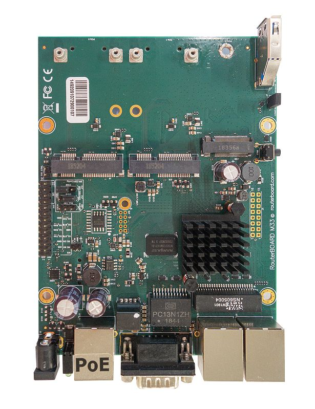
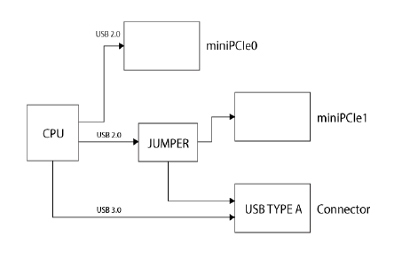
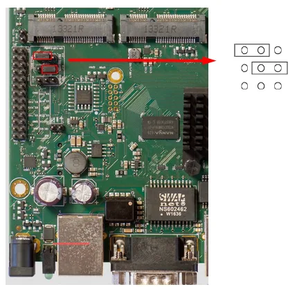
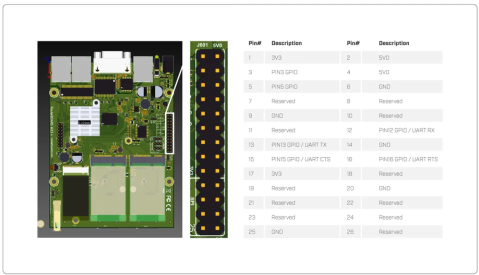

Powerful OEM board with three Gigabit LAN and two miniPCIe slots. See the [RBM33G product page](https://mikrotik.com/product/rbm33g) for full specifications and brochures.

## Safety Warnings

Before you work on any equipment, be aware of the hazards involved with electrical circuitry, and be familiar with standard practices for preventing accidents. Ultimate disposal of this product should be handled according to all national laws and regulations. All installation methods for mounting an access point on any wall surface is subject to the acceptance of local jurisdiction. The Installation of the equipment must comply with local and national electrical codes. This product is intended to be mounted outdoors on a pole but can also be installed indoors. Please read the mounting instructions carefully before beginning installation. Failure to use the correct hardware and configuration or to follow the correct procedures could result in a hazardous situation to people and damage to the system. Use only the power supply and accessories approved by the manufacturer, and which can be found in the original packaging of this product. Read the installation instructions before connecting the system to the power source. We cannot guarantee that no accidents or damage will occur due to the improper use of the device. Please use this product with care and operate at your own risk! In the case of device failure, please disconnect it from power. The fastest way to do so is by unplugging the power plug from the power outlet. It is the customer's responsibility to follow local country regulations, including operation within legal frequency channels, output power, cabling requirements, and Dynamic Frequency Selection (DFS) requirements. All MikroTik radio devices must be professionally installed.

## First use

- (Optional) Install the device in a case.
- Connect cables to wireless cards and Ethernet ports.
- Plug-in power cable (directly or through the PoE injector) to turn on the device, please see (link) paragraph.
- The Initial connection has to be done via the Ethernet cable, using the MikroTik WinBox utility. WinBox should be used to connect to the default IP address of 192.168.88.1 with the username admin and no password (or, for some models, check user and wireless passwords on the sticker).
- We recommend clicking the "Check for updates" button and updating your RouterOS software to the latest version to ensure the best performance and stability,
- Choose your country, to apply country regulation settings (if applicable), and set up your password on the screen that loads.

## Assembly

M33G for professional use. Each of the devices comes in ESD protective packaging. When handling electrical equipment please observe the following safety precautions:

- Use a wrist grounding strap when unpacking and working with electrical components to avoid electrical discharge (ESD) damage.
- After unpacking please place the router on the anti-static mat.
- When mounting unit make sure there are no objects that can damage or touch the PCB plate.
- Note that ETH, USB and other ports are extending over the perimeter of the PCB plate. The device can be mounted in your desired location using the factory provided four holes in a PCB plate, located on each side of the device.

## Mounting

Mounting and configuration of this device should be performed by a qualified person.

The installation infrastructure (towers and masts), as well as the router itself, must be properly grounded.

## Powering

The device accepts power with the following modes:

- Passive 11-28 V DC ⎓ PoE to J1 Ethernet port. The Higher voltage needed to compensate for power loss on long cables at least 18 V is suggested.
- Direct input to the power jack DC ⎓ 11-28 V. The maximum total power consumption with all interfaces loaded is 24 W. Maximum power to each extension card is 3 A.

### Connecting to a PoE Adapter

- Connect the Ethernet cable from the device to the POE port of the POE adapter.
- Connect an Ethernet cable from your LAN to the LAN port of the POE adapter, please mind arrows for data and power flow.
- Connect the power cord to the adapter, and then plug the power cord into a power outlet.

## Booting process

RouterOS is the operating system of all RouterBOARD routers. Please see documentation: [https://mt.lv/help](https://mt.lv/help) This device is not preconfigured other than an IP address on the Ethernet port. Other configurations have to be applied according to the documentation manual linked above. In case you wish to boot the device from the network, for example, to use MikroTik Netinstall, hold the reset button of the device when starting it until the LED light turns off, and the device will start to look for Netinstall servers. In case the IP connection is not available, the WinBox utility can also be used to connect to the MAC address of the device. More information in the documentation.

## Extension slots and ports

- Three Gigabit Ethernet ports (With Auto MDI/X so you can use either straight or cross-over cables for connecting to other network devices). The J1 (first from the left) Ethernet port accepts 11-30 V DC powering from a passive PoE injector.
- Two miniPCIe slots for either an 802.11 wireless card or a 3G/LTE modem. Mini-SIM 2FF slots available for miniPCIe 3G/LTE modems and have no functionality when a modem is not installed.
- One M.2 (M key) slot for PCI-e SSD disk. The mounting hole is for 2242 size cards, for other sizes, an extender is suggested. Any speed M.2 cards will operate at 1x PCIe speed.
- One microSD slot for a storage card.
- One DB9 RS232 serial port for serial console access. Configured as 115200 bit/s, 8 data bits, 1 stop bit, no parity.

## USB jumper

Located right next to the USB 3.0 port. When loaded, the jumper enables the USB 3.0 port. Remove the jumper to switch the USB 2.0 lines to the J10 (central) miniPCIe slot (USB 3.0 lines remain enabled to the USB port). This is required if you need to use two cellular modems in the device. Normally you can use the LTE modem in the J8 (left-hand side) slot and use an 802.11 wireless card in the J10 slot. In this case, you can leave the jumper on, as most wireless cards operate on a PCI express. Removing the jumper enables the use of a secondary cellular modem in the central J10 slot, but disables the USB 2.0 functionality of the USB port, while USB 3.0 can still be used on the USB port. Refer to the diagram below:



## Boot configuration jumpers

Default jumper configuration for MikroTik RouterOS boot:



## MiniPCIe, SIM slot usage

Installing a miniPCIe module should be done by a qualified person, please follow safety precautions when handling electrical equipment:

- Use a wrist grounding strap when unpacking and working with electrical components to avoid electrical discharge (ESD) damage.
- Place the PCB board on the anti-static mat.
- Locate the miniPCIe slot on the PCB and remove two factory attached screws.
- Install the card into miniPCIe slot.
- The secure card in place using previously removed two screws.
- Attach the grey uFL connector to the MAIN antenna connector of the modem, attach the black cable to the secondary (or AUX) connector. Slide in the SIM cards from your mobile operator into the SIM slots. The slot accepts miniSIM (2FF). Each MiniPCie slot corresponds to the SIM slot which is located under them. The SIM slots cannot be switched in RouterOS.

## GPIO pinout

M33 pinout is shown below:



All output pins are open drain.

Digital input voltage is 0 to 3.63 V max.

To receive a logical "0" on the pin, the voltage should be between 0 to 1.4 V.

To receive a logical "1" on the pin, the voltage should be between 1.41 to 3.63 V.

By default pins 12,13,15,16 are configured for the second "serial1" port usage:

```
/system/routerboard/settings/set gpio-function=serial1

```

They can be resigned for GPIO usage in /iot/gpio/digital menu with following commands:

```
/system/routerboard/settings/set gpio-function=""
/system/reboot

```

## Buttons and jumpers

**RouterBOOT reset button.** This button has the following functions:

- Hold this button during boot time until LED light starts flashing, release the button to reset RouterOS configuration (total 5 seconds).
- Keep holding for 5 more seconds, LED turns solid, release now to turn on CAPs mode (total 10 seconds).* Keep holding the button for 5 more seconds until LED turns off, then release it to make the RouterBOARD look for Netinstall servers (total 15 seconds). Regardless of the above option used, the system will load the backup RouterBOOT loader if the button is pressed before power is applied to the device. Useful for RouterBOOT debugging and recovery.

## Accessories

Package includes the following accessories that come with the device:

- K-25 set.

## Specifications

For more information about this product, specification and pictures please visit our web page: [https://mikrotik.com/product/rbm33g](https://mikrotik.com/product/rbm33g)

## Operating system support

The device supports RouterOS v7 and above. The specific factory-installed version is listed in /system resource. Other operating systems have not been tested.

## MikroTik mobile app

Use the MikroTik smartphone app to configure your router in the field, or to apply the most basic initial settings for your MikroTik home access point.


- Scan QR code and choose your preferred OS.
- Install and open application.
- By default, the IP address and user name will be already entered.
- Click Connect to establish a connection to your device through a wireless network.
- Choose Quick setup and application will guide you through all basic configuration settings in a couple of easy steps.
- An advanced menu is available to fully configure all necessary settings.

To avoid pollution of the environment, please separate the device from household waste and dispose of it in a safe manner, such as in designated waste disposal sites. Familiarize yourself with the procedures for the proper transportation of the equipment to the designated disposal sites in your area.

## Federal Communication Commission Interference Statement

This equipment has been tested and found to comply with the limits for a Class B digital device, pursuant to Part 15 of the FCC Rules. These limits are designed to provide reasonable protection against harmful interference in a residential installation.


This equipment generates, uses and can radiate radio frequency energy and, if not installed and used in accordance with the instructions, may cause harmful interference to radio communications. However, there is no guarantee that interference will not occur in a particular installation. If this equipment does cause harmful interference to radio or television reception, which can be determined by turning the equipment off and on, the user is encouraged to try to correct the interference by one of the following measures:

- Reorient or relocate the receiving antenna.
- Increase the separation between the equipment and receiver.
- Connect the equipment into an outlet on a circuit different from that to which the receiver is connected.
- Consult the dealer or an experienced radio/TV technician for help. FCC Caution: Any changes or modifications not expressly approved by the party responsible for compliance could void the user's authority to operate this equipment. This device complies with Part 15 of the FCC Rules. Operation is subject to the following two conditions: (1) This device may not cause harmful interference, and (2) this device must accept any interference received, including interference that may cause undesired operation. Note: This unit was tested with shielded cables on the peripheral devices. Shielded cables must be used with the unit to ensure compliance.

## Innovation, Science and Economic Development Canada

This device complies with Industry Canada's license-exempt RSS standard(s). Operation is subject to the following two conditions: (1) this device may not cause interference, and (2) this device must accept any interference, including interference that may cause undesired operation of the device. Le présent appareil est conforme aux CNR d'Industrie Canada applicables aux appareils radio exempts de licence. L'exploitation est autorisée aux deux conditions suivantes: (1) l'appareil ne doit pas produire de brouillage, et (2) l'utilisateur de l'appareil doit accepter tout brouillage radioélectrique subi, même si le brouillage est susceptible d'en compromettre le fonctionnement.

This Class B digital apparatus complies with Canadian ICES-003.

Cet appareil numérique de la classe [B] est conforme à la norme NMB-003 du Canada.

CAN ICES-003 (B) / NMB-003 (B)

## UKCA marking


## Eurasian Conformity Mark

Информация о дате изготовления устройства указана в конце серийного номера на его наклейке через дробь. Первая цифра означает номер года (последняя цифра года), две последующие означают номер недели.

Изготовитель: MikroTikls SIA, Aizkraukles iela 23, Riga, LV-1006, Латвия, [support@mikrotik.com](mailto:support@mikrotik.com). Сделано в Китае, Латвии или Литве. Cм. на упаковке.

Для получения подробных сведений о гарантийном обслуживании обратитесь к продавцу. Информация об импортерах продукции MikroTik в Российскую Федерацию: [https://mikrotik.com/buy/europe/russia](https://mikrotik.com/buy/europe/russia)

Продукты MikroTik, которые поставляются в Евразийский таможенный союз, оцениваются с учетом соответствующих требований и помечены знаком EAC, как показано ниже:


## Norma Oficial Mexicana

EFICIENCIA ENERGETICA CUMPLE CON LA NOM-029-ENER-2017.

La operacion de este equipo esta sujeta a las siguientes dos condiciones:

- Es posible que este equipo o dispositivo no cause interferencia perjudicial y.
- Este equipo debe aceptar cualquier interferencia, incluyendo la que pueda causar su operacion no deseada. Fabricante: MikroTikls SIA, Brivibas gatve 214i, Riga, LV-1039, Latvia.

País De Origen: Letonia; Lituania; China (Republica Popular); Estados Unidos De America; Mexico.

Por favor contacte a su distribuidor local para preguntas regionales específicas. La lista de importadores se puede encontrar en nuestra página de inicio – [https://mikrotik.com/buy/latinamerica/mexico](https://mikrotik.com/buy/latinamerica/mexico).

## CE Declaration of Conformity

Manufacturer: MikroTikls SIA, Brivibas gatve 214i Riga, Latvia, LV1039.

The full text of the EU declaration of conformity is available at the following internet address:[https://mikrotik.com/products](https://mikrotik.com/products)
