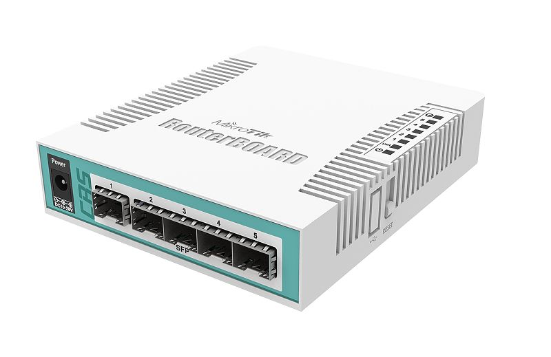
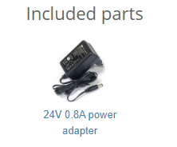

## [CRS106-1C-5S](https://mikrotik.com/product/CRS106-1C-5S)

The CRS106-1C-5S is a network switch with five SFP ports and one Ethernet/SFP combo port. It is already configured, with all ports switched together. We recommend you set up a password to secure your device. See the [CRS106-1C-5S product page](https://mikrotik.com/product/CRS106-1C-5S) for full specifications and brochures.

## Safety Warnings

- Before you work on any equipment, be aware of the hazards involved with electrical circuitry, and be familiar with standard practices for preventing accidents.
- Ultimate disposal of this product should be handled according to all national laws and regulations.
- The Installation of the equipment must comply with local and national electrical codes.
- This product is intended to be installed indoors. Keep this product away from water, fire, humidity or hot environments.
- Use only the power supply and accessories approved by the manufacturer, and which can be found in the original packaging of this product.
- Read the installation instructions before connecting the system to the power source.
- We cannot guarantee that no accidents or damage will occur due to the improper use of the device. Please use this product with care and operate at your own risk!
- In the case of device failure, please disconnect it from power. The fastest way to do so is by unplugging the power plug from the power outlet.
- It is the customer's responsibility to follow local country regulations, including operation within legal frequency channels, output power, cabling requirements, and Dynamic Frequency Selection (DFS) requirements. All MikroTik devices must be professionally installed.

## Powering

The power consumption of this device under maximum load is up to 11 W. The device accepts powering in the following ways:

- Direct-input power jack (5.5mm outside and 2mm inside, female, pin positive plug) accepts 8-30 V DC.
- The combo ethernet port accepts passive Power over Ethernet 8-30 V DC, PoE injector is not included.

## Quickstart

The device has five SFP ports and one SFP/Ethernet combo port. This unit is compatible with 100Mbit and 1.25G SFP modules. The ETH/SFP combo interface has two connectors on the back of the unit, of which only one can be used at the same time. The used port is automatically recognized as Combo1. It is possible to select which physical port is used in the software Ethernet menu. If left to the default "auto", the first port to initialize will be used.

- Connect your WAN cable to port 1 and the other devices to ports 2-5;
- Set the client device IP configuration to automatic (DHCP);
- The default IP address from ports 2-5 (LAN) is 192.168.88.1;
- The username is "**admin**" and there is no password (or, for some models, check user and wireless passwords on the sticker);
- Secure the device by setting up a password.

## Configuration

The CRS106-1C-5S is set up as a switch, with 192.168.88.1 as the management IP of the master interface. We recommend clicking the "Check for updates" button and updating your RouterOS software to the latest version to ensure the best performance and stability. RouterOS includes many configuration options in addition to what is described in this document. We suggest starting here to get yourself accustomed to the possibilities: [https://mt.lv/help](https://mt.lv/help) In case IP connection is not available, the WinBox tool ([https://mt.lv/winbox](https://mt.lv/winbox)) can be used to connect to the MAC address of the device from the LAN side (all access is blocked from the internet port by default). For recovery purposes, it is possible to boot the device from the network, see the Reset button.

## Reset button

Hold this button during boot time until LED light starts flashing, release the button to reset RouterOS configuration.

## Specifications

<table><thead><tr><th>Parameters</th><th>Description</th></tr></thead><tbody><tr><td>**Product Code**</td><td>CRS106-1C-5S</td></tr><tr><td>**Architecture**</td><td>MIPSBE</td></tr><tr><td>**CPU**</td><td>QCA8511, 1 core, 400 MHz</td></tr><tr><td>**Switch chip model**</td><td>QCA8511</td></tr><tr><td>**RAM**</td><td>128 MB</td></tr><tr><td>**Storage**</td><td>16 MB, Flash</td></tr><tr><td>**Ethernet**</td><td>1 × Gigabit Ethernet combo port (SFP or RJ45)</td></tr><tr><td>**SFP ports**</td><td>5 × 1.25G SFP cages</td></tr><tr><td>**PoE-in**</td><td>Passive PoE, 11-30 V</td></tr><tr><td>**DC jack input voltage**</td><td>11-30 V</td></tr><tr><td>**Max power consumption**</td><td>11 W</td></tr><tr><td>**Dimensions**</td><td>114 × 137 × 29 mm</td></tr><tr><td>**Operating temperature**</td><td>-20 °C to +70 °C</td></tr><tr><td>**IP rating**</td><td>IP20</td></tr></tbody></table>

For more information about this product, specification and pictures please visit our web page: [https://mikrotik.com/product/CRS106-1C-5S](https://mikrotik.com/product/CRS106-1C-5S)

## Operating system support

This device runs SwOS, which is the only supported OS for this device.

## Safety notice

To avoid pollution of the environment, please separate the device from household waste and dispose of it in a safe manner, such as in designated waste disposal sites. Familiarize yourself with the procedures for the proper transportation of the equipment to the designated disposal sites in your area.

## Federal Communication Commission Interference Statement

This equipment has been tested and found to comply with the limits for a Class A digital device, pursuant to Part 15 of the FCC Rules. These limits are designed to provide reasonable protection against harmful interference in a commercial installation.

This equipment generates, uses, and can radiate radio frequency energy and, if not installed and used in accordance with the instruction manual, may cause harmful interference to radio communications. Operation of this equipment in a residential area is likely to cause harmful interference in which case the user will be required to correct the interference at his own expense.

FCC Caution: Any changes or modifications not expressly approved by the party responsible for compliance could void the user's authority to operate this equipment. This device complies with Part 15 of the FCC Rules. Operation is subject to the following two conditions: (1) This device may not cause harmful interference, and (2) this device must accept any interference received, including interference that may cause undesired operation. Note: This unit was tested with shielded cables on the peripheral devices. Shielded cables must be used with the unit to ensure compliance.

## Innovation, Science and Economic Development Canada

This device complies with Industry Canada's license-exempt RSS standard(s). Operation is subject to the following two conditions: (1) this device may not cause interference, and (2) this device must accept any interference, including interference that may cause undesired operation of the device. Le présent appareil est conforme aux CNR d'Industrie Canada applicables aux appareils radio exempts de licence. L'exploitation est autorisée aux deux conditions suivantes: (1) l'appareil ne doit pas produire de brouillage, et (2) l'utilisateur de l'appareil doit accepter tout brouillage radioélectrique subi, même si le brouillage est susceptible d'en compromettre le fonctionnement.

This Class A digital apparatus complies with Canadian ICES-003.

Cet appareil numérique de la classe [A] est conforme à la norme NMB-003 du Canada.

CAN ICES-003 (A) / NMB-003 (A)

## UKCA marking

## Eurasian Conformity Mark

Информация о дате изготовления устройства указана в конце серийного номера на его наклейке через дробь. Первая цифра означает номер года (последняя цифра года), две последующие означают номер недели.

Изготовитель: MikroTikls SIA, Aizkraukles iela 23, Riga, LV-1006, Латвия, [support@mikrotik.com](mailto:support@mikrotik.com). Сделано в Китае, Латвии или Литве. Cм. на упаковке.

Для получения подробных сведений о гарантийном обслуживании обратитесь к продавцу. Информация об импортерах продукции MikroTik в Российскую Федерацию: [https://mikrotik.com/buy/europe/russia](https://mikrotik.com/buy/europe/russia)

Продукты MikroTik, которые поставляются в Евразийский таможенный союз, оцениваются с учетом соответствующих требований и помечены знаком EAC, как показано ниже:

## Norma Oficial Mexicana

EFICIENCIA ENERGETICA CUMPLE CON LA NOM-029-ENER-2017.

La operacion de este equipo esta sujeta a las siguientes dos condiciones:

- Es posible que este equipo o dispositivo no cause interferencia perjudicial y.
- Este equipo debe aceptar cualquier interferencia, incluyendo la que pueda causar su operacion no deseada. Fabricante: MikroTikls SIA, Brivibas gatve 214i, Riga, LV-1039, Latvia.

País De Origen: Letonia; Lituania; China (Republica Popular); Estados Unidos De America; Mexico.

Por favor contacte a su distribuidor local para preguntas regionales específicas. La lista de importadores se puede encontrar en nuestra página de inicio – [https://mikrotik.com/buy/latinamerica/mexico](https://mikrotik.com/buy/latinamerica/mexico).

## CE Declaration of Conformity

Manufacturer: MikroTikls SIA, Brivibas gatve 214i Riga, Latvia, LV1039.

The full text of the EU Declaration of Conformity is available at the following internet address: [https://mikrotik.com/products](https://mikrotik.com/products)
