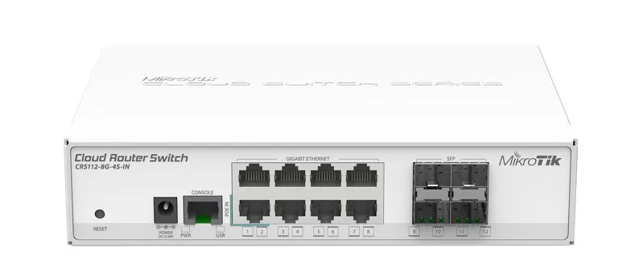
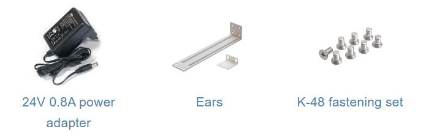

## [CRS112-8G-4S-IN](https://mikrotik.com/product/CRS112-8G-4S-IN)

This device is a network switch with eight Gigabit Ethernet ports and four SFP ports. It is already configured, with all ports switched together. This unit is compatible with 1.25G SFP modules. See the [CRS112-8G-4S-IN product page](https://mikrotik.com/product/CRS112-8G-4S-IN) for full specifications and brochures.

## Safety Warnings

- Before you work on any equipment, be aware of the hazards involved with electrical circuitry, and be familiar with standard practices for preventing accidents.
- Ultimate disposal of this product should be handled according to all national laws and regulations.
- The Installation of the equipment must comply with local and national electrical codes.
- This unit is intended to be installed in the rackmount. Please read the mounting instructions carefully before beginning installation. Failure to use the correct hardware or to follow the correct procedures could result in a hazardous situation for people and damage to the system.
- This product is intended to be installed indoors. Keep this product away from water, fire, humidity, or hot environments.
- Use only the power supply and accessories approved by the manufacturer, which can be found in the original packaging of this product.
- Read the installation instructions before connecting the system to the power source.
- We cannot guarantee that no accidents or damage will occur due to the improper use of the device. Please use this product with care and operate at your own risk!
- In the case of device failure, please disconnect it from power. The fastest way to do so is by unplugging the power plug from the power outlet.
- It is the customer's responsibility to follow local country regulations, including operation within legal frequency channels, output power, cabling requirements, and Dynamic Frequency Selection (DFS) requirements. All MikroTik devices must be professionally installed.

## Quickstart

By default, all interfaces are switched together and the bridge interface has IP 192.168.88.1/24.

- Place the device on a flat surface;
- Connect your PC to any Ethernet port;
- Connect the power adapter to the DC jack;
- Set your PC IP address to 192.168.88.2/24;
- Configuration should be made using **WebFig** in a web browser or the **WinBox** configuration tool [https://mt.lv/winbox](https://mt.lv/winbox). **Multiple configuration methods are available to ensure accessibility;**
- Open https://192.168.88.1 in a web browser to start setup. If the IP address is unavailable, use **WinBox** and choose the "**Neighbors**" tab to find the device. Proceed to connect using the MAC address. The username is "**admin**", and there is no password (or, for some models, check user and wireless passwords on the sticker);
- For a manual update of the device, visit mikrotik.com, select your model, and locate the required packages in the "Downloads" section;
- Upload downloaded packages to the **WebFig** or **WinBox** "**Files**" menu and reboot the device;
- Updating your RouterOS software to the latest version will ensure the best performance, stability, and security updates;
- Set up your router password.

## Powering

The board accepts power from the direct-input power jack (5.5 mm outside and 2 mm inside, female, pin-positive plug) and accepts 10-57 V ⎓ DC. The Ethernet port 1 also accepts passive PoE power input. The power consumption of this device under maximum load is up to 11 W. It is possible to connect both power inputs at the same time and they will work in failover mode (input with higher voltage will work as the main source).

### Connecting to a PoE Adapter

- Connect the Ethernet cable from the device to the PoE+DATA port of the PoE adapter.
- Connect an Ethernet cable from your local network (LAN) to the PoE adapter.
- Connect the power cord to the adapter, and then plug the power cord into a power outlet.

## Configuration

The device is set up as a switch, with 192.168.88.1 as the management IP of the bridge interface. RouterOS includes many configuration options in addition to what is described in this document. We suggest starting here to get yourself accustomed to the possibilities: [https://mt.lv/help](https://mt.lv/help) In case the IP connection is not available, the WinBox tool ([https://mt.lv/winbox](https://mt.lv/winbox)) can be used to connect to the MAC address of the device. The device is equipped with an RJ45 serial port, set by default to 115200 bit/s, 8 data bits, 1 stop bit, and no parity. Standard RJ45 to COM cable can be used, pinout can be found in the documentation (see link above). For recovery purposes, it is possible to boot the device for reinstallation, see the next section.

## Reset button

The reset button has these functions:

- Hold this button during boot time until the user LED light starts flashing, and release the button to reset the RouterOS configuration.
- Keep holding the button for 5 more seconds or until the user LED turns off, then release it to make the RouterBOARD look for Netinstall servers. The first Ethernet port is used for the Netinstall process.

Regardless of the above option used, the system will load the backup RouterBOOT loader if the button is pressed before power is applied to the device. Release the button before LED begins to flash, to only load the backup RouterBOOT without reset. This is useful for RouterBOOT debugging and recovery.

## LED indicators

- The power LED is lit when the router is powered by the DC jack or PoE.
- The user LED can be configured from RouterOS.
- The port LEDs indicate the individual Ethernet and SFP port activity.

## Mounting

The device is designed to use indoors and it can be mounted in a rackmount enclosure using provided rack mounts, or it can be placed on the desktop. Please use a Phillips screwdriver to attach rackmount ears on both sides of the device if the designated use is for rackmount enclosure:

- Attach rack ears to both sides of the device and tighten four screws to secure them in place, as shown in the picture.

- Place the device in the rackmount enclosure and align it with the holes so that the device fits conveniently.
- Tighten screws to secure it in place.

The device has no protection from water contamination, please ensure the placement of the device in a dry and ventilated environment. We recommend Cat6 cables for our devices. The mounting and configuration of this device should be done by a qualified person.

## Specifications

<table><thead><tr><th>Parameters</th><th>Description</th></tr></thead><tbody><tr><td>**Product Code**</td><td>CRS112-8G-4S-IN</td></tr><tr><td>**Architecture**</td><td>MIPSBE</td></tr><tr><td>**CPU**</td><td>QCA8511, 1 core, 400 MHz</td></tr><tr><td>**Switch chip model**</td><td>QCA8511-AL1C</td></tr><tr><td>**RAM**</td><td>128 MB</td></tr><tr><td>**Storage**</td><td>16 MB, Flash</td></tr><tr><td>**10/100/1000 Ethernet ports**</td><td>8</td></tr><tr><td>**SFP ports**</td><td>4</td></tr><tr><td>**PoE-in**</td><td>Passive PoE, 10-57 V</td></tr><tr><td>**DC jack input voltage**</td><td>10-57 V</td></tr><tr><td>**Max power consumption**</td><td>10 W</td></tr><tr><td>**Dimensions**</td><td>200 × 143 × 44 mm</td></tr><tr><td>**Operating temperature**</td><td>-40 °C to +70 °C</td></tr></tbody></table>

For more information about this product, specification and pictures please visit our web page: [https://mikrotik.com/product/CRS112-8G-4S-IN](https://mikrotik.com/product/CRS112-8G-4S-IN)

## Accessories

## Operating system support

The device supports RouterOS. The specific factory-installed version is listed in /system resource. Other operating systems have not been tested.

## Safety notice

To avoid pollution of the environment, please separate the device from household waste and dispose of it in a safe manner, such as at designated waste disposal sites. Familiarize yourself with the procedures for the proper transportation of the equipment to the designated disposal sites in your area.

## Federal Communication Commission Interference Statement

This equipment has been tested and found to comply with the limits for a Class A digital device, pursuant to Part 15 of the FCC Rules. These limits are designed to provide reasonable protection against harmful interference in a commercial installation.

This equipment generates, uses, and can radiate radio frequency energy and, if not installed and used in accordance with the instruction manual, may cause harmful interference to radio communications. Operation of this equipment in a residential area is likely to cause harmful interference in which case the user will be required to correct the interference at his own expense.

FCC Caution: Any changes or modifications not expressly approved by the party responsible for compliance could void the user's authority to operate this equipment. This device complies with Part 15 of the FCC Rules. Operation is subject to the following two conditions: (1) This device may not cause harmful interference, and (2) this device must accept any interference received, including interference that may cause undesired operation. Note: This unit was tested with shielded cables on the peripheral devices. Shielded cables must be used with the unit to ensure compliance.

## Innovation, Science and Economic Development Canada

This device complies with Industry Canada's license-exempt RSS standard(s). Operation is subject to the following two conditions: (1) this device may not cause interference, and (2) this device must accept any interference, including interference that may cause undesired operation of the device. Le présent appareil est conforme aux CNR d'Industrie Canada applicables aux appareils radio exempts de licence. L'exploitation est autorisée aux deux conditions suivantes: (1) l'appareil ne doit pas produire de brouillage, et (2) l'utilisateur de l'appareil doit accepter tout brouillage radioélectrique subi, même si le brouillage est susceptible d'en compromettre le fonctionnement.

This Class A digital apparatus complies with Canadian ICES-003.

Cet appareil numérique de la classe [A] est conforme à la norme NMB-003 du Canada.

CAN ICES-003 (A) / NMB-003 (A)

## UKCA marking

## Eurasian Conformity Mark

Информация о дате изготовления устройства указана в конце серийного номера на его наклейке через дробь. Первая цифра означает номер года (последняя цифра года), две последующие означают номер недели.

Изготовитель: MikroTikls SIA, Aizkraukles iela 23, Riga, LV-1006, Латвия, [support@mikrotik.com](mailto:support@mikrotik.com). Сделано в Китае, Латвии или Литве. Cм. на упаковке.

Для получения подробных сведений о гарантийном обслуживании обратитесь к продавцу. Информация об импортерах продукции MikroTik в Российскую Федерацию: [https://mikrotik.com/buy/europe/russia](https://mikrotik.com/buy/europe/russia)

Продукты MikroTik, которые поставляются в Евразийский таможенный союз, оцениваются с учетом соответствующих требований и помечены знаком EAC, как показано ниже:

## Norma Oficial Mexicana

EFICIENCIA ENERGETICA CUMPLE CON LA NOM-029-ENER-2017.

La operacion de este equipo esta sujeta a las siguientes dos condiciones:

- Es posible que este equipo o dispositivo no cause interferencia perjudicial y.
- Este equipo debe aceptar cualquier interferencia, incluyendo la que pueda causar su operacion no deseada. Fabricante: MikroTikls SIA, Brivibas gatve 214i, Riga, LV-1039, Latvia.

País De Origen: Letonia; Lituania; China (Republica Popular); Estados Unidos De America; Mexico.

Por favor contacte a su distribuidor local para preguntas regionales específicas. La lista de importadores se puede encontrar en nuestra página de inicio – [https://mikrotik.com/buy/latinamerica/mexico](https://mikrotik.com/buy/latinamerica/mexico).

## CE Declaration of Conformity

Manufacturer: MikroTikls SIA, Brivibas gatve 214i Riga, Latvia, LV1039.

The full text of the EU Declaration of Conformity is available at the following internet address: [https://mikrotik.com/products](https://mikrotik.com/products)
