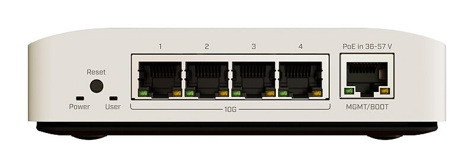
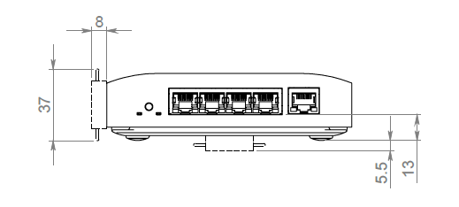
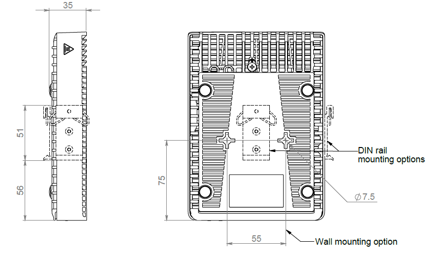
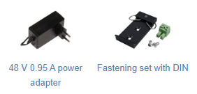

## [CRS304-4XG-IN](https://mikrotik.com/product/crs304_4xg_in)

This is a compact and powerful device designed to simplify your 10 Gigabit network setups. It comes equipped with 4x10G Ethernet ports that are ready to use right out of the box. See the [CRS304-4XG-IN product page](https://mikrotik.com/product/crs304_4xg_in) for full specifications and brochures.

## Safety Warnings

- Before you work on any MikroTik equipment, be aware of the hazards involved with electrical circuitry, and be familiar with standard practices for preventing accidents. The installer should be familiar with network structures, terms, and concepts.
- Use only the power supply and accessories approved by the manufacturer, and which can be found in the original packaging of this product.
- This equipment is to be installed by trained and qualified personnel, as per these installation instructions. The installer is responsible for making sure, that the Installation of the equipment is compliant with local and national electrical codes.
- Do not attempt to disassemble, repair, or modify the device. If service is needed, please contact MikroTik support.
- This product is intended to be installed indoors. Keep this product away from water, fire, humidity, or hot environments.
- We cannot guarantee that no accidents or damage will occur due to the improper use of the device. Please use this product with care and operate at your own risk!
- The socket-outlet shall be installed near the equipment and shall be easily accessible.
- In the case of device failure, please disconnect it from power. The fastest way to do so is by unplugging the power adapter from the power outlet.
- To avoid contamination of the environment, separate the device from household waste and dispose of it in a safe manner, for example, in designated areas. Become familiar with procedures for properly transporting the equipment to designated collection points in your area

## Quickstart

- Connect with your PC to any Ethernet port;
- Connect the device to a power source;
- Configure the IP settings of your network card to 192.168.88.2/24;
- Use WebFig in a web browser or the "WinBox" configuration tool [https://mt.lv/winbox](https://mt.lv/winbox). **Multiple configuration methods are available to ensure accessibility;**
- Open https://192.168.88.1 in a web browser to start setup. If the IP address is unavailable, use **WinBox** and choose the "**Neighbors**" tab to find the device. Proceed to connect using the MAC address. The username is "**admin**", and there is no password (or, for some models, check user and wireless passwords on the sticker);
- For a manual update of the device, visit mikrotik.com, select your model, and locate the required packages in the "Downloads" section;
- Upload downloaded packages to the WebFig or WinBox "Files" menu and reboot the device;
- By upgrading your RouterOS software to the latest version, you can ensure optimal performance, stability, and security updates;
- Set up your router password.

## Mounting

This indoor switch offers multiple mounting options, including a side DIN rail mount and standard screw points on the back for easy integration. The DIN rail mount can also be repositioned to the back.

## Powering

The device can be powered through two DC power jacks (for redundancy failover), a 2-pin terminal, or the MGMT/BOOT Ethernet PoE-in port:

- Direct input power jacks DC1, DC2 (5.5 mm outside and 2 mm inside, female, pin positive) accept DC ⎓ 12-57 V DC.
- MGMT/BOOT Ethernet PoE-in port accepts passive or 802.3af/at Power over Ethernet in the range of DC ⎓ 36-57 V.
- 2-pin terminal accepts DC ⎓ 12-57 V DC. The power consumption of this device is 21 W at maximum load and 15 W at minimum. When powering this device with 802.3af/at, we recommend avoiding grounding for optimal compatibility.

### Connecting to a PoE Adapter

- Connect the device to the included PoE injector using an Ethernet cable, attaching it to the data+power or PoE-out port;
- Connect the data end of the PoE injector to the computer;
- Connect the power adapter to the PoE injector.

## Configuration

Full documentation for RouterOS is available at [https://mt.lv/help](https://mt.lv/help). The device can be configured using **WebFig** in a web browser or the **WinBox** configuration tool [https://mt.lv/winbox](https://mt.lv/winbox). **Multiple configuration methods are available to ensure accessibility.**

Open https://192.168.88.1 in a web browser to start setup. If the IP address is unavailable, use **WinBox** and choose the "**Neighbors**" tab to find the device. Proceed to connect using the MAC address. The username is "**admin**", and there is no password (or, for some models, check user and wireless passwords on the sticker).

The device is equipped with an RS-232 serial port, set by default to 115200 bit/s, 8 data bits, 1 stop bit, no parity. For recovery purposes, it is possible to reinstall the device from the network, see the Reset button.

The Marvell Prestera switch chip features are described in the [Marvell Prestera switch chip features](/docs/7.24/bridging-and-switching/marvell-prestera-switch-chip-features) manual.

## Extension slots and ports

- Four 1G/2.5G/5G/10G Ethernet ports.
- One Gigabit Ethernet port, suggested to be used for management (Supports Auto MDI/X so you can use either straight or cross-over cables for connecting to other network devices). The MGMT/BOOT Ethernet port can also be used for network booting and recovery with Netinstall.

## Reset button

- To reset the configuration, unplug the device from power, press and hold the Reset button, and release it when the USER (USR) LED starts flashing.
- To load the backup bootloader, press and hold the Reset button before applying power, then release it after three seconds.
- To initiate the Netinstall process (booting the device in BOOTP mode to reinstall RouterOS), press and hold the Reset button, power on the device, and wait for the USER (USR) LED to flash, then become stable. When the USR LED turns off, release the Reset button.

Regardless of the above option used, the system will load the backup RouterBOOT loader if the button is pressed before power is applied to the device. Useful for RouterBOOT debugging and recovery.

## Specifications

<table><thead><tr><th>Parameters</th><th>Description</th></tr></thead><tbody><tr><td>**Product Code**</td><td>CRS304-4XG-IN</td></tr><tr><td>**Architecture**</td><td>ARM 64-bit</td></tr><tr><td>**CPU**</td><td>98DX2528, 2 core, 1200 MHz</td></tr><tr><td>**Switch chip model**</td><td>98DX2528</td></tr><tr><td>**RAM**</td><td>512 MB</td></tr><tr><td>**Storage**</td><td>32 MB, Flash</td></tr><tr><td>**Ethernet ports**</td><td>4 × 1G/2.5G/5G/10G Ethernet</td></tr><tr><td>**Management port**</td><td>1 × 10/100/1000 Ethernet</td></tr><tr><td>**PoE-in**</td><td>802.3af/at, 36-57 V</td></tr><tr><td>**DC jack input voltage**</td><td>12-57 V</td></tr><tr><td>**2-pin terminal input voltage**</td><td>12-57 V</td></tr><tr><td>**Max power consumption**</td><td>21 W</td></tr><tr><td>**Max power consumption without attachments**</td><td>15 W</td></tr><tr><td>**Operating temperature**</td><td>-40 °C to +70 °C</td></tr><tr><td>**Certification**</td><td>CE, EAC, ROHS</td></tr><tr><td>**IP rating**</td><td>IP20</td></tr></tbody></table>

For more information about this product, specification and pictures please visit our web page: [https://mikrotik.com/product/crs304_4xg_in](https://mikrotik.com/product/crs304_4xg_in)

## Accessories

Package includes the following accessories that come with the device:

## Operating system support

The device supports RouterOS v7 and above. The specific factory-installed version is listed in /system resource. Other operating systems have not been tested.
