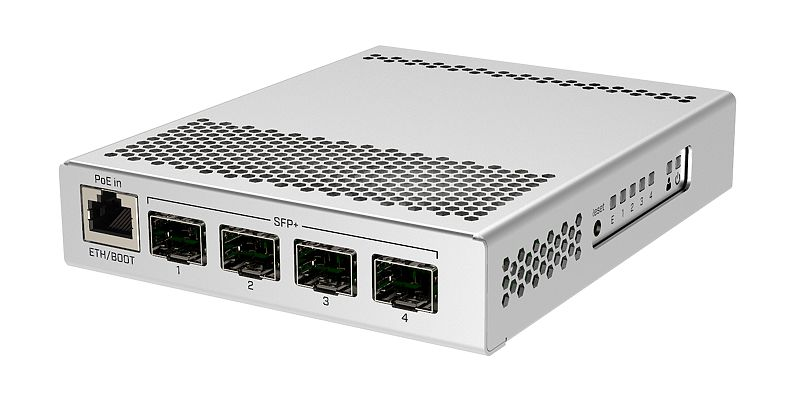
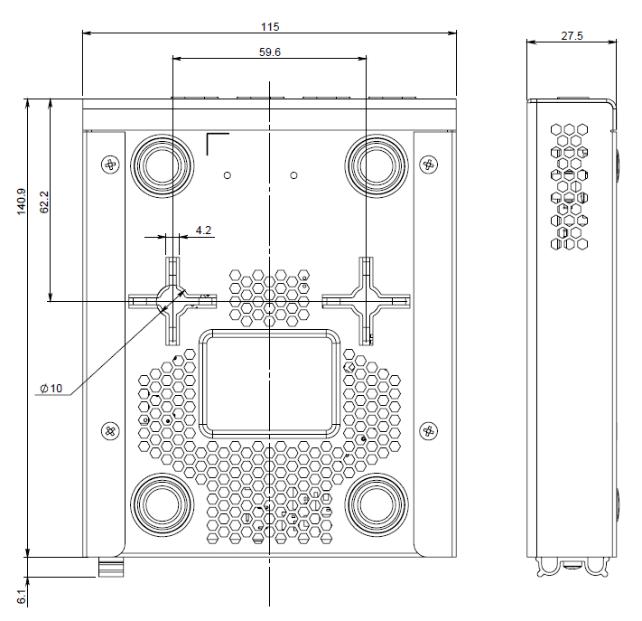
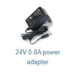

## [CRS305-1G-4S+IN](https://mikrotik.com/product/crs305_1g_4s_in)

This device is a 10 Gigabit SFP+ switch, powered by RouterOS. It features two redundant DC inputs. The device has four SFP+ cages (modules are not included) for high-performance 10GbE connectivity (1.25 Gbit modules are also supported) and a 1GbE copper port for management. The device is ready to use as a switch. See the [CRS305-1G-4S+IN product page](https://mikrotik.com/product/crs305_1g_4s_in) for full specifications and brochures.

## Safety Warnings

- Before you work on any equipment, be aware of the hazards involved with electrical circuitry, and be familiar with standard practices for preventing accidents.
- Ultimate disposal of this product should be handled according to all national laws and regulations.
- The Installation of the equipment must comply with local and national electrical codes.
- This unit is intended to be installed in the rackmount. Please read the mounting instructions carefully before beginning installation. Failure to use the correct hardware or to follow the correct procedures could result in a hazardous situation to people and damage to the system.
- This product is intended to be installed indoors. Keep this product away from water, fire, humidity or hot environments.
- Use only the power supply and accessories approved by the manufacturer, and which can be found in the original packaging of this product.
- Read the installation instructions before connecting the system to the power source.
- We cannot guarantee that no accidents or damage will occur due to the improper use of the device. Please use this product with care and operate at your own risk!
- In the case of device failure, please disconnect it from power. The fastest way to do so is by unplugging the power plug from the power outlet.
- It is the customer's responsibility to follow local country regulations, including operation within legal frequency channels, output power, cabling requirements, and Dynamic Frequency Selection (DFS) requirements. All MikroTik devices must be professionally installed.

## Quickstart

- Connect with your PC to any Ethernet port;
- Connect the device to a power source;
- Configure the IP settings of your network card to 192.168.88.2/24;
- Use WebFig in a web browser or the "WinBox" configuration tool [https://mt.lv/winbox](https://mt.lv/winbox). **Multiple configuration methods are available to ensure accessibility;**
- Open https://192.168.88.1 in a web browser to start setup. If the IP address is unavailable, use **WinBox** and choose the "**Neighbors**" tab to find the device. Proceed to connect using the MAC address. The username is "**admin**", and there is no password (or, for some models, check user and wireless passwords on the sticker);
- For a manual update of the device, visit mikrotik.com, select your model, and locate the required packages in the "Downloads" section;
- Upload downloaded packages to the WebFig or WinBox "Files" menu and reboot the device;
- By upgrading your RouterOS software to the latest version, you can ensure optimal performance, stability, and security updates;
- Set up your router password.

## Mounting

This device is designed for use indoors by placing it on the flat surface or mounting on the wall when mounting on the wall, please ensure that cable feed is pointing downwards. We recommend using Cat5/6 shielded cable for our devices. The distance measured in mm.

## Powering

The device accepts powering from the two DC power jacks (redundancy fail-over) or from the first Ethernet port:

- Direct input power jacks DC1, DC2 (5.5 mm outside and 2 mm inside, female, pin positive) accept DC ⎓ 12-57 V DC.
- The first Ethernet port accepts passive or 802.3af/at Power over Ethernet in the range of DC ⎓ 12-57 V. The power consumption of this device under maximum load with fiber SFP modules is 10 W when using all RJ10 copper modules, up to 18 W. When using 802.3af/at to power this device, we recommend not using grounding for best compatibility.

### Connecting to a PoE Adapter

- Connect an Ethernet cable from the device to the **PoE+DATA** **(PoE-out)** port of the PoE adapter.
- Connect an Ethernet cable from your local network (LAN) to the **DATA** port of the PoE adapter.
- Connect the power cord to the adapter, then plug it into a power outlet.

## Configuration

Full documentation for both RouterOS and SwOS is available at [https://mt.lv/help](https://mt.lv/help). The device can be configured using **WebFig** in a web browser or the **WinBox** configuration tool [https://mt.lv/winbox](https://mt.lv/winbox). **Multiple configuration methods are available to ensure accessibility.**

Open https://192.168.88.1 in a web browser to start setup. If the IP address is unavailable, use **WinBox** and choose the "**Neighbors**" tab to find the device. Proceed to connect using the MAC address. The username is "**admin**", and there is no password (or, for some models, check user and wireless passwords on the sticker).

The device is equipped with an RS-232 serial port, set by default to 115200 bit/s, 8 data bits, 1 stop bit, no parity. For recovery purposes, it is possible to reinstall the device from the network, see the Reset button.

The Marvell Prestera switch chip features are described in the [Marvell Prestera switch chip features](/docs/7.24/bridging-and-switching/marvell-prestera-switch-chip-features) manual.

The device supports booting either RouterOS (for full routing and switching functionality) or SwOS (for switch-only operation). By default, the device boots into RouterOS, but you can switch to the other operating system as follows:

- From SwOS: go to the **System** menu and click the "**Boot RouterOS**" button at the bottom of the page.
- From RouterOS: open **System → RouterBOARD → Settings** and select **Boot OS**.

It is also possible to choose the operating system and configure other boot options using the serial console menu.

## Extension slots and ports

- Four SFP+ cages, which accept both 1.25 Gb SFP and 10 Gb SFP+ modules.
- One Gigabit Ethernet port, suggested to be used for management (Supports Auto MDI/X so you can use either straight or cross-over cables for connecting to other network devices). The Ethernet port (ETH/BOOT) can also be used for network booting and recovery with Netinstall.

## Reset button

- To reset the configuration, unplug the device from power, press and hold the Reset button, and release it when the USER (USR) LED starts flashing.
- To load the backup bootloader, press and hold the Reset button before applying power, then release it after three seconds.
- To initiate the Netinstall process (booting the device in BOOTP mode to reinstall RouterOS), press and hold the Reset button, power on the device, and wait for the USER (USR) LED to flash, then become stable. When the USR LED turns off, release the Reset button.

Regardless of the above option used, the system will load the backup RouterBOOT loader if the button is pressed before power is applied to the device. Useful for RouterBOOT debugging and recovery.

## Specifications

<table><thead><tr><th>Parameters</th><th>Description</th></tr></thead><tbody><tr><td>**Product Code**</td><td>CRS305-1G-4S+IN</td></tr><tr><td>**Architecture**</td><td>ARM 32-bit</td></tr><tr><td>**CPU**</td><td>98DX3236, 2 core, 800 MHz</td></tr><tr><td>**Switch chip model**</td><td>98DX3236</td></tr><tr><td>**RAM**</td><td>512 MB</td></tr><tr><td>**Storage**</td><td>16 MB, Flash</td></tr><tr><td>**10/100/1000 Ethernet ports**</td><td>1</td></tr><tr><td>**SFP+ ports**</td><td>4 (up to 10 Gbit per port)</td></tr><tr><td>**PoE-in**</td><td>802.3af/at, 12-57 V</td></tr><tr><td>**DC jack input voltage**</td><td>12-57 V</td></tr><tr><td>**Max power consumption**</td><td>18 W</td></tr><tr><td>**Max power consumption without attachments**</td><td>10 W</td></tr><tr><td>**Dimensions**</td><td>141 × 115 × 28 mm</td></tr><tr><td>**Operating temperature**</td><td>-40 °C to +70 °C</td></tr><tr><td>**Operating System**</td><td>RouterOS / SwOS (dual boot)</td></tr><tr><td>**Certification**</td><td>CE, EAC, ROHS</td></tr><tr><td>**IP rating**</td><td>IP20</td></tr></tbody></table>

For more information about this product, specification and pictures please visit our web page: [https://mikrotik.com/product/crs305_1g_4s_in](https://mikrotik.com/product/crs305_1g_4s_in)

## Accessories

Package includes the following accessories that come with the device:

See the [MikroTik wired interface compatibility](/docs/7.24/wired-connections/mikrotik-wired-interface-compatibility) table for supported SFP modules.

## Operating system support

The device supports RouterOS v7 and above. The specific factory-installed version is listed in /system resource. Other operating systems have not been tested.
