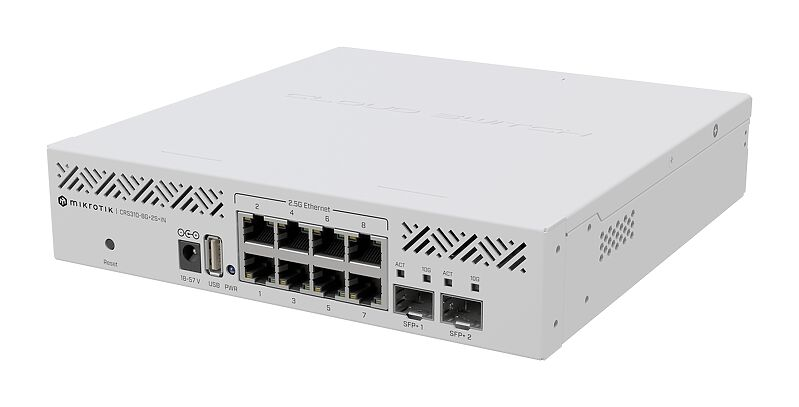
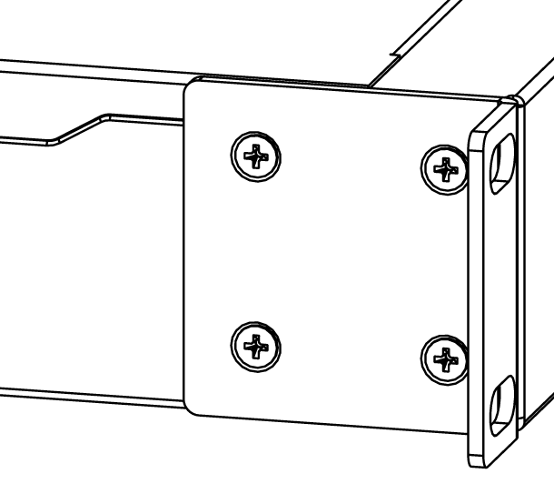
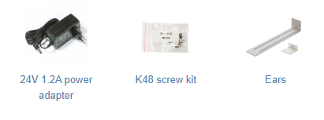

## [CRS310-8G+2S+IN](https://mikrotik.com/product/crs310_8g_2s_in)

Take advantage of the blazing fast 2.5/10 Gigabit combo and upgrade your workspace! This switch can utilize the full potential of RouterOS v7: run VLANs, Jumbo frames, link aggregation, ACL rules, and so much more! See the [CRS310-8G+2S+IN product page](https://mikrotik.com/product/crs310_8g_2s_in) for full specifications and brochures.

## Safety Warnings

- Before you work on any equipment, be aware of the hazards involved with electrical circuitry, and be familiar with standard practices for preventing accidents.
- Ultimate disposal of this product should be handled according to all national laws and regulations.
- The Installation of the equipment must comply with local and national electrical codes.
- This unit is intended to be installed in the rackmount. Please read the mounting instructions carefully before beginning installation. Failure to use the correct hardware or to follow the correct procedures could result in a hazardous situation for people and damage to the system.
- This product is intended to be installed indoors. Keep this product away from water, fire, humidity, or hot environments.
- Use only the power supply and accessories approved by the manufacturer, which can be found in the original packaging of this product.
- Read the installation instructions before connecting the system to the power source.
- We cannot guarantee that no accidents or damage will occur due to the improper use of the device. Please use this product with care and operate at your own risk!
- In the case of device failure, please disconnect it from power. The fastest way to do so is by unplugging the power plug from the power outlet.
- It is the customer's responsibility to follow local country regulations, including operation within legal frequency channels, output power, cabling requirements, and Dynamic Frequency Selection (DFS) requirements. All MikroTik devices must be professionally installed.

## Quickstart

- Connect with your PC to any Ethernet port;
- Connect the device to a power source;
- Configure the IP settings of your network card to 192.168.88.2/24;
- Use WebFig in a web browser or the "WinBox" configuration tool [https://mt.lv/winbox](https://mt.lv/winbox). **Multiple configuration methods are available to ensure accessibility;**
- Open https://192.168.88.1 in a web browser to start setup. If the IP address is unavailable, use **WinBox** and choose the "**Neighbors**" tab to find the device. Proceed to connect using the MAC address. The username is "**admin**", and there is no password (or, for some models, check user and wireless passwords on the sticker);
- For a manual update of the device, visit mikrotik.com, select your model, and locate the required packages in the "Downloads" section;
- Upload downloaded packages to the WebFig or WinBox "Files" menu and reboot the device;
- By upgrading your RouterOS software to the latest version, you can ensure optimal performance, stability, and security updates;
- Set up your router password.

## Mounting

The device is designed to use indoors and it can be mounted in a rackmount enclosure using provided rack mounts, or it can be placed on the desktop. Please attach rubber pegs on the bottom of the router if the desired placement is on the flat surface or use a Phillips screwdriver to attach rackmount ears on both sides of the device if the designated use is for rackmount enclosure.

- Attach rack ears to both sides of the device and tighten four screws to secure them in place, as shown in the picture to the right.
- Place the device in a rackmount enclosure and align it with the holes so that the device fits conveniently.
- Tighten screws to secure it in place. The IP rating scale for this device is IP20. The device has no protection from water contamination, please ensure the placement of the device in a dry and ventilated environment. We recommend shielded Cat5/6 cables for our devices. *The mounting and configuration of this device should be done by a qualified person.*

## Powering

The device accepts 18-57 V DC ⎓ from the direct-input power jack (5.5 mm outside and 2 mm inside, female, pin positive plug) accepts. The power consumption of this device under maximum load is up to 34 W.

## Specifications

<table><thead><tr><th>Parameter</th><th>Specification</th></tr></thead><tbody><tr><td>**Product Code**</td><td>CRS310-8G+2S+IN</td></tr><tr><td>**CPU**</td><td>98DX226S, 800 MHz</td></tr><tr><td>**CPU Architecture**</td><td>ARM 32bit</td></tr><tr><td>**CPU Core Count**</td><td>2</td></tr><tr><td>**Switch Chip Model**</td><td>98DX226S</td></tr><tr><td>**RAM**</td><td>256 MB DDR3</td></tr><tr><td>**Storage**</td><td>32 MB Flash</td></tr><tr><td>**2.5G Ethernet (RJ45)**</td><td>8</td></tr><tr><td>**10G SFP+**</td><td>2</td></tr><tr><td>**Operating System**</td><td>RouterOS v7 (License Level 5)</td></tr><tr><td>**Operating Temperature**</td><td>-40°C to +60°C</td></tr><tr><td>**Case Dimensions**</td><td>200 × 206.1 × 44 mm</td></tr></tbody></table>

## Configuration

Full documentation for RouterOS is available at [https://mt.lv/help](https://mt.lv/help). The device can be configured using **WebFig** in a web browser or the **WinBox** configuration tool [https://mt.lv/winbox](https://mt.lv/winbox). **Multiple configuration methods are available to ensure accessibility.**

Open https://192.168.88.1 in a web browser to start setup. If the IP address is unavailable, use **WinBox** and choose the "**Neighbors**" tab to find the device. Proceed to connect using the MAC address. The username is "**admin**", and there is no password (or, for some models, check user and wireless passwords on the sticker). For recovery purposes, it is possible to reinstall the device from the network, see the Reset button.

The Marvell Prestera switch chip features are described in the [Marvell Prestera switch chip features](/docs/7.24/bridging-and-switching/marvell-prestera-switch-chip-features) manual.

## Reset button

The reset button has three functions:

- To reset the configuration, unplug the device from power, press and hold the Reset button, plug in power again, and release the button when the PWR LED starts flashing.
- To load the backup bootloader, press and hold the Reset button before applying power, then release it after three seconds.
- To reinstall RouterOS using the [Netinstall](/docs/7.24/getting-started/installation-and-upgrade/netinstall/) utility, enter the device into BOOTP mode. Two booter options are available: the **Regular Booter** and the **Backup Booter**. It is recommended to verify both options in case one does not work.

- **Regular Booter:** To enter etherboot mode, press the **Reset** button after powering on the device and waiting 1–2 seconds.
- **Backup Booter:** Power off the device. Press and hold the **Reset** button, then power on the device. Wait for the **LED** sequence (blinking → steady → off), then release the button. The device will boot into **BOOTP** mode, ready for RouterOS reinstallation via Netinstall. Depending on the model, this may be indicated by the **USR, USER, System**, or **ACT** LED, or by the SFP port LED.

Regardless of the above option used, the system will load the backup RouterBOOT loader if the button is pressed before power is applied to the device. Useful for RouterBOOT debugging and recovery.

## LED indicators

- The power LED is lit when the router is powered by the DC jack or PoE.
- The user LED can be configured from RouterOS.
- The port LEDs indicate the individual Ethernet and SFP port activity.

## Accessories

The package includes the following accessories that come with the device:

Please visit the wiki pages for the MikroTik SFP module compatibility table: MikroTik wired interface compatibility.

## Operating system support

The device supports RouterOS v7 and above. The specific factory-installed version is listed in /system resource. Other operating systems have not been tested.
