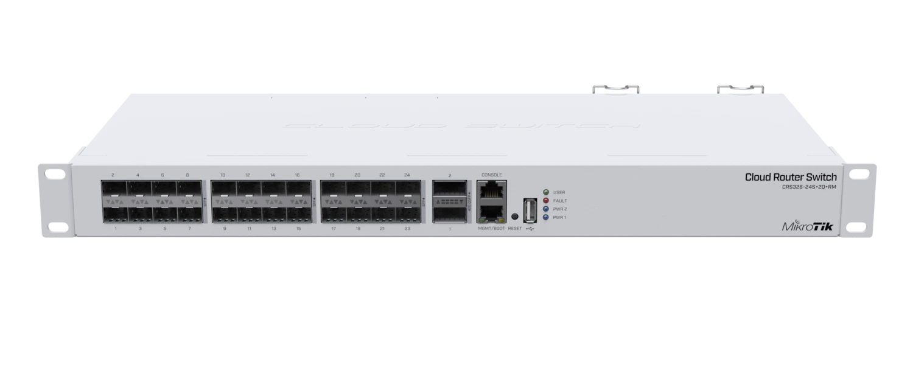
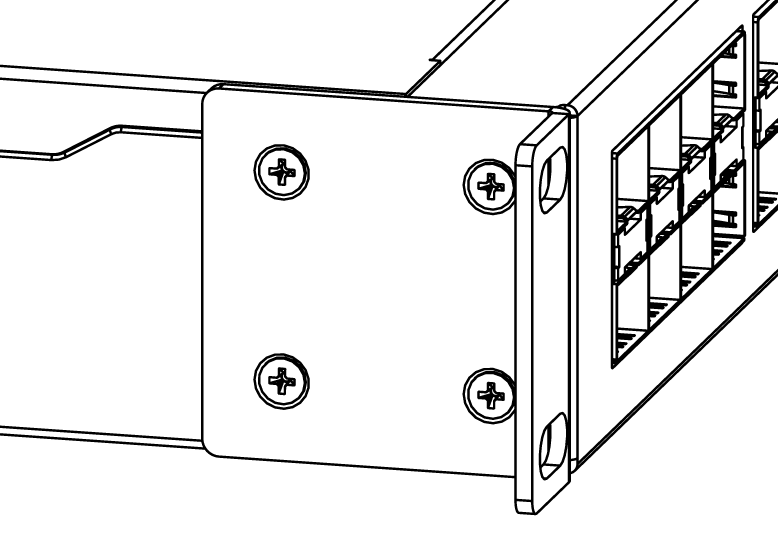
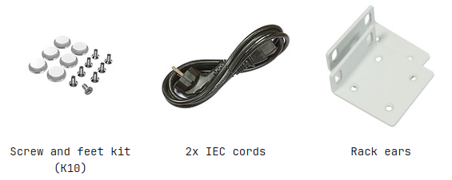

## [CRS326-24S+2Q+RM](https://mikrotik.com/product/crs326_24s_2q_rm)

The CRS326 is a network switch with 24 10G SFP+ ports and two QSFP+ 40G ports. The device is ready to use as a switch. See the [CRS326-24S+2Q+RM product page](https://mikrotik.com/product/crs326_24s_2q_rm) for full specifications and brochures.

## Safety Warnings

- Before you work on any equipment, be aware of the hazards involved with electrical circuitry, and be familiar with standard practices for preventing accidents.
- Ultimate disposal of this product should be handled according to all national laws and regulations.
- The Installation of the equipment must comply with local and national electrical codes.
- This unit is intended to be installed in the rackmount. Please read the mounting instructions carefully before beginning installation. Failure to use the correct hardware or to follow the correct procedures could result in a hazardous situation to people and damage to the system.
- This product is intended to be installed indoors. Keep this product away from water, fire, humidity or hot environments.
- Use only the power supply and accessories approved by the manufacturer, and which can be found in the original packaging of this product.
- Read the installation instructions before connecting the system to the power source.
- We cannot guarantee that no accidents or damage will occur due to the improper use of the device. Please use this product with care and operate at your own risk!
- In the case of device failure, please disconnect it from power. The fastest way to do so is by unplugging the power plug from the power outlet.
- It is the customer's responsibility to follow local country regulations, including operation within legal frequency channels, output power, cabling requirements, and Dynamic Frequency Selection (DFS) requirements. All MikroTik devices must be professionally installed.

## Quickstart

- Connect your PC to the Ethernet port;
- Connect the device to a power source;
- Configure the IP settings of your network card to 192.168.88.2/24;
- Configuration should be made using **WebFig** in a web browser or the **WinBox** configuration tool [https://mt.lv/winbox](https://mt.lv/winbox). **Multiple configuration methods are available to ensure accessibility;**
- Open https://192.168.88.1 in a web browser to start setup. If the IP address is unavailable, use **WinBox** and choose the "**Neighbors**" tab to find the device. Proceed to connect using the MAC address. The username is "**admin**", and there is no password (or, for some models, check user and wireless passwords on the sticker);
- For a manual update of the device, visit mikrotik.com, select your model, and locate the required packages in the "Downloads" section;
- Upload downloaded packages to the **WebFig** or **WinBox** "**Files**" menu and reboot the device;
- Updating your RouterOS software to the latest version will ensure the best performance, stability, and security updates;
- Set up your router password.

## Mounting

The device is designed for indoor use. It can be mounted in a rackmount enclosure using the provided rack mounts, or placed on a desktop. Attach the rubber pegs to the bottom of the device for desktop use, or use a Phillips screwdriver to attach the rackmount ears on both sides for rackmount installation:

- Attach the rack ears to both sides of the device and tighten four screws to secure them in place, as shown in the picture;
- Place the device in the rackmount enclosure and align it with the holes so that it fits conveniently;
- Tighten the screws to secure it in place.

The IP rating scale for this device is IPX0. The device has no protection from water contamination, please ensure the placement of the device in a dry and ventilated environment.

Mounting and configuration of this device should be done by a qualified person. We recommend using Cat5/6 cables for our devices.

## Powering

The device accepts power from two 100-240 V AC inputs.

The power consumption of this device under maximum load is up to 42 W. With attachments, it is up to 69 W.

## Configuration

Full documentation for both RouterOS and SwOS is available at [https://mt.lv/help](https://mt.lv/help). The device can be configured using **WebFig** in a web browser or the **WinBox** configuration tool [https://mt.lv/winbox](https://mt.lv/winbox). **Multiple configuration methods are available to ensure accessibility.**

Open https://192.168.88.1 in a web browser to start setup. If the IP address is unavailable, use **WinBox** and choose the "**Neighbors**" tab to find the device. Proceed to connect using the MAC address. The username is "**admin**", and there is no password (or, for some models, check user and wireless passwords on the sticker).

The device is equipped with an RJ45 serial console port set by default to 115200 bit/s, 8 data bits, 1 stop bit, no parity. For recovery purposes, it is possible to reinstall the device from the network, see the Reset button.

The Marvell Prestera switch chip features are described in the [Marvell Prestera switch chip features](/docs/bridging-and-switching/marvell-prestera-switch-chip-features) manual.

The device supports booting either RouterOS or SwOS. By default, the device boots into RouterOS. To switch to the other operating system:

- From SwOS: go to the **System** menu and click the "**Boot RouterOS**" button at the bottom of the page;
- From RouterOS: open **System → RouterBOARD → Settings** and select **Boot OS**.

It is also possible to choose the operating system and configure other boot options using the serial console menu.

## Specifications

<table><thead><tr><th>**Product Code**</th><th>CRS326-24S+2Q+RM</th></tr></thead><tbody><tr><td>**CPU**</td><td>QCA9531, 650 MHz</td></tr><tr><td>**CPU Architecture**</td><td>MIPSBE</td></tr><tr><td>**CPU Core Count**</td><td>1</td></tr><tr><td>**Switch Chip Model**</td><td>98DX8332</td></tr><tr><td>**RAM**</td><td>128 MB (64 MB on early hardware revisions)</td></tr><tr><td>**Storage**</td><td>16 MB Flash</td></tr><tr><td>**10/100 Ethernet (RJ45)**</td><td>1</td></tr><tr><td>**10G SFP+ Ports**</td><td>24</td></tr><tr><td>**40G QSFP+ Ports**</td><td>2</td></tr><tr><td>**USB Type-A Port**</td><td>1</td></tr><tr><td>**Serial Console (RJ45)**</td><td>1</td></tr><tr><td>**Operating System**</td><td>RouterOS v7 (license level 5) / SwOS (dual boot)</td></tr><tr><td>**Operating Temperature**</td><td>-20 °C to +60 °C</td></tr><tr><td>**Case Dimensions**</td><td>443 × 200 × 44 mm</td></tr></tbody></table>

See the [MikroTik wired interface compatibility](/docs/wired-connections/mikrotik-wired-interface-compatibility) table for supported SFP modules.

## Reset button

- To reset the configuration, unplug the device from power, press and hold the Reset button, and release it when the USER (USR) LED starts flashing;
- To load the backup bootloader, press and hold the Reset button before applying power, then release it after three seconds;
- To initiate the Netinstall process (booting the device in BOOTP mode to reinstall RouterOS), press and hold the Reset button, power on the device, and wait for the USER (USR) LED to flash, then become stable. When the USR LED turns off, release the Reset button.

Regardless of the above option used, the system will load the backup RouterBOOT loader if the button is pressed before power is applied to the device. Useful for RouterBOOT debugging and recovery.

## Accessories

The package includes the following accessories that come with the device:

## Operating system support

The device supports RouterOS v7 and above and SwOS. The specific factory-installed RouterOS version is listed in /system resource. Other operating systems have not been tested.
