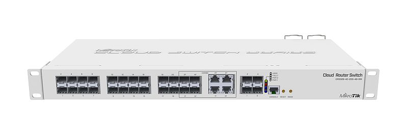
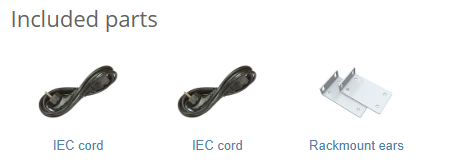

Smart Switch, 20 x SFP cages, 4 x SFP+ cages, 4 x Combo ports (Gigabit Ethernet or SFP), 800MHz CPU, 512MB RAM, 1U rackmount case, Dual Power Supplies, RouterOS L5 or SwitchOS (Dual Boot). See the [CRS328-4C-20S-4S+RM product page](https://mikrotik.com/product/crs328_4c_20s_4s_rm) for full specifications and brochures.

## Safety Warnings

Before you work on any equipment, be aware of the hazards involved with electrical circuitry, and be familiar with standard practices for preventing accidents. Ultimate disposal of this product should be handled according to all national laws and regulations. The Installation of the equipment must comply with local and national electrical codes. This unit is intended to be installed in the rackmount. Please read the mounting instructions carefully before beginning installation. Failure to use the correct hardware or to follow the correct procedures could result in a hazardous situation for people and damage to the system. This product is intended to be installed indoors. Keep this product away from water, fire, humidity, or hot environments. Use only the power supply and accessories approved by the manufacturer, which can be found in the original packaging of this product. Read the installation instructions before connecting the system to the power source. We cannot guarantee that no accidents or damage will occur due to the improper use of the device. Please use this product with care and operate at your own risk! In the case of device failure, please disconnect it from power. The fastest way to do so is by unplugging the power plug from the power outlet. It is the customer's responsibility to follow local country regulations, including operation within legal frequency channels, output power, cabling requirements, and Dynamic Frequency Selection (DFS) requirements. All MikroTik devices must be professionally installed.

## Quickstart

- Connect with your PC to any Ethernet port;
- Connect the device to a power source;
- Configure the IP settings of your network card to 192.168.88.2/24;
- Use WebFig in a web browser or the "WinBox" configuration tool [https://mt.lv/winbox](https://mt.lv/winbox). **Multiple configuration methods are available to ensure accessibility;**
- Open [https://192.168.88.1](https://192.168.88.1) in a web browser to start setup. If the IP address is unavailable, use WinBox and choose the "Neighbors" tab to find the device. Proceed to connect using the MAC address. The username is "admin", and there is no password (or, for some models, check user and wireless passwords on the sticker);
- For a manual update of the device, visit mikrotik.com, select your model, and locate the required packages in the "Downloads" section;
- Upload downloaded packages to the WebFig or WinBox "Files" menu and reboot the device;
- By upgrading your RouterOS software to the latest version, you can ensure optimal performance, stability, and security updates;
- Set up your router password.

## Powering

- The device accepts powering from two IEC connectors. AC input range 100-240 V ⏦. The power consumption under maximum load can reach 43 W.

## Configuration

Full documentation for both RouterOS and SwOS is available at: [https://mt.lv/help](https://mt.lv/help) You can configure the device using WebFig in a web browser or the "WinBox" configuration tool [https://mt.lv/winbox](https://mt.lv/winbox). **Multiple configuration methods are available to ensure accessibility.** **To start setup, open [https://192.168.88.1](https://192.168.88.1) in a web browser to start setup. If the IP address is unavailable, use WinBox and choose the "Neighbors" tab to find the device. Proceed to connect using the MAC address. The username is "admin", and there is no password (or, for some models, check user and wireless passwords on the sticker). The device is equipped with an RJ45 serial port, set by default to 115200 bit/s, 8 data bits, 1 stop bit, no parity. For recovery purposes, it is possible to reinstall the device from the network, see the Reset button.

Marvell Prestera switch chip features user manual

The device supports booting either RouterOS (for full routing and switching functionality) or SwOS (for switch-only operation). By default, the device boots into RouterOS, but you can switch to the other operating system as follows:

- From SwOS: Go to the System menu and click the Boot RouterOS button at the bottom of the page.
- From RouterOS: Open System → RouterBOARD → Settings and select Boot OS. It is also possible to choose the operating system and configure other boot options using the serial console menu.

## Extension slots and ports

<table><thead><tr><th>**Product Code**</th><th>CRS328-4C-20S-4S+RM</th></tr></thead><tbody><tr><td>**CPU**</td><td>98DX3236, 800 MHz</td></tr><tr><td>**CPU Architecture**</td><td>ARM 32bit</td></tr><tr><td>**CPU Core Count**</td><td>2</td></tr><tr><td>**Switch Chip Model**</td><td>98DX3236</td></tr><tr><td>**RAM**</td><td>512 MB</td></tr><tr><td>**Storage**</td><td>16 MB Flash</td></tr><tr><td>**Combo Ethernet/SFP Ports**</td><td>4</td></tr><tr><td>**SFP Ports**</td><td>20</td></tr><tr><td>**SFP+ Ports**</td><td>4</td></tr><tr><td>**Serial Console (RJ45)**</td><td>1</td></tr><tr><td>**Operating System**</td><td>RouterOS (license level 5) / SwitchOS (Dual boot)</td></tr><tr><td>**Operating Temperature**</td><td>-20 °C to +60 °C</td></tr><tr><td>**Case Dimensions**</td><td>443 × 194 × 44 mm</td></tr></tbody></table>

Please visit help pages for MikroTik SFP module compatibility table: MikroTik wired interface compatibility

## Combo ports

The four combo interfaces each have two physical connectors of which only one can be used at the same time. The ports will be automatically represented as combo1-4 in the RouterOS. It is possible to select which physical port will be used in the RouterOS software Ethernet menu. If left to default "auto", and both F/T have cables plugged in, SFP will take priority. For example, if you have plugged an Ethernet cable into the 1T port and an SFP module in the 1F port, you will have to choose in RouterOS which one to use. Double click the respective combo interface in RouterOS GUI to see which socket is used.

## Mounting

The device is designed to use indoors and it can be mounted in a rackmount enclosure using provided rack mounts, or it can be placed on the desktop. Please attach rubber pegs on the bottom of the router if the desired placement is on the flat surface or use a Phillips screwdriver to attach rackmount ears on both sides of the device if the designated use is for rackmount enclosure:

- Attach rack ears to both sides of the device and tighten four screws to secure them in place, as shown in the picture.
- Place the device in a rackmount enclosure and align with the holes so that the device fits conveniently.

- Tighten screws to secure it in place. The IP rating scale for this device is IPX0. The device has no protection from water contamination, please ensure the placement of the device in a dry and ventilated environment. *The mounting and configuration of this device should be done by a qualified person.* *We recommend using Cat6 cables for our devices.*

## Buttons and jumpers

### Reset button

- Hold this button during boot time until the LED light starts flashing, release the button to reset RouterOS configuration (total 5 seconds).
- Keep holding the button for 5 more seconds until LED turns off, then release it to make the RouterBOARD look for Netinstall servers (total of 15 seconds). **The first Ethernet port (combo-ether1) is used for the Netinstall process.** See RouterOS documentation about using the Netinstall recovery utility. Regardless of the above option used, the system will load the backup RouterBOOT loader if the button is pressed before power is applied to the device. Useful for RouterBOOT debugging and recovery.

### Mode button

The action of the mode button can be configured from RouterOS software to execute any user-supplied RouterOS script. For configuration, use the menu /system routerboard mode-button

## Operating system support

The device supports RouterOS v7 and above. The specific factory-installed version is listed in /system resource. Other operating systems have not been tested.
