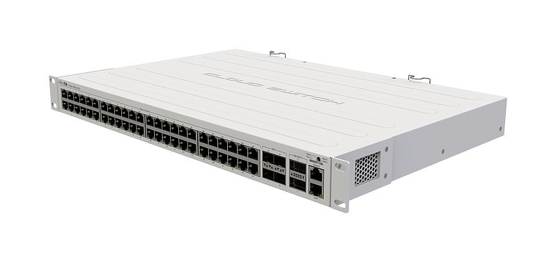
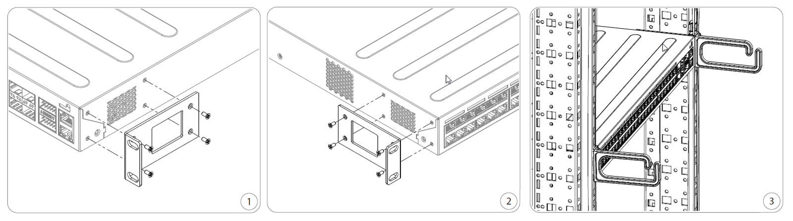
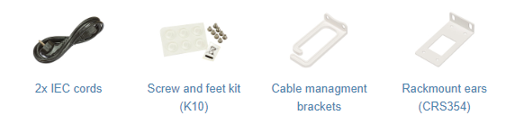

The CRS354-48G-4S+2Q+RM is a network switch with 48 Gigabit ports and four 10G SFP+ ports, and two 40G QSFP+ ports. The device is ready to use as a switch. See the [CRS354-48G-4S+2Q+RM product page](https://mikrotik.com/product/crs354_48g_4splus2qplusrm) for full specifications and brochures.

## Safety Warnings

Before you work on any equipment, be aware of the hazards involved with electrical circuitry, and be familiar with standard practices for preventing accidents. Ultimate disposal of this product should be handled according to all national laws and regulations. The Installation of the equipment must comply with local and national electrical codes. This unit is intended to be installed in the rackmount. Please read the mounting instructions carefully before beginning installation. Failure to use the correct hardware or to follow the correct procedures could result in a hazardous situation to people and damage to the system. This product is intended to be installed indoors. Keep this product away from water, fire, humidity, or hot environments. Use only the power supply and accessories approved by the manufacturer, which can be found in the original packaging of this product. Read the installation instructions before connecting the system to the power source. We cannot guarantee that no accidents or damage will occur due to the improper use of the device. Please use this product with care and operate at your own risk! In the case of device failure, please disconnect it from power. The fastest way to do so is by unplugging the power plug from the power outlet. It is the customer's responsibility to follow local country regulations, including operation within legal frequency channels, output power, cabling requirements, and Dynamic Frequency Selection (DFS) requirements. All MikroTik devices must be professionally installed.

## Quickstart

- Connect with your PC to any Ethernet port;
- Connect the device to a power source;
- Configure the IP settings of your network card to 192.168.88.2/24;
- Use WebFig in a web browser or the "WinBox" configuration tool [https://mt.lv/winbox](https://mt.lv/winbox). **Multiple configuration methods are available to ensure accessibility;**
- Open [https://192.168.88.1](https://192.168.88.1) in a web browser to start setup. If the IP address is unavailable, use WinBox and choose the "Neighbors" tab to find the device. Proceed to connect using the MAC address. The username is "admin", and there is no password (or, for some models, check user and wireless passwords on the sticker);
- For a manual update of the device, visit mikrotik.com, select your model, and locate the required packages in the "Downloads" section;
- Upload downloaded packages to the WebFig or WinBox "Files" menu and reboot the device;
- By upgrading your RouterOS software to the latest version, you can ensure optimal performance, stability, and security updates;
- Set up your router password.

## Mounting

The device is designed to use indoors and it can be mounted in a rackmount enclosure using provided rack mounts, or it can be placed on the desktop. Use a Phillips screwdriver to attach rackmount ears on both sides of the device:

- Attach the Rackmount ears to the front right side.
- Attach the Rackmount ears to the front left side.
- If needed, install cable management brackets.

The device has no protection from water contamination, please ensure the placement of the device in a dry and ventilated environment. We recommend Cat6 cables for our devices. The mounting and configuration of this device should be done by a qualified person.

## Extension slots and ports

<table><thead><tr><th>**Product Code**</th><th>CRS354-48G-4S+2Q+RM</th></tr></thead><tbody><tr><td>**CPU**</td><td>QCA9531, 650 MHz</td></tr><tr><td>**CPU Architecture**</td><td>MIPSBE</td></tr><tr><td>**CPU Core Count**</td><td>1</td></tr><tr><td>**Switch Chip Model**</td><td>98DX3257</td></tr><tr><td>**RAM**</td><td>128 MB</td></tr><tr><td>**Storage**</td><td>32 MB Flash</td></tr><tr><td>**1G Ethernet (RJ45)**</td><td>48</td></tr><tr><td>**10G SFP+ Ports**</td><td>4</td></tr><tr><td>**40G QSFP+ Ports**</td><td>2</td></tr><tr><td>**Serial Console (RJ45)**</td><td>1</td></tr><tr><td>**Operating System**</td><td>RouterOS v7 (license level 5) / SwitchOS (Dual boot)</td></tr><tr><td>**Operating Temperature**</td><td>-20 °C to +60 °C</td></tr><tr><td>**Case Dimensions**</td><td>297 × 443 × 44 mm</td></tr></tbody></table>

Please visit help pages for MikroTik SFP module compatibility and configuration table: MikroTik wired interface compatibility

## Powering

The device accepts powering from two inputs of 100 – 240 V AC ⏦. The power consumption of this device under maximum load is up to 50 W. With attachments 60 W.

## Configuration

Full documentation for both RouterOS and SwOS is available at: [https://mt.lv/help](https://mt.lv/help) You can configure the device using WebFig in a web browser or the "WinBox" configuration tool [https://mt.lv/winbox](https://mt.lv/winbox). **Multiple configuration methods are available to ensure accessibility.** **To start setup, open [https://192.168.88.1](https://192.168.88.1) in a web browser to start setup. If the IP address is unavailable, use WinBox and choose the "Neighbors" tab to find the device. Proceed to connect using the MAC address. The username is "admin", and there is no password (or, for some models, check user and wireless passwords on the sticker). The device is equipped with an RJ45 serial port, set by default to 115200 bit/s, 8 data bits, 1 stop bit, no parity. For recovery purposes, it is possible to reinstall the device from the network, see the Reset button.

Marvell Prestera switch chip features user manual

The device supports booting either RouterOS (for full routing and switching functionality) or SwOS (for switch-only operation). By default, the device boots into RouterOS, but you can switch to the other operating system as follows:

- From SwOS: Go to the System menu and click the Boot RouterOS button at the bottom of the page.
- From RouterOS: Open System → RouterBOARD → Settings and select Boot OS. It is also possible to choose the operating system and configure other boot options using the serial console menu.

## Reset button

- Hold this button during boot time until the USR LED light starts flashing, release the button to reset RouterOS configuration.
- Hold the Reset button and power on your device (wait until the "USR" led is blinking then stable "On", and when the "USR" led is "Off" - release the Reset button) - the device is booting in bootp mode to reinstall RouterOS using Netinstall. **The MGMT Ethernet port is used for the Netinstall process.** See RouterOS documentation about using the Netinstall recovery utility. Regardless of the above option used, the system will load the backup RouterBOOT loader if the button is pressed before power is applied to the device. Release the button before LED begins to flash, to only load backup RouterBOOT without resetting. This is useful for RouterBOOT debugging and recovery.

## Accessories

The package includes the following accessories that come with the device:

## Operating system support

The device supports RouterOS v7 and above. The specific factory-installed version is listed in /system resource. Other operating systems have not been tested.
