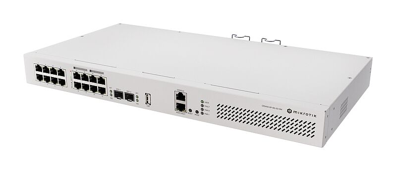
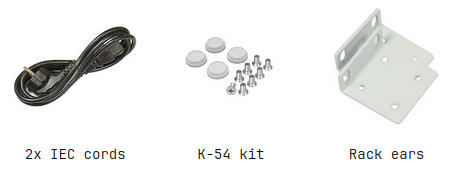

You wanted a switch that could do more. So we built one that does everything! 16x (+1) Gigabit Ethernet ports (8x with PoE-out), dual 10G uplinks, and a powerful quad-core 2.2 GHz ARM CPU. Powerful enough to replace most small/medium office routers, ~3x faster than a CRS320 or a CRS328… and for a better price! See the [CRS418-8P-8G-2S+RM product page](https://mikrotik.com/product/crs418_8p_8g_2s_rm) for full specifications and brochures.

## Safety Warnings

Before you work on any equipment, be aware of the hazards involved with electrical circuitry, and be familiar with standard practices for preventing accidents. Ultimate disposal of this product should be handled according to all national laws and regulations. The Installation of the equipment must comply with local and national electrical codes. This unit is intended to be installed in the rackmount. Please read the mounting instructions carefully before beginning installation. Failure to use the correct hardware or to follow the correct procedures could result in a hazardous situation to people and damage to the system. This product is intended to be installed indoors. Keep this product away from water, fire, humidity or hot environments. Use only the power supply and accessories approved by the manufacturer, and which can be found in the original packaging of this product. The socket-outlet shall be installed near the equipment and shall be easily accessible. Read the installation instructions before connecting the system to the power source. We cannot guarantee that no accidents or damage will occur due to the improper use of the device. Please use this product with care and operate at your own risk! In the case of device failure, please disconnect it from power. The fastest way to do so is by unplugging the power plug from the power outlet. It is the customer's responsibility to follow local country regulations. All MikroTik devices must be professionally installed. This is a Class A product. In a domestic environment, this product might cause radio interference in which case the user might be required to take adequate measures

## Quickstart

- Connect with your PC to any Ethernet port;
- Connect the device to a power source;
- Configure the IP settings of your network card to 192.168.88.2/24;
- Use WebFig in a web browser or the "WinBox" configuration tool [https://mt.lv/winbox](https://mt.lv/winbox). **Multiple configuration methods are available to ensure accessibility;**
- Open [https://192.168.88.1](https://192.168.88.1) in a web browser to start setup. If the IP address is unavailable, use WinBox and choose the "Neighbors" tab to find the device. Proceed to connect using the MAC address. The username is "admin", and there is no password (or, for some models, check user and wireless passwords on the sticker);
- For a manual update of the device, visit mikrotik.com, select your model, and locate the required packages in the "Downloads" section;
- Upload downloaded packages to the WebFig or WinBox "Files" menu and reboot the device;
- By upgrading your RouterOS software to the latest version, you can ensure optimal performance, stability, and security updates;
- Set up your router password.

## Mounting

The device is designed for indoor use and can be either mounted in a rack enclosure using the provided rackmount brackets or simply placed on a desktop. Please attach rubber pegs on the bottom of the router if the desired placement is on the flat surface or use a Phillips screwdriver to attach rackmount ears on both sides of the device if designated use is for rackmount enclosure:

- Attach rackmount ears and the rear support ears to both sides of the device and tighten four screws to secure them in place, as shown in the picture.

- Place the device in the rackmount enclosure and align with the holes so that the device fits conveniently.
- Tighten screws to secure it in place. The device has no protection from water contamination, please ensure the placement of the device in a dry and ventilated environment. We recommend Cat6 cables for our devices. Mounting and configuration of this device should be done by a qualified person.

## Powering

The unit is equipped with two power supplies, 250 W, which accepts 100-240 V ⏦ (~ 50/60 Hz 4.5 A max). The maximum power consumption without attachments is 28 W, and under maximum load, it can reach 215 W.

## Configuration

Full documentation for RouterOS is available at: [https://mt.lv/help](https://mt.lv/help) You can configure the device using WebFig in a web browser or the "WinBox" configuration tool [https://mt.lv/winbox](https://mt.lv/winbox). **Multiple configuration methods are available to ensure accessibility.** **To start setup, open [https://192.168.88.1](https://192.168.88.1) in a web browser to start setup. If the IP address is unavailable, use WinBox and choose the "Neighbors" tab to find the device. Proceed to connect using the MAC address. The username is "admin", and there is no password (or, for some models, check user and wireless passwords on the sticker). The device is equipped with an RJ45 serial port, set by default to 115200 bit/s, 8 data bits, 1 stop bit, no parity. For recovery purposes, it is possible to reinstall the device from the network, see the Reset button.

Marvell Prestera switch chip features user manual

## Buttons

**Reset button**:

- Hold this button during boot time until the USER LED light starts flashing, release the button to reset RouterOS configuration.
- Hold the Reset button and power on your device (wait until the "USER" led is blinking then stable "On", and when the "USER" LED is "Off" - release the Reset button) - the device is booting in BOOTP mode to reinstall RouterOS using Netinstall. **The MGMT/BOOT Ethernet port is used for the Netinstall process.** See RouterOS documentation about using the Netinstall recovery utility. Regardless of the above option used, the system will load the backup RouterBOOT loader if the button is pressed before power is applied to the device. Release the button before LED begins to flash, to only load backup RouterBOOT without resetting. This is useful for RouterBOOT debugging and recovery.

## Extension slots and ports

- Product code: **CRS418-8P-8G-2S+RM**.
- CPU: Quad-Core IPQ-8072 2.2 GHz.
- CPU: architecture ARM 64bit.
- Size of RAM: 1 GB.
- RAM type: DDR3L.
- Storage: 128 MB, NAND.
- Number of 1G Ethernet ports: 17.
- Number of 10G SFP+ Ethernet ports: 2.
- Number of 1G Ethernet ports with PoE-out: 8.
- PoE-out ports: Ether9-Ether16, 802.3af/at, Total output power 150 W.
- 1x RJ45 console port (set at 115200bits/s, 8 data bits, 1 stop bit no parity).
- USB: 1 USB 3.0 type A.
- Switch chip model: 98DX226S.
- Dimensions: 443 x 156 x 44 mm.
- Operating system RouterOS: v7, License level 5.
- Operating temperature: -20°C to +70°C.
- IP: 20. Please visit help pages for MikroTik SFP module compatibility and configuration table: MikroTik wired interface compatibility

## LED indicators

- PWR LED is lit when the router is powered on.
- USER LED indicates the device's state while powering it up into different modes, such as resetting the configuration or booting device for the Netinstall utility.
- The FAULT LED indicates a problem with any of the cooling fans.
- The triangle LEDs (top row) indicate PoE out status. Green LED indicates that the respective port uses low voltage, a red LED indicates high voltage. Flashing single green LED: problem to start a low voltage device. Flashing single red LED: problem with high voltage device.
- The SFP+ port green LEDs indicate individual SFP+ port activity.

## Accessories

Package includes the following accessories that come with the device:

## Operating system support

The device supports RouterOS v7 and above. The specific factory-installed version is listed in /system resource. Other operating systems have not been tested.
