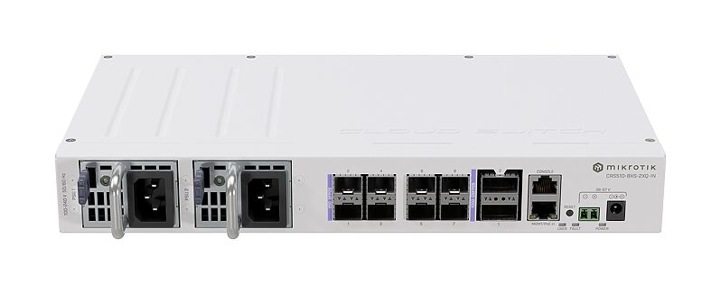
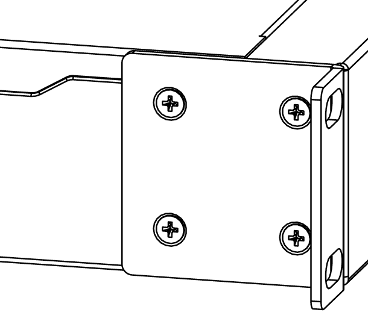
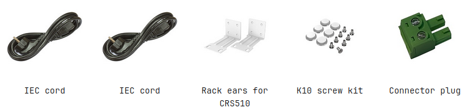

A versatile 100 Gigabit switch that offers speed, value, and diverse connectivity options. 2x 100 Gigabit QSFP28 ports, 8x 25 Gigabit SFP28 ports, dual hot-swap power supplies. See the [CRS510-8XS-2XQ-IN product page](https://mikrotik.com/product/crs510_8xs_2xq_in) for full specifications and brochures.

## Safety Warnings

Before you work on any equipment, be aware of the hazards involved with electrical circuitry, and be familiar with standard practices for preventing accidents. Ultimate disposal of this product should be handled according to all national laws and regulations. The Installation of the equipment must comply with local and national electrical codes. This unit is intended to be installed in the rackmount. Please read the mounting instructions carefully before beginning installation. Failure to use the correct hardware or to follow the correct procedures could result in a hazardous situation for people and damage to the system. This product is intended to be installed indoors. Keep this product away from water, fire, humidity, or hot environments. Use only the power supply and accessories approved by the manufacturer, which can be found in the original packaging of this product. Read the installation instructions before connecting the system to the power source. We cannot guarantee that no accidents or damage will occur due to the improper use of the device. Please use this product with care and operate at your own risk! In the case of device failure, please disconnect it from power. The fastest way to do so is by unplugging the power plug from the power outlet. It is the customer's responsibility to follow local country regulations, including operation within legal frequency channels, output power, cabling requirements, and Dynamic Frequency Selection (DFS) requirements. All MikroTik devices must be professionally installed.

## Quickstart

- Connect with your PC to any Ethernet port;
- Connect the device to a power source;
- Configure the IP settings of your network card to 192.168.88.2/24;
- Use WebFig in a web browser or the "WinBox" configuration tool [https://mt.lv/winbox](https://mt.lv/winbox). **Multiple configuration methods are available to ensure accessibility;**
- Open [https://192.168.88.1](https://192.168.88.1) in a web browser to start setup. If the IP address is unavailable, use WinBox and choose the "Neighbors" tab to find the device. Proceed to connect using the MAC address. The username is "admin", and there is no password (or, for some models, check user and wireless passwords on the sticker);
- For a manual update of the device, visit mikrotik.com, select your model, and locate the required packages in the "Downloads" section;
- Upload downloaded packages to the WebFig or WinBox "Files" menu and reboot the device;
- By upgrading your RouterOS software to the latest version, you can ensure optimal performance, stability, and security updates;
- Set up your router password.

## Mounting

The device is designed to use indoors and it can be mounted in a rackmount enclosure using provided rack mounts, or it can be placed on the desktop. Please attach rubber pegs on the bottom of the router if the desired placement is on the flat surface or use a Phillips screwdriver to attach rackmount ears on both sides of the device if the designated use is for rackmount enclosure:

- Attach rack ears to both sides of the device and tighten four screws to secure them in place, as shown in the picture.
- Place the device in a rackmount enclosure and align it with the holes so that the device fits conveniently.
- Tighten screws to secure it in place.

The IP rating scale for this device is IPX0. The device has no protection from water contamination, please ensure the placement of the device in a dry and ventilated environment. We recommend shielded Cat5/6 cables for our devices. The mounting*and configuration of this device should be done by a qualified person.*

## Configuration

Full documentation for RouterOS is available at: [https://mt.lv/help](https://mt.lv/help) You can configure the device using WebFig in a web browser or the "WinBox" configuration tool [https://mt.lv/winbox](https://mt.lv/winbox). **Multiple configuration methods are available to ensure accessibility.** **To start setup, open [https://192.168.88.1](https://192.168.88.1) in a web browser to start setup. If the IP address is unavailable, use WinBox and choose the "Neighbors" tab to find the device. Proceed to connect using the MAC address. The username is "admin", and there is no password (or, for some models, check user and wireless passwords on the sticker). The device is equipped with an RJ45 serial port, set by default to 115200 bit/s, 8 data bits, 1 stop bit, no parity. For recovery purposes, it is possible to reinstall the device from the network, see the Reset button.

Marvell Prestera switch chip features user manual

## Powering

- Number of DC inputs 3 (PoE-in, DC jack, 2-pin terminal)
- PoE-in input Voltage 43-57 V Passive PoE or 802.3bt Class 6
- DC jack input Voltage 36-57 V
- 2-pin terminal input Voltage 36-57 V
- Number of AC inputs 2
- AC input range 100-240 V
- Frequency 47-63 Hz
- Max power consumption without attachments 27 W
- Max power consumption 45 W

## Extension slots and ports

- Product code CRS510-8XS-2XQ-IN
- CPU QCA9531 650 MHz
- CPU architecture MIPSBE
- CPU core count 1
- Size of RAM 128 MB
- Storage 32 MB, Flash
- Number of 100M Ethernet ports 1
- Number of 25G SFP28 ports 8
- Number of 100G QSFP28 ports 2
- Switch chip model 98DX4310
- Dimensions 320 x 185 x 44 mm
- Operating system RouterOS v7, License level 5
- Operating temperature -40°C to +70°C

## Reset button

The RouterBOOT reset button has the following functions. Press the button and apply the power, then:

- Release the button when the green LED starts flashing, to reset the RouterOS configuration to defaults.
- Release the button when the LED turns solid green to clear all configurations and defaults.
- Release the button after the LED is no longer lit (~20 seconds) to cause a device to look for Netinstall servers (required for reinstalling RouterOS over the network). Regardless of the above option used, the system will load the backup RouterBOOT loader if the button is pressed before power is applied to the device. Useful for RouterBOOT debugging and recovery.

## Accessories

The package includes the following accessories that come with the device:

Please visit help pages for MikroTik SFP module compatibility and configuration table: MikroTik wired interface compatibility

## Operating system support

The device supports RouterOS v7 and above. The specific factory-installed version is listed in /system resource. Other operating systems have not been tested.
