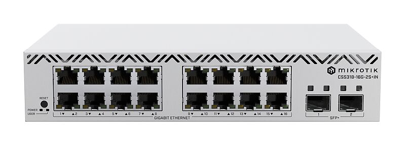
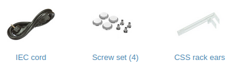

With 16 Gigabit Ethernet ports and 2 SFP+ 10G uplink ports, you get all the connectivity you need without unnecessary bulk. Stack two units side by side in a single 1U rack space for even greater flexibility and scalability. See the [CSS318-16G-2S+IN product page](https://mikrotik.com/product/css318_16g_2s_in) for full specifications and brochures.

## Safety Warnings

Before you work on any equipment, be aware of the hazards involved with electrical circuitry, and be familiar with standard practices for preventing accidents. Ultimate disposal of this product should be handled according to all national laws and regulations. The Installation of the equipment must comply with local and national electrical codes. This product is intended to be mounted outdoors on a pole. Please read the mounting instructions carefully before beginning installation. Failure to use the correct hardware and configuration or to follow the correct procedures could result in a hazardous situation for people and damage to the system. Use only the power supply and accessories approved by the manufacturer, and which can be found in the original packaging of this product. Read the installation instructions before connecting the system to the power source. We cannot guarantee that no accidents or damage will occur due to the improper use of the device. Please use this product with care and operate at your own risk! In the case of device failure, please disconnect it from power. The fastest way to do so is by unplugging the power plug from the power outlet. It is the customer's responsibility to follow local country regulations, including operation within legal frequency channels, output power, cabling requirements, and Dynamic Frequency Selection (DFS) requirements. All MikroTik devices must be professionally installed.

## Quickstart

- Download the latest version of SwitchOS software from [https://mikrotik.com/download](https://mikrotik.com/download);
- Connect your computer to one of the Ethernet ports;
- Connect the device to the power supply;
- Set the IP address of your computer to 192.168.88.2;
- Open your web browser, the default IP management address is 192.168.88.1, with username: **admin** and no password (or, for some models, check user and wireless passwords on the sticker);
- Upload a file with the web browser in the Upgrade tab, the device will reboot after the upgrade;
- Set your password to secure your device.

## Extension slots and ports

- Sixteen Gigabit Ethernet ports.
- Two - 10G SFP+ ports.

## Configuration

The device can be discovered using the WinBox utility by clicking on the Neighbors list. The default management address is 192.168.88.1. SwOS is a simple software designed for switches. We recommend starting with this guide to familiarize yourself with its capabilities: [https://mt.lv/help](https://mt.lv/help) For recovery purposes, it is possible to boot the device for reinstallation, see section .

## Powering

The device accepts powering from two inputs of 100-240 V AC ⏦.

The power consumption of this device under maximum load is up to 10 W. With attachments up to 13 W.

## Mounting

The device is designed to use indoors and it can be mounted in a rackmount enclosure using provided rack mounts, or it can be placed on the desktop. Use a Phillips screwdriver to attach rackmount ears on both sides of the device if designated use is for rackmount enclosure:

- Attach rack ears to both sides of the device and tighten four screws to secure them in place, as shown in the picture.

- Place the device in a rackmount enclosure and align with the holes so that the device fits conveniently.
- Tighten screws to secure it in place. The device has no protection from water contamination, please ensure the placement of the device in a dry and ventilated environment. *The mounting and configuration of this device should be done by a qualified person.* *We recommend using Cat6 cables for our devices.*

## Buttons and jumpers

Hold this button during boot time until the LED light starts to flash. Release the button to reset SwOS configuration and load backup software for reinstallation and upgrade.

## Accessories

The package includes the following accessories that come with the device:

## Operating system support

The device supports SwOS software. Other operating systems have not been tested.
