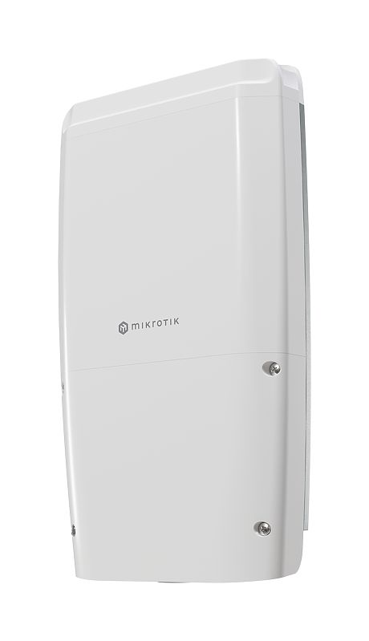
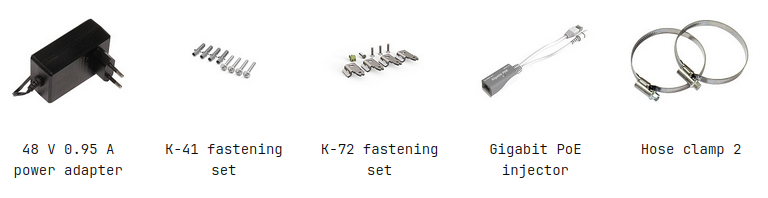

Ultimate value pick for 10 Gigabit outdoor networking. High masts, poles, or towers – your connection will be safe! A powerful budget version of the netFiber 9. See the [FiberBox Plus product page](https://mikrotik.com/product/fiberboxplus) for full specifications and brochures.

### FiberBox Plus (CRS305-1G-4S+OUT)

## Safety Warnings

Before you work on any equipment, be aware of the hazards involved with electrical circuitry, and be familiar with standard practices for preventing accidents. Ultimate disposal of this product should be handled according to all national laws and regulations. The Installation of the equipment must comply with local and national electrical codes. This unit is intended to be installed in the rackmount. Please read the mounting instructions carefully before beginning installation. Failure to use the correct hardware or to follow the correct procedures could result in a hazardous situation to people and damage to the system. This product is intended to be installed indoors. Keep this product away from water, fire, humidity, or hot environments. Use only the power supply and accessories approved by the manufacturer, which can be found in the original packaging of this product. Read the installation instructions before connecting the system to the power source. We cannot guarantee that no accidents or damage will occur due to the improper use of the device. Please use this product with care and operate at your own risk! In the case of device failure, please disconnect it from power. The fastest way to do so is by unplugging the power plug from the power outlet. It is the customer's responsibility to follow local country regulations, including operation within legal frequency channels, output power, cabling requirements, and Dynamic Frequency Selection (DFS) requirements. All MikroTik devices must be professionally installed.

## Quickstart

- Connect with your PC to any Ethernet port;
- Connect the device to a power source;
- Configure the IP settings of your network card to 192.168.88.2/24;
- Use WebFig in a web browser or the "WinBox" configuration tool [https://mt.lv/winbox](https://mt.lv/winbox). **Multiple configuration methods are available to ensure accessibility;**
- Open [https://192.168.88.1](https://192.168.88.1) in a web browser to start setup. If the IP address is unavailable, use WinBox and choose the "Neighbors" tab to find the device. Proceed to connect using the MAC address. The username is "admin", and there is no password (or, for some models, check user and wireless passwords on the sticker);
- For a manual update of the device, visit mikrotik.com, select your model, and locate the required packages in the "Downloads" section;
- Upload downloaded packages to the WebFig or WinBox "Files" menu and reboot the device;
- By upgrading your RouterOS software to the latest version, you can ensure optimal performance, stability, and security updates;
- Set up your router password.

## Mounting

250

## Powering

- Number of DC inputs 3 (PoE-in, DC jack, 2-pin terminal)
- PoE-in input Voltage 42-57 V 802.3af/at
- DC jack input Voltage 24-57 V
- 2-pin terminal input Voltage 24-57 V
- Power adapter nominal voltage 48 V
- Power adapter nominal current 1.2 A
- Max power consumption (without attachments) 7 W
- Max power consumption 17 W
- -48V power is NOT compatible with PoE-in and +24V (or any other minus grounded PSU)! We strongly suggest using the included power supply

### Connecting to a PoE Adapter

- Connect the Ethernet cable from the device to the POE port of the POE adapter.
- Connect an Ethernet cable from your LAN to the LAN port of the POE adapter, please mind arrows for data and power flow.
- Connect the power cord to the adapter, and then plug the power cord into a power outlet.

## Configuration

Full documentation for RouterOS is available at: [https://mt.lv/help](https://mt.lv/help) You can configure the device using WebFig in a web browser or the "WinBox" configuration tool [https://mt.lv/winbox](https://mt.lv/winbox). **Multiple configuration methods are available to ensure accessibility.** **To start setup, open [https://192.168.88.1](https://192.168.88.1) in a web browser to start setup. If the IP address is unavailable, use WinBox and choose the "Neighbors" tab to find the device. Proceed to connect using the MAC address. The username is "admin", and there is no password (or, for some models, check user and wireless passwords on the sticker). The device is equipped with an RJ45 serial port, set by default to 115200 bit/s, 8 data bits, 1 stop bit, no parity. For recovery purposes, it is possible to reinstall the device from the network, see the Reset button.

Marvell Prestera switch chip features user manual

## Extension slots and ports

<table><thead><tr><th>**Product Code**</th><th>CRS305‑1G‑4S+OUT (FiberBox Plus)</th></tr></thead><tbody><tr><td>**CPU**</td><td>98DX226S, 800 MHz</td></tr><tr><td>**CPU Architecture**</td><td>ARM 32bit</td></tr><tr><td>**CPU Core Count**</td><td>2</td></tr><tr><td>**Switch Chip Model**</td><td>98DX226S</td></tr><tr><td>**RAM**</td><td>256 MB</td></tr><tr><td>**Storage**</td><td>16 MB Flash</td></tr><tr><td>**1G Ethernet (RJ45)**</td><td>1</td></tr><tr><td>**10G SFP+ Ports**</td><td>4</td></tr><tr><td>**Serial Console (RJ45)**</td><td>1</td></tr><tr><td>**Operating System**</td><td>RouterOS v7 (license level 5) / SwOS (Dual boot)</td></tr><tr><td>**Operating Temperature**</td><td>‑40 °C to +70 °C</td></tr><tr><td>**Case Dimensions**</td><td>330 × 200 × 70 mm</td></tr><tr><td>**Ingress Protection**</td><td>IP66</td></tr></tbody></table>

## Reset button

To use the reset button, hold it and then turn on the device, while still holding the button.

- Release the button when the green LED starts flashing, to reset the RouterOS configuration. To not load the backup bootloader, you can start holding the button after power is already applied.
- Release the button after LED is no longer flashing (~20 seconds) to cause the device to look for Netinstall servers (required for reinstalling RouterOS over the network). You can also release the button at the time when the device has appeared in the Netinstall utility device list. Regardless of the above option used, the system will load the backup RouterBOOT loader if the button is pressed before power is applied to the device. Useful for RouterBOOT debugging and recovery.

## Accessories

The package includes the following accessories that come with the device:

Please visit help pages for MikroTik SFP module compatibility and configuration table: MikroTik wired interface compatibility

## Operating system support

The device supports dual boot with SwOS version 2.9 and later, as well as RouterOS version 7 or above. The specific factory-installed RouterOS version is indicated in the RouterOS menu under /system resource. Other operating systems have not been tested and are not officially supported.
