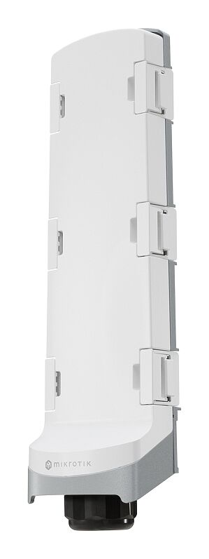
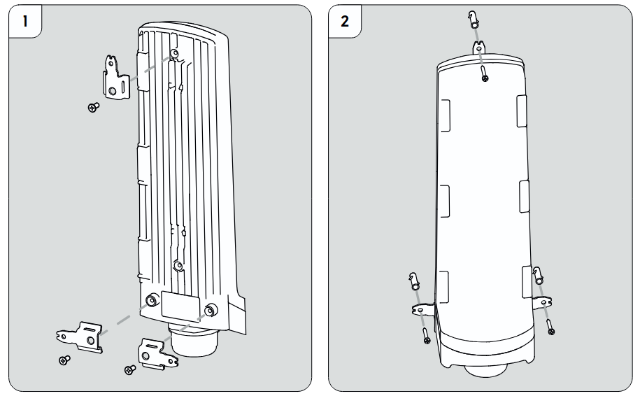
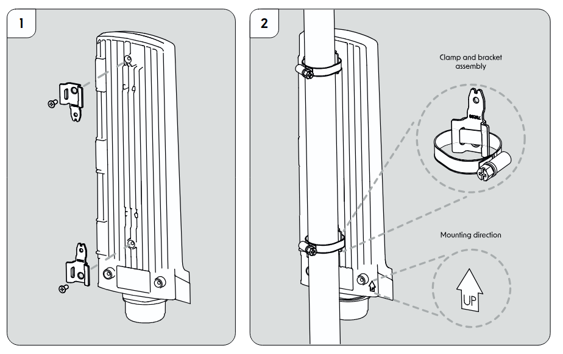
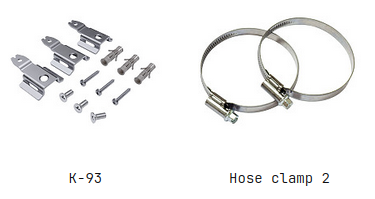

### GPERx6 (CSS606-1G-2Gi-3S+OUT)

Cut the cable clutter – extend power and fiber together, anywhere – with a single hybrid cable. At the far end, the GPERx6 splits it all neatly: SFP+ for further long-distance uplinks, PoE-out for powering other switches or access points, and DC outputs for IoT gear or specialized devices. See the [GPERx6 product page](https://mikrotik.com/product/gperx6) for full specifications and brochures.

## Quickstart

Please follow these quick steps to set up your device:

- Download the latest version of SwOS Lite software from [https://mikrotik.com/download](https://mikrotik.com/download);
- Connect your computer to one of the Ethernet ports;
- Connect the device to the power supply;
- Set the IP address of your computer to 192.168.88.2;
- Open your web browser, the default IP management address is 192.168.88.1, with username: **admin** and no password (or, for some models, check user and wireless passwords on the sticker);
- Upload a file with the web browser in the Upgrade tab, the device will reboot after the upgrade;
- Set your password to secure your device.

## Extension slots and ports

<table><thead><tr><th>**Parameter**</th><th>**Value**</th></tr></thead><tbody><tr><td>**Product Code**</td><td>CSS606‑1G‑2Gi‑3S+OUT</td></tr><tr><td>**Switch Chip Model**</td><td>88E6193X</td></tr><tr><td>**Operating System**</td><td>SwOS</td></tr><tr><td>**MTBF**</td><td>Approx. 200,000 hours at 25 °C</td></tr><tr><td>**Tested Ambient Temperature**</td><td>‑40 °C to +70 °C</td></tr><tr><td>**10/100/1000 Ethernet Ports**</td><td>3</td></tr><tr><td>**1G Ethernet with PoE‑IN**</td><td>One, Ether1 802.3 bt</td></tr><tr><td>**PoE-In input Voltage 42-57 V**</td><td>42-57 V</td></tr><tr><td>**1G Ethernet with PoE‑OUT**</td><td>Passive PoE up to 57V (Ether2- Ether3)</td></tr><tr><td>**10G SFP+ Ports**</td><td>3</td></tr><tr><td>**Number of DC inputs**</td><td>2 (2-pin screw terminal, PoE-In)</td></tr><tr><td>**2-pin screw terminal input Voltage **</td><td>12-57 V</td></tr><tr><td>**Number of DC-out ports**</td><td>3, DC1-DC3 Max total out 3.6 A</td></tr><tr><td>**Max power consumption (without attachments) **</td><td>6 W</td></tr><tr><td>**Max power consumption**</td><td>160 W</td></tr><tr><td>**CPU Temperature Monitor**</td><td>Yes</td></tr><tr><td>**Ingress Protection**</td><td>IP66</td></tr><tr><td>**Dimensions**</td><td>406 × 116 × 76 mm</td></tr></tbody></table>

## Configuration

Full documentation for SwOS is available at: [https://mt.lv/help](https://mt.lv/help) The device can be discovered using WinBox utility, by clicking on the Neighbors list. The default management address is 192.168.88.1. See the [CSS610 series SwOS manual](/docs/bridging-and-switching/swos/css610) to get yourself accustomed to the possibilities. For recovery purposes, it is possible to boot the device for reinstallation, see section .

## Buttons and jumpers

Hold the Reset button during boot time until the LED light starts to flash. Release the button to reset SwOS configuration and load backup software for reinstallation and upgrade.

## Mounting

The GPERx6 is designed for outdoor use and can be mounted on either a wall or a pole. Align the device following the **mounting direction mark** (the arrow labeled “UP”) to ensure proper orientation.

### To mount the GPERx6 on the wall:

-

#### Attach Brackets to the Device

Use the screws from the **K‑93 mounting kit** to attach **three metal brackets** to the back of the GPERx6.

- Position the brackets so they align with the device’s mounting holes.
- Ensure the **top bracket** is oriented with its **thinner section upward** for proper wall attachment.
-

-

#### Mount the Device on the Wall

Align the device with the **mounting direction mark (“UP” arrow)**.

- Fix the device to the wall using the screws or anchors appropriate for your wall type, engaging all three brackets for stability.

### To mount the GPERx6 on a pole:

-

#### Attach Brackets to the Device

Use the screws from the **K‑93 mounting kit** to attach the two metal brackets to the back of the GPERx6.

- Make sure the **clamp holes** in the brackets are oriented **toward the back** of the device.
-

-

#### Mounting on the Pole

Insert the **hose clamps** through the holes in the brackets.

- Position the GPERx6 around the pole, and slide the clamps around the pole.
- Tighten the clamps to secure the device firmly.

## Accessories

## Operating system support

The device supports SwOS software. Other operating systems have not been tested.
