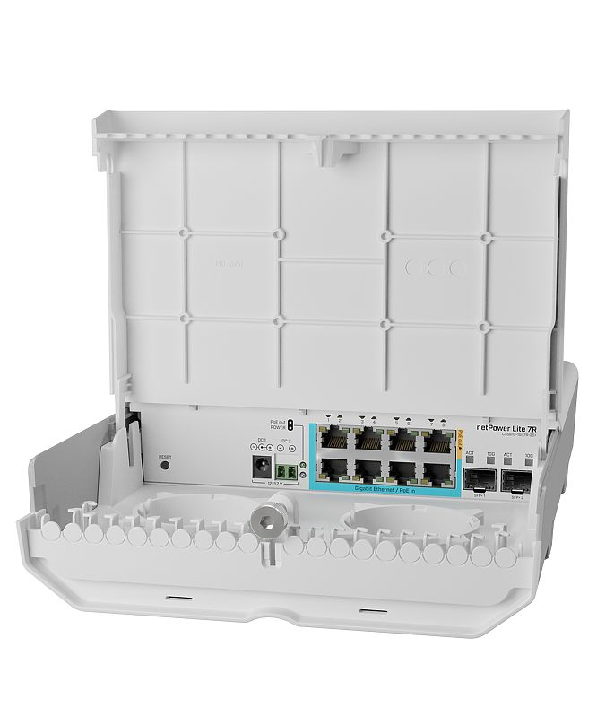
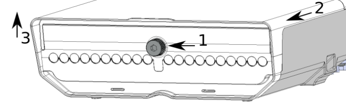
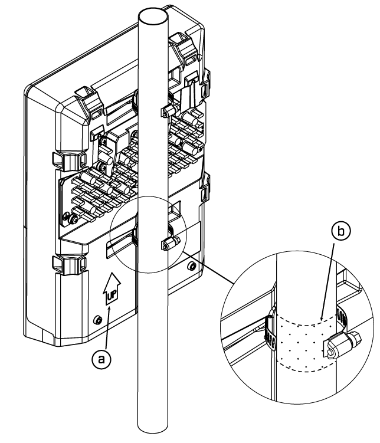
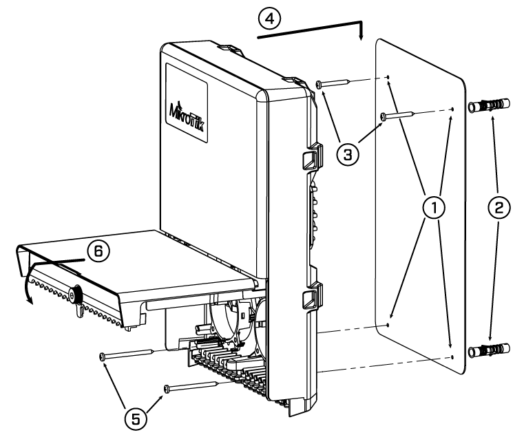
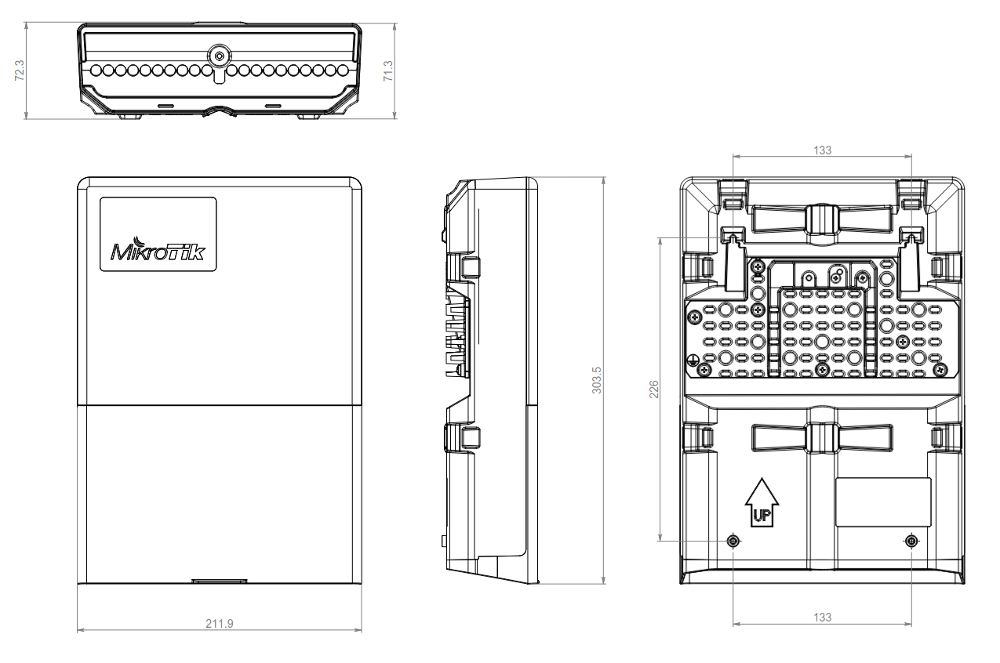

An outdoor reverse PoE switch with Gigabit Ethernet and 10G SFP+ ports. See the [netPower Lite 7R product page](https://mikrotik.com/product/netpower_lite_7r) for full specifications and brochures.

### netPower Lite 7R (CSS610-1Gi-7R-2S+OUT)

## Safety Warnings

Before you work on any equipment, be aware of the hazards involved with electrical circuitry, and be familiar with standard practices for preventing accidents. Ultimate disposal of this product should be handled according to all national laws and regulations. The Installation of the equipment must comply with local and national electrical codes. This product is intended to be mounted outdoors on a pole. Please read the mounting instructions carefully before beginning installation. Failure to use the correct hardware and configuration or to follow the correct procedures could result in a hazardous situation for people and damage to the system. Use only the power supply and accessories approved by the manufacturer, and which can be found in the original packaging of this product. Read the installation instructions before connecting the system to the power source. We cannot guarantee that no accidents or damage will occur due to the improper use of the device. Please use this product with care and operate at your own risk! In the case of device failure, please disconnect it from power. The fastest way to do so is by unplugging the power plug from the power outlet. It is the customer's responsibility to follow local country regulations, including operation within legal frequency channels, output power, cabling requirements, and Dynamic Frequency Selection (DFS) requirements. All MikroTik devices must be professionally installed.

## Quickstart

- Download the latest version of SwitchOS software from [https://mikrotik.com/download](https://mikrotik.com/download);
- Connect your computer to one of the Ethernet ports;
- Connect the device to the power supply;
- Set the IP address of your computer to 192.168.88.2;
- Open your web browser, the default IP management address is 192.168.88.1, with username: **admin** and no password (or, for some models, check user and wireless passwords on the sticker);
- Upload a file with the web browser in the Upgrade tab, the device will reboot after the upgrade;
- Set your password to secure your device.

## Extension slots and ports

- Gigabit Ethernet, one port PoE-out.
- Gigabit Ethernet, eight ports.
- Gigabit Ethernet, seven ports, Reverse PoE (PoE in).
- Two - 10G SFP+ ports.

## Configuration

The device can be discovered using WinBox utility, by clicking on the Neighbors list. The default management address is 192.168.88.1. SwOS is a simple software designed for the switch. We suggest starting here to get yourself accustomed to the possibilities: [https://mt.lv/help](https://mt.lv/help) For recovery purposes, it is possible to boot the device for reinstallation, see section .

## Powering

The device accepts power in the two ways following ways:

- Direct-input power jack, (5.5 mm outside and 2 mm inside, female, pin positive plug) accepts 12-57 V DC⎓.
- Direct-input block terminal, 12-57 V DC ⎓.
- PoE in, 12-57 V DC ⎓. The power consumption under maximum load can reach 7 W, with attachments 29 W.

## Power output

The device supports passive PoE from Ethernet port eight. You can power MikroTik devices which supports powering through Ethernet. The power delivered through the PoE port will depend on the incoming to the device.

### Connecting to a PoE Adapter, only to deliver power to other devices

- Connect the Ethernet cable from the device to the PoE+DATA port of the PoE adapter.
- Connect an Ethernet cable from your local network (LAN) to the PoE adapter.
- Connect the power cord to the adapter, and then plug the power cord into a power outlet.

## Bottom Lid

- The bottom lid is secured in place with the captive screw, it can be unscrewed by hand, but do not remove the screw completely.
- Pull the cover towards.

- Lift to access Ethernet ports.

## Mounting

The device can be mounted in several ways: pole, wall, or ceiling. The package also includes a drill hole template with detailed mounting instructions, to help you with the drill hole marking. The device has eight mounting points for versatility use zip ties or steel clamps for mounting on the pole. The IP rating scale for this device is IP54. When mounting outdoors, please ensure that any cable openings are directed downwards. We recommend using the POE injector and proper grounding with Cat6 shielded cable. **Mounting points:**

- There are eight mounting points on the back of this device. Choose the most relevant ones.
- Middle points are designed for mounting on the mast, there are curves on the case for slim fitment. It's recommended to secure Ethernet cable to the pole using zip ties. With the distance from the device approximately 30 cm.

The device must be mounted by UP arrow facing upwards.

The installation infrastructure (towers and masts), as well as the router itself, must be properly grounded. The device includes a grounding wire attachment screw on the backside.

- Attach your grounding wire to the grounding screw.
- Attach the other end of the grounding wire to the grounded mast. Mounting and configuration of this device should be performed by a qualified person. **Mounting on the mast or pole:**

-

Insert provided steel clamps into mounting spots.

-

Attach the unit to the mast.

-

Align the device and secure it by tightening steel clamps with a PH2 screwdriver.

-

Guide Ethernet cables through the opening and connect to the Ethernet ports.

-

Close bottom latch and secure with a screw. **A – Always make sure to place the unit in an upwards position.** ***B - It's recommended to use electrical tape to increase friction between materials.*** **Mounting unit on the wall:**

-

Use included a template to mark spots for drilling holes. Align accordingly, it will depend on how the device will be mounted finally.

- Insert dowels if needed, depends on wall structure and material.
- Insert screws and screw them by leaving approximately 1 cm out.
- Attach the unit to the position.
- Use screw holes under the bottom cover and tighten to secure in place. Extend your Ethernet cables through the openings and connect to Ethernet ports.
- Close bottom latch.

Carefully check the wall for electric cables before drilling mounting holes.

## Buttons and jumpers

The RouterBOOT reset button has the following functions. Press the button and apply the power, then:

- Release the button when the green LED starts flashing, to reset the SwOS configuration to defaults.
- Release the button when the LED turns solid green to clear all configuration and bridge all interfaces. Regardless of the above option used, the system will load the backup RouterBOOT loader if the button is pressed before power is applied to the device. Useful for RouterBOOT debugging and recovery.

## Accessories

The package includes the following accessories that come with the device:

- Hose Clamp SUS304.
- K-66 fastening set.
- OED-drill-template, paper brochure.

## Operating system support

The device supports SwOS software. Other operating systems have not been tested.

To avoid pollution of the environment, please separate the device from household waste and dispose of it in a safe manner, such as in designated waste disposal sites. Familiarize yourself with the procedures for the proper transportation of the equipment to the designated disposal sites in your area.

## Federal Communication Commission Interference Statement

This equipment has been tested and found to comply with the limits for a Class A digital device, pursuant to Part 15 of the FCC Rules. These limits are designed to provide reasonable protection against harmful interference in a commercial installation.

This equipment generates, uses, and can radiate radio frequency energy and, if not installed and used in accordance with the instruction manual, may cause harmful interference to radio communications. Operation of this equipment in a residential area is likely to cause harmful interference in which case the user will be required to correct the interference at his own expense

FCC Caution: Any changes or modifications not expressly approved by the party responsible for compliance could void the user’s authority to operate this equipment.

This device complies with Part 15 of the FCC Rules. Operation is subject to the following two conditions: (1) This device may not cause harmful interference, and (2) this device must accept any interference received, including interference that may cause undesired operation.

Note: This unit was tested with shielded cables on the peripheral devices. Shielded cables must be used with the unit to ensure compliance.

## Innovation, Science and Economic Development Canada

This device contains license-exempt transmitter(s)/receiver(s) that comply with Innovation, Science, and Economic Development Canada’s license-exempt RSS(s). Operation is subject to the following two conditions: (1) This device may not cause interference. (2) This device must accept any interference, including interference that may cause undesired operation of the device.

L’émetteur/récepteur exempt de licence contenu dans le présent appareil est conforme aux CNR d’Innovation, Sciences et Développement économique Canada applicables aux appareils radio exempts de licence. L’exploitation est autorisée aux deux conditions suivantes : 1) L’appareil ne doit pas produire de brouillage; 2) L’appareil doit accepter tout brouillage radioélectrique subi, même si le brouillage est susceptible d’en compromettre le fonctionnement.

This Class A digital apparatus complies with Canadian ICES-003.

Cet appareil numérique de la classe [A] est conforme à la norme NMB-003 du Canada.

CAN ICES-003 (A) / NMB-003 (A)

## UKCA marking

## Eurasian Conformity Mark

Информация о дате изготовления устройства указана в конце серийного номера на его наклейке через дробь. Первая цифра означает номер года (последняя цифра года), две последующие означают номер недели.

Изготовитель: MikroTikls SIA, Aizkraukles iela 23, Riga, LV-1006, Латвия, [support@mikrotik.com](mailto:support@mikrotik.com). Сделано в Китае, Латвии или Литве. Cм. на упаковке.

Для получения подробных сведений о гарантийном обслуживании обратитесь к продавцу. Информация об импортерах продукции MikroTik в Российскую Федерацию: [https://mikrotik.com/buy/europe/russia](https://mikrotik.com/buy/europe/russia)

Продукты MikroTik, которые поставляются в Евразийский таможенный союз, оцениваются с учетом соответствующих требований и помечены знаком EAC, как показано ниже:

## Norma Oficial Mexicana

EFICIENCIA ENERGETICA CUMPLE CON LA NOM-029-ENER-2017.

La operacion de este equipo esta sujeta a las siguientes dos condiciones:

- Es posible que este equipo o dispositivo no cause interferencia perjudicial y.
- Este equipo debe aceptar cualquier interferencia, incluyendo la que pueda causar su operacion no deseada. Fabricante: MikroTikls SIA, Brivibas gatve 214i, Riga, LV-1039, Latvia.

País De Origen: Letonia; Lituania; China (Republica Popular); Estados Unidos De America; Mexico.

Por favor contacte a su distribuidor local para preguntas regionales específicas. La lista de importadores se puede encontrar en nuestra página de inicio – [https://mikrotik.com/buy/latinamerica/mexico](https://mikrotik.com/buy/latinamerica/mexico).

## CE Declaration of Conformity

Manufacturer: MikroTikls SIA, Brivibas gatve 214i Riga, Latvia, LV1039.

The full text of the EU Declaration of Conformity is available at the following internet address: [https://mikrotik.com/products](https://mikrotik.com/products)
