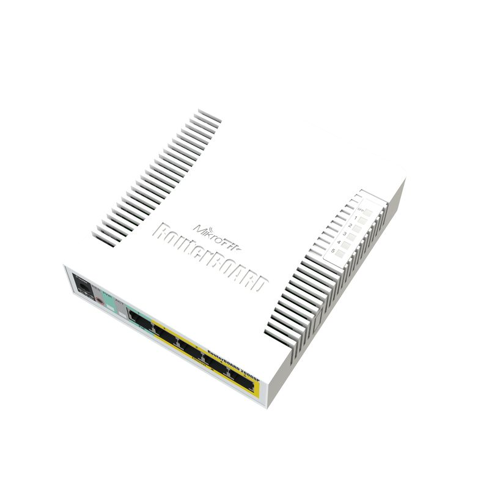
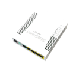
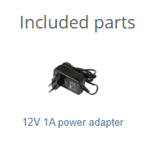
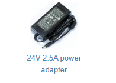

:::info This article covers

- **[RB260GS](https://mikrotik.com/product/RB260GS)**
- **[RB260GSP](https://mikrotik.com/product/RB260GSP)**

:::

The CSS106 is a network switch with five Ethernet ports and one SFP, it is powered by the SwOS operating system. It is already configured, with all ports switched together. We recommend you to set up a password to secure your device. CSS106-1G-4P-1S has PoE output capabilities on four of it's Ethernet ports.

Tested and recommended to use with MikroTik SFP modules: S-85DLC05D, S-31DLC20D and S-35/53LC20D (not included)

## Safety Warnings

Before you work on any equipment, be aware of the hazards involved with electrical circuitry, and be familiar with standard practices for preventing accidents. Ultimate disposal of this product should be handled according to all national laws and regulations. The Installation of the equipment must comply with local and national electrical codes. This product is intended to be installed indoors. Keep this product away from water, fire, humidity or hot environments. Use only the power supply and accessories approved by the manufacturer, and which can be found in the original packaging of this product. Read the installation instructions before connecting the system to the power source. We cannot guarantee that no accidents or damage will occur due to the improper use of the device. Please use this product with care and operate at your own risk! In the case of device failure, please disconnect it from power. The fastest way to do so is by unplugging the power plug from the power outlet. It is the customer's responsibility to follow local country regulations, including operation within legal frequency channels, output power, cabling requirements, and Dynamic Frequency Selection (DFS) requirements. All MikroTik devices must be professionally installed.

## Powering

The power consumption of this device under maximum load is up to 11 W. The device accepts powering in the following ways:

- Direct-input power jack (5.5mm outside and 2mm inside, female, pin positive plug) accepts 11-30 V DC.
- The combo ethernet port accepts passive Power over Ethernet 11-30 V DC, PoE injector is not included.

## First use

See [Connecting to the switch](/docs/bridging-and-switching/swos/css106#connecting-to-the-switch) in the SwOS manual.

- Power the device either from the power jack (11-30 V accepted, a power adapter is bundled with the device) or from the first port over Passive PoE (11-30 V).
- Download the latest version of SwitchOS software from [https://mikrotik.com/download](https://mikrotik.com/download);
- Connect your computer to one of the Ethernet ports;
- Connect the device to the power supply;
- Set the IP address of your computer to 192.168.88.2;
- Open your web browser, the default IP management address is 192.168.88.1, with username: **admin** and no password (or, for some models, check user and wireless passwords on the sticker);
- Upload a file with the web browser in the Upgrade tab, the device will reboot after the upgrade;
- Set your password to secure your device.

## Configuration

The device is set up as a switch, with 192.168.88.1 as the management IP of the master interface.

SwOS is an operating system designed specifically for the administration of MikroTik switch products.

SwOS is configurable from your web browser. It gives you all the basic functionality for a managed switch, plus more: allows you to manage port-to-port forwarding, broadcast storm control, apply MAC filter, configure VLANs, mirror traffic, apply bandwidth limitation and even adjust some MAC and IP header fields.

See the [CSS106 (RB260) series SwOS manual](/docs/bridging-and-switching/swos/css106) for configuration details.

## Power Output

The CSS106-1G-4P-1S model can supply PoE powering to external devices from its Ethernet ports. This is convenient, as you don't need any additional PoE injectors to power other devices. The output voltage will be the same as the input Voltage. By default, it is set to "auto", so it is safe to plug any device into the powered ports. The maximum power output of each ethernet port in this mode is 1 A, total for all ports 2 A. Once Power Output is enabled in RouterOS, the Ethernet LED light turns from Green to Red. Red LED means the port is currently providing PoE power. For the best PoE output functionality, please use the power jack to power the CSS unit.

## Buttons and jumpers

Hold this button during boot time and release after LED light stops flashing to reset SwOS configuration and load primary backup firmware. Access to primary firmware allows the reinstallation of the main firmware.

See [Reset](/docs/bridging-and-switching/swos/css106#reset) in the SwOS manual.

## Operating system support

The CSS runs SwOS, which is the only supported OS for this device. See the [SwOS manual](/docs/bridging-and-switching/swos) for more information.

### GSP Models

## Federal Communication Commission Interference Statement

This equipment has been tested and found to comply with the limits for a Class B digital device, pursuant to Part 15 of the FCC Rules. These limits are designed to provide reasonable protection against harmful interference in a residential installation.

This equipment generates, uses and can radiate radio frequency energy and, if not installed and used in accordance with the instructions, may cause harmful interference to radio communications. However, there is no guarantee that interference will not occur in a particular installation. If this equipment does cause harmful interference to radio or television reception, which can be determined by turning the equipment off and on, the user is encouraged to try to correct the interference by one of the following measures:

- Reorient or relocate the receiving antenna.
- Increase the separation between the equipment and receiver.
- Connect the equipment into an outlet on a circuit different from that to which the receiver is connected.
- Consult the dealer or an experienced radio/TV technician for help. FCC Caution: Any changes or modifications not expressly approved by the party responsible for compliance could void the user's authority to operate this equipment. This device complies with Part 15 of the FCC Rules. Operation is subject to the following two conditions: (1) This device may not cause harmful interference, and (2) this device must accept any interference received, including interference that may cause undesired operation. Note: This unit was tested with shielded cables on the peripheral devices. Shielded cables must be used with the unit to ensure compliance.

## Innovation, Science and Economic Development Canada

This device complies with Industry Canada's license-exempt RSS standard(s). Operation is subject to the following two conditions: (1) this device may not cause interference, and (2) this device must accept any interference, including interference that may cause undesired operation of the device. Le présent appareil est conforme aux CNR d'Industrie Canada applicables aux appareils radio exempts de licence. L'exploitation est autorisée aux deux conditions suivantes: (1) l'appareil ne doit pas produire de brouillage, et (2) l'utilisateur de l'appareil doit accepter tout brouillage radioélectrique subi, même si le brouillage est susceptible d'en compromettre le fonctionnement.

This Class B digital apparatus complies with Canadian ICES-003.

Cet appareil numérique de la classe [B] est conforme à la norme NMB-003 du Canada.

CAN ICES-003 (B) / NMB-003 (B)

## UKCA marking

## Eurasian Conformity Mark

Информация о дате изготовления устройства указана в конце серийного номера на его наклейке через дробь. Первая цифра означает номер года (последняя цифра года), две последующие означают номер недели.

Изготовитель: MikroTikls SIA, Aizkraukles iela 23, Riga, LV-1006, Латвия, [support@mikrotik.com](mailto:support@mikrotik.com). Сделано в Китае, Латвии или Литве. Cм. на упаковке.

Для получения подробных сведений о гарантийном обслуживании обратитесь к продавцу. Информация об импортерах продукции MikroTik в Российскую Федерацию: [https://mikrotik.com/buy/europe/russia](https://mikrotik.com/buy/europe/russia)

Продукты MikroTik, которые поставляются в Евразийский таможенный союз, оцениваются с учетом соответствующих требований и помечены знаком EAC, как показано ниже:

## Norma Oficial Mexicana

EFICIENCIA ENERGETICA CUMPLE CON LA NOM-029-ENER-2017.

La operacion de este equipo esta sujeta a las siguientes dos condiciones:

- Es posible que este equipo o dispositivo no cause interferencia perjudicial y.
- Este equipo debe aceptar cualquier interferencia, incluyendo la que pueda causar su operacion no deseada. Fabricante: MikroTikls SIA, Brivibas gatve 214i, Riga, LV-1039, Latvia.

País De Origen: Letonia; Lituania; China (Republica Popular); Estados Unidos De America; Mexico.

Por favor contacte a su distribuidor local para preguntas regionales específicas. La lista de importadores se puede encontrar en nuestra página de inicio – [https://mikrotik.com/buy/latinamerica/mexico](https://mikrotik.com/buy/latinamerica/mexico).

## CE Declaration of Conformity

Manufacturer: MikroTikls SIA, Brivibas gatve 214i Riga, Latvia, LV1039.

The full text of the EU Declaration of Conformity is available at the following internet address: [https://mikrotik.com/products](https://mikrotik.com/products)
