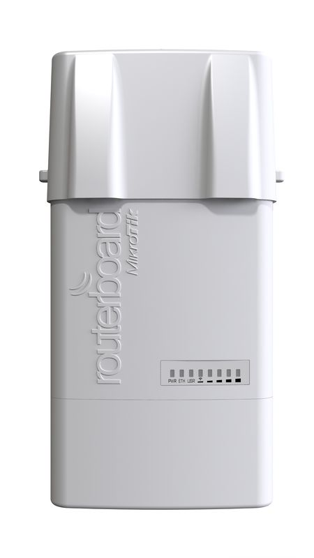
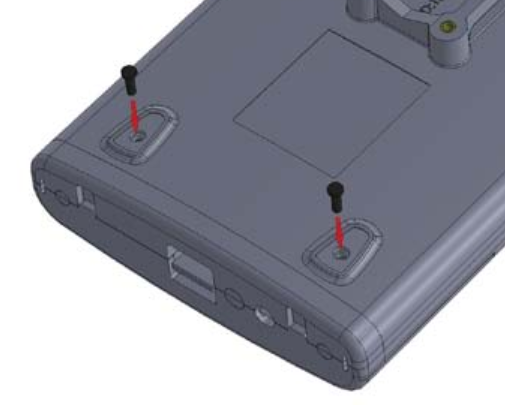
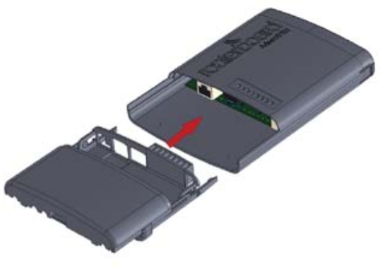
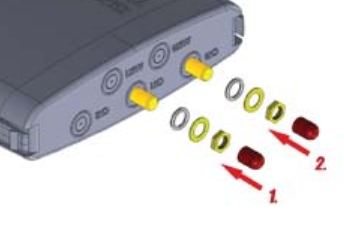
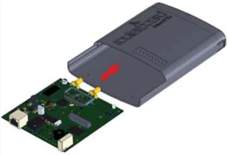
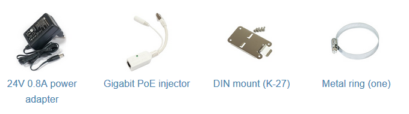

## [BaseBox 5](https://mikrotik.com/product/RB912UAG-5HPnD-OUT) (RB912UAG-5HPnD-OUT)

:::info This article covers

- **[BaseBox 2](https://mikrotik.com/product/RB912UAG-2HPnD-OUT)** (RB912UAG-2HPnD-OUT)
- **[BaseBox 5](https://mikrotik.com/product/RB912UAG-5HPnD-OUT)** (RB912UAG-5HPnD-OUT)
- **[BaseBox 6](https://mikrotik.com/product/basebox_6)** (RB912UAG-6HPnD-OUT)

:::

The Basebox is a solid and weatherproof outdoor device based on the RB912 wireless router model. It has high power wireless and one Gigabit Ethernet connector, which supports MDI-X auto-detection. The device has two RPSMA connectors for connecting external antennas. The device is packaged with a power adapter, a PoE injector, and two mounting loops. Extra places for more RP-SMA connectors are available on the unit in this case.

## Safety Warnings

- Before you work on any equipment, be aware of the hazards involved with electrical circuitry, and be familiar with standard practices for preventing accidents.
- Ultimate disposal of this product should be handled according to all national laws and regulations.
- The Installation of the equipment must comply with local and national electrical codes.
- This product is intended to be mounted outdoors on a pole. Please read the mounting instructions carefully before beginning installation. Failure to use the correct hardware and configuration or to follow the correct procedures could result in a hazardous situation for people and damage to the system.
- Use only the power supply and accessories approved by the manufacturer, and which can be found in the original packaging of this product.
- Read the installation instructions before connecting the system to the power source.
- We cannot guarantee that no accidents or damage will occur due to the improper use of the device. Please use this product with care and operate at your own risk!
- In the case of device failure, please disconnect it from power. The fastest way to do so is by unplugging the power plug from the power outlet.
- It is the customer's responsibility to follow local country regulations, including operation within legal frequency channels, output power, cabling requirements, and Dynamic Frequency Selection (DFS) requirements. All MikroTik radio devices must be professionally installed.
- This is a class A device. In a domestic environment, this product might cause radio interference in which case the user might be required to take adequate measures.

**Exposure to Radio Frequency Radiation:** This MikroTik equipment complies with the FCC, IC and European Union radiation exposure limits set forth for an uncontrolled environment.

## First use

- Choose your powering solution, please see the Reset button.

## Extension slots and ports

BaseBox 2 model - 2.4 GHz, 802.11b/g/n.

- BaseBox 5 model - 5 GHz, 802.11a/n.
- BaseBox 6 model - 6 GHz, 802.11a/n.
- One 10/100/1000 Gigabit Ethernet port, supporting automatic cross/straight cable correction (Auto MDI/X), so you can use either straight or crossover cable for connecting to other network devices.
- USB type-A slot.
- One miniPCIe slot. *This device might be incompatible with the R11e-LTE international modem.*

## The miniPCI-e slot usage

- Remove top cover;
- Unscrew two screws on the back of the device;

- Open Ethernet port cover and withdraw it from the base of the device;

- Unscrew the antenna connector;

- Withdraw the PCB plate from the base cover;

- Install your modem and reassemble.

## Reset button

The reset button has three functions:

- Hold this button during boot time until LED light starts flashing, release the button to reset RouterOS configuration (total 5 seconds).
- Keep holding for 5 more seconds, LED turns solid, release now to turn on CAP mode. The device will now look for a CAPsMAN server (total 10 seconds).
- Or Keep holding the button for 5 more seconds until LED turns off, then release it to make the RouterBOARD look for Netinstall servers (total 15 seconds). Regardless of the above option used, the system will load the backup RouterBOOT loader if the button is pressed before power is applied to the device. Useful for RouterBOOT debugging and recovery.

## Operating system support

The device supports RouterOS v7 and above. The specific factory-installed version is listed in /system resource. Other operating systems have not been tested.

## Included parts

*DIN mount includes four screws to attach it to the back of the device.

To avoid pollution of the environment, please separate the device from household waste and dispose of it in a safe manner, such as in designated waste disposal sites. Familiarize yourself with the procedures for the proper transportation of the equipment to the designated disposal sites in your area.

## Federal Communication Commission Interference Statement

This equipment has been tested and found to comply with the limits for a Class A digital device, pursuant to Part 15 of the FCC Rules. These limits are designed to provide reasonable protection against harmful interference in a commercial installation.

This equipment generates, uses, and can radiate radio frequency energy and, if not installed and used in accordance with the instruction manual, may cause harmful interference to radio communications. Operation of this equipment in a residential area is likely to cause harmful interference in which case the user will be required to correct the interference at his own expense.

FCC Caution: Any changes or modifications not expressly approved by the party responsible for compliance could void the user's authority to operate this equipment. This device complies with Part 15 of the FCC Rules. Operation is subject to the following two conditions: (1) This device may not cause harmful interference, and (2) this device must accept any interference received, including interference that may cause undesired operation. This device and its antenna must not be co-located or operation in conjunction with any other antenna or transmitter.

**IMPORTANT: Exposure to Radio Frequency Radiation.** This equipment complies with the FCC RF radiation exposure limits set forth for an uncontrolled environment. This equipment should be installed and operated with a minimum distance between the radiator and any part of your body, please see the table below.

<table><thead><tr><th>**Model**</th><th>**FCC ID**</th><th>**RF Exposure minimum safety distance**</th></tr></thead><tbody><tr><td>BaseBox 2</td><td>TV7RB912G-2HPND</td><td>142 cm</td></tr><tr><td>BaseBox 5</td><td>TV7RB912G-5HPNDM</td><td>375 cm</td></tr><tr><td>BaseBox 6</td><td>TV7RB912G-6HPND</td><td>375 cm</td></tr></tbody></table>

**Antenna Installation WARNING:** It is the installer's responsibility to ensure that when using the authorized antennas in the USA (or where FCC rules apply); only those antennas certified with the product are to be used. The installer should configure the output power level of antennas, according to country regulations and per antenna type. Professional installation is required for equipment with connectors to ensure compliance with health and safety issues.

## Innovation, Science and Economic Development Canada

This device complies with Industry Canada's licence-exempt RSS standard(s). Operation is subject to the following two conditions: (1) this device may not cause interference, and (2) this device must accept any interference, including interference that may cause undesired operation of the device. Le présent appareil est conforme aux CNR d'Industrie Canada applicables aux appareils radio exempts de licence. L'exploitation est autorisée aux deux conditions suivantes : (1) l'appareil ne doit pas produire de brouillage, et (2) l'utilisateur de l'appareil doit accepter tout brouillage radioélectrique subi, même si le brouillage est susceptible d'en compromettre le fonctionnement.

This Class A digital apparatus complies with Canadian ICES-003.

Cet appareil numérique de la classe [A] est conforme à la norme NMB-003 du Canada.

CAN ICES-3 (A)/NMB-3(A)

The device for operation in the band 5150–5250 MHz is only for indoor use to reduce the potential for harmful interference to co-channel mobile satellite systems.

Les dispositifs fonctionnant dans la bande de 5 150 à 5 250 MHz sont réservés uniquement pour une utilisation à l'intérieur afin de réduire les risques de brouillage préjudiciable aux systèmes de satellites mobiles utilisant les mêmes canaux.

**IMPORTANT: Exposure to Radio Frequency Radiation.** This equipment complies with the IC radiation exposure limits set forth for an uncontrolled environment. This equipment should be installed and operated with a minimum distance between the radiator and any part of your body please see table below. Cet équipement est conforme aux limites d'exposition au rayonnement IC définies pour un environnement non contrôlé. Cet équipement doit être installé et utilisé avec une distance minimale entre le radiateur et toute partie de votre corps, voir le tableau ci-dessous.

<table><thead><tr><th>**Model**</th><th>**IC**</th><th>**RF Exposure minimum safety distance**</th></tr></thead><tbody><tr><td>BaseBox 2</td><td>7442A-912G2HPND</td><td>142 cm</td></tr><tr><td>BaseBox 5</td><td>7442A-912G5HPNDM</td><td>378 cm</td></tr><tr><td>BaseBox 6</td><td>7442A-912G6HPNDM</td><td>378 cm</td></tr></tbody></table>

**Antenna Installation WARNING:** It is the installer's responsibility to ensure that when using the authorized antennas in Canada (or where IC rules apply); only those antennas certified with the product are to be used. The installer should configure the output power level of antennas, according to country regulations and per antenna type. Professional installation is required for equipment with connectors to ensure compliance with health and safety issues.

## UKCA marking

## Eurasian Conformity Mark

<table><thead><tr><th>Частотный диапазон</th><th>Мощность передатчика</th></tr></thead><tbody><tr><td>2400-2483.5 МГц, 5150-5350 МГц, 5650-5850 МГц, 6425-7100 МГц</td><td>≤100 мВт</td></tr></tbody></table>

*Доступные частотные каналы могут различаться в зависимости от модели продукта и сертификации.

Информация о дате изготовления устройства указана в конце серийного номера на его наклейке через дробь. Первая цифра означает номер года (последняя цифра года), две последующие означают номер недели.

Изготовитель: MikroTikls SIA, Aizkraukles iela 23, Riga, LV-1006, Латвия, [support@mikrotik.com](mailto:support@mikrotik.com). Сделано в Китае, Латвии или Литве. Cм. на упаковке.

Для получения подробных сведений о гарантийном обслуживании обратитесь к продавцу.

Продукты MikroTik, которые поставляются в Евразийский таможенный союз, оцениваются с учетом соответствующих требований и помечены знаком EAC, как показано ниже:

## Norma Oficial Mexicana

Rango de frecuencia (potencia de salida máxima): 2400-2483.5 MHz (30 dBm), 5725-5850 MHz (30 dBm). Los canales de frecuencia disponibles pueden variar según el modelo y la certificación del producto.

EFICIENCIA ENERGETICA CUMPLE CON LA NOM-029-ENER-2017.

La operacion de este equipo esta sujeta a las siguientes dos condiciones:

- Es posible que este equipo o dispositivo no cause interferencia perjudicial y.
- Este equipo debe aceptar cualquier interferencia, incluyendo la que pueda causar su operacion no deseada. Fabricante: MikroTikls SIA, Unijas 2, Riga, LV-1039, Latvia.

País De Origen: Letonia; Lituania; China (Republica Popular); Estados Unidos De America; Mexico.

Por favor contacte a su distribuidor local para preguntas regionales específicas. La lista de importadores se puede encontrar en nuestra página de inicio – [https://mikrotik.com/buy/latinamerica/mexico](https://mikrotik.com/buy/latinamerica/mexico).

## The National Commission for the State Regulation of Communications and Informatization by Ukraine

Виробник: MikroTikls SIA, Вулиця Уніяс 2, Рига, Латвія, LV1039.

Робоча частота (Максимальна вихідна потужність): 2400-2483.5 МГц (20 дБм)5150-5250 МГц (23 дБм), 5250-5350 МГц (20 дБм), 5470-5725 МГц (27 дБм).

Справжнім MikroTikls SIA заявляє, що маршрутизатор відповідає основним вимогам та іншим відповідним положенням директиви 2014/53/EC, а також суттєвим вимогам Технічного регламенту радіообладнання, затвердженого постановою Кабінету Міністрів України від 24 травня 2017 року № 355.

Для експлуатації в Україні необхідно отримати дозвіл на експлуатацію у порядку, затвердженому рішенням НКРЗІ від 01.11.2012 № 559, зареєстрованому в Міністерстві юстиції України 03.01.2013 за № 57/22589.

## CE Declaration of Conformity

Manufacturer: MikroTikls SIA, Unijas iela 2, Riga, Latvia, LV1039.

Hereby, Mikrotīkls SIA declares that the radio equipment type RouterBOARD is in compliance with Directive 2014/53/EU. The full text of the EU declaration of conformity is available at the following internet address: [https://mikrotik.com/products](https://mikrotik.com/products)

### Frequency bands terms of use

<table><thead><tr><th>Frequency range (for applicable models)</th><th>Channels used</th><th>Maximum Output Power (EIRP)</th><th>Restriction</th></tr></thead><tbody><tr><td>2412-2472 MHz</td><td>1 - 13</td><td>20 dBm</td><td>Without any restriction to use in all EU Member States</td></tr><tr><td>5150-5250 MHz</td><td>26 - 48</td><td>23 dBm</td><td>Restricted to indoor use only*</td></tr><tr><td>5250-5350 MHz</td><td>52 - 64</td><td>20 dBm</td><td>Restricted to indoor use only*</td></tr><tr><td>5470-5725 MHz</td><td>100 - 140</td><td>27 dBm</td><td>Without any restriction to use in all EU Member States</td></tr></tbody></table>

**It is the customer's responsibility to follow local country regulations, including operation within legal frequency channels, output power, cabling requirements, and Dynamic Frequency Selection (DFS) requirements. All MikroTik radio devices must be professionally installed!**

This MikroTik device meets Maximum WLAN transmit power limits per ETSI regulations. For more detailed information see Declaration of Conformity above / Dieses MikroTik-Gerät erfüllt die maximalen WLAN- Sendeleistung Grenzwerte gemäß ETSI-Bestimmungen. Weitere Informationen finden Sie oben unter Konformitätserklärung / Cet appareil MikroTik respecte les limites maximales de puissance de transmission WLAN conformément aux réglementations ETSI. Pour plus d'informations, voir la déclaration de conformité ci-dessus / Questo dispositivo MikroTik è conforme ai limiti massimi di potenza di trasmissione WLAN in conformità con le normative ETSI. Per ulteriori informazioni, consultare la dichiarazione di conformità sopra / Este dispositivo MikroTik cumple con los límites máximos de potencia de transmisión WLAN de acuerdo con las regulaciones ETSI. Para obtener más información, consulte la declaración de conformidad anterior / Это устройство MikroTik соответствует максимальным пределам мощности передачи WLAN в соответствии с правилами ETSI. Для получения дополнительной информации см. Декларацию соответствия выше.Please, test your antenna with our device in accreditation laboratory to be in compliance with EU rules.
