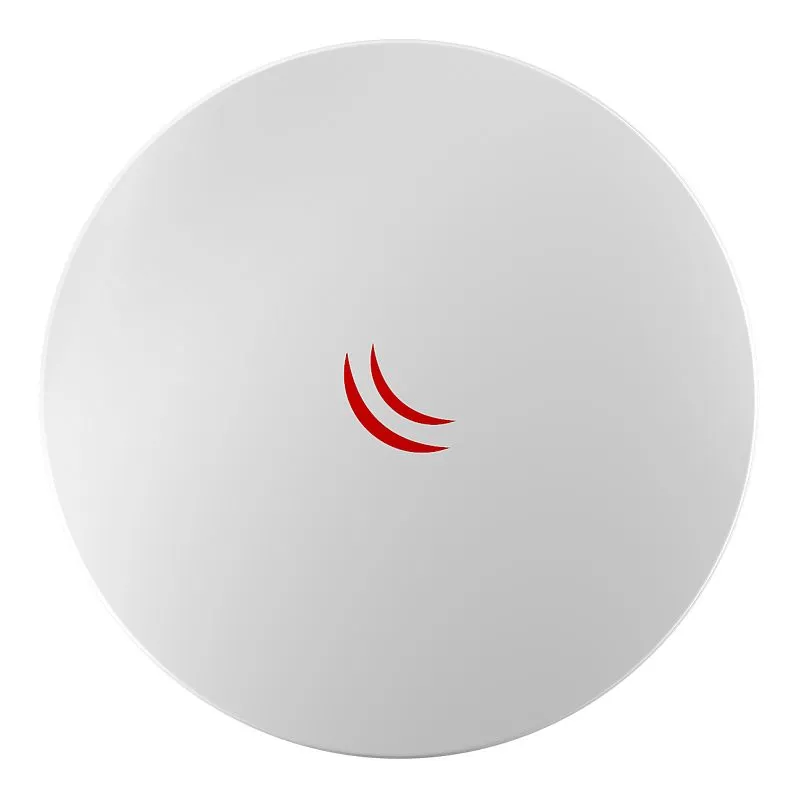

## [DynaDish 6](https://mikrotik.com/product/dynadish_6) (RBDynaDishG-6HnD)

The Dynadish 6 uses the same effective antenna design and enclosure as our successful 5 GHz model, but this new device operates in the licensed 6GHz frequency. This means less interference than the often saturated 5 GHz frequencies for higher speed and more reach. By operating above the most popular WiFi frequencies you are now able to build your wireless links from busy towers without suffering problems with noise.

It is a simple and completely integrated product with everything you need to quickly install a reliable point to point link.

This product is not suitable for unlicensed ISM bands. Device use is subject to country regulations. Availability might be limited depending on distributor stock and country regulations.

## Safety Warnings

- Before you work on any equipment, be aware of the hazards involved with electrical circuitry, and be familiar with standard practices for preventing accidents.
- Ultimate disposal of this product should be handled according to all national laws and regulations.
- The Installation of the equipment must comply with local and national electrical codes.
- This product is intended to be mounted outdoors on a pole. Failure to use the correct hardware and configuration or to follow the correct procedures could result in a hazardous situation for people and damage to the system.
- Use only the power supply and accessories approved by the manufacturer, and which can be found in the original packaging of this product.
- Read the installation instructions before connecting the system to the power source.
- We cannot guarantee that no accidents or damage will occur due to the improper use of the device. Please use this product with care and operate at your own risk!
- In the case of device failure, please disconnect it from power. The fastest way to do so is by unplugging the power plug from the power outlet.
- It is the customer's responsibility to follow local country regulations, including operation within legal frequency channels, output power, cabling requirements, and Dynamic Frequency Selection (DFS) requirements. All MikroTik radio devices must be professionally installed.

## Quickstart

Please follow these quick steps to set up your device:

- Connect the device to the included PoE injector with an Ethernet cable to the data+power end;
- Connect the data end of the PoE injector to the computer;
- Connect the power adapter to the PoE injector;
- Configure your device using a web browser through **WebFig** or the **WinBox** tool at [https://mt.lv/WinBox](https://mt.lv/WinBox); multiple configuration methods are available to ensure accessibility;
- Access **WebFig** by opening [https://192.168.88.1](https://192.168.88.1), and for **WinBox**, download the tool, navigate to the **Neighbors** tab, and click on the MAC address. The username is "**admin**" with no password (or, for some models, check user and wireless passwords on the sticker);
- For a manual update of the device, visit mikrotik.com, select your model, and locate the required packages in the "Downloads" section;
- Upload downloaded packages to the **WebFig** or **WinBox** "**Files**" menu and reboot the device;
- Updating your RouterOS software to the latest version will ensure the best performance, stability, and security updates;
- In the "Quick Set" menu set up the following: Choose your country, to apply country regulation settings;
- Set up your wireless network password in the left field;
- Set up your router password in the bottom field.

## Powering

The device accepts 12-30 V DC from Passive PoE injectors. Power consumption is up to 10 W.

## Booting process

The device is preconfigured as a wireless client (CPE), and all you need to do is select the AP to connect to and set a device password. You can do this in the quickSET tab that is loaded by default. In case IP connection is not available, WinBox can be used to connect to the MAC address of the device. In case you wish to boot the device from the network, for example, to use MikroTik Netinstall, hold the RESET button of the device when starting it, until the LED light turns off, then the device will start to look for Netinstall servers.More information about using RouterOS and connecting to this device in our documentation: +[https://mt.lv/help##](https://mt.lv/help##) Extension slots and ports

- One 10/100/1000 Gigabit Ethernet port, supporting automatic cross/straight cable correction (Auto MDI/X), so you can use either straight or cross-over cables for connecting to other network devices.
- One Integrated wireless 802.11a/n, 2x2 MIMO with a built-in parabolic dish antenna, max gain 25dBi

## Buttons and jumpers

RouterBOOT reset button (RESET, front panel) has three functions:

- Hold this button during boot time until LED light starts flashing, release the button to reset RouterOS configuration (total 5 seconds)
- Or Keep holding the button until LED turns off, then release it to make the RouterBOARD look for Netinstall servers (total 15 seconds)

## Operating system support

The device supports RouterOS v7 and above. The specific factory-installed version is listed in /system resource. Other operating systems have not been tested.

To avoid pollution of the environment, please separate the device from household waste and dispose of it in a safe manner, such as in designated waste disposal sites. Familiarize yourself with the procedures for the proper transportation of the equipment to the designated disposal sites in your area.

## Federal Communication Commission Interference Statement

FCC ID: TV7DYNADISHGAC

This equipment has been tested and found to comply with the limits for a Class A digital device, pursuant to Part 15 of the FCC Rules. These limits are designed to provide reasonable protection against harmful interference in a commercial installation.

This equipment generates, uses, and can radiate radio frequency energy and, if not installed and used in accordance with the instruction manual, may cause harmful interference to radio communications. Operation of this equipment in a residential area is likely to cause harmful interference in which case the user will be required to correct the interference at his own expense.

**FCC Caution:** Any changes or modifications not expressly approved by the party responsible for compliance could void the user’s authority to operate this equipment.

This device complies with Part 15 of the FCC Rules. Operation is subject to the following two conditions: (1) This device may not cause harmful interference, and (2) this device must accept any interference received, including interference that may cause undesired operation.

Note: This unit was tested with shielded cables on the peripheral devices. Shielded cables must be used with the unit to ensure compliance.

## Innovation, Science and Economic Development Canada

IC: 7442A-DYNADISHGAC

This device contains license-exempt transmitter(s)/receiver(s) that comply with Innovation, Science, and Economic Development Canada’s license-exempt RSS(s). Operation is subject to the following two conditions: (1) This device may not cause interference. (2) This device must accept any interference, including interference that may cause undesired operation of the device.

L’émetteur/récepteur exempt de licence contenu dans le présent appareil est conforme aux CNR d’Innovation, Sciences et Développement économique Canada applicables aux appareils radio exempts de licence. L’exploitation est autorisée aux deux conditions suivantes : 1) L’appareil ne doit pas produire de brouillage; 2) L’appareil doit accepter tout brouillage radioélectrique subi, même si le brouillage est susceptible d’en compromettre le fonctionnement.

This Class A digital apparatus complies with Canadian ICES-003.

Cet appareil numérique de la classe [A] est conforme à la norme NMB-003 du Canada.

CAN ICES-003 (A) / NMB-003 (A)

## UKCA Marking

## Eurasian Conformity Mark

Информация о дате изготовления устройства указана в конце серийного номера на его наклейке через дробь. Первая цифра означает номер года (последняя цифра года), две последующие означают номер недели.

Изготовитель: MikroTikls SIA, Aizkraukles iela 23, Riga, LV-1006, Латвия, [support@mikrotik.com](mailto:support@mikrotik.com). Сделано в Китае, Латвии или Литве. Cм. на упаковке.

Для получения подробных сведений о гарантийном обслуживании обратитесь к продавцу. Информация об импортерах продукции MikroTik в Российскую Федерацию: [https://mikrotik.com/buy/europe/russia](https://mikrotik.com/buy/europe/russia)

Продукты MikroTik, которые поставляются в Евразийский таможенный союз, оцениваются с учетом соответствующих требований и помечены знаком EAC, как показано ниже:

## Norma Oficial Mexicana

EFICIENCIA ENERGETICA CUMPLE CON LA NOM-029-ENER-2017.

La operacion de este equipo esta sujeta a las siguientes dos condiciones:

Es posible que este equipo o dispositivo no cause interferencia perjudicial y. Este equipo debe aceptar cualquier interferencia, incluyendo la que pueda causar su operacion no deseada.

Fabricante: MikroTikls SIA, Brivibas gatve 214i, Riga, LV-1039, Latvia.

País De Origen: Letonia; Lituania; China (Republica Popular); Estados Unidos De America; Mexico.

Por favor contacte a su distribuidor local para preguntas regionales específicas. La lista de importadores se puede encontrar en nuestra página de inicio – [https://mikrotik.com/buy/latinamerica/mexico](https://mikrotik.com/buy/latinamerica/mexico).

## The National Commission for the State Regulation of Communications and Informatization by Ukraine

Виробник: MikroTikls SIA, Brivibas gatve 214i Рига, Латвія, LV1039.

Справжнім MikroTikls SIA заявляє, що маршрутизатор відповідає основним вимогам та іншим відповідним положенням директиви 2014/53/EC, а також суттєвим вимогам Технічного регламенту радіообладнання, затвердженого постановою Кабінету Міністрів України від 24 травня 2017 року № 355.

Для експлуатації в Україні необхідно отримати дозвіл на експлуатацію у порядку, затвердженому рішенням НКРЗІ від 01.11.2012 № 559, зареєстрованому в Міністерстві юстиції України 03.01.2013 за № 57/22589.

## CE Declaration of Conformity

Manufacturer: MikroTikls SIA, Brivibas gatve 214i Riga, Latvia, LV1039.

Hereby, Mikrotīkls SIA declares that the radio equipment type RBDynaDishG-6HnD is in compliance with Directive 2014/53/EU. The full text of the EU declaration of conformity is available at the following internet address: [https://mikrotik.com/products](https://mikrotik.com/products)
